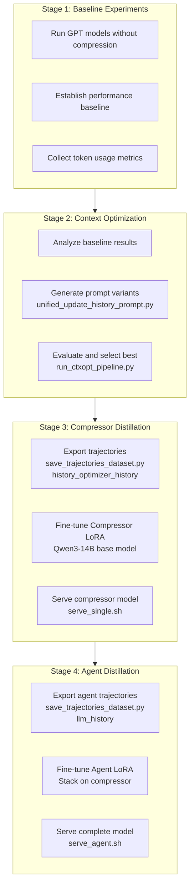
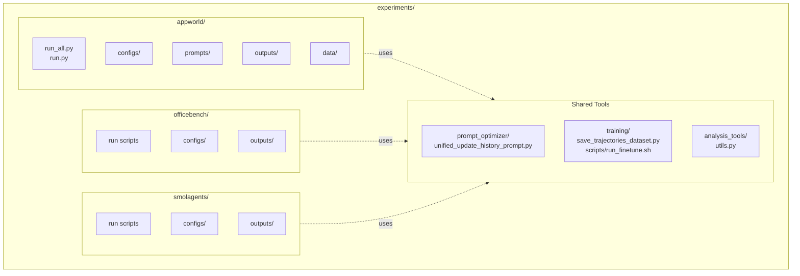
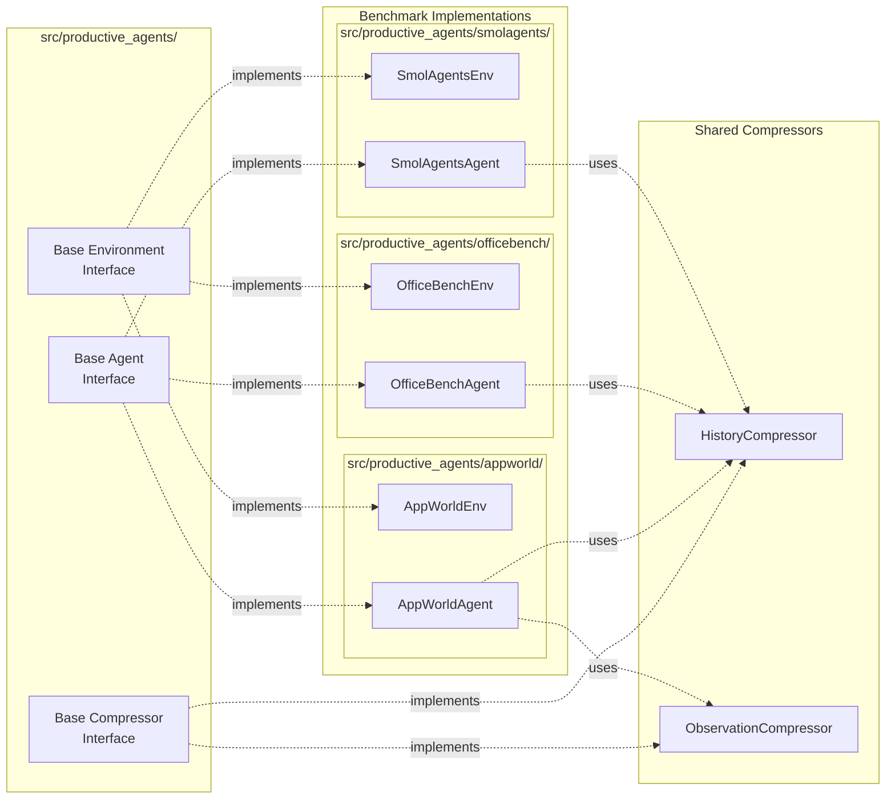

<!-- source: DeepWiki mcp.deepwiki.com · repo microsoft/acon · page 4 Benchmarks · fetched 2026-10-26 -->

# Benchmarks

<details>
<summary>Relevant source files</summary>

The following files were used as context for generating this wiki page:

- [README.md](README.md)
- [experiments/appworld/README.md](experiments/appworld/README.md)

</details>


## Purpose and Scope

This page provides an overview of the three benchmark families supported by ACON: **AppWorld**, **OfficeBench**, and **8-objective QA (SmolAgents)**. It describes the purpose of each benchmark, their common experimental pipeline, and how they integrate with the ACON framework.

For detailed implementation and setup instructions for AppWorld, see [AppWorld Benchmark](#4.1). For setup and usage of OfficeBench and SmolAgents, see [OfficeBench and SmolAgents](#4.2). For information about running experiments across benchmarks, see [Running Experiments](#5).

---

## Benchmark Families

ACON supports three benchmark families, each targeting different types of long-horizon agent tasks. All benchmarks share the same experimental pipeline and core abstractions (environments, agents, and context compressors) but differ in task complexity, domain, and evaluation metrics.

### Benchmark Overview

| Benchmark | Domain | Task Type | Location |
|-----------|--------|-----------|----------|
| **AppWorld** | Day-to-day personal tasks | Multi-step workflows using web APIs and apps | `experiments/appworld/` |
| **OfficeBench** | Office productivity | Document processing and automation | `experiments/officebench/` |
| **8-objective QA** | Knowledge retrieval | Lightweight reasoning and QA | `experiments/smolagents/` |

**Sources:** [README.md:122-131](), [experiments/appworld/README.md:1-4]()

---

## AppWorld

AppWorld is a benchmark for evaluating agents on day-to-day personal task workflows. Tasks involve multi-step interactions with simulated web applications and APIs, requiring agents to maintain context across extended interaction sequences.

**Key Characteristics:**
- **Task complexity:** Multi-turn interactions requiring planning and state tracking
- **Data splits:** `train`, `dev`, `test_normal`, `test_challenge`
- **Evaluation:** Task completion accuracy via `appworld evaluate` command
- **Difficulty levels:** Tasks categorized by difficulty (1, 2, 3) for analysis

**Implementation Details:**
- Environment: `src/productive_agents/appworld/` contains AppWorld-specific environment and agent implementations
- Experiment scripts: `experiments/appworld/run_all.py` for batch execution, `run.py` for single tasks
- Configuration: `experiments/appworld/configs/` contains base configurations and context optimization configs

**Sources:** [README.md:126-129](), [experiments/appworld/README.md:1-89]()

---

## OfficeBench

OfficeBench focuses on office productivity automation tasks, including document processing, spreadsheet manipulation, and workflow automation.

**Key Characteristics:**
- **Task complexity:** Document-centric workflows
- **Domain:** Office productivity applications
- **Implementation:** `experiments/officebench/`

**Sources:** [README.md:129]()

---

## 8-objective QA (SmolAgents)

The 8-objective QA benchmark provides lightweight reasoning and retrieval tasks. It is implemented using the SmolAgents framework and focuses on question-answering with multiple objectives.

**Key Characteristics:**
- **Task complexity:** Lighter-weight than AppWorld and OfficeBench
- **Domain:** Knowledge retrieval and reasoning
- **Implementation:** `experiments/smolagents/`

**Sources:** [README.md:130]()

---

## Common Experimental Pipeline

All three benchmarks follow the same four-stage experimental pipeline, enabling systematic progression from baseline models to optimized and distilled models.



**Stage 1: Baseline Experiments**

Run frontier models (GPT-4.1, GPT-4o) without context compression to establish baseline performance and token usage.

**Stage 2: Context Optimization**

Optimize compression guidelines using prompt optimization to reduce token usage while maintaining performance:
- Analyze baseline results to identify compression opportunities
- Generate and test prompt variants using `experiments/prompt_optimizer/unified_update_history_prompt.py`
- Validate candidates and select the best configuration

**Stage 3: Compressor Distillation**

Distill compression behavior into a local model:
- Export compression trajectories from frontier model runs
- Fine-tune a LoRA adapter on the base model (e.g., `Qwen/Qwen3-14B`)
- The adapter learns to compress context following the optimized guidelines

**Stage 4: Agent Distillation**

Distill complete agent behavior:
- Export agent decision-making trajectories
- Fine-tune a second LoRA adapter that stacks on the compressor adapter
- The resulting model performs both compression and reasoning locally

**Sources:** [README.md:132-137](), [experiments/appworld/README.md:25-237]()

---

## Benchmark Directory Structure

Each benchmark follows a consistent directory structure under `experiments/`:



**Common Structure Components:**

| Component | Purpose | Location Pattern |
|-----------|---------|------------------|
| **Run scripts** | Execute experiments | `run_all.py`, `run.py` |
| **Configs** | Model and compression settings | `configs/` |
| **Prompts** | Jinja templates for prompts | `prompts/` |
| **Outputs** | Experiment results and trajectories | `outputs/<model>_<tag>/<split>/` |
| **Data** | Benchmark-specific datasets | `data/` |

**Shared Tools:**

All benchmarks share common utilities located in `experiments/`:
- **Prompt Optimizer:** `prompt_optimizer/` for guideline optimization
- **Training:** `training/` for dataset generation and LoRA fine-tuning
- **Analysis:** `analysis_tools/` for token and cost analysis

**Sources:** [README.md:112-120](), [experiments/appworld/README.md:67-84]()

---

## Benchmark Output Format

All benchmarks generate outputs following a consistent structure:

```
experiments/<benchmark>/outputs/
└── <model>_<tag>/
    ├── <split>/
    │   ├── experiment_summary.json
    │   └── task_<id>_<rep>/
    │       ├── env_history.json
    │       ├── llm_history.json
    │       ├── history_optimizer_history.json
    │       ├── results.json
    │       └── <benchmark-specific files>
```

**Key Output Files:**

| File | Content | Used For |
|------|---------|----------|
| `experiment_summary.json` | Aggregate results across all tasks | Performance evaluation |
| `llm_history.json` | Agent LLM interaction history | Agent distillation (Stage 4) |
| `history_optimizer_history.json` | Context compression history | Compressor distillation (Stage 3) |
| `env_history.json` | Environment interaction trace | Debugging and analysis |
| `results.json` | Task-level results | Evaluation metrics |

**Sources:** [experiments/appworld/README.md:67-89]()

---

## Integration with ACON Core

Each benchmark integrates with ACON's core abstractions defined in `src/productive_agents/`:



**Abstraction Layers:**

1. **Environment Interface:** Each benchmark implements a custom environment (`AppWorldEnv`, `OfficeBenchEnv`, `SmolAgentsEnv`) that handles task execution and state management

2. **Agent Interface:** Each benchmark implements a custom agent (`AppWorldAgent`, `OfficeBenchAgent`, `SmolAgentsAgent`) that performs action selection and planning

3. **Compressor Interface:** All benchmarks share common compressor implementations (`HistoryCompressor`, `ObservationCompressor`) that can use either frontier models or local models with LoRA adapters

**Sources:** [README.md:114-120]()

---

## Evaluation and Analysis

All benchmarks support the same analysis and evaluation tools:

**Token and Cost Analysis**

Use `experiments/analysis_tools/utils.py` to analyze token usage and costs:
- Function: `analyze_experiment_tokens_v2()`
- Automatically detects benchmark type (`appworld`, `officebench`, `smolagents`)
- Generates markdown tables and CSV reports
- Supports cache-aware token counting for accurate cost estimation

**Benchmark-Specific Evaluation**

Each benchmark provides its own evaluation command:
- **AppWorld:** `appworld evaluate <model>_<tag> <split>`
- **OfficeBench:** Benchmark-specific evaluation scripts
- **SmolAgents:** Benchmark-specific evaluation scripts

For detailed information on token analysis, see [Token and Cost Analysis](#7.1). For evaluation procedures, see [Output and Results](#5.4).

**Sources:** [experiments/appworld/README.md:86-89]()

---

## Configuration Schema

All benchmarks use YAML configuration files with a common schema:

**Base Configuration** (`base_config.yaml`)
- Model selection and API settings
- Agent behavior parameters
- Retry and timeout settings

**Context Optimization Configuration** (e.g., `gpt-4.1-mini_history.yaml`)
- Compression type: `history` or `observation`
- Model and LoRA adapter paths
- Compression thresholds and rules
- Prompt template references

For detailed configuration information, see [Configuration](#6).

**Sources:** [experiments/appworld/README.md:58-64](), [experiments/appworld/README.md:171-184]()

---

