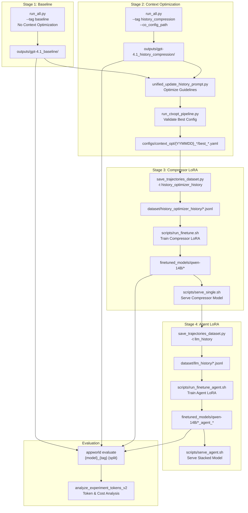
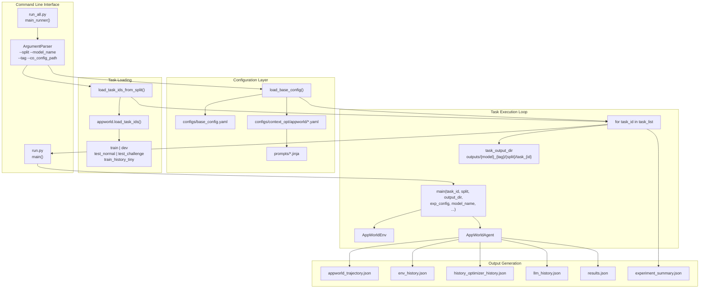
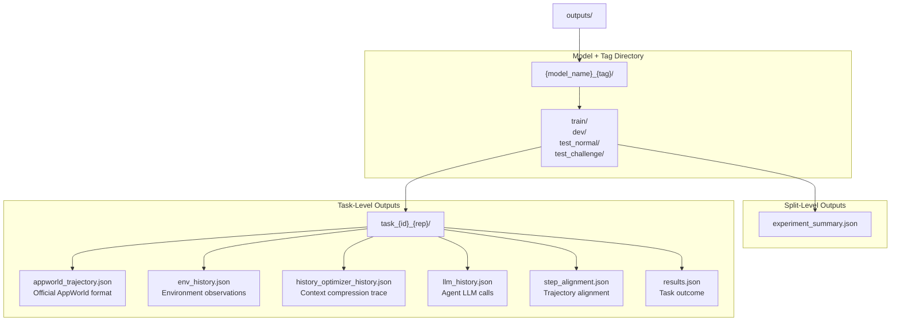
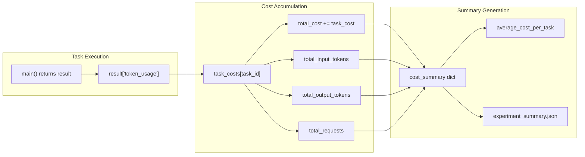

<!-- source: DeepWiki mcp.deepwiki.com · repo microsoft/acon · page 4.1 AppWorld Benchmark · fetched 2026-10-26 -->

# AppWorld Benchmark

<details>
<summary>Relevant source files</summary>

The following files were used as context for generating this wiki page:

- [experiments/appworld/README.md](experiments/appworld/README.md)
- [experiments/appworld/data_copy/datasets/train_history_tiny.txt](experiments/appworld/data_copy/datasets/train_history_tiny.txt)
- [experiments/appworld/run_all.py](experiments/appworld/run_all.py)

</details>


This document provides a comprehensive guide to the AppWorld benchmark within the ACON framework. AppWorld is a benchmark for evaluating long-horizon agents on realistic day-to-day tasks involving web applications, calendars, email, and productivity tools.

For environment installation and data setup, see [AppWorld Setup](#4.1.1). For detailed information about task formats and data structures, see [AppWorld Task Structure](#4.1.2). For general information about the ACON pipeline stages, see [Four-Stage Pipeline](#3.2).

**Sources:** [experiments/appworld/README.md:1-9]()

## Overview

AppWorld is a research benchmark designed to test agent capabilities on multi-step tasks that require interaction with simulated web applications. Tasks involve operations such as scheduling meetings, managing emails, processing documents, and coordinating across multiple apps. The benchmark provides:

- **Multiple dataset splits**: `train`, `dev`, `test_normal`, `test_challenge`
- **Difficulty levels**: Tasks categorized by complexity (1, 2, 3, level_1, unknown)
- **Realistic task scenarios**: Day-to-day productivity workflows
- **Ground-truth evaluation**: Automated scoring via the `appworld evaluate` command

AppWorld serves as the primary benchmark for ACON's context optimization experiments, providing a testbed for evaluating compression strategies and model distillation.

**Sources:** [experiments/appworld/README.md:1-9](), [experiments/appworld/run_all.py:60-72]()

## AppWorld in the ACON Pipeline

The following diagram shows how AppWorld experiments integrate into the four-stage ACON optimization pipeline:

**AppWorld Four-Stage Execution Flow**



Each stage produces outputs that feed into subsequent stages, enabling progressive refinement from frontier models to optimized local models.

**Sources:** [experiments/appworld/README.md:25-237]()

## Experiment Execution Architecture

The AppWorld experiment execution system consists of several key components that orchestrate task execution, configuration management, and output collection.

**AppWorld Execution Components**



**Sources:** [experiments/appworld/run_all.py:1-364](), [experiments/appworld/README.md:69-89]()

### Primary Execution Scripts

#### run_all.py

The main entry point for batch execution. Key functions:

| Function | Purpose | Lines |
|----------|---------|-------|
| `main_runner()` | Orchestrates multi-task execution with progress tracking | [75-363]() |
| `load_base_config()` | Loads and merges YAML configurations | [33-57]() |
| `load_task_ids_from_split()` | Retrieves task IDs from AppWorld API | [60-72]() |

Key command-line arguments:

```bash
python run_all.py \
    --split train \                    # Dataset split
    --model_name gpt-4.1 \            # LLM model
    --tag baseline \                   # Experiment identifier
    --co_config_path configs/...yaml \ # Context optimization config
    --max_iter 50 \                    # Maximum steps per task
    --debug                            # Run single task only
```

**Sources:** [experiments/appworld/run_all.py:75-99](), [experiments/appworld/README.md:30-64]()

#### run.py

Executes individual tasks. Called by `run_all.py` for each task in the batch. Initializes the environment, instantiates the agent, and handles single-task execution with logging.

**Sources:** [experiments/appworld/run_all.py:18](), [experiments/appworld/README.md:30-40]()

### Configuration Resolution

The configuration system merges multiple sources with the following precedence (highest to lowest):

1. Command-line arguments (`--model_name`, `--tag`, `--max_iter`)
2. Context optimization config (`--co_config_path`)
3. Base configuration (`configs/base_config.yaml`)

The `load_base_config()` function creates the final merged configuration:

**Sources:** [experiments/appworld/run_all.py:33-57](), [experiments/appworld/run_all.py:122-137]()

## Dataset Splits and Custom Subsets

AppWorld supports standard splits and custom task subsets:

| Split Type | Example | Location | Purpose |
|------------|---------|----------|---------|
| Standard | `train`, `dev`, `test_normal`, `test_challenge` | AppWorld package | Official benchmark splits |
| Custom | `train_history_tiny` | `data/datasets/*.txt` | Development/debugging subsets |

Custom subsets are text files containing task IDs (one per line). The `load_task_ids_from_split()` function automatically detects whether to load from the AppWorld package or from a local file.

**Example custom subset:**

**Sources:** [experiments/appworld/data_copy/datasets/train_history_tiny.txt:1-39](), [experiments/appworld/run_all.py:60-72]()

## Output Directory Structure

Each experiment generates a hierarchical output structure organized by model, tag, and split:

**AppWorld Output Organization**



**Sources:** [experiments/appworld/README.md:67-84](), [experiments/appworld/run_all.py:155-159]()

### Key Output Files

| File | Purpose | Used By |
|------|---------|---------|
| `experiment_summary.json` | Aggregate statistics, success rates, cost summary | Analysis scripts |
| `appworld_trajectory.json` | Task execution in AppWorld format | `appworld evaluate` |
| `history_optimizer_history.json` | Context compression LLM calls | Compressor LoRA training, token analysis |
| `llm_history.json` | Agent reasoning LLM calls | Agent LoRA training, token analysis |
| `env_history.json` | Raw environment observations | Debugging, analysis |
| `results.json` | Task success/failure with termination reason | Evaluation |

**Sources:** [experiments/appworld/README.md:69-84]()

### experiment_summary.json Structure

The split-level summary aggregates results across all tasks:

```json
{
  "experiment_config": {...},
  "split": "train",
  "total_tasks": 150,
  "successful_tasks": [...],
  "failed_tasks": [...],
  "success_rate": 0.87,
  "total_time_seconds": 3456.78,
  "run_timestamp": 1234567890,
  "cost_summary": {
    "total_cost_usd": 12.34,
    "total_input_tokens": 1500000,
    "total_output_tokens": 250000,
    "average_cost_per_task": 0.0823,
    "task_costs": {...}
  }
}
```

**Sources:** [experiments/appworld/run_all.py:321-345]()

## Execution Modes

The `run_all.py` script supports several execution modes for different workflows:

### Normal Execution

Standard batch processing with progress tracking:

```bash
python run_all.py --split train --model_name gpt-4.1 --tag baseline
```

**Sources:** [experiments/appworld/run_all.py:226-280]()

### Debug Mode

Runs a single task with verbose output, always rerunning the first task:

```bash
python run_all.py --split train --model_name gpt-4.1 --tag baseline --debug
```

Debug mode:
- Disables progress bars for clarity
- Runs only the first task in the list
- Ignores existing outputs
- Enables detailed logging

**Sources:** [experiments/appworld/run_all.py:187-225]()

### Continue Existing

Skips tasks that already have output directories:

```bash
python run_all.py --split train --model_name gpt-4.1 --tag baseline --continue_existing
```

**Sources:** [experiments/appworld/run_all.py:92](), [experiments/appworld/run_all.py:245-248]()

### Rerun Failed

Reruns only tasks that failed in a previous run:

```bash
python run_all.py --split train --model_name gpt-4.1 --tag baseline --rerun_failed
```

This mode:
1. Loads `experiment_summary.json` to find failed tasks
2. Removes existing output directories for failed tasks
3. Reruns only those tasks

**Sources:** [experiments/appworld/run_all.py:93](), [experiments/appworld/run_all.py:161-172]()

## Cost Tracking and Token Usage

The execution system tracks token usage and costs in real-time during batch execution:

**Token Tracking Flow**



The cost tracking system operates at two levels:

1. **Per-task tracking**: Each task's costs stored in `task_costs` dictionary
2. **Aggregate tracking**: Running totals across all tasks in the batch

Cost metrics are displayed at experiment completion and saved in `experiment_summary.json`.

**Sources:** [experiments/appworld/run_all.py:178-184](), [experiments/appworld/run_all.py:209-216](), [experiments/appworld/run_all.py:263-271](), [experiments/appworld/run_all.py:305-315](), [experiments/appworld/run_all.py:331-339]()

## Evaluation

AppWorld provides an official evaluation command that computes success metrics:

```bash
appworld evaluate {model_name}_{tag} {split}
```

This command:
1. Locates `appworld_trajectory.json` files in the output directory
2. Validates trajectories against ground truth
3. Computes success rates and other metrics
4. Updates `experiment_summary.json` with evaluation results

For detailed cost and token analysis beyond basic evaluation, see [Token and Cost Analysis](#7.1).

**Sources:** [experiments/appworld/README.md:39](), [experiments/appworld/README.md:86-88]()

## Context Optimization Configuration

AppWorld experiments support context optimization through the `--co_config_path` argument. The configuration file specifies:

- **Compression type**: `history` or `observation`
- **Model selection**: Frontier models or local models with LoRA adapters
- **Prompt templates**: Jinja templates for compression instructions
- **Thresholds**: When to trigger compression based on token count
- **Preservation rules**: How many recent turns to preserve uncompressed

Example configuration reference:

```bash
--co_config_path configs/context_opt/appworld/gpt-4.1_history_v2.yaml
```

For detailed configuration options, see [Context Optimization Configuration](#6.2). For history-specific settings, see [History Compression](#6.2.1).

**Sources:** [experiments/appworld/run_all.py:89](), [experiments/appworld/run_all.py:104-119](), [experiments/appworld/README.md:176-184]()

## Model Serving Options

AppWorld experiments support two model serving backends:

### Frontier Models (OpenAI API)

Direct API calls to OpenAI models (default mode):

```bash
python run_all.py --model_name gpt-4.1 --tag baseline
```

Configuration automatically routes to OpenAI API when no LoRA adapter is specified.

**Sources:** [experiments/appworld/run_all.py:112-119]()

### Local Models with LoRA

Local model serving with fine-tuned LoRA adapters:

```bash
python run_all.py \
    --model_name Qwen/Qwen3-14B \
    --lora_name finetuned_models/qwen-14B/agent_lora \
    --co_config_path configs/context_opt/qwen3-14B/history_baseline.yaml
```

The context optimization config specifies the compressor LoRA:

```yaml
model_type: local
model: "Qwen/Qwen3-14B"
lora_name: "finetune=finetuned_models/qwen-14B/history_compression_3epochs"
```

The system instantiates a `vLLMLocal` client for local model inference.

**Sources:** [experiments/appworld/run_all.py:94](), [experiments/appworld/run_all.py:112-119](), [experiments/appworld/README.md:171-184]()

## Integration with Training Pipeline

AppWorld outputs feed into the two-stage distillation pipeline:

**Stage 1: Compressor LoRA Training**
- Input: `history_optimizer_history.json` from experiments with context optimization
- Script: `experiments/training/save_trajectories_dataset.py -t history_optimizer_history`
- Output: Training dataset for compressor LoRA

**Stage 2: Agent LoRA Training**
- Input: `llm_history.json` from experiments
- Script: `experiments/training/save_trajectories_dataset.py -t llm_history`
- Output: Training dataset for agent LoRA

For complete distillation workflow, see [Model Distillation](#8). For compressor training details, see [Stage 1: Compressor LoRA](#8.2). For agent training details, see [Stage 2: Agent LoRA](#8.3).

**Sources:** [experiments/appworld/README.md:135-237]()

## Progress Tracking

The batch execution system provides rich progress feedback using the `rich` library:

```python
with Progress(
    SpinnerColumn(),
    TextColumn("[progress.description]{task.description}"),
    BarColumn(),
    TextColumn("{task.completed}/{task.total}"),
    TimeElapsedColumn(),
    TimeRemainingColumn(),
    transient=False,
) as progress:
```

Progress tracking includes:
- Spinner animation
- Current task description with ID
- Progress bar
- Task count (completed/total)
- Time elapsed
- Estimated time remaining

**Sources:** [experiments/appworld/run_all.py:19](), [experiments/appworld/run_all.py:227-236]()

## Best Practices

### Development and Debugging

1. **Start with debug mode**: Always use `--debug` for initial setup verification
2. **Use custom subsets**: Create small task lists in `data/datasets/` for rapid iteration
3. **Check error.log**: The script clears and regenerates this file on each run
4. **Monitor first task**: Debug mode runs only the first task for quick feedback

**Sources:** [experiments/appworld/run_all.py:90](), [experiments/appworld/run_all.py:139-141](), [experiments/appworld/README.md:42]()

### Production Runs

1. **Use appropriate splits**: `train` for development, `test_normal` and `test_challenge` for final evaluation
2. **Enable continue_existing**: For long runs, use `--continue_existing` to resume interrupted experiments
3. **Track costs**: Monitor `experiment_summary.json` cost metrics throughout execution
4. **Verify evaluation**: Always run `appworld evaluate` after batch completion

**Sources:** [experiments/appworld/run_all.py:92](), [experiments/appworld/README.md:39]()

### Configuration Management

1. **Version control configs**: Keep context optimization configs under version control
2. **Name experiments meaningfully**: Use descriptive `--tag` values that indicate configuration
3. **Document prompt changes**: When optimizing prompts, maintain a changelog
4. **Test configs before batch runs**: Validate new configs on a small subset first

**Sources:** [experiments/appworld/run_all.py:85](), [experiments/appworld/README.md:122-133]()

---

