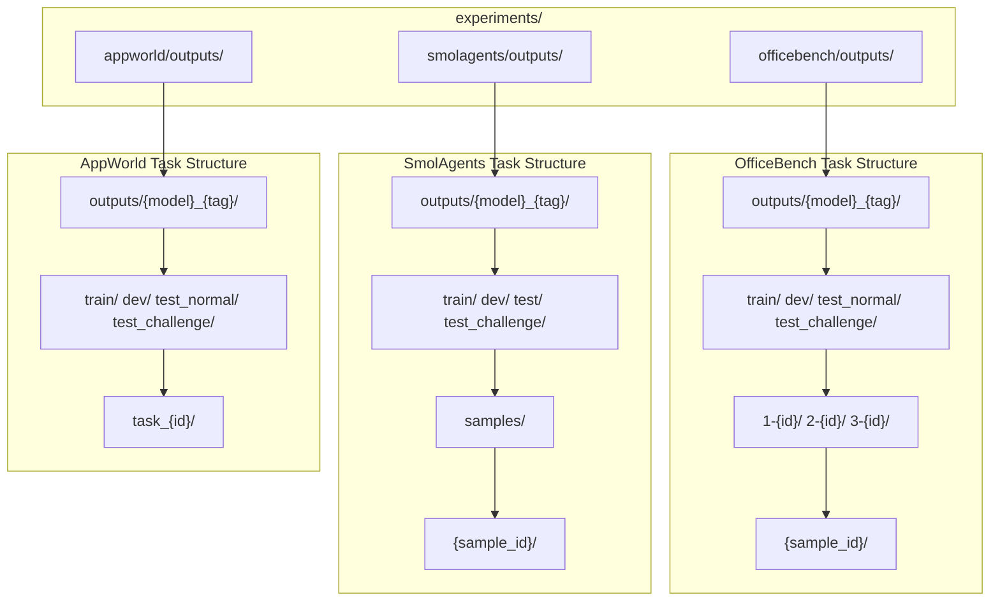
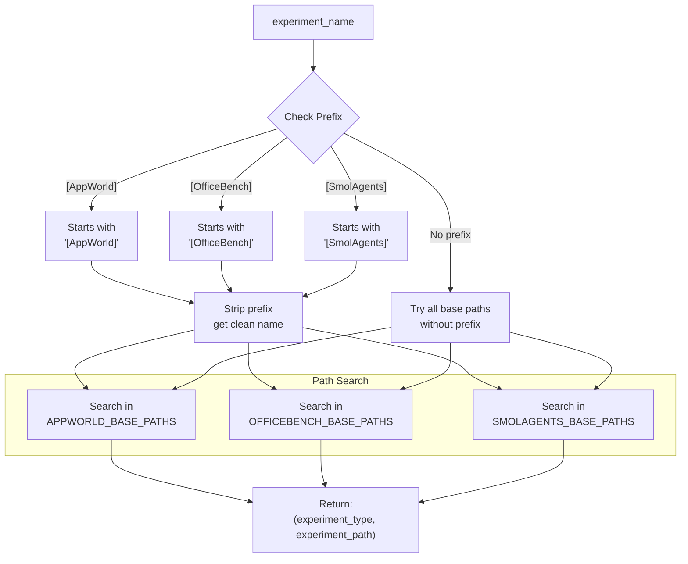
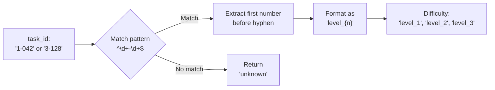
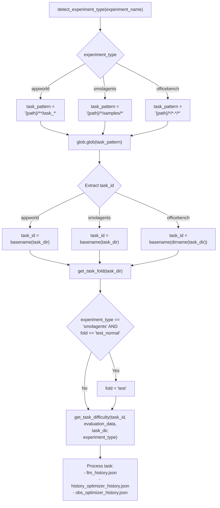
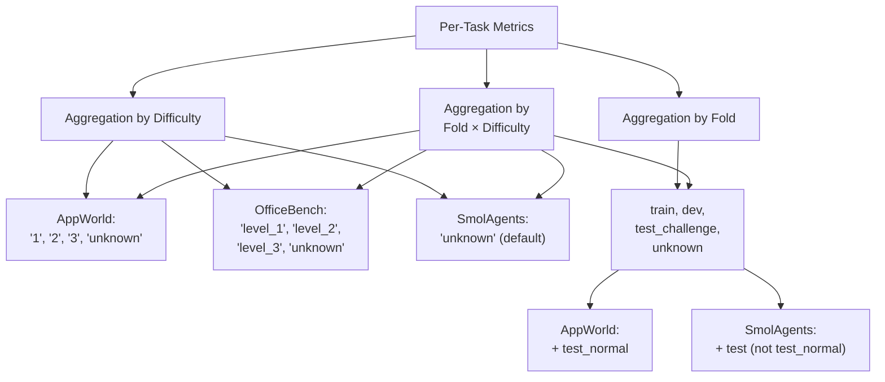

<!-- source: DeepWiki mcp.deepwiki.com · repo microsoft/acon · page 4.2 OfficeBench and SmolAgents · fetched 2026-10-26 -->

# OfficeBench and SmolAgents

<details>
<summary>Relevant source files</summary>

The following files were used as context for generating this wiki page:

- [README.md](README.md)
- [experiments/analysis_tools/utils.py](experiments/analysis_tools/utils.py)

</details>


## Purpose and Scope

This page provides an overview of the **OfficeBench** and **SmolAgents** (8-objective QA) benchmark families supported by ACON. These benchmarks follow the same four-stage experimental pipeline as AppWorld but differ in task structure, directory organization, and evaluation metrics.

For detailed information about the AppWorld benchmark, see [AppWorld Benchmark](#4.1). For general information about the four-stage pipeline that applies to all benchmarks, see [Four-Stage Pipeline](#3.2). For instructions on running experiments, see [Running Experiments](#5).

---

## Benchmark Overview

ACON supports three benchmark families for evaluating context optimization strategies:

| Benchmark | Description | Location | Task Domain |
|-----------|-------------|----------|-------------|
| **OfficeBench** | Office productivity automation tasks | `experiments/officebench/` | Document processing, spreadsheet manipulation, office workflows |
| **SmolAgents** | 8-objective question answering tasks | `experiments/smolagents/` | Lightweight reasoning, information retrieval, QA |
| **AppWorld** | Day-to-day personal task workflows | `experiments/appworld/` | Personal productivity, multi-app interactions |

Both OfficeBench and SmolAgents follow the same experimental workflow as AppWorld:

1. **Baseline**: Run with GPT models without compression
2. **Context Optimization**: Optimize compression guidelines
3. **Compressor LoRA**: Distill compression to local model
4. **Agent LoRA**: Distill complete agent to local model

Sources: [README.md:122-141]()

---

## Directory Structure and Task Organization

### Output Directory Paths

The ACON framework automatically detects experiment types based on standardized output directory paths:



**Key Differences:**
- **AppWorld**: Tasks directly under fold directories as `task_{id}/`
- **OfficeBench**: Level-based organization as `{level}-{id}/{sample_id}/`
- **SmolAgents**: Additional `samples/` subdirectory containing `{sample_id}/`

Sources: [experiments/analysis_tools/utils.py:454-461](), [experiments/analysis_tools/utils.py:756-762]()

---

## Experiment Type Detection

The analysis pipeline automatically detects experiment types using prefixes and path matching:



**Implementation Details:**

The `detect_experiment_type` function performs prefix-based detection followed by path existence checks:

1. **Prefix Detection** ([experiments/analysis_tools/utils.py:543-562]()):
   - `[AppWorld]` prefix → Search `APPWORLD_BASE_PATHS`
   - `[OfficeBench]` prefix → Search `OFFICEBENCH_BASE_PATHS`
   - `[SmolAgents]` prefix → Search `SMOLAGENTS_BASE_PATHS`

2. **Fallback Search**: If no prefix, search all base paths sequentially

3. **Multiple Output Directory Support** ([experiments/analysis_tools/utils.py:459-461]()):
   - Primary: `outputs/`
   - Alternate: `outputs_gpt5/` (if exists)

Sources: [experiments/analysis_tools/utils.py:543-577]()

---

## OfficeBench Specifics

### Task Identification and Difficulty

OfficeBench uses a **level-based difficulty system** rather than numeric 1/2/3 ratings:



**Code Implementation:**

The `get_task_difficulty` function handles OfficeBench differently from AppWorld ([experiments/analysis_tools/utils.py:599-619]()):

```python
# For OfficeBench
if experiment_type == 'officebench':
    if re.match(r'^\d+-\d+$', task_id):
        return f"level_{task_id.split('-')[0]}"
    return 'unknown'
```

**Task ID Examples:**
- `1-042` → Difficulty: `level_1`
- `2-015` → Difficulty: `level_2`
- `3-128` → Difficulty: `level_3`

Sources: [experiments/analysis_tools/utils.py:599-619]()

### Task Pattern Matching

For token analysis, OfficeBench uses a three-level directory glob pattern:

```python
# experiments/analysis_tools/utils.py:761
task_pattern = os.path.join(str(experiment_path), '*', '[1-3]-*', '*')
```

This matches paths like:
- `outputs/gpt-4.1-mini_baseline/train/1-042/sample_001/`
- `outputs/gpt-4.1-mini_baseline/dev/2-015/sample_002/`

The `task_id` is extracted from the **level directory name** (e.g., `1-042`), not the sample subdirectory.

Sources: [experiments/analysis_tools/utils.py:755-768]()

---

## SmolAgents (8-Objective QA) Specifics

### Task Organization

SmolAgents uses a `samples/` subdirectory structure distinct from both AppWorld and OfficeBench:

```
experiments/smolagents/outputs/{model}_{tag}/
├── train/
│   └── samples/
│       ├── sample_0001/
│       ├── sample_0002/
│       └── ...
├── dev/
│   └── samples/
│       └── ...
├── test/
│   └── samples/
│       └── ...
└── test_challenge/
    └── samples/
        └── ...
```

**Task Pattern Matching:**

```python
# experiments/analysis_tools/utils.py:759
task_pattern = os.path.join(str(experiment_path), '*', 'samples', '*')
```

This matches paths like:
- `outputs/gpt-4.1-mini_baseline/test/samples/sample_0001/`
- `outputs/gpt-4.1-mini_baseline/dev/samples/sample_0042/`

Sources: [experiments/analysis_tools/utils.py:755-768]()

### Fold Naming Convention

SmolAgents preserves the original `test` fold name instead of normalizing to `test_normal`:

```python
# experiments/analysis_tools/utils.py:770-772
fold_val = get_task_fold(task_dir)
if experiment_type in ('smolagents') and fold_val == 'test_normal':
    # Preserve original 'test' naming for these datasets
    fold_val = 'test'
```

This ensures compatibility with SmolAgents-specific evaluation scripts that expect `test` rather than `test_normal`.

Sources: [experiments/analysis_tools/utils.py:769-774]()

---

## Integration with Token Analysis Pipeline

### Task Processing Flow

The `analyze_experiment_tokens_v2` function handles all three benchmarks with specialized logic:



Sources: [experiments/analysis_tools/utils.py:638-820]()

### Environment Step Calculation

Both benchmarks use `env_history.json` for step counting (unlike AppWorld which uses `appworld_trajectory.json`):

```python
# experiments/analysis_tools/utils.py:519-527
if experiment_type == 'appworld':
    f = os.path.join(task_dir, 'appworld_trajectory.json')
    # ... AppWorld-specific logic
else:  # OfficeBench and SmolAgents
    f = os.path.join(task_dir, 'env_history.json')
    if os.path.exists(f):
        with open(f, 'r') as fh:
            env = json.load(fh)
        return {'num_steps': len(env)}
```

Sources: [experiments/analysis_tools/utils.py:508-527]()

---

## Output Files

All three benchmarks produce the same set of output files per task:

| File | Purpose | Token Analysis |
|------|---------|----------------|
| `llm_history.json` | Agent LLM interaction history | Analyzed by `calculate_llm_tokens_with_cache` |
| `history_optimizer_history.json` | History compression optimizer calls | Analyzed by `calculate_optimizer_tokens_with_cache` |
| `obs_optimizer_history.json` | Observation compression optimizer calls | Analyzed by `calculate_optimizer_tokens_with_cache` |
| `env_history.json` | Environment interaction history | Used for step counting (OfficeBench/SmolAgents) |
| `appworld_trajectory.json` | AppWorld-specific trajectory | Used for step counting (AppWorld only) |
| `results.json` | Task evaluation results | Per-task success metrics |

Sources: [experiments/analysis_tools/utils.py:779-920]()

---

## Cost Aggregation

Token analysis aggregates costs across multiple dimensions for all benchmarks:

### Aggregation Dimensions



Sources: [experiments/analysis_tools/utils.py:652-751](), [experiments/analysis_tools/utils.py:1039-1134]()

### Computed Metrics

For each aggregation dimension (difficulty, fold, fold×difficulty), the analysis computes:

**Agent Metrics:**
- `num_tasks`: Number of tasks processed
- `avg_steps`: Average environment steps per task
- `avg_peak_tokens`: Average peak input tokens across steps
- `avg_dependency`: Average dependency metric (token complexity)
- `avg_total_cost_no_cache`: Average cost without prompt caching
- `avg_total_cost_with_cache`: Average cost with prompt caching

**Optimizer Metrics:**
- `num_tasks`: Number of tasks with optimizer usage
- `avg_peak_tokens`: Average peak optimizer input tokens
- `avg_dependency`: Average optimizer dependency metric
- `avg_total_cost_no_cache`: Average optimizer cost without caching
- `avg_total_cost_with_cache`: Average optimizer cost with caching

Sources: [experiments/analysis_tools/utils.py:659-751]()

---

## Benchmark-Specific READMEs

For detailed setup instructions, experiment configuration, and benchmark-specific features, refer to the dedicated README files:

- **OfficeBench**: `experiments/officebench/README.md`
- **SmolAgents**: `experiments/smolagents/README.md`

These READMEs provide:
- Environment setup and dependencies
- Dataset preparation
- Running baseline and optimized experiments
- Evaluation procedures
- Benchmark-specific configuration options

Sources: [README.md:138-141]()

---

## Summary

OfficeBench and SmolAgents extend the ACON framework beyond AppWorld with different task organizations and difficulty systems:

| Aspect | AppWorld | OfficeBench | SmolAgents |
|--------|----------|-------------|------------|
| **Task ID Format** | `task_{id}` | `{level}-{id}` | `sample_{id}` |
| **Difficulty Levels** | `1`, `2`, `3` | `level_1`, `level_2`, `level_3` | `unknown` (default) |
| **Directory Depth** | 2 levels | 3 levels | 3 levels (with `samples/`) |
| **Test Fold Name** | `test_normal` | `test_normal` | `test` |
| **Trajectory File** | `appworld_trajectory.json` | `env_history.json` | `env_history.json` |

All benchmarks integrate seamlessly with the same token analysis pipeline ([analyze_experiment_tokens_v2](#7.1.1)), LoRA distillation workflow ([Model Distillation](#8)), and cost reporting tools ([Cost Reporting](#7.1.3)).

Sources: [experiments/analysis_tools/utils.py:543-1137]()

---

