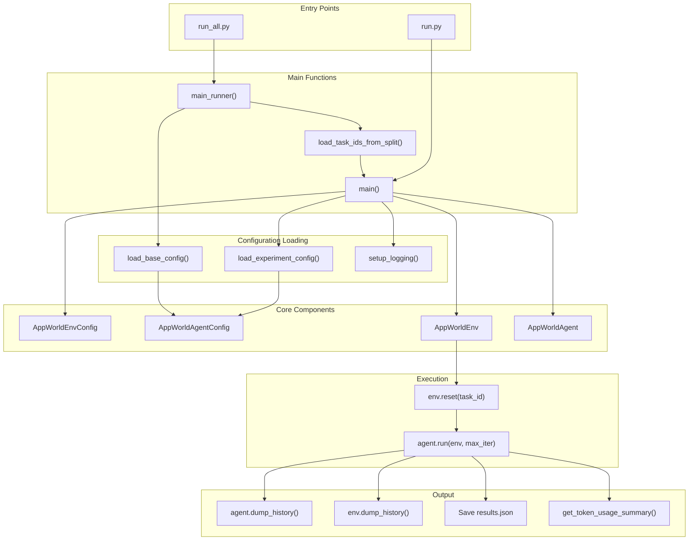
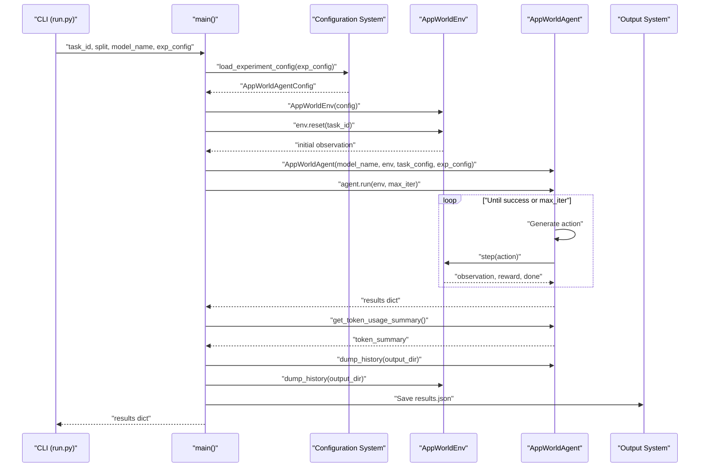
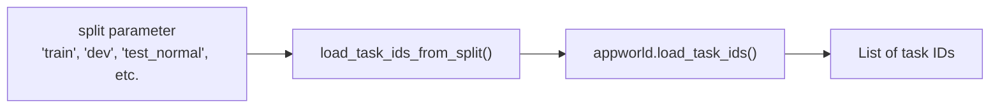
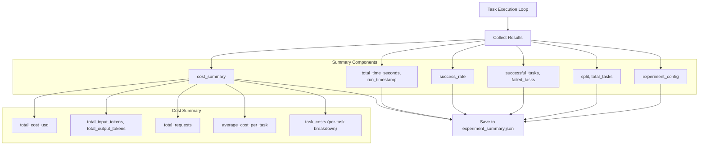

<!-- source: DeepWiki mcp.deepwiki.com · repo microsoft/acon · page 5 Running Experiments · fetched 2026-10-26 -->

# Running Experiments

<details>
<summary>Relevant source files</summary>

The following files were used as context for generating this wiki page:

- [experiments/appworld/run.py](experiments/appworld/run.py)
- [experiments/appworld/run_all.py](experiments/appworld/run_all.py)

</details>


## Purpose and Scope

This page describes how to execute experiments in the ACON framework across different benchmarks. It covers the command-line scripts used to run tasks, the execution workflow, and basic usage patterns.

For detailed information about:
- Installation and initial setup, see [Installation](#2.1)
- Configuration options, see [Configuration](#6)
- Analysis of experiment results, see [Analysis and Optimization](#7)
- Individual subsystems: [Single Task Execution](#5.1), [Batch Execution](#5.2), [CLI Reference](#5.3), [Output Structure](#5.4)

---

## Experiment Execution Overview

The ACON framework provides two primary entry points for running experiments:

| Script | Purpose | Typical Use Case |
|--------|---------|------------------|
| `run.py` | Execute a single task | Testing, debugging, rapid iteration |
| `run_all.py` | Execute multiple tasks from a split | Benchmark evaluation, production runs |

Both scripts support the same underlying execution model but differ in orchestration. Single task execution is useful for development and debugging, while batch execution is designed for running complete benchmark evaluations with progress tracking and summary statistics.

Sources: [experiments/appworld/run.py:1-233](), [experiments/appworld/run_all.py:1-364]()

---

## Execution Architecture

The following diagram illustrates the relationship between entry points, core components, and the execution flow:



Sources: [experiments/appworld/run.py:54-206](), [experiments/appworld/run_all.py:75-363]()

---

## Task Execution Workflow

When a task is executed, the system follows this sequence:



Sources: [experiments/appworld/run.py:54-206]()

---

## Basic Execution Patterns

### Single Task Execution

The `main()` function in `run.py` executes a single task:

**Function signature:**
```python
def main(
    task_id: str,
    split: str = 'train',
    output_dir: str = 'outputs',
    exp_config: Dict[str, Any] = None,
    model_name: str = 'gpt-4o',
    debug_mode: bool = True,
    experiment_name: str = 'minimal_test',
    max_iter: int = 50,
    model_ctxopt: Optional[Any] = None,
    lora_name: Optional[str] = None,
    **kwargs
) -> Dict[str, Any]
```

Sources: [experiments/appworld/run.py:54-66]()

### Batch Execution

The `main_runner()` function in `run_all.py` orchestrates multiple tasks:

**Key responsibilities:**
1. Parse command-line arguments
2. Load task IDs from the specified split using `load_task_ids_from_split()`
3. Create experiment configuration via `load_base_config()`
4. Iterate through tasks and call `main()` for each
5. Track success/failure and aggregate token usage
6. Generate experiment summary

Sources: [experiments/appworld/run_all.py:75-363]()

---

## Task ID Loading

The `load_task_ids_from_split()` function retrieves task IDs for a given dataset split:



This function delegates to the AppWorld library's `load_task_ids()` function, which handles the actual task loading from the benchmark dataset.

Sources: [experiments/appworld/run_all.py:60-72]()

---

## Configuration Loading

### Experiment Configuration

The `load_experiment_config()` function creates an `AppWorldAgentConfig` instance:

**Process:**
1. Extract valid field names from `AppWorldAgentConfig.__dataclass_fields__`
2. Separate valid configuration parameters from extra parameters
3. Store extra parameters in `extra_config` field
4. Remove `None` values to allow defaults to take effect

Sources: [experiments/appworld/run.py:28-51]()

### Base Configuration

The `load_base_config()` function in `run_all.py` loads the base configuration:

**Steps:**
1. Load `configs/base_config.yaml` if it exists
2. Create minimal fallback configuration if file is missing
3. Override with runtime values (tag, model_name, etc.)
4. Inject context optimization config if provided

Sources: [experiments/appworld/run_all.py:33-57]()

---

## Output Structure

Each task execution produces a structured output directory:

```
outputs/{model}_{tag}/{split}/task_{task_id}/
├── results.json                      # Task execution results
├── llm_history.json                  # Agent LLM interactions
├── history_optimizer_history.json   # Context optimizer history
└── env_history.json                 # Environment interaction log
```

At the split level, a summary is generated:

```
outputs/{model}_{tag}/{split}/
└── experiment_summary.json           # Aggregated statistics
```

Sources: [experiments/appworld/run.py:168-177](), [experiments/appworld/run_all.py:320-347]()

---

## Token Usage Tracking

Both execution modes track token usage and costs:

**During execution:**
1. Agent tracks each LLM call's token counts
2. `get_token_usage_summary()` aggregates across all calls
3. Token summary includes:
   - Total requests
   - Input/output/total tokens
   - Input/output/total costs (USD)

**In batch mode:**
The `main_runner()` aggregates token usage across all tasks and includes it in the experiment summary.

Sources: [experiments/appworld/run.py:155-193](), [experiments/appworld/run_all.py:178-315]()

---

## Context Optimization Integration

Experiments can use context optimization (history/observation compression):

**Configuration:**
1. Specify `--co_config_path` pointing to a YAML file (e.g., `configs/context_opt/gpt-4.1-mini_history.yaml`)
2. Config is loaded and passed as `co_config` parameter
3. For local models, `vLLMLocal` instance is created with LoRA path

**Model instantiation:**
```python
if co_config and co_config.get("model_type", None):
    if co_config["model_type"] == "local":
        from productive_agents.llm import vLLMLocal
        model_ctxopt = vLLMLocal(co_config["model"], lora_path=co_config.get("lora_name"))
    else:
        model_ctxopt = None
```

Sources: [experiments/appworld/run_all.py:103-119]()

---

## Progress Tracking and Logging

### Logging Setup

The `setup_logging()` function configures Python logging:

**In run.py:**
- Sets level based on `debug_mode` (DEBUG or INFO)
- Formats messages with timestamp, logger name, level, and message

**In run_all.py:**
- Sets INFO level for production runs
- Suppresses noisy loggers (httpx, azure.identity, azure.core)

Sources: [experiments/appworld/run.py:19-26](), [experiments/appworld/run_all.py:22-30]()

### Progress Bar

Batch execution uses the `rich` library for progress tracking:

**Components:**
- Spinner column
- Task description (current task ID)
- Progress bar
- Completed/total count
- Elapsed time
- Estimated time remaining

The progress bar is disabled in debug mode for clarity.

Sources: [experiments/appworld/run_all.py:187-280]()

---

## Experiment Summary Generation

After batch execution completes, `main_runner()` generates a comprehensive summary:



Sources: [experiments/appworld/run_all.py:320-347]()

---

## Error Handling

### Task-Level Errors

Individual task failures are captured but don't halt batch execution:

**Behavior:**
1. Task exceptions are caught and logged
2. Task is added to `failed_tasks` list
3. Execution continues with next task
4. Summary includes failed task IDs

### Error Log

The `run_all.py` script clears `error.log` at the start of execution to provide a clean error log for the current run.

Sources: [experiments/appworld/run_all.py:139-141](), [experiments/appworld/run_all.py:273-278]()

---

## Rerun and Continue Modes

### Continue Existing

Flag: `--continue_existing`

Behavior: Skip tasks that already have output directories, allowing interrupted runs to resume.

### Rerun Failed

Flag: `--rerun_failed`

**Process:**
1. Load `experiment_summary.json`
2. Extract `failed_tasks` list
3. Remove existing experiment folders for failed tasks
4. Re-execute only the failed tasks

Sources: [experiments/appworld/run_all.py:92-93](), [experiments/appworld/run_all.py:161-172](), [experiments/appworld/run_all.py:245-248]()

---

## Output Directory Routing

The framework supports routing outputs to different directories:

### GPT-5 Routing

Experiments using `gpt-5-chat` models are automatically routed to `./outputs_gpt5/` instead of `./outputs/`.

### Custom Output Directory

The `--output_dir` parameter copies outputs to a specified location after execution completes, maintaining the same directory structure.

**Copied directories:**
1. Task outputs: `{output_dir}/{outputs_base}/{model}_{tag}/{split}/`
2. Experiment artifacts: `{output_dir}/experiments/outputs/{model}_{tag}/`

Sources: [experiments/appworld/run_all.py:154-159](), [experiments/appworld/run_all.py:349-359]()

---

## LoRA Model Support

Both execution modes support LoRA-enhanced agent models:

**Parameter:** `--lora_name`

**Usage:**
When specified, the LoRA name is passed to the `AppWorldAgent` constructor, enabling the agent to use a fine-tuned adapter on top of the base model.

Sources: [experiments/appworld/run.py:64](), [experiments/appworld/run.py:146](), [experiments/appworld/run_all.py:94](), [experiments/appworld/run_all.py:205](), [experiments/appworld/run_all.py:260]()

---

## Environment Cleanup

After task execution completes, the environment is properly closed:

```python
env.close()
```

This ensures resources are released and any necessary cleanup is performed.

Sources: [experiments/appworld/run.py:203]()

---

