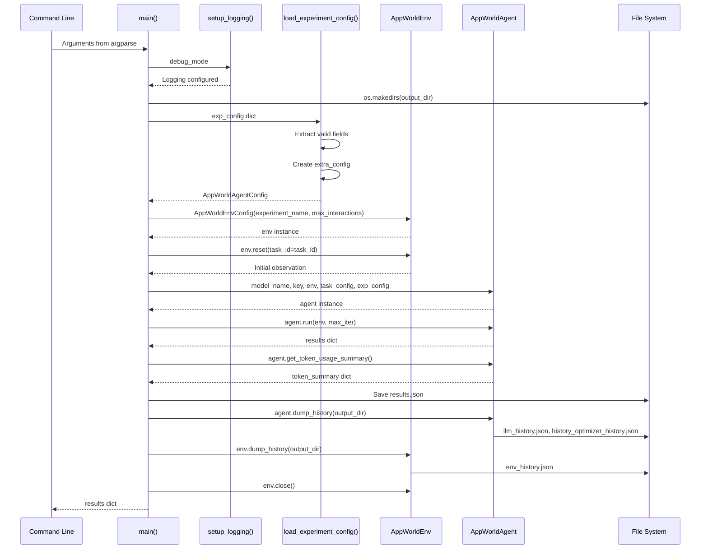
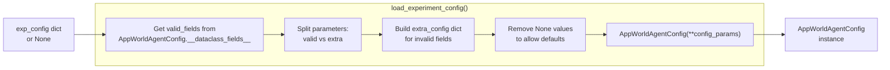
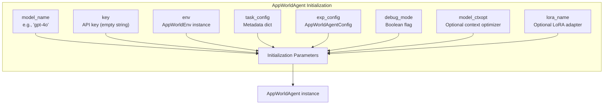
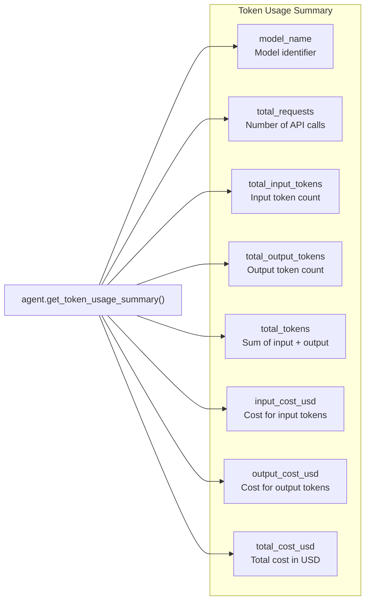
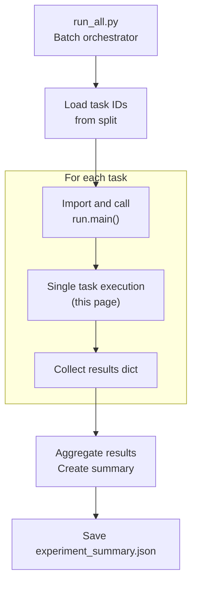

<!-- source: DeepWiki mcp.deepwiki.com · repo microsoft/acon · page 5.1 Single Task Execution · fetched 2026-10-26 -->

# Single Task Execution

<details>
<summary>Relevant source files</summary>

The following files were used as context for generating this wiki page:

- [experiments/appworld/configs/base_config.yaml](experiments/appworld/configs/base_config.yaml)
- [experiments/appworld/run.py](experiments/appworld/run.py)

</details>


## Purpose and Scope

This page documents how to execute individual AppWorld tasks using the `run.py` script. Single task execution is the fundamental building block of the ACON framework, allowing you to run and debug a single task with specific configurations.

For running multiple tasks in batch mode, see [Batch Experiment Execution](#5.2). For a complete reference of all command-line options across all scripts, see [Command-Line Reference](#5.3).

**Sources:** [experiments/appworld/run.py:1-233]()

---

## Overview

The `run.py` script provides a command-line interface for executing a single AppWorld task. It handles the complete lifecycle of task execution:

1. Loading and validating configuration
2. Initializing the environment and agent
3. Running the agent until task completion or max iterations
4. Saving results, histories, and trajectories
5. Reporting token usage and costs

The script serves as both a standalone CLI tool and a callable Python function that can be imported and used programmatically by other scripts like `run_all.py`.

**Sources:** [experiments/appworld/run.py:1-10]()

---

## Command-Line Interface

### Basic Usage

```bash
python experiments/appworld/run.py \
  --task_id <task_id> \
  --split <split> \
  --model_name <model> \
  --output_dir <path>
```

### Command-Line Arguments

The following table describes all command-line arguments accepted by `run.py`:

| Argument | Type | Default | Required | Description |
|----------|------|---------|----------|-------------|
| `--task_id` | string | - | Yes | AppWorld task ID to execute |
| `--split` | string | `"train"` | No | Dataset split the task belongs to (train/dev/test_normal/test_challenge) |
| `--output_dir` | string | `"outputs"` | No | Directory where all outputs will be saved |
| `--model_name` | string | `"gpt-4o"` | No | Model name for the agent (e.g., gpt-4o, gpt-4.1-mini) |
| `--debug_mode` | flag | `False` | No | Enable debug-level logging |
| `--max_iter` | integer | `50` | No | Maximum number of agent iterations before termination |
| `--experiment_name` | string | `"minimal_test"` | No | Name for the AppWorld experiment instance |

**Sources:** [experiments/appworld/run.py:208-220]()

### Example Commands

**Run a single task with defaults:**
```bash
python experiments/appworld/run.py --task_id train_1
```

**Run with custom model and debug mode:**
```bash
python experiments/appworld/run.py \
  --task_id dev_42 \
  --split dev \
  --model_name gpt-4.1-mini \
  --debug_mode \
  --max_iter 30
```

**Run with custom output directory:**
```bash
python experiments/appworld/run.py \
  --task_id test_normal_100 \
  --split test_normal \
  --output_dir experiments/outputs/my_experiment
```

**Sources:** [experiments/appworld/run.py:208-233]()

---

## Execution Flow

### High-Level Execution Pipeline

The following diagram shows the complete execution flow from script invocation to results output:

```mermaid
graph TB
    START["run.py invoked"]
    PARSE["argparse.ArgumentParser<br/>Parse CLI arguments"]
    MAIN["main() function"]
    
    subgraph "Initialization Phase"
        LOGGING["setup_logging()<br/>Configure logging level"]
        MKDIR["os.makedirs()<br/>Create output_dir"]
        LOAD_CONFIG["load_experiment_config()<br/>Create AppWorldAgentConfig"]
        ENV_CONFIG["AppWorldEnvConfig()<br/>experiment_name, max_interactions"]
    end
    
    subgraph "Environment Setup"
        INIT_ENV["AppWorldEnv(config=env_config)<br/>Initialize environment"]
        RESET_ENV["env.reset(task_id=task_id)<br/>Load specific task"]
    end
    
    subgraph "Agent Setup"
        TASK_CONFIG["Build task_config dict<br/>task_id, split, date, time"]
        INIT_AGENT["AppWorldAgent()<br/>model_name, key, env, configs"]
    end
    
    subgraph "Execution Phase"
        RUN["agent.run(env, max_iter)<br/>Execute agent loop"]
        GET_TOKENS["agent.get_token_usage_summary()<br/>Collect metrics"]
    end
    
    subgraph "Output Phase"
        SAVE_RESULTS["Save results.json<br/>success, iterations, reward"]
        DUMP_AGENT["agent.dump_history(output_dir)<br/>llm_history.json, optimizer history"]
        DUMP_ENV["env.dump_history(output_dir)<br/>env_history.json"]
        PRINT_SUMMARY["Print token usage<br/>and cost summary"]
    end
    
    CLEANUP["env.close()<br/>Cleanup resources"]
    RETURN["Return results dict"]
    
    START --> PARSE
    PARSE --> MAIN
    MAIN --> LOGGING
    LOGGING --> MKDIR
    MKDIR --> LOAD_CONFIG
    LOAD_CONFIG --> ENV_CONFIG
    ENV_CONFIG --> INIT_ENV
    INIT_ENV --> RESET_ENV
    RESET_ENV --> TASK_CONFIG
    TASK_CONFIG --> INIT_AGENT
    INIT_AGENT --> RUN
    RUN --> GET_TOKENS
    GET_TOKENS --> SAVE_RESULTS
    SAVE_RESULTS --> DUMP_AGENT
    DUMP_AGENT --> DUMP_ENV
    DUMP_ENV --> PRINT_SUMMARY
    PRINT_SUMMARY --> CLEANUP
    CLEANUP --> RETURN
```



**Sources:** [experiments/appworld/run.py:54-205]()

### Detailed Function Call Sequence



**Sources:** [experiments/appworld/run.py:54-205]()

---

## Configuration Loading

### Configuration Structure

The `main()` function accepts an optional `exp_config` dictionary that is transformed into an `AppWorldAgentConfig` dataclass. The configuration loading process handles:

1. **Field validation**: Only valid `AppWorldAgentConfig` fields are extracted
2. **Extra parameters**: Unrecognized parameters are placed in `extra_config`
3. **Default values**: `None` values are removed to allow defaults to take effect



**Sources:** [experiments/appworld/run.py:28-51]()

### Default Configuration Values

When `exp_config` is `None` (default when called from CLI), a minimal configuration is created:

| Field | Default Value | Source |
|-------|---------------|--------|
| `debug_mode` | From `--debug_mode` flag | CLI argument |
| `max_iter` | `50` or from `--max_iter` | CLI argument |
| `experiment_name` | `"minimal_test"` or from `--experiment_name` | CLI argument |

Additional defaults come from `AppWorldAgentConfig` dataclass defaults and `base_config.yaml` when loaded by calling scripts.

**Sources:** [experiments/appworld/run.py:92-97](), [experiments/appworld/configs/base_config.yaml:1-25]()

### Environment Configuration

The environment is configured separately via `AppWorldEnvConfig`:

```python
env_config = AppWorldEnvConfig(
    experiment_name=experiment_name,
    max_interactions=max_iter,
    debug_mode=debug_mode
)
```

**Sources:** [experiments/appworld/run.py:103-107]()

---

## Agent and Environment Initialization

### Task Configuration Dictionary

Before agent initialization, a `task_config` dictionary is created containing task metadata:

| Key | Value | Description |
|-----|-------|-------------|
| `task_id` | From argument | AppWorld task identifier |
| `split` | From argument | Dataset split name |
| `experiment_name` | From argument | Experiment instance name |
| `username` | `"user"` | Hardcoded username |
| `date` | Current date | Format: `YYYY-MM-DD` |
| `weekday` | Current weekday | Full name (e.g., "Monday") |
| `time` | Current time | Format: `HH:MM:SS` |

**Sources:** [experiments/appworld/run.py:127-135]()

### Agent Initialization Parameters

The `AppWorldAgent` is initialized with the following parameters:



**Sources:** [experiments/appworld/run.py:138-147]()

### Execution Phase

Once initialized, the agent executes via:

```python
results = agent.run(env, max_iter=max_iter)
```

This returns a results dictionary containing execution details including success status, number of iterations, termination reason, and final reward.

**Sources:** [experiments/appworld/run.py:152]()

---

## Results and Output

### Output Directory Structure

All outputs are saved to the specified `output_dir` with the following structure:

```
output_dir/
├── results.json                       # Main results file
├── llm_history.json                   # Agent LLM interaction history
├── history_optimizer_history.json     # Context optimizer history (if enabled)
├── env_history.json                   # Environment trajectory
└── [additional files from agent/env]
```

**Sources:** [experiments/appworld/run.py:168-176]()

### results.json Schema

The `results.json` file contains the following fields:

| Field | Type | Description |
|-------|------|-------------|
| `success` | boolean | Whether the task was completed successfully |
| `iterations` | integer | Number of agent iterations executed |
| `termination_reason` | string | Why execution stopped (e.g., "success", "max_iter", "error") |
| `final_reward` | float/integer | Final reward from the environment |
| `task_id` | string | Task identifier |
| `split` | string | Dataset split |
| `model_name` | string | Model used for execution |
| `experiment_name` | string | Experiment instance name |
| `config` | object | Complete experiment configuration |
| `token_usage` | object | Token usage and cost summary |

**Sources:** [experiments/appworld/run.py:158-165]()

### Token Usage Summary

The `token_usage` object contains detailed metrics:



**Sources:** [experiments/appworld/run.py:155-156](), [experiments/appworld/run.py:179-193]()

### Console Output

The script prints a formatted token usage and cost summary to the console:

```
==================================================
TOKEN USAGE AND COST SUMMARY
==================================================
Model: gpt-4o
Total Requests: 15
Input Tokens: 12,345
Output Tokens: 2,456
Total Tokens: 14,801
------------------------------
Input Cost: $0.061725
Output Cost: $0.024560
TOTAL COST: $0.086285
==================================================
```

**Sources:** [experiments/appworld/run.py:178-193]()

### Saved History Files

#### llm_history.json

Contains the complete history of LLM interactions, including:
- Prompts sent to the model
- Model responses
- Token counts per request
- Timestamps

#### history_optimizer_history.json

Contains the history of context optimization operations (if context optimization is enabled):
- Summarization requests
- Compressed contexts
- Token savings

#### env_history.json

Contains the environment interaction trajectory:
- Observations received
- Actions taken
- Rewards
- State transitions

**Sources:** [experiments/appworld/run.py:173-176]()

---

## Programmatic Usage

The `main()` function can be imported and called programmatically from other Python scripts:

```python
from experiments.appworld.run import main

result = main(
    task_id="train_42",
    split="train",
    output_dir="outputs/my_experiment",
    model_name="gpt-4.1-mini",
    debug_mode=True,
    max_iter=30,
    exp_config={
        'use_workflow_memory': False,
        'use_thinking_tokens': True
    }
)

print(f"Task completed: {result['success']}")
print(f"Final reward: {result['final_reward']}")
```

### Function Signature

```python
def main(
    task_id: str,
    split: str = 'train',
    output_dir: str = 'outputs',
    exp_config: Dict[str, Any] = None,
    model_name: str = 'gpt-4o',
    debug_mode: bool = True,
    experiment_name: str = 'minimal_test',
    max_iter: int = 50,
    model_ctxopt: Optional[Any] = None,
    lora_name: Optional[str] = None,
    **kwargs
) -> Dict[str, Any]
```

**Sources:** [experiments/appworld/run.py:54-83]()

### Return Value

The function returns a dictionary containing all execution results, including:
- Task completion status
- Iteration count
- Termination reason
- Final reward
- Token usage and costs
- Complete configuration

This return value is used by `run_all.py` for batch processing and aggregation.

**Sources:** [experiments/appworld/run.py:158-205]()

---

## Logging Configuration

The `setup_logging()` function configures Python's logging system based on the debug mode:

| Debug Mode | Log Level | Format |
|------------|-----------|--------|
| `True` | `DEBUG` | `%(asctime)s - %(name)s - %(levelname)s - %(message)s` |
| `False` | `INFO` | `%(asctime)s - %(name)s - %(levelname)s - %(message)s` |

Key log messages include:
- Task initialization details
- Model and configuration information
- Iteration progress
- Success/failure status
- Token usage and costs

**Sources:** [experiments/appworld/run.py:19-25]()

---

## Error Handling and Cleanup

The script ensures proper resource cleanup:

1. **Environment cleanup**: `env.close()` is called after execution completes
2. **History saving**: All histories are saved even if execution fails
3. **Result persistence**: Results are written before cleanup

No explicit exception handling is implemented in the main flow; exceptions propagate to the caller, which is appropriate for both CLI usage (shows stack trace) and programmatic usage (allows caller to handle errors).

**Sources:** [experiments/appworld/run.py:203]()

---

## Integration with Batch Processing

The `run.py` script is designed to be called by `run_all.py` for batch processing:



The batch processor relies on:
- Consistent return value structure from `main()`
- Predictable output directory structure
- Programmatic error propagation

See [Batch Experiment Execution](#5.2) for details on running multiple tasks.

**Sources:** [experiments/appworld/run.py:54-205]()

---

