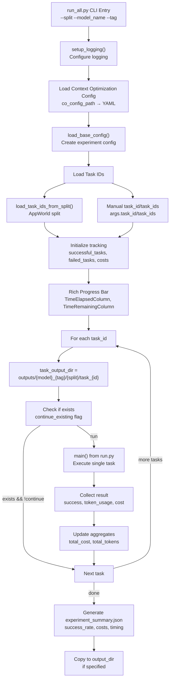
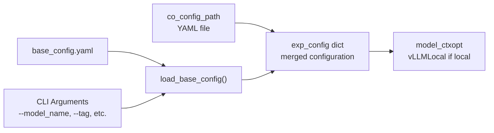
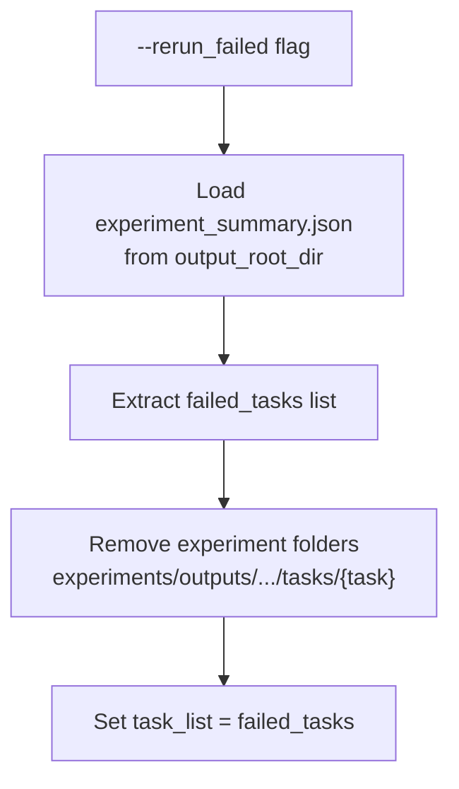
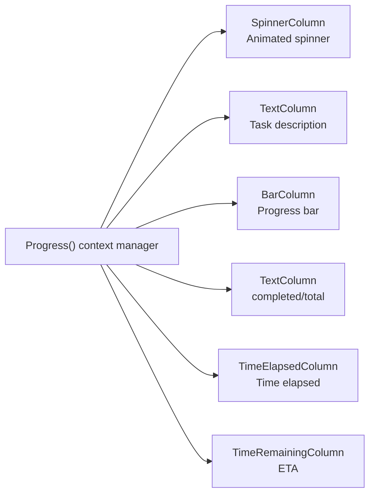
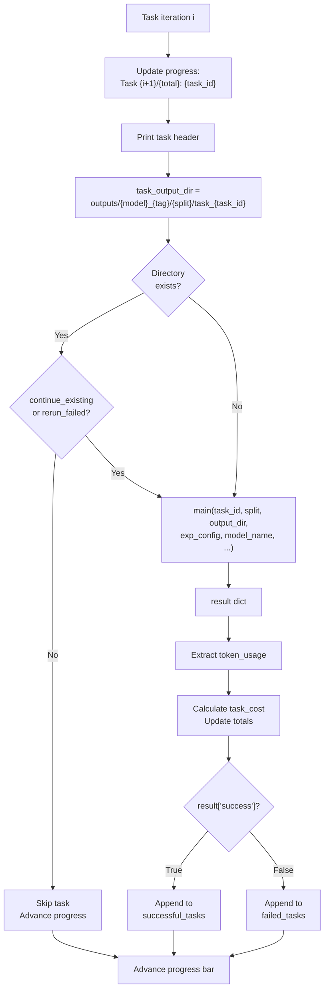
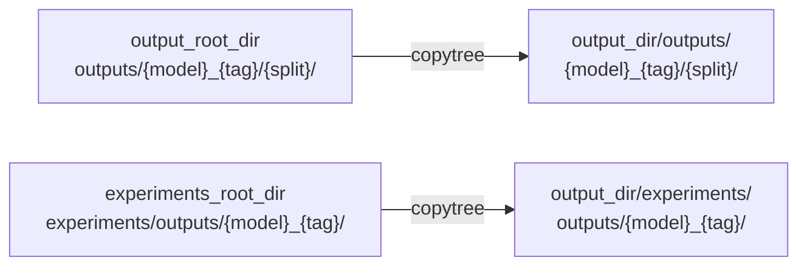
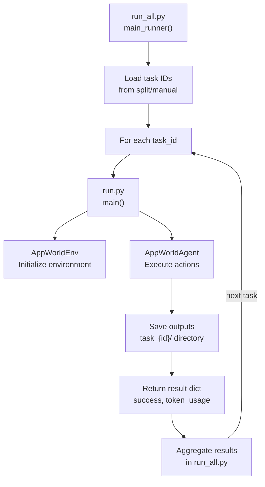

<!-- source: DeepWiki mcp.deepwiki.com · repo microsoft/acon · page 5.2 Batch Experiment Execution · fetched 2026-10-26 -->

# Batch Experiment Execution

<details>
<summary>Relevant source files</summary>

The following files were used as context for generating this wiki page:

- [experiments/appworld/README.md](experiments/appworld/README.md)
- [experiments/appworld/run_all.py](experiments/appworld/run_all.py)

</details>


This page describes how to execute multiple tasks in batch mode using `run_all.py`. Batch execution is the primary workflow for running experiments across entire dataset splits (train, dev, test_normal, test_challenge) or custom task subsets.

For single task execution, see [Single Task Execution](#5.1). For detailed command-line options, see [Command-Line Reference](#5.3). For understanding experiment outputs, see [Output and Results](#5.4).

**Sources:** [experiments/appworld/README.md:1-237](), [experiments/appworld/run_all.py:1-364]()

## Overview

The batch experiment execution system orchestrates running multiple AppWorld tasks sequentially, tracking progress, aggregating results, and computing cost summaries. The primary entry point is `run_all.py`, which loads task IDs from dataset splits, configures each task, and invokes the single-task runner in a loop.

### Execution Flow



**Sources:** [experiments/appworld/run_all.py:75-363]()

## Main Runner Function

The `main_runner()` function serves as the orchestrator for batch execution. It performs the following sequence:

1. Parse command-line arguments
2. Set up logging configuration
3. Load context optimization configuration
4. Create base experiment configuration
5. Load task IDs from split or manual specification
6. Execute tasks in a loop with progress tracking
7. Aggregate results and compute cost summary
8. Save experiment summary JSON

**Sources:** [experiments/appworld/run_all.py:75-363]()

### Argument Parsing

The argument parser accepts the following key parameters:

| Argument | Type | Default | Description |
|----------|------|---------|-------------|
| `--split` | str | `"train"` | Dataset split (train, dev, test_normal, test_challenge, custom) |
| `--task_id` | str | None | Single task ID to run |
| `--task_ids` | str[] | None | List of specific task IDs |
| `--tag` | str | `"debug"` | Experiment grouping label |
| `--model_name` | str | `"gpt-4o"` | Model to use for agent |
| `--co_config_path` | str | None | Path to context optimization config |
| `--debug` | flag | False | Enable debug mode (runs only first task) |
| `--max_iter` | int | 50 | Maximum iterations per task |
| `--continue_existing` | flag | False | Continue from existing results |
| `--rerun_failed` | flag | False | Rerun only failed tasks |
| `--lora_name` | str | None | LoRA model name for agent |
| `--seed` | int | 42 | Random seed for LLM generation |

**Sources:** [experiments/appworld/run_all.py:78-98]()

### Configuration Loading



The `load_base_config()` function creates a minimal configuration by:

1. Loading `configs/base_config.yaml` if it exists
2. Overriding with runtime values from CLI arguments
3. Setting experiment metadata (exp_id, model_name, tag)

**Sources:** [experiments/appworld/run_all.py:33-57](), [experiments/appworld/run_all.py:103-127]()

The context optimization configuration is loaded separately from the specified YAML file. If the config specifies `model_type: "local"`, a `vLLMLocal` instance is created for the compressor model:

[experiments/appworld/run_all.py:112-119]()

## Task Loading

Tasks are loaded via one of three mechanisms:

### 1. Split-Based Loading

When no specific task IDs are provided, tasks are loaded from AppWorld dataset splits:

```python
def load_task_ids_from_split(split: str) -> List[str]:
    from appworld import load_task_ids
    return load_task_ids(split)
```

Supported splits include:
- `train`: Training set
- `dev`: Development set
- `test_normal`: Normal difficulty test set
- `test_challenge`: Challenge difficulty test set
- Custom splits (e.g., `train_history_tiny`)

**Sources:** [experiments/appworld/run_all.py:60-72]()

### 2. Single Task

When `--task_id` is specified, only that task is executed:

[experiments/appworld/run_all.py:144-146]()

### 3. Manual Task List

When `--task_ids` is specified with multiple IDs, exactly those tasks are executed:

[experiments/appworld/run_all.py:147-149]()

### Failed Task Re-execution

When `--rerun_failed` is enabled, the system loads previously failed tasks from the experiment summary:



**Sources:** [experiments/appworld/run_all.py:161-172]()

## Execution Loop

The main execution loop processes tasks sequentially, tracking progress and aggregating results.

### Progress Tracking

In non-debug mode, a Rich progress bar displays execution status with multiple columns:



**Sources:** [experiments/appworld/run_all.py:227-236]()

### Debug Mode

In debug mode (`--debug` flag), the system:
- Disables the progress bar for clarity
- Runs only the first task in the list
- Always reruns the task (skips existing check)
- Prints detailed execution information

[experiments/appworld/run_all.py:187-225]()

### Task Execution Loop

Each task iteration performs the following:



**Sources:** [experiments/appworld/run_all.py:238-280]()

The `main()` function from `run.py` is invoked with the following parameters:

[experiments/appworld/run_all.py:250-261]()

## Cost and Token Tracking

The batch executor aggregates cost and token usage across all tasks.

### Per-Task Collection

After each task execution, token usage is extracted from the result:

```python
if 'token_usage' in result and result['token_usage']:
    token_info = result['token_usage']
    task_cost = token_info.get('total_cost_usd', 0.0)
    task_costs[task_id] = task_cost
    total_cost += task_cost
    total_input_tokens += token_info.get('total_input_tokens', 0)
    total_output_tokens += token_info.get('total_output_tokens', 0)
    total_requests += token_info.get('total_requests', 0)
```

**Sources:** [experiments/appworld/run_all.py:263-271]()

### Aggregation Variables

The following variables accumulate across tasks:

| Variable | Type | Description |
|----------|------|-------------|
| `total_cost` | float | Total USD cost across all tasks |
| `total_input_tokens` | int | Sum of input tokens |
| `total_output_tokens` | int | Sum of output tokens |
| `total_requests` | int | Total API requests made |
| `task_costs` | dict | Per-task cost mapping {task_id: cost} |

**Sources:** [experiments/appworld/run_all.py:178-183]()

### Cost Summary Output

After execution, a detailed cost summary is printed:

```
TOKEN USAGE AND COST SUMMARY
============================================================
Total Requests: 1,234
Total Input Tokens: 567,890
Total Output Tokens: 123,456
Total Tokens: 691,346
TOTAL COST: $12.345678
Average cost per task: $0.246914
============================================================
```

**Sources:** [experiments/appworld/run_all.py:304-315]()

## Experiment Summary

Upon completion, the batch executor generates a comprehensive experiment summary.

### Summary Structure

The `experiment_summary.json` file contains:

```json
{
  "experiment_config": {...},
  "split": "train",
  "total_tasks": 100,
  "successful_tasks": ["task_1", "task_2", ...],
  "failed_tasks": ["task_42", ...],
  "success_rate": 0.95,
  "total_time_seconds": 3600.5,
  "run_timestamp": 1234567890.123,
  "cost_summary": {
    "total_cost_usd": 12.34,
    "total_input_tokens": 567890,
    "total_output_tokens": 123456,
    "total_tokens": 691346,
    "total_requests": 1234,
    "average_cost_per_task": 0.1234,
    "task_costs": {
      "task_1": 0.12,
      "task_2": 0.15,
      ...
    }
  }
}
```

**Sources:** [experiments/appworld/run_all.py:320-340]()

### Summary Generation

The summary is created after all tasks complete:

[experiments/appworld/run_all.py:320-347]()

### Directory Structure

The experiment creates the following directory structure:

```
outputs/{model_name}_{tag}/{split}/
├── experiment_summary.json          # Aggregated summary
├── task_{id}_0/                     # Individual task outputs
│   ├── appworld_trajectory.json
│   ├── env_history.json
│   ├── history_optimizer_history.json
│   ├── llm_history.json
│   ├── step_alignment.json
│   └── results.json
├── task_{id}_1/
└── ...
```

**Sources:** [experiments/appworld/README.md:67-84]()

## Output Directory Management

### Base Output Directory

The system determines the output directory based on the model name:

```python
is_gpt5 = 'gpt-5-chat' in args.model_name
outputs_base = './outputs_gpt5' if is_gpt5 else './outputs'
output_root_dir = f'{outputs_base}/{args.model_name.replace("/","_")}_{args.tag}/{args.split}/'
```

This routes GPT-5 experiments to a separate directory tree.

**Sources:** [experiments/appworld/run_all.py:154-159]()

### Output Copying

If `--output_dir` is specified, results are copied to the target location:



**Sources:** [experiments/appworld/run_all.py:349-359]()

## Advanced Features

### Continue Existing

The `--continue_existing` flag allows resuming interrupted experiments:

```python
if not args.continue_existing and os.path.exists(task_output_dir) and not args.rerun_failed:
    print(f"Output directory for task {task_id} already exists, skipping...")
    progress.advance(pb, 1)
    continue
```

When enabled, existing task directories are not skipped, allowing the system to pick up where it left off.

**Sources:** [experiments/appworld/run_all.py:245-248]()

### Rerun Failed Tasks

The `--rerun_failed` flag targets only previously failed tasks:

1. Loads `experiment_summary.json`
2. Extracts the `failed_tasks` list
3. Removes existing experiment folders for those tasks
4. Sets the task list to only failed tasks

[experiments/appworld/run_all.py:161-172]()

### Logging Configuration

The `setup_logging()` function configures logging for the batch executor:

```python
def setup_logging():
    logging.basicConfig(
        level=logging.INFO,
        format="%(asctime)s - %(name)s - %(levelname)s - %(message)s",
    )
    # Suppress noisy loggers
    for logger_name in ["httpx", "azure.identity", "azure.core"]:
        logging.getLogger(logger_name).setLevel(logging.WARNING)
```

This suppresses verbose HTTP and Azure SDK logging while maintaining INFO-level logging for the experiment.

**Sources:** [experiments/appworld/run_all.py:22-30]()

## Integration with Single Task Runner

The batch executor delegates to the single-task runner for each task:



**Sources:** [experiments/appworld/run_all.py:1-18](), [experiments/appworld/run_all.py:250-261]()

## Usage Examples

### Basic Batch Execution

Run all tasks from the training split with GPT-4o and a context optimization config:

```bash
cd experiments/appworld
python run_all.py \
    --split train \
    --model_name gpt-4o \
    --tag history_compression \
    --co_config_path configs/context_opt/appworld/gpt-4.1_history_v2.yaml
```

**Sources:** [experiments/appworld/README.md:44-54]()

### Debug Mode

Run only the first task with verbose output:

```bash
python run_all.py \
    --split train \
    --model_name gpt-4.1 \
    --tag debug \
    --debug
```

**Sources:** [experiments/appworld/README.md:42]()

### Rerun Failed Tasks

After an initial run, rerun only the tasks that failed:

```bash
python run_all.py \
    --split train \
    --model_name gpt-4o \
    --tag retry \
    --co_config_path configs/context_opt/appworld/gpt-4.1_history_v2.yaml \
    --rerun_failed
```

**Sources:** [experiments/appworld/run_all.py:161-172]()

### Custom Task Subset

Run specific tasks by ID:

```bash
python run_all.py \
    --split train \
    --task_ids task_123 task_456 task_789 \
    --model_name gpt-4o \
    --tag custom_subset
```

**Sources:** [experiments/appworld/run_all.py:84](), [experiments/appworld/run_all.py:147-149]()

### With Output Directory Copy

Run experiments and copy results to a shared storage location:

```bash
python run_all.py \
    --split test_normal \
    --model_name gpt-4.1 \
    --tag production \
    --co_config_path configs/context_opt/appworld/best_config.yaml \
    --output_dir /mnt/shared/experiments
```

**Sources:** [experiments/appworld/run_all.py:349-359]()

---

