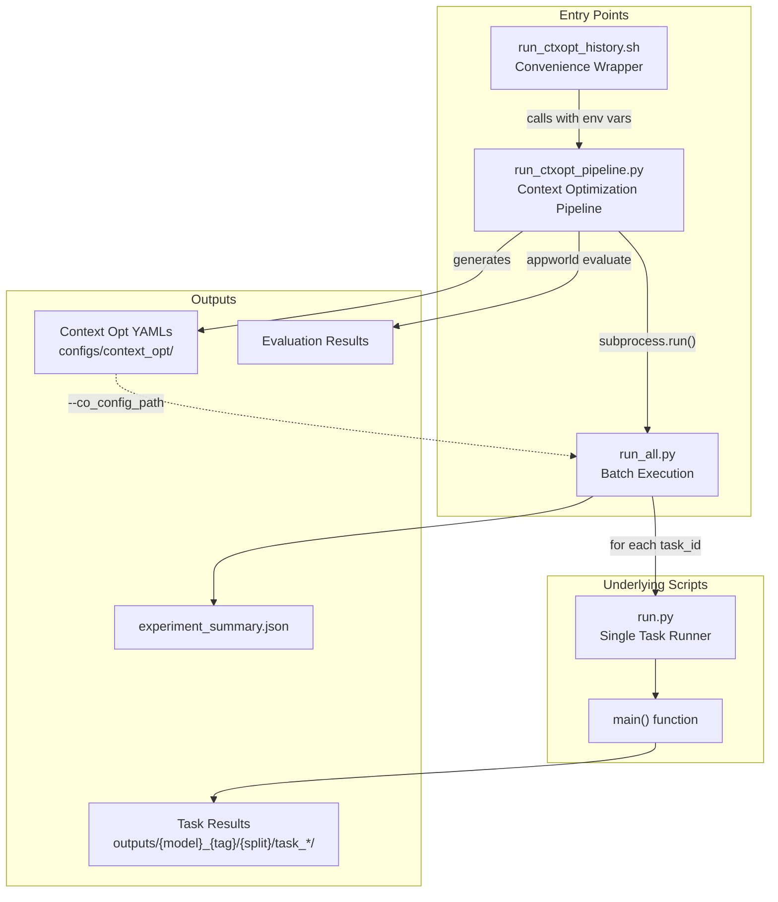
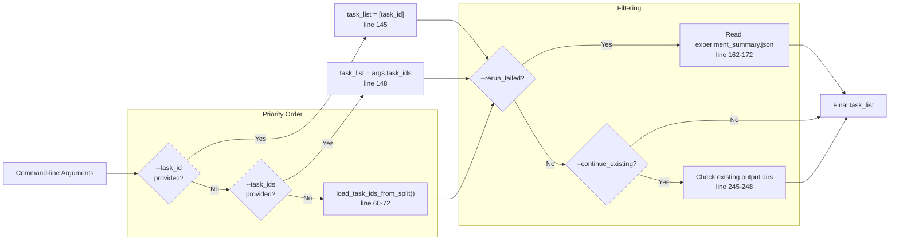
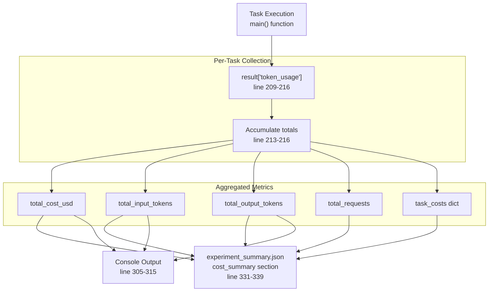
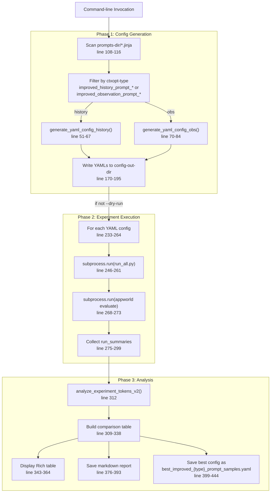
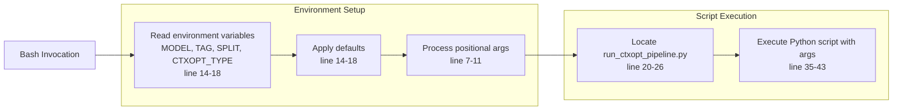
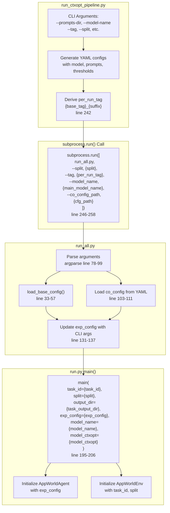

<!-- source: DeepWiki mcp.deepwiki.com · repo microsoft/acon · page 5.3 Command-Line Reference · fetched 2026-10-26 -->

# Command-Line Reference

<details>
<summary>Relevant source files</summary>

The following files were used as context for generating this wiki page:

- [experiments/appworld/run_all.py](experiments/appworld/run_all.py)
- [experiments/appworld/run_ctxopt_pipeline.py](experiments/appworld/run_ctxopt_pipeline.py)
- [experiments/appworld/scripts/run_ctxopt_history.sh](experiments/appworld/scripts/run_ctxopt_history.sh)

</details>


This page provides a complete reference for all command-line parameters and options used to execute ACON experiments. It covers the primary execution scripts for running AppWorld tasks, managing context optimization pipelines, and convenience wrappers for common workflows.

For step-by-step guides on running experiments, see [Running Your First Experiment](#2.3), [Single Task Execution](#5.1), and [Batch Experiment Execution](#5.2). For configuration file options, see [Configuration](#6).

## Script Overview

ACON provides three main entry points for experiment execution:



**Sources:** [experiments/appworld/run_all.py:1-363](), [experiments/appworld/run_ctxopt_pipeline.py:1-449](), [experiments/appworld/scripts/run_ctxopt_history.sh:1-44]()

## run_all.py

Primary script for batch execution of AppWorld tasks across dataset splits.

**Location:** [experiments/appworld/run_all.py]()

### Synopsis

```bash
python experiments/appworld/run_all.py [OPTIONS]
```

### Parameters

| Parameter | Type | Default | Description |
|-----------|------|---------|-------------|
| `--split` | str | `"train"` | Dataset split to run (train, dev, test_normal, test_challenge, or custom splits like train_history_tiny) |
| `--task_id` | str | `None` | Run a single specific task ID |
| `--task_ids` | str[] | `None` | List of specific task IDs to run (space-separated) |
| `--tag` | str | `"debug"` | Experiment tag used in output directory naming |
| `--model_name` | str | `"gpt-4o"` | LLM model name for agent execution |
| `--use_workflow_memory` | flag | `False` | Enable workflow memory feature |
| `--output_dir` | str | `None` | Copy outputs to specified directory after completion |
| `--co_config_path` | str | `None` | Path to context optimization YAML configuration file |
| `--debug` | flag | `False` | Enable debug mode (runs only first task with verbose output) |
| `--max_iter` | int | `50` | Maximum iterations per task before termination |
| `--continue_existing` | flag | `False` | Continue from existing results (skip tasks with output directories) |
| `--rerun_failed` | flag | `False` | Rerun only tasks that failed in previous run |
| `--lora_name` | str | `None` | LoRA adapter name for agent model (local models only) |
| `--verbose` | flag | `False` | Enable verbose output logging |
| `--seed` | int | `42` | Random seed for LLM generation |

### Task Selection Logic



**Sources:** [experiments/appworld/run_all.py:60-172]()

### Output Directory Structure

The script generates outputs with the following naming convention:

```
{outputs_base}/{model_name}_{tag}/{split}/
├── task_{task_id_1}/
│   ├── history_optimizer_history.json
│   ├── llm_history.json
│   ├── env_history.json
│   └── results.json
├── task_{task_id_2}/
│   └── ...
└── experiment_summary.json
```

Where `outputs_base` is `./outputs_gpt5` if model name contains `gpt-5-chat`, otherwise `./outputs`.

**Sources:** [experiments/appworld/run_all.py:154-159](), [experiments/appworld/run_all.py:320-346]()

### Context Optimization Configuration

When `--co_config_path` is provided, the script:

1. Loads the YAML configuration file [experiments/appworld/run_all.py:103-111]()
2. Checks for local model requirements [experiments/appworld/run_all.py:112-119]()
3. Initializes `vLLMLocal` model if `model_type: "local"` is specified
4. Passes `co_config` to the experiment configuration [experiments/appworld/run_all.py:122-127]()

### Cost Tracking

The script automatically tracks and reports token usage and costs:



**Sources:** [experiments/appworld/run_all.py:178-216](), [experiments/appworld/run_all.py:305-339]()

### Examples

Run development split with GPT-4.1 and history compression:
```bash
python experiments/appworld/run_all.py \
  --split dev \
  --model_name gpt-4.1-mini \
  --tag hist_compression_v1 \
  --co_config_path configs/context_opt/gpt-4.1-mini_history.yaml
```

Run specific tasks in debug mode:
```bash
python experiments/appworld/run_all.py \
  --task_ids task_123 task_456 task_789 \
  --model_name gpt-4o \
  --tag debug_run \
  --debug
```

Rerun failed tasks from previous experiment:
```bash
python experiments/appworld/run_all.py \
  --split train \
  --model_name gpt-4.1-mini \
  --tag retry_failed \
  --rerun_failed
```

**Sources:** [experiments/appworld/run_all.py:75-363]()

## run_ctxopt_pipeline.py

Pipeline script for batch evaluation of multiple context optimization prompt configurations.

**Location:** [experiments/appworld/run_ctxopt_pipeline.py]()

### Synopsis

```bash
python experiments/appworld/run_ctxopt_pipeline.py [OPTIONS]
```

### Purpose

This script automates the workflow of:
1. Reading optimized prompt templates from a directory
2. Generating context-optimization YAML configurations for each template
3. Running `run_all.py` with each configuration
4. Evaluating results with `appworld evaluate`
5. Comparing performance across all prompt variants

**Sources:** [experiments/appworld/run_ctxopt_pipeline.py:1-17]()

### Parameters

| Parameter | Type | Default | Description |
|-----------|------|---------|-------------|
| `--ctxopt-type` | str | `"history"` | Context optimization type: `"history"` or `"obs"` |
| `--prompts-dir` | str | **Required** | Directory containing optimized `.jinja` prompt templates |
| `--model-name` | str | `"gpt-4.1-mini"` | Model name to record in generated YAML configs (compressor model) |
| `--main-model-name` | str | `"gpt-4.1-mini"` | Model name for agent execution (passed to run_all.py) |
| `--tag` | str | *auto-derived* | Experiment tag (auto-derived from prompts directory if not set) |
| `--split` | str | `"train_history_tiny"` | Dataset split to run |
| `--config-out-dir` | str | *auto-generated* | Output directory for generated YAML configs |
| `--dry-run` | flag | `False` | Only generate configs without executing experiments |
| `--task-ids` | str | `None` | Comma-separated task IDs or path to file with task IDs (one per line) |
| `--debug` | flag | `False` | Pass `--debug` to run_all.py |
| `--opt-version` | int | `1` | Optimization version number for history/obs versioning |

### Pipeline Workflow



**Sources:** [experiments/appworld/run_ctxopt_pipeline.py:87-448]()

### YAML Config Generation

The script generates different YAML structures based on `--ctxopt-type`:

**History Compression Config** (generated by `generate_yaml_config_history`):
```yaml
type: "history"
model: "{model-name}"
compressor_type: "full"
prompts:
  prompt_system: "system_prompt"
  prompt_history_user: "{template_name}"
history_summarization_threshold: 4096
preserve_last_k_turns: 1
history_summary_rule: "reset"
history_prompt_dir: "{prompts-dir}"
history_version: {opt-version}
```

**Observation Compression Config** (generated by `generate_yaml_config_obs`):
```yaml
type: "obs"
model: "{model-name}"
compressor_type: "full"
prompts:
  prompt_system: "system_prompt"
  prompt_user: "{template_name}"
obs_summarization_threshold: 1024
obs_prompt_dir: "{prompts-dir}"
obs_version: {opt-version}
```

**Sources:** [experiments/appworld/run_ctxopt_pipeline.py:51-84]()

### Comparison Metrics

After all experiments complete, the pipeline generates a comparison table with:

| Metric | Description | Source |
|--------|-------------|--------|
| Config | YAML configuration filename | Generated config name |
| Tag | Experiment tag | Derived per-run tag |
| Tasks | Number of tasks executed | `experiment_summary.json` |
| Avg Steps | Average steps per task | Computed from agent history |
| Task GC | Task goal completion rate | `{split}.json` evaluation file |
| Agent In | Total agent input tokens | `analyze_experiment_tokens_v2()` |
| Opt In | Total optimizer input tokens | `analyze_experiment_tokens_v2()` |
| Total In | Sum of agent + optimizer input | Computed |

Configs are ranked by total input tokens (ascending) and displayed in a Rich table.

**Sources:** [experiments/appworld/run_ctxopt_pipeline.py:301-373]()

### Best Config Selection

The pipeline automatically identifies and saves the best-performing configuration:

1. **Primary criterion:** Highest `task_goal_completion` rate
2. **Tie-breaker:** Lowest total input tokens
3. **Output:** Saved as `best_improved_history_prompt_samples.yaml` or `best_improved_observation_prompt_samples.yaml`

**Sources:** [experiments/appworld/run_ctxopt_pipeline.py:399-444]()

### Examples

Evaluate history compression prompts on tiny split:
```bash
python experiments/appworld/run_ctxopt_pipeline.py \
  --ctxopt-type history \
  --prompts-dir experiments/prompt_optimizer/outputs_appworld/250818_history_regression/optimized_prompts \
  --model-name gpt-4.1-mini \
  --tag hist_eval_v1 \
  --split train_history_tiny
```

Dry-run to generate configs without execution:
```bash
python experiments/appworld/run_ctxopt_pipeline.py \
  --ctxopt-type obs \
  --prompts-dir path/to/prompts \
  --model-name gpt-4.1-mini \
  --dry-run
```

Run with specific task subset:
```bash
python experiments/appworld/run_ctxopt_pipeline.py \
  --ctxopt-type history \
  --prompts-dir path/to/prompts \
  --task-ids task_1,task_2,task_3 \
  --debug
```

**Sources:** [experiments/appworld/run_ctxopt_pipeline.py:7-14]()

## run_ctxopt_history.sh

Convenience wrapper script for running the context optimization pipeline with environment variable configuration.

**Location:** [experiments/appworld/scripts/run_ctxopt_history.sh]()

### Synopsis

```bash
./experiments/appworld/scripts/run_ctxopt_history.sh [PROMPTS_DIR] [EXTRA_OPTIONS...]
```

### Environment Variables

| Variable | Default | Description |
|----------|---------|-------------|
| `MODEL` | `gpt-4.1-mini` | Model name for both compressor and agent |
| `TAG` | `2501013_prompteval_hist_opt` | Experiment tag |
| `SPLIT` | `train_history_tiny` | Dataset split |
| `CTXOPT_TYPE` | `history` | Context optimization type (history or obs) |

### Positional Arguments

1. **PROMPTS_DIR** (optional): Path to prompts directory. Defaults to `../prompt_optimizer/outputs/appworld/251010_history_optimized_retry/optimized_prompts`
2. **EXTRA_OPTIONS**: Any additional flags are forwarded to `run_ctxopt_pipeline.py`

### Execution Flow



**Sources:** [experiments/appworld/scripts/run_ctxopt_history.sh:1-44]()

### Examples

Run with default settings:
```bash
./experiments/appworld/scripts/run_ctxopt_history.sh
```

Override prompts directory:
```bash
./experiments/appworld/scripts/run_ctxopt_history.sh \
  /path/to/custom/prompts
```

Use environment variables:
```bash
MODEL=gpt-4o TAG=custom_eval SPLIT=dev \
  ./experiments/appworld/scripts/run_ctxopt_history.sh
```

Pass additional flags:
```bash
./experiments/appworld/scripts/run_ctxopt_history.sh \
  /path/to/prompts \
  --dry-run --debug
```

**Sources:** [experiments/appworld/scripts/run_ctxopt_history.sh:1-44]()

## Parameter Flow Across Scripts

The following diagram illustrates how parameters flow from the pipeline script through to individual task execution:



**Sources:** [experiments/appworld/run_ctxopt_pipeline.py:233-261](), [experiments/appworld/run_all.py:33-137](), [experiments/appworld/run_all.py:195-206]()

## Common Parameter Combinations

### Baseline Experiments

No context optimization, frontier model:
```bash
python experiments/appworld/run_all.py \
  --split dev \
  --model_name gpt-4o \
  --tag baseline \
  --max_iter 50
```

### Context-Optimized Experiments

With history compression:
```bash
python experiments/appworld/run_all.py \
  --split dev \
  --model_name gpt-4.1-mini \
  --tag hist_compressed \
  --co_config_path configs/context_opt/gpt-4.1-mini_history.yaml
```

### Local Model with LoRA

Using distilled local model:
```bash
python experiments/appworld/run_all.py \
  --split dev \
  --model_name Qwen/Qwen3-14B \
  --lora_name agent_history_v2_3epochs \
  --tag local_distilled \
  --co_config_path configs/context_opt/local_history.yaml
```

Note: The `co_config` YAML should specify `model_type: "local"` and include the compressor LoRA path.

### Pipeline Evaluation

Batch evaluate multiple prompt variants:
```bash
python experiments/appworld/run_ctxopt_pipeline.py \
  --ctxopt-type history \
  --prompts-dir experiments/prompt_optimizer/outputs_appworld/prompts_v3/optimized_prompts \
  --model-name gpt-4.1-mini \
  --main-model-name gpt-4.1-mini \
  --tag prompt_eval_v3 \
  --split train_history_tiny
```

**Sources:** [experiments/appworld/run_all.py:78-96](), [experiments/appworld/run_ctxopt_pipeline.py:87-99]()

---

