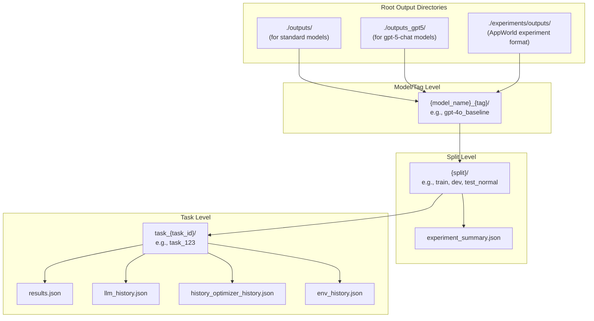
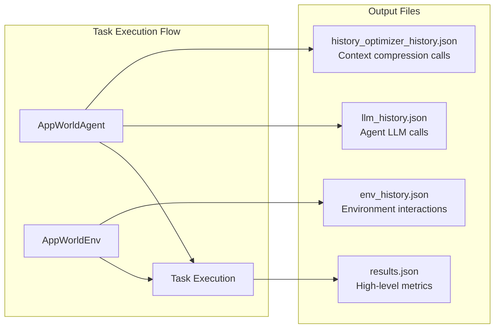
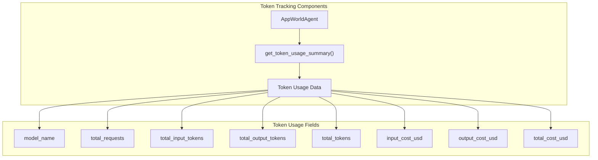
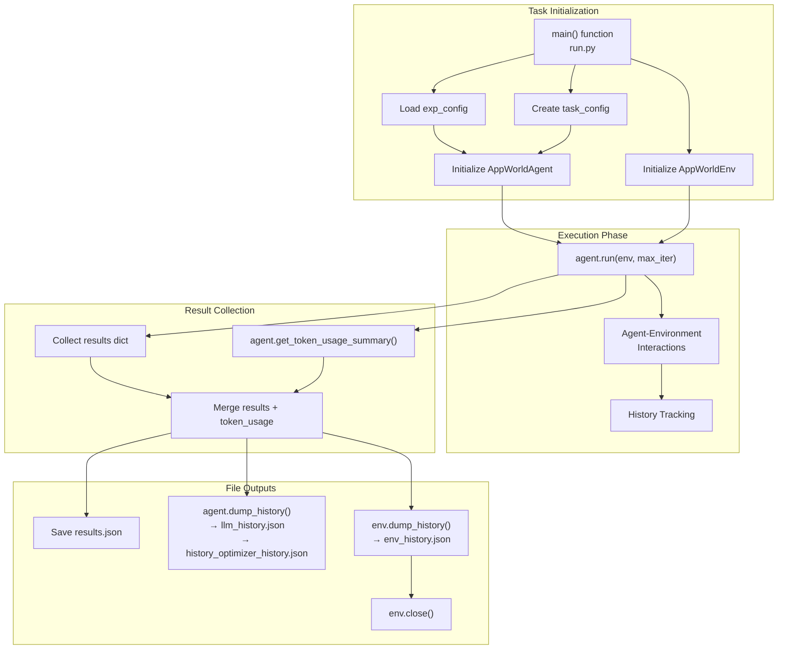
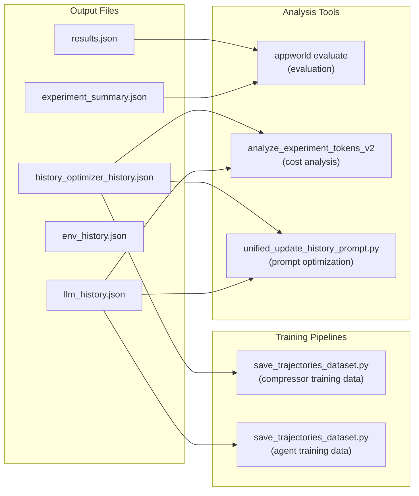

<!-- source: DeepWiki mcp.deepwiki.com · repo microsoft/acon · page 5.4 Output and Results · fetched 2026-10-26 -->

# Output and Results

<details>
<summary>Relevant source files</summary>

The following files were used as context for generating this wiki page:

- [experiments/appworld/run.py](experiments/appworld/run.py)
- [experiments/appworld/run_all.py](experiments/appworld/run_all.py)

</details>


This page describes the output directory structure and result files generated when running ACON experiments. When tasks are executed via `run.py` or `run_all.py`, the framework creates a standardized set of output files that capture execution traces, agent decisions, environment interactions, token usage, and overall experiment metrics.

For information about running experiments that generate these outputs, see [Running Experiments](#5). For details on analyzing these outputs, see [Token and Cost Analysis](#7.1).

---

## Output Directory Structure

The ACON framework organizes experiment outputs in a hierarchical directory structure based on the model, experiment tag, and dataset split.

### Directory Hierarchy



**Sources:** [experiments/appworld/run_all.py:154-159]()

### Path Construction Logic

The output directory path is constructed differently based on the model name:

| Model Type | Root Directory | Full Path Pattern |
|------------|---------------|-------------------|
| Standard models | `./outputs/` | `./outputs/{model_name}_{tag}/{split}/task_{task_id}/` |
| `gpt-5-chat` | `./outputs_gpt5/` | `./outputs_gpt5/{model_name}_{tag}/{split}/task_{task_id}/` |
| AppWorld experiments | `./experiments/outputs/` | `./experiments/outputs/{model_name}_{tag}/tasks/{task_id}/` |

The `model_name` in paths has forward slashes replaced with underscores (e.g., `Qwen/Qwen3-14B` becomes `Qwen_Qwen3-14B`).

**Sources:** [experiments/appworld/run_all.py:154-159]()

---

## Per-Task Output Files

Each task execution generates four primary JSON files that capture different aspects of the agent's behavior and the environment's response.

### Task Output File Structure



**Sources:** [experiments/appworld/run.py:168-176]()

### results.json

The `results.json` file contains high-level execution metrics and configuration for a single task.

**File Location:** `{output_dir}/task_{task_id}/results.json`

**Content Structure:**
```json
{
  "task_id": "string",
  "split": "string",
  "model_name": "string",
  "experiment_name": "string",
  "config": {...},
  "success": boolean,
  "iterations": integer,
  "termination_reason": "string",
  "final_reward": float,
  "token_usage": {...}
}
```

**Key Fields:**

| Field | Type | Description |
|-------|------|-------------|
| `task_id` | string | Unique identifier for the task |
| `split` | string | Dataset split (train, dev, test_normal, test_challenge) |
| `model_name` | string | Model used for agent execution |
| `experiment_name` | string | Formatted as `{model_name}_{tag}` |
| `config` | object | Full experiment configuration used |
| `success` | boolean | Whether the task completed successfully |
| `iterations` | integer | Number of agent-environment interaction steps |
| `termination_reason` | string | Why the task ended (success, max_iter, error, etc.) |
| `final_reward` | float | Final reward/score from the environment |
| `token_usage` | object | Token usage summary (see [Token Usage Data](#token-usage-data)) |

**Sources:** [experiments/appworld/run.py:158-170]()

### llm_history.json

The `llm_history.json` file is generated by `agent.dump_history()` and contains the complete trace of all LLM calls made by the agent during task execution.

**File Location:** `{output_dir}/task_{task_id}/llm_history.json`

**Purpose:** This file records every prompt sent to the agent's LLM and the corresponding response, enabling:
- Detailed analysis of agent reasoning patterns
- Token usage calculation for agent LLM calls
- Training data generation for agent distillation
- Debugging agent behavior

**Sources:** [experiments/appworld/run.py:173]()

### history_optimizer_history.json

The `history_optimizer_history.json` file is generated by `agent.dump_history()` (specifically for the history optimizer component) and contains all context compression LLM calls.

**File Location:** `{output_dir}/task_{task_id}/history_optimizer_history.json`

**Purpose:** This file records every prompt sent to the context compression model and its response, enabling:
- Analysis of context compression effectiveness
- Token usage calculation for compression overhead
- Training data generation for compressor distillation
- Evaluation of compression quality

**Sources:** [experiments/appworld/run.py:173](), Diagram 3 from high-level overview

### env_history.json

The `env_history.json` file is generated by `env.dump_history()` and contains the complete environment trajectory.

**File Location:** `{output_dir}/task_{task_id}/env_history.json`

**Purpose:** This file records all actions taken and observations received from the environment, enabling:
- Replay of environment interactions
- Analysis of action distributions
- Debugging environment-specific issues
- Evaluation of task completion paths

**Sources:** [experiments/appworld/run.py:176]()

---

## Experiment-Level Outputs

In addition to per-task outputs, batch experiments create summary files at the split level.

### experiment_summary.json

When running multiple tasks via `run_all.py`, an experiment summary is generated at the split level.

**File Location:** `{output_root_dir}/experiment_summary.json`

**Content Structure:**
```json
{
  "experiment_config": {...},
  "split": "string",
  "total_tasks": integer,
  "successful_tasks": ["task_id", ...],
  "failed_tasks": ["task_id", ...],
  "success_rate": float,
  "total_time_seconds": float,
  "run_timestamp": float,
  "cost_summary": {...}
}
```

**Key Fields:**

| Field | Type | Description |
|-------|------|-------------|
| `experiment_config` | object | Configuration used for the entire experiment |
| `split` | string | Dataset split that was run |
| `total_tasks` | integer | Total number of tasks attempted |
| `successful_tasks` | array | List of task IDs that completed successfully |
| `failed_tasks` | array | List of task IDs that failed |
| `success_rate` | float | Ratio of successful tasks to total tasks |
| `total_time_seconds` | float | Total wall-clock time for the experiment |
| `run_timestamp` | float | Unix timestamp when the experiment completed |
| `cost_summary` | object | Aggregate cost and token usage (see below) |

**Sources:** [experiments/appworld/run_all.py:320-345]()

### Cost Summary Structure

The `cost_summary` field in `experiment_summary.json` aggregates token usage and costs across all tasks:

```json
{
  "cost_summary": {
    "total_cost_usd": float,
    "total_input_tokens": integer,
    "total_output_tokens": integer,
    "total_tokens": integer,
    "total_requests": integer,
    "average_cost_per_task": float,
    "task_costs": {
      "task_id": float,
      ...
    }
  }
}
```

**Sources:** [experiments/appworld/run_all.py:331-339]()

---

## Token Usage Data

Token usage information is tracked at both the per-task and experiment levels, providing detailed cost accounting for LLM API calls.

### Per-Task Token Usage

Each task's `results.json` includes a `token_usage` field populated by `agent.get_token_usage_summary()`:



**Token Usage Fields:**

| Field | Type | Description |
|-------|------|-------------|
| `model_name` | string | Model used for the task |
| `total_requests` | integer | Number of LLM API calls made |
| `total_input_tokens` | integer | Sum of all input tokens across calls |
| `total_output_tokens` | integer | Sum of all output tokens across calls |
| `total_tokens` | integer | Sum of input and output tokens |
| `input_cost_usd` | float | Cost for input tokens in USD |
| `output_cost_usd` | float | Cost for output tokens in USD |
| `total_cost_usd` | float | Total cost in USD |

**Sources:** [experiments/appworld/run.py:154-165](), [experiments/appworld/run.py:179-193]()

### Console Token Summary

When a task completes, token usage is printed to the console in a formatted summary:

```
==================================================
TOKEN USAGE AND COST SUMMARY
==================================================
Model: gpt-4o
Total Requests: 15
Input Tokens: 45,234
Output Tokens: 8,932
Total Tokens: 54,166
------------------------------
Input Cost: $0.225000
Output Cost: $0.134000
TOTAL COST: $0.359000
==================================================
```

**Sources:** [experiments/appworld/run.py:178-193]()

### Experiment-Level Token Aggregation

During batch execution, token usage is aggregated across all tasks and displayed at experiment completion:

```
==================================================
TOKEN USAGE AND COST SUMMARY
==================================================
Total Requests: 450
Total Input Tokens: 1,234,567
Total Output Tokens: 234,567
Total Tokens: 1,469,134
TOTAL COST: $12.345678
Average cost per task: $0.411523
==================================================
```

**Sources:** [experiments/appworld/run_all.py:304-315]()

---

## Output Collection During Execution

The following diagram shows how outputs are collected and saved during task execution:

### Output Generation Flow



**Sources:** [experiments/appworld/run.py:54-206]()

---

## Using Outputs for Analysis

The output files serve as inputs to various analysis and optimization pipelines in ACON.

### Output File Usage Map



**Analysis Use Cases:**

| Tool | Input Files | Purpose |
|------|-------------|---------|
| `appworld evaluate` | `results.json`, `experiment_summary.json` | Evaluate task success metrics |
| `analyze_experiment_tokens_v2` | `llm_history.json`, `history_optimizer_history.json` | Calculate token usage and costs with caching simulation |
| `unified_update_history_prompt.py` | `llm_history.json`, `history_optimizer_history.json` | Optimize context compression prompts |
| `save_trajectories_dataset.py` | `history_optimizer_history.json` | Generate training data for compressor LoRA |
| `save_trajectories_dataset.py` | `llm_history.json` | Generate training data for agent LoRA |

**Sources:** Diagram 3 and Diagram 4 from high-level overview, [experiments/appworld/run_all.py:347-359]() for output copying

---

## Rerunning Failed Tasks

The `experiment_summary.json` file supports rerunning only failed tasks from a previous experiment using the `--rerun_failed` flag:

```bash
python run_all.py --split train --model_name gpt-4o --tag baseline --rerun_failed
```

This command:
1. Loads `experiment_summary.json` from the output directory
2. Extracts the `failed_tasks` list
3. Removes existing experiment folders for those tasks
4. Reruns only the failed tasks

**Sources:** [experiments/appworld/run_all.py:161-172]()

---

## Output Directory Copying

For archival or sharing purposes, outputs can be copied to a specified directory using the `--output_dir` flag:

```bash
python run_all.py --split train --model_name gpt-4o --tag baseline --output_dir /path/to/archive
```

This copies both:
- Task outputs: `{output_dir}/outputs/{model_name}_{tag}/{split}/`
- Experiment metadata: `{output_dir}/experiments/outputs/{model_name}_{tag}/`

**Sources:** [experiments/appworld/run_all.py:349-359]()

---

