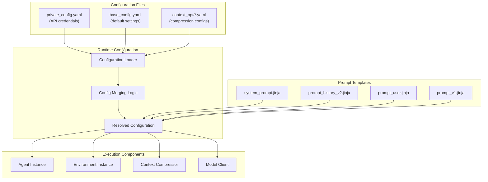
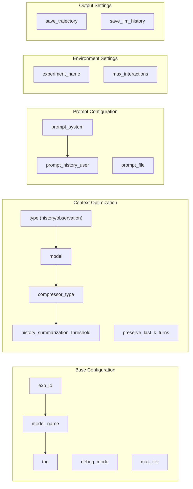
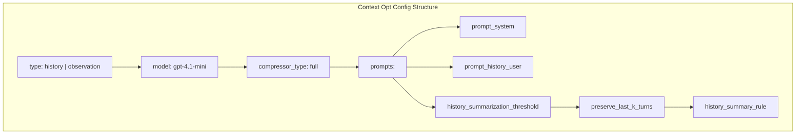
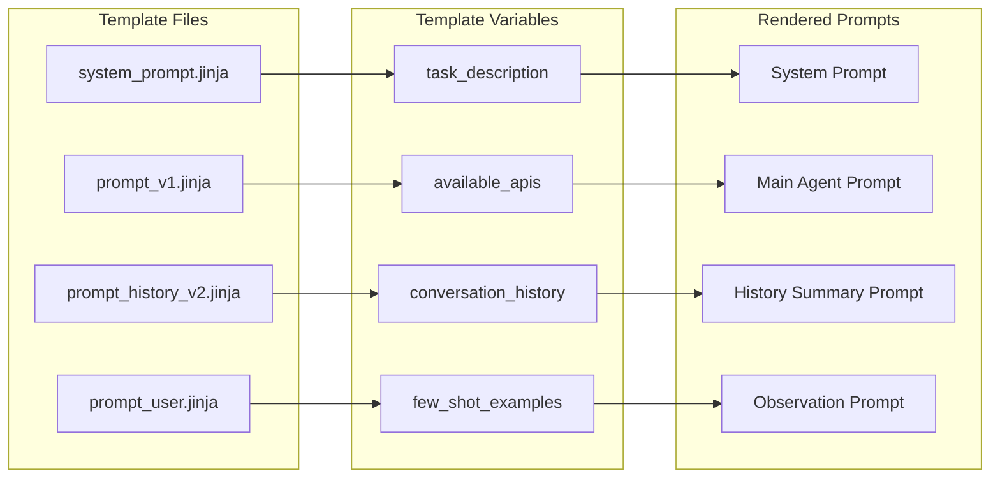
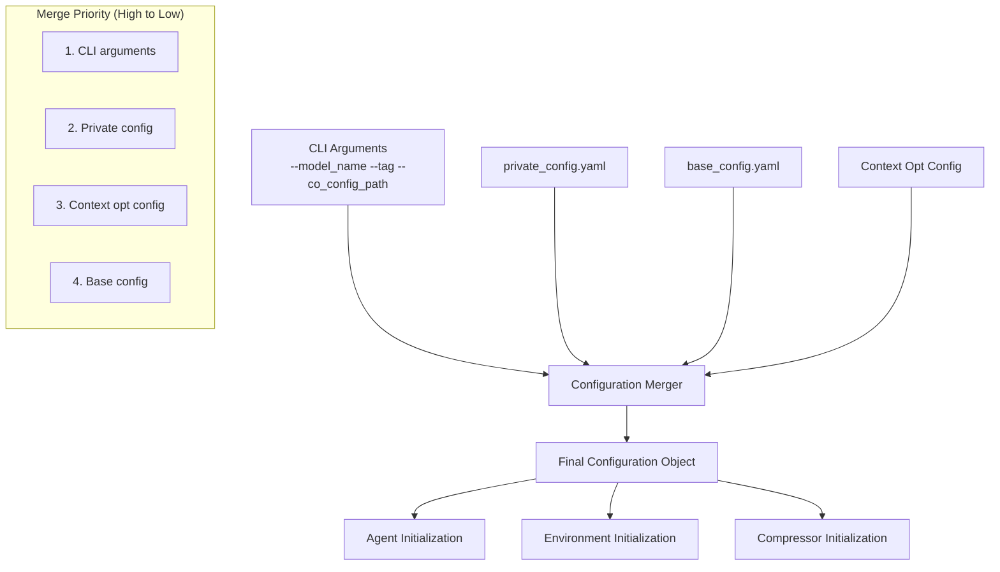

<!-- source: DeepWiki mcp.deepwiki.com · repo microsoft/acon · page 6 Configuration · fetched 2026-10-26 -->

# Configuration

<details>
<summary>Relevant source files</summary>

The following files were used as context for generating this wiki page:

- [experiments/appworld/configs/base_config.yaml](experiments/appworld/configs/base_config.yaml)
- [experiments/appworld/configs/context_opt/gpt-4.1-mini_history.yaml](experiments/appworld/configs/context_opt/gpt-4.1-mini_history.yaml)

</details>


This page provides an overview of the ACON configuration system, which controls all aspects of experiment execution including agent behavior, model selection, context optimization strategies, and output generation. Configuration in ACON is organized hierarchically through YAML files and Jinja templates, allowing flexible customization while maintaining sensible defaults.

For detailed information about specific configuration types, see:
- Base configuration options: [Base Configuration](#6.1)
- Context optimization settings: [Context Optimization Configuration](#6.2)
- Prompt template system: [Prompt Templates](#6.3)
- API credentials setup: [API Configuration](#2.2)

## Configuration System Architecture

The ACON configuration system uses a multi-layer approach that separates concerns and enables composition of different configuration aspects:



**Configuration Flow from Files to Runtime Components**

Sources: [experiments/appworld/configs/base_config.yaml](), [experiments/appworld/configs/context_opt/gpt-4.1-mini_history.yaml]()

## Configuration File Hierarchy

ACON uses a hierarchical configuration structure where more specific configurations override general ones:

| Configuration Type | File Path | Purpose | Override Priority |
|-------------------|-----------|---------|-------------------|
| Private Config | `private_config.yaml` | API keys and secrets | Highest |
| Base Config | `configs/base_config.yaml` | Default experiment settings | Medium |
| Context Opt Config | `configs/context_opt/*.yaml` | Compression strategies | Medium |
| CLI Arguments | Command-line flags | Runtime overrides | Highest |

The configuration hierarchy follows this resolution order:
1. CLI arguments override all file-based configuration
2. Private config provides API credentials
3. Context optimization config (if specified) merges with base config
4. Base config provides defaults for unspecified values

Sources: [experiments/appworld/configs/base_config.yaml](), [experiments/appworld/configs/context_opt/gpt-4.1-mini_history.yaml]()

## Configuration Categories



**Configuration Schema Organization**

Sources: [experiments/appworld/configs/base_config.yaml:1-25](), [experiments/appworld/configs/context_opt/gpt-4.1-mini_history.yaml:1-9]()

## Base Configuration Structure

The `base_config.yaml` file defines the foundation for all experiments. Key configuration sections include:

### Experiment Identification
- `exp_id`: Unique identifier for the experiment
- `model_name`: Primary LLM model (e.g., `"gpt-4o"`, `"gpt-4.1-mini"`)
- `tag`: Human-readable experiment tag

### Agent Behavior
- `debug_mode`: Enable verbose logging (`true`/`false`)
- `max_iter`: Maximum agent iterations per task
- `use_workflow_memory`: Enable workflow memory tracking
- `use_thinking_tokens`: Enable chain-of-thought reasoning tokens

### Environment Configuration
- `experiment_name`: Name for the environment instance
- `max_interactions`: Maximum environment interactions allowed

### Context Optimization
- `co_config`: Path to context optimization config file (or `null` to disable)

### Output Control
- `save_trajectory`: Save complete execution trajectories
- `save_llm_history`: Save all LLM interaction logs

Sources: [experiments/appworld/configs/base_config.yaml:1-25]()

## Context Optimization Configuration

Context optimization configs are separate YAML files located in `configs/context_opt/` that define compression strategies. These configurations are referenced from the base config via the `co_config` parameter:



**Context Optimization Configuration Schema**

### Configuration Fields

| Field | Type | Description |
|-------|------|-------------|
| `type` | string | Compression type: `"history"` or `"observation"` |
| `model` | string | Model for compression (e.g., `"gpt-4.1-mini"`) |
| `compressor_type` | string | Compressor variant: `"full"`, `"summary"`, etc. |
| `prompts.prompt_system` | string | System prompt template name |
| `prompts.prompt_history_user` | string | History compression prompt template name |
| `history_summarization_threshold` | int | Token count triggering summarization |
| `preserve_last_k_turns` | int | Number of recent turns to preserve verbatim |
| `history_summary_rule` | string | Summarization strategy: `"reset"`, `"cumulative"` |

Sources: [experiments/appworld/configs/context_opt/gpt-4.1-mini_history.yaml:1-9]()

## Prompt Template System

ACON uses Jinja templates (`.jinja` files) for all prompts, enabling:
- Template variable substitution
- Conditional logic
- Prompt composition and reuse



**Template Rendering Flow**

Prompt templates are referenced by name in configuration files without the `.jinja` extension. The system automatically locates and renders them at runtime.

Sources: [experiments/appworld/configs/base_config.yaml:13](), [experiments/appworld/configs/context_opt/gpt-4.1-mini_history.yaml:4-6]()

## Configuration Loading and Merging

The configuration system implements a merge strategy that combines multiple configuration sources:



**Configuration Merging Process**

### Merge Rules
1. CLI arguments have highest priority and override all file-based settings
2. Private config values override corresponding base config values
3. Context optimization config merges into base config, overriding base values
4. Base config provides default values for any unspecified settings
5. Nested dictionaries are merged recursively (e.g., `prompts` section)

Sources: [experiments/appworld/configs/base_config.yaml](), [experiments/appworld/configs/context_opt/gpt-4.1-mini_history.yaml]()

## Configuration Usage in Execution

Different components consume different parts of the configuration:

| Component | Configuration Sections Used |
|-----------|----------------------------|
| Agent | `model_name`, `max_iter`, `debug_mode`, `use_thinking_tokens`, `use_workflow_memory` |
| Environment | `experiment_name`, `max_interactions` |
| Context Compressor | All fields from `co_config` file, including `type`, `model`, `compressor_type`, `prompts` |
| Model Client | `model_name`, API credentials from private config |
| Output System | `save_trajectory`, `save_llm_history`, `exp_id`, `tag` |

The configuration is passed to components during initialization, ensuring consistent behavior across the experiment execution pipeline.

Sources: [experiments/appworld/configs/base_config.yaml:1-25](), [experiments/appworld/configs/context_opt/gpt-4.1-mini_history.yaml:1-9]()

## Configuration File Locations

ACON expects configuration files in standardized locations:

```
experiments/
└── appworld/
    ├── configs/
    │   ├── base_config.yaml           # Base configuration
    │   ├── private_config.yaml        # API keys (not in git)
    │   └── context_opt/               # Context optimization configs
    │       ├── gpt-4.1-mini_history.yaml
    │       └── gpt-4.1-mini_obs.yaml
    └── prompts/                       # Jinja templates
        ├── system_prompt.jinja
        ├── prompt_v1.jinja
        ├── prompt_history_v2.jinja
        └── prompt_user.jinja
```

**Note**: `private_config.yaml` is excluded from version control (via `.gitignore`) to protect API credentials.

Sources: [experiments/appworld/configs/base_config.yaml](), [experiments/appworld/configs/context_opt/gpt-4.1-mini_history.yaml]()

## Specifying Configuration at Runtime

Configuration can be customized via command-line arguments:

```bash
# Use custom context optimization config
python run_all.py --co_config_path configs/context_opt/gpt-4.1-mini_history.yaml

# Override model and tag
python run_all.py --model_name gpt-4o --tag optimized_v2

# Combine multiple overrides
python run_all.py --model_name gpt-4.1-mini --tag test --co_config_path configs/context_opt/custom.yaml
```

See [Command-Line Reference](#5.3) for complete CLI documentation.

Sources: [experiments/appworld/configs/base_config.yaml]()

## Next Steps

For detailed information about specific configuration types:
- [Base Configuration](#6.1) - Complete reference for all `base_config.yaml` options
- [Context Optimization Configuration](#6.2) - In-depth guide to compression configuration
- [Prompt Templates](#6.3) - Working with Jinja templates and prompt customization

---

