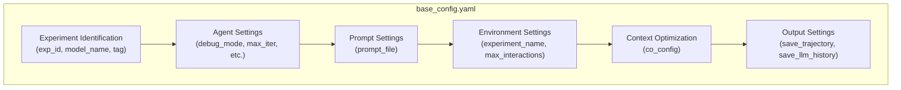
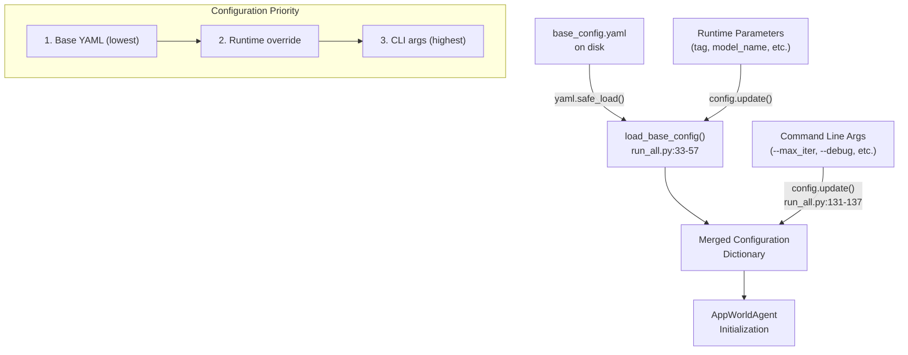
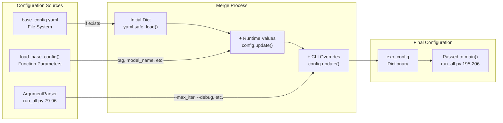
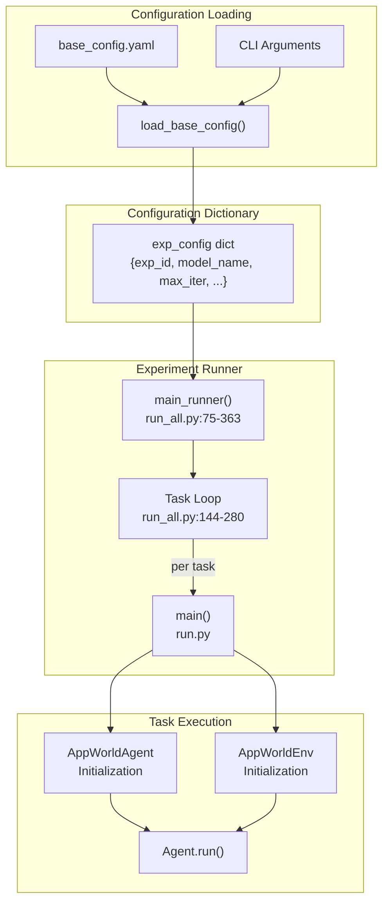

<!-- source: DeepWiki mcp.deepwiki.com · repo microsoft/acon · page 6.1 Base Configuration · fetched 2026-10-26 -->

# Base Configuration

<details>
<summary>Relevant source files</summary>

The following files were used as context for generating this wiki page:

- [experiments/appworld/configs/base_config.yaml](experiments/appworld/configs/base_config.yaml)
- [experiments/appworld/run_all.py](experiments/appworld/run_all.py)

</details>


## Purpose and Scope

This document explains the structure, loading, and customization of `base_config.yaml`, the foundational configuration file for ACON experiments. The base configuration defines default settings for agent behavior, environment parameters, and output options that apply across all experiments.

For context optimization settings (history and observation compression), see [Context Optimization Configuration](#6.2). For prompt template configuration, see [Prompt Templates](#6.3).

## Configuration File Structure

The base configuration file is located at [experiments/appworld/configs/base_config.yaml:1-25](). It uses YAML format and contains six main sections:



**Sources:** [experiments/appworld/configs/base_config.yaml:1-25]()

## Configuration Loading Process

The base configuration is loaded and merged with runtime parameters through the `load_base_config` function. The following diagram shows the complete loading pipeline:



**Sources:** [experiments/appworld/run_all.py:33-57](), [experiments/appworld/run_all.py:122-137]()

### Loading Implementation

The configuration loading follows this sequence:

1. **File Loading** [experiments/appworld/run_all.py:35-42]()
   - Attempts to load `configs/base_config.yaml`
   - Falls back to empty dict if file doesn't exist

2. **Runtime Override** [experiments/appworld/run_all.py:44-56]()
   - Updates config with runtime values (tag, model_name, etc.)
   - Sets derived values like `exp_id` and `experiment_name`

3. **CLI Override** [experiments/appworld/run_all.py:131-137]()
   - Applies command-line arguments
   - Has highest precedence in the merge hierarchy

**Sources:** [experiments/appworld/run_all.py:33-57](), [experiments/appworld/run_all.py:122-137]()

## Configuration Sections

### Experiment Identification

These fields uniquely identify an experiment and determine output directory structure.

| Field | Type | Default | Description |
|-------|------|---------|-------------|
| `exp_id` | string | `"appworld_base"` | Unique experiment identifier |
| `model_name` | string | `"gpt-4o"` | LLM model name (e.g., `"gpt-4o"`, `"gpt-4.1-mini"`, `"Qwen/Qwen3-14B"`) |
| `tag` | string | `"base"` | Experiment tag used in output directory naming |

The combination of `model_name` and `tag` determines the output directory path:
```
./outputs/{model_name}_{tag}/{split}/task_{task_id}/
```

**Sources:** [experiments/appworld/configs/base_config.yaml:2-4](), [experiments/appworld/run_all.py:154-159]()

### Agent Settings

Controls agent execution behavior and capabilities.

| Field | Type | Default | Description |
|-------|------|---------|-------------|
| `debug_mode` | boolean | `true` | Enable verbose logging and single-task execution |
| `max_iter` | integer | `50` | Maximum agent iterations per task |
| `use_workflow_memory` | boolean | `false` | Enable workflow memory feature |
| `use_thinking_tokens` | boolean | `true` | Enable thinking tokens in agent reasoning |

**Debug Mode Behavior:**
- When `true`: Executes only first task with verbose output [experiments/appworld/run_all.py:187-225]()
- When `false`: Executes all tasks with progress bar [experiments/appworld/run_all.py:226-280]()

**Maximum Iterations:**
- Controls agent action limit before forced termination
- Can be overridden via `--max_iter` CLI argument [experiments/appworld/run_all.py:91]()

**Sources:** [experiments/appworld/configs/base_config.yaml:7-10](), [experiments/appworld/run_all.py:49](), [experiments/appworld/run_all.py:91]()

### Prompt Settings

Specifies the prompt template file to use for agent instructions.

| Field | Type | Default | Description |
|-------|------|---------|-------------|
| `prompt_file` | string or null | `null` | Path to JSON prompt template file |

When `null`, the default prompt file is used. When set via `load_base_config`, defaults to `"./prompts/prompts_v1.json"` [experiments/appworld/run_all.py:52]().

For detailed information on prompt templates, see [Prompt Templates](#6.3).

**Sources:** [experiments/appworld/configs/base_config.yaml:13](), [experiments/appworld/run_all.py:52]()

### Environment Settings

Configures the AppWorld environment wrapper.

| Field | Type | Default | Description |
|-------|------|---------|-------------|
| `experiment_name` | string | `"minimal_test"` | Name used for environment initialization |
| `max_interactions` | integer | `50` | Maximum environment interactions per task |

The `experiment_name` is typically derived from `model_name` and `tag` at runtime [experiments/appworld/run_all.py:54]():
```python
'experiment_name': f"experiment_{tag}"
```

**Sources:** [experiments/appworld/configs/base_config.yaml:16-17]()

### Context Optimization Settings

Links to external context optimization configuration.

| Field | Type | Default | Description |
|-------|------|---------|-------------|
| `co_config` | dict or null | `null` | Context optimization configuration dictionary |

When `null`, no context optimization is applied. When specified via `--co_config_path`, the YAML file is loaded and merged into this field [experiments/appworld/run_all.py:104-108]().

For detailed information on context optimization configuration, see [Context Optimization Configuration](#6.2).

**Sources:** [experiments/appworld/configs/base_config.yaml:20](), [experiments/appworld/run_all.py:104-127]()

### Output Settings

Controls what experiment artifacts are saved.

| Field | Type | Default | Description |
|-------|------|---------|-------------|
| `save_trajectory` | boolean | `true` | Save complete agent trajectory |
| `save_llm_history` | boolean | `true` | Save LLM interaction history |

These settings affect which JSON files are written to task output directories:
- `save_trajectory=true` → `env_history.json`
- `save_llm_history=true` → `llm_history.json`, `history_optimizer_history.json`

For output directory structure details, see [Output and Results](#5.4).

**Sources:** [experiments/appworld/configs/base_config.yaml:23-24]()

## Runtime Override Mechanism

The following diagram illustrates how different configuration sources are merged at runtime:



**Sources:** [experiments/appworld/run_all.py:33-137](), [experiments/appworld/run_all.py:195-206]()

### Priority Hierarchy

Configuration values are applied in order of increasing precedence:

1. **Base YAML defaults** [experiments/appworld/configs/base_config.yaml:1-25]()
2. **Runtime function parameters** [experiments/appworld/run_all.py:44-56]()
3. **Command-line arguments** [experiments/appworld/run_all.py:131-137]()

Example: If `max_iter` is set in all three sources, the CLI argument value wins.

**Sources:** [experiments/appworld/run_all.py:33-137]()

## Common Configuration Patterns

### Basic Baseline Experiment

Default configuration for running baseline experiments without optimization:

```yaml
exp_id: "appworld_base"
model_name: "gpt-4o"
tag: "base"
debug_mode: true
max_iter: 50
use_workflow_memory: false
use_thinking_tokens: true
prompt_file: null
experiment_name: "minimal_test"
max_interactions: 50
co_config: null
save_trajectory: true
save_llm_history: true
```

**Sources:** [experiments/appworld/configs/base_config.yaml:1-25]()

### Production Run with Context Optimization

Example runtime override for production with context optimization:

```python
exp_config = load_base_config(
    tag="history_optimized",
    model_name="gpt-4.1-mini",
    use_workflow_memory=False,
    co_config=co_config_dict
)
```

This produces:
- Output directory: `./outputs/gpt-4.1-mini_history_optimized/{split}/`
- Context optimization: Applied per `co_config_dict`
- Debug mode: Disabled (set via CLI)

**Sources:** [experiments/appworld/run_all.py:122-127]()

### Local Model Configuration

For local models with LoRA adapters:

```yaml
model_name: "Qwen/Qwen3-14B"
tag: "local_agent"
max_iter: 50
co_config:
  model_type: "local"
  model: "Qwen/Qwen3-14B"
  lora_name: "path/to/agent_lora"
```

The local model client is instantiated when `co_config["model_type"] == "local"` [experiments/appworld/run_all.py:112-119]().

**Sources:** [experiments/appworld/run_all.py:112-119]()

## Configuration File Management

### File Location

The base configuration file must be located at:
```
experiments/appworld/configs/base_config.yaml
```

This path is hardcoded in `load_base_config` [experiments/appworld/run_all.py:35]().

### Fallback Behavior

If `base_config.yaml` doesn't exist, the system uses an empty dictionary as fallback [experiments/appworld/run_all.py:39-42](), and all configuration comes from:
- Function parameters
- Command-line arguments

This allows running experiments without a base configuration file, though it's not recommended for production use.

**Sources:** [experiments/appworld/run_all.py:35-42]()

## Integration with Experiment Execution

The merged configuration flows into the experiment execution pipeline:



**Sources:** [experiments/appworld/run_all.py:75-363](), [experiments/appworld/run_all.py:195-206]()

### Configuration Propagation

The `exp_config` dictionary is passed to the `main()` function [experiments/appworld/run_all.py:199]() where it configures:

1. **Agent initialization**: `debug_mode`, `max_iter`, `use_workflow_memory`, `use_thinking_tokens`
2. **Environment setup**: `experiment_name`, `max_interactions`
3. **Output behavior**: `save_trajectory`, `save_llm_history`
4. **Context optimization**: `co_config` (if provided)

**Sources:** [experiments/appworld/run_all.py:195-206]()

## Summary Table of All Fields

| Section | Field | Type | Default | Override Source |
|---------|-------|------|---------|-----------------|
| **Identification** | `exp_id` | string | `"appworld_base"` | Runtime function |
| | `model_name` | string | `"gpt-4o"` | CLI `--model_name` |
| | `tag` | string | `"base"` | CLI `--tag` |
| **Agent** | `debug_mode` | boolean | `true` | CLI `--debug` |
| | `max_iter` | integer | `50` | CLI `--max_iter` |
| | `use_workflow_memory` | boolean | `false` | CLI `--use_workflow_memory` |
| | `use_thinking_tokens` | boolean | `true` | Runtime function |
| **Prompt** | `prompt_file` | string/null | `null` | Runtime function |
| **Environment** | `experiment_name` | string | `"minimal_test"` | Runtime function |
| | `max_interactions` | integer | `50` | YAML only |
| **Context Opt** | `co_config` | dict/null | `null` | CLI `--co_config_path` |
| **Output** | `save_trajectory` | boolean | `true` | YAML only |
| | `save_llm_history` | boolean | `true` | YAML only |

**Sources:** [experiments/appworld/configs/base_config.yaml:1-25](), [experiments/appworld/run_all.py:79-96](), [experiments/appworld/run_all.py:33-137]()

---

