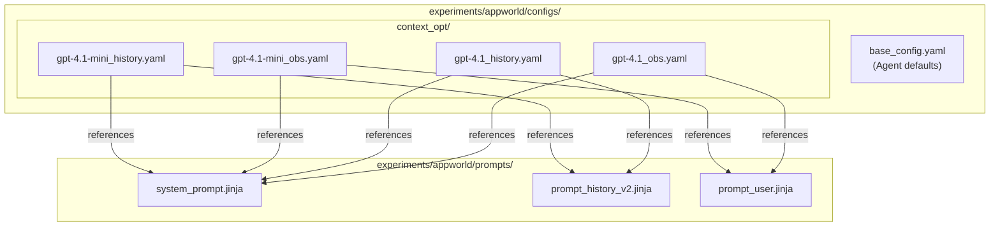
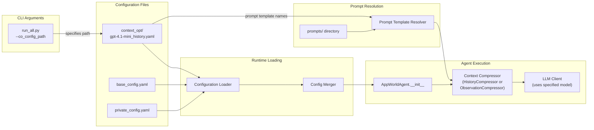
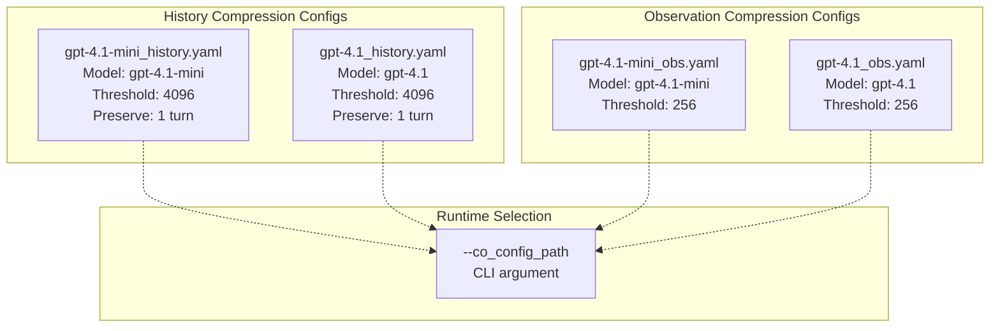

<!-- source: DeepWiki mcp.deepwiki.com · repo microsoft/acon · page 6.2 Context Optimization Configuration · fetched 2026-10-26 -->

# Context Optimization Configuration

<details>
<summary>Relevant source files</summary>

The following files were used as context for generating this wiki page:

- [experiments/appworld/configs/context_opt/gpt-4.1-mini_history.yaml](experiments/appworld/configs/context_opt/gpt-4.1-mini_history.yaml)
- [experiments/appworld/configs/context_opt/gpt-4.1-mini_obs.yaml](experiments/appworld/configs/context_opt/gpt-4.1-mini_obs.yaml)
- [experiments/appworld/configs/context_opt/gpt-4.1_history.yaml](experiments/appworld/configs/context_opt/gpt-4.1_history.yaml)
- [experiments/appworld/configs/context_opt/gpt-4.1_obs.yaml](experiments/appworld/configs/context_opt/gpt-4.1_obs.yaml)

</details>


## Purpose and Scope

This document describes the context optimization configuration system in ACON. Context optimization configurations define how the framework compresses long contexts—either agent interaction history or environment observations—to reduce token usage while preserving task-relevant information.

This page covers the structure, location, and common parameters of context optimization configuration files. For detailed guides on specific compression types, see [History Compression](#6.2.1) and [Observation Compression](#6.2.2). For general agent configuration, see [Base Configuration](#6.1). For the prompt templates referenced by these configurations, see [Context Optimization Prompts](#6.3.3).

## Configuration File Structure

Context optimization configurations are YAML files located in the `experiments/appworld/configs/context_opt/` directory. Each configuration file defines a specific compression strategy for either history or observation compression.

### Directory Organization



**Configuration File Organization**

Sources: [experiments/appworld/configs/context_opt/gpt-4.1-mini_history.yaml:1-9](), [experiments/appworld/configs/context_opt/gpt-4.1-mini_obs.yaml:1-7]()

### Naming Convention

Configuration files follow the pattern `{model}_{type}.yaml`:
- `{model}`: The LLM model used for compression (e.g., `gpt-4.1-mini`, `gpt-4.1`)
- `{type}`: The compression type, either `history` or `obs`

Examples:
- `gpt-4.1-mini_history.yaml`: History compression using GPT-4.1-mini
- `gpt-4.1_obs.yaml`: Observation compression using GPT-4.1

Sources: [experiments/appworld/configs/context_opt/gpt-4.1-mini_history.yaml:1-9](), [experiments/appworld/configs/context_opt/gpt-4.1-mini_obs.yaml:1-7]()

## Configuration Types

ACON supports two types of context optimization, each with distinct purposes and parameters.

### Comparison Table

| Attribute | History Compression | Observation Compression |
|-----------|---------------------|-------------------------|
| **Type identifier** | `type: "history"` | `type: "obs"` |
| **Purpose** | Compress accumulated agent interaction history | Compress individual environment observations |
| **Trigger** | When accumulated history exceeds threshold | When single observation exceeds threshold |
| **Key threshold parameter** | `history_summarization_threshold` | `obs_summarization_threshold` |
| **Prompt template** | `prompt_history_user` (e.g., `prompt_history_v2`) | `prompt_user` |
| **Typical threshold value** | 4096 tokens | 256 tokens |
| **Additional parameters** | `preserve_last_k_turns`, `history_summary_rule` | None |

Sources: [experiments/appworld/configs/context_opt/gpt-4.1-mini_history.yaml:1-9](), [experiments/appworld/configs/context_opt/gpt-4.1-mini_obs.yaml:1-7]()

## Common Configuration Parameters

All context optimization configurations share a common structure with these core parameters:

### Example History Configuration

```yaml
type: "history"
model: "gpt-4.1-mini"
compressor_type: "full"
prompts:
  prompt_system: "system_prompt"
  prompt_history_user: "prompt_history_v2"
history_summarization_threshold: 4096
preserve_last_k_turns: 1
history_summary_rule: "reset"
```

Sources: [experiments/appworld/configs/context_opt/gpt-4.1-mini_history.yaml:1-9]()

### Example Observation Configuration

```yaml
type: "obs"
model: "gpt-4.1-mini"
compressor_type: "full"
prompts:
  prompt_system: "system_prompt"
  prompt_user: "prompt_user"
obs_summarization_threshold: 256
```

Sources: [experiments/appworld/configs/context_opt/gpt-4.1-mini_obs.yaml:1-7]()

### Parameter Descriptions

| Parameter | Required | Description |
|-----------|----------|-------------|
| `type` | Yes | Compression type: `"history"` or `"obs"` |
| `model` | Yes | LLM model name for compression (e.g., `"gpt-4.1-mini"`) |
| `compressor_type` | Yes | Compressor implementation type (typically `"full"`) |
| `prompts` | Yes | Dictionary mapping prompt roles to template names |
| `prompts.prompt_system` | Yes | System prompt template name (e.g., `"system_prompt"`) |
| `*_summarization_threshold` | Yes | Token count threshold to trigger compression |

Sources: [experiments/appworld/configs/context_opt/gpt-4.1-mini_history.yaml:1-9](), [experiments/appworld/configs/context_opt/gpt-4.1-mini_obs.yaml:1-7]()

## Configuration Loading and Usage

Context optimization configurations are loaded at runtime and merged with base configuration to control agent behavior.



**Configuration Flow from Files to Runtime Components**

Sources: [experiments/appworld/configs/context_opt/gpt-4.1-mini_history.yaml:1-9]()

### Command-Line Usage

Context optimization configurations are specified using the `--co_config_path` argument:

```bash
# Using history compression configuration
python experiments/appworld/run_all.py \
  --split dev \
  --model_name gpt-4.1-mini \
  --co_config_path experiments/appworld/configs/context_opt/gpt-4.1-mini_history.yaml

# Using observation compression configuration  
python experiments/appworld/run_all.py \
  --split dev \
  --model_name gpt-4.1-mini \
  --co_config_path experiments/appworld/configs/context_opt/gpt-4.1-mini_obs.yaml
```

For detailed CLI usage, see [Command-Line Reference](#5.3).

Sources: [experiments/appworld/configs/context_opt/gpt-4.1-mini_history.yaml:1-9](), [experiments/appworld/configs/context_opt/gpt-4.1-mini_obs.yaml:1-7]()

## Model Selection

The `model` parameter in context optimization configurations specifies which LLM performs the compression. This is independent of the main agent model.

### Available Models

Common model values include:

| Model Value | Description | Use Case |
|-------------|-------------|----------|
| `gpt-4.1-mini` | GPT-4.1-mini via OpenAI API | Cost-effective compression |
| `gpt-4.1` | GPT-4.1 via OpenAI API | Higher-quality compression |
| `gpt-4o-mini` | GPT-4o-mini via OpenAI API | Fast, cheap compression |
| Custom endpoint | Local model server | Distilled compressor models |

### Model Independence

The compression model can differ from the main agent model. For example:

```yaml
# History compression with GPT-4.1-mini
model: "gpt-4.1-mini"
```

This configuration can be used with any main agent model specified via `--model_name`, enabling cost optimization by using cheaper models for compression while using more powerful models for agent reasoning.

Sources: [experiments/appworld/configs/context_opt/gpt-4.1-mini_history.yaml:2](), [experiments/appworld/configs/context_opt/gpt-4.1_history.yaml:2]()

## Compressor Type

The `compressor_type` parameter specifies the compressor implementation class.

```yaml
compressor_type: "full"
```

Currently, `"full"` is the standard compressor type, which performs complete context summarization. This parameter exists to support potential future compressor implementations (e.g., selective extraction, structured compression).

Sources: [experiments/appworld/configs/context_opt/gpt-4.1-mini_history.yaml:3](), [experiments/appworld/configs/context_opt/gpt-4.1-mini_obs.yaml:3]()

## Prompt Template References

The `prompts` section maps prompt roles to template file names (without `.jinja` extension). These templates must exist in the `experiments/appworld/prompts/` directory.

### History Compression Prompts

```yaml
prompts:
  prompt_system: "system_prompt"
  prompt_history_user: "prompt_history_v2"
```

- `prompt_system`: System prompt defining compressor behavior → `prompts/system_prompt.jinja`
- `prompt_history_user`: User prompt requesting history summarization → `prompts/prompt_history_v2.jinja`

Sources: [experiments/appworld/configs/context_opt/gpt-4.1-mini_history.yaml:4-6]()

### Observation Compression Prompts

```yaml
prompts:
  prompt_system: "system_prompt"
  prompt_user: "prompt_user"
```

- `prompt_system`: System prompt defining compressor behavior → `prompts/system_prompt.jinja`
- `prompt_user`: User prompt requesting observation refinement → `prompts/prompt_user.jinja`

Sources: [experiments/appworld/configs/context_opt/gpt-4.1-mini_obs.yaml:4-6]()

For details on prompt template structure and customization, see [Context Optimization Prompts](#6.3.3).

## Configuration Variants

The framework includes multiple configuration variants for different models and use cases:



**Configuration Variants and Selection Mechanism**

Sources: [experiments/appworld/configs/context_opt/gpt-4.1-mini_history.yaml:1-9](), [experiments/appworld/configs/context_opt/gpt-4.1-mini_obs.yaml:1-7](), [experiments/appworld/configs/context_opt/gpt-4.1_history.yaml:1-9](), [experiments/appworld/configs/context_opt/gpt-4.1_obs.yaml:1-7]()

### Choosing a Configuration

Selection criteria:

1. **Compression Type**: Choose `history` for multi-turn compression or `obs` for single-observation compression
2. **Model**: Choose `gpt-4.1-mini` for cost efficiency or `gpt-4.1` for higher quality
3. **Thresholds**: Configurations include standard thresholds; create custom configs for different values

## Relationship to Base Configuration

Context optimization configurations supplement the base configuration ([Base Configuration](#6.1)). Key relationships:

| Aspect | Base Config | Context Opt Config |
|--------|-------------|-------------------|
| **Scope** | Agent reasoning, task execution | Context compression only |
| **Model specification** | Main agent model | Compression model |
| **Prompt templates** | Main agent prompts | Compression prompts |
| **Override behavior** | Default values | Adds compression parameters |

The two configurations are merged at runtime, with context optimization parameters augmenting (not replacing) base configuration settings.

Sources: [experiments/appworld/configs/context_opt/gpt-4.1-mini_history.yaml:1-9]()

## Creating Custom Configurations

To create a custom context optimization configuration:

1. **Choose a base configuration** to copy from the `context_opt/` directory
2. **Modify parameters** as needed (thresholds, model, prompts)
3. **Save with descriptive name** following the `{model}_{type}.yaml` convention
4. **Reference in CLI** using `--co_config_path path/to/custom_config.yaml`

Example custom configuration for aggressive history compression:

```yaml
type: "history"
model: "gpt-4.1-mini"
compressor_type: "full"
prompts:
  prompt_system: "system_prompt"
  prompt_history_user: "prompt_history_v2"
history_summarization_threshold: 2048  # Lower threshold for more frequent compression
preserve_last_k_turns: 2                # Preserve more recent context
history_summary_rule: "reset"
```

For parameter-specific guidance, see [History Compression](#6.2.1) and [Observation Compression](#6.2.2).

Sources: [experiments/appworld/configs/context_opt/gpt-4.1-mini_history.yaml:1-9]()

## Next Steps

- [History Compression](#6.2.1) - Detailed guide to history compression parameters
- [Observation Compression](#6.2.2) - Detailed guide to observation compression parameters
- [Context Optimization Prompts](#6.3.3) - Understanding and customizing compression prompts
- [Context Optimization Pipeline](#7.2) - Automated prompt optimization workflow

---

