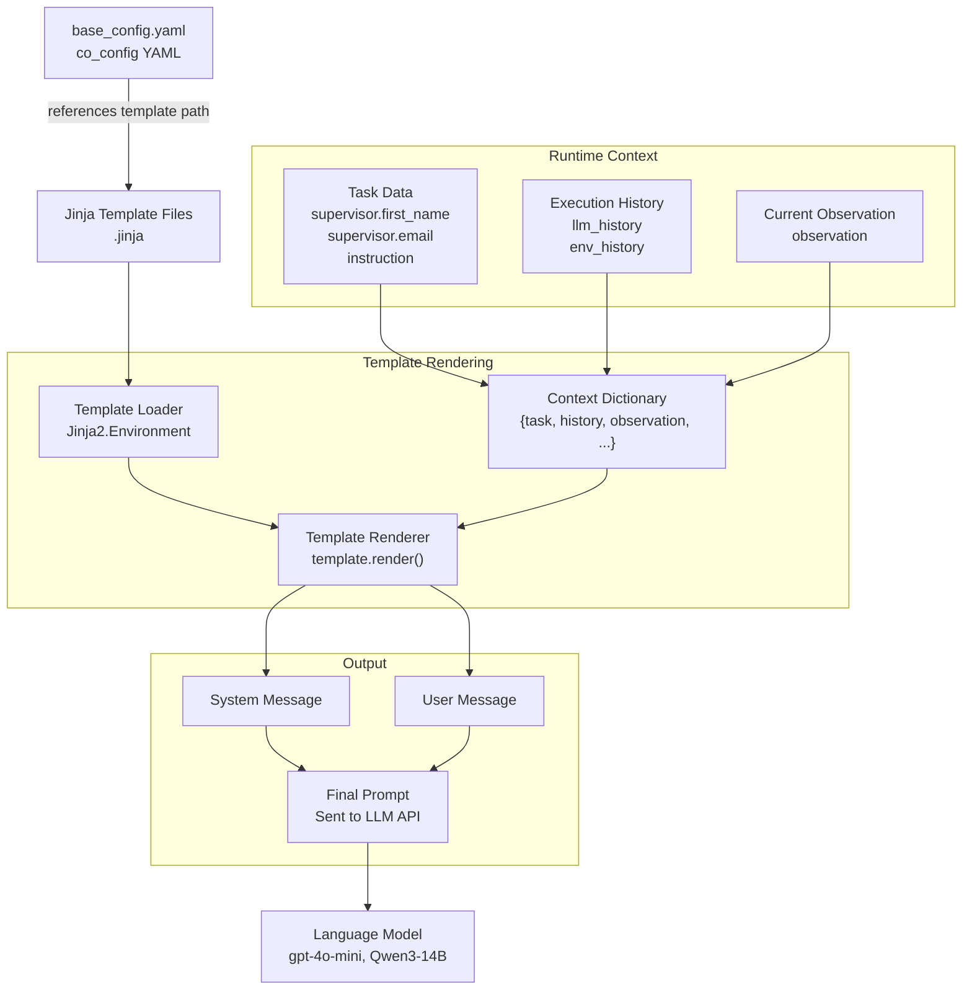
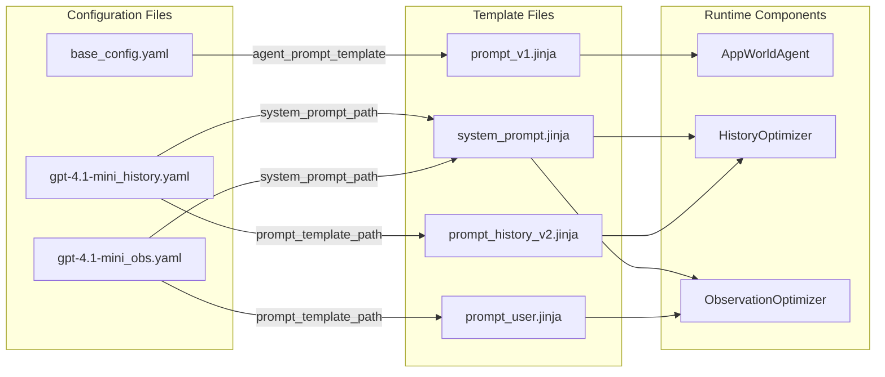
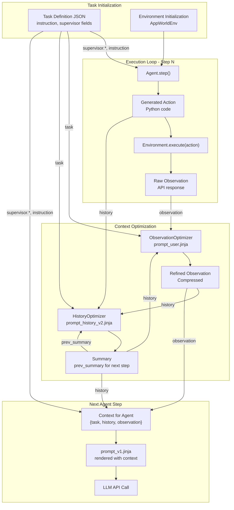
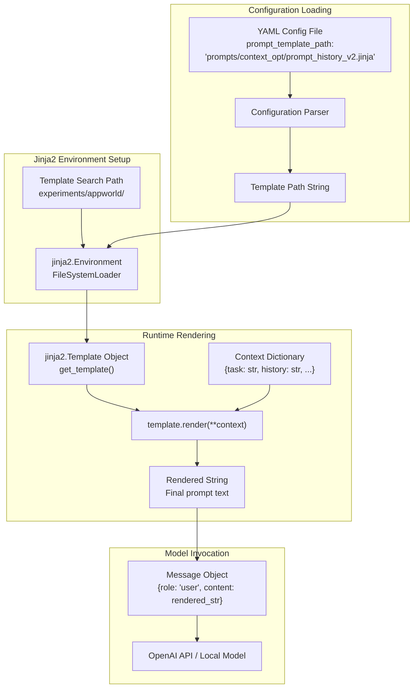
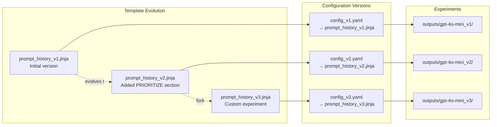

<!-- source: DeepWiki mcp.deepwiki.com · repo microsoft/acon · page 6.3 Prompt Templates · fetched 2026-10-26 -->

# Prompt Templates

<details>
<summary>Relevant source files</summary>

The following files were used as context for generating this wiki page:

- [experiments/appworld/prompts/context_opt/prompt_history_v2.jinja](experiments/appworld/prompts/context_opt/prompt_history_v2.jinja)
- [experiments/appworld/prompts/context_opt/prompt_user.jinja](experiments/appworld/prompts/context_opt/prompt_user.jinja)
- [experiments/appworld/prompts/context_opt/system_prompt.jinja](experiments/appworld/prompts/context_opt/system_prompt.jinja)
- [experiments/appworld/prompts/prompt_v1.jinja](experiments/appworld/prompts/prompt_v1.jinja)

</details>


## Purpose and Scope

This document describes the prompt templating system used throughout ACON to define agent behavior and context optimization strategies. Prompt templates are Jinja2 files (`.jinja`) that define the text prompts sent to language models, with placeholders for dynamic values injected at runtime.

For specific template types, see:
- System-level prompts: [System Prompts](#6.3.1)
- Main agent prompts: [Agent Prompts](#6.3.2)
- Context compression prompts: [Context Optimization Prompts](#6.3.3)

For how templates are referenced in configuration files, see [Context Optimization Configuration](#6.2).

## Template System Overview

ACON uses Jinja2 templates to separate prompt logic from code, enabling:

1. **Reusability**: Same template structure across different experiments
2. **Version Control**: Track prompt changes independently from code
3. **Dynamic Content**: Inject task-specific data, history, observations at runtime
4. **Experimentation**: Rapidly iterate on prompt engineering without code changes

Templates are text files containing both static instructions and dynamic placeholders (`{{ variable_name }}`). At runtime, the framework loads templates, injects values from the experiment context, and sends the rendered text to language models.

**Template Loading Flow Diagram**



Sources: [experiments/appworld/prompts/prompt_v1.jinja](), [experiments/appworld/prompts/context_opt/prompt_history_v2.jinja](), [experiments/appworld/prompts/context_opt/prompt_user.jinja]()

## Directory Structure and Template Types

Templates are organized by benchmark and purpose. For AppWorld, the structure is:

```
experiments/appworld/prompts/
├── prompt_v1.jinja                    # Main agent prompt
└── context_opt/
    ├── system_prompt.jinja            # System message for compression
    ├── prompt_history_v2.jinja        # History compression template
    └── prompt_user.jinja              # Observation compression template
```

### Template Type Taxonomy

| Template Type | File Path | Purpose | Key Variables |
|--------------|-----------|---------|---------------|
| **Agent Main Prompt** | `prompts/prompt_v1.jinja` | Instructs agent on task execution | `supervisor.*`, `instruction` |
| **Compression System** | `prompts/context_opt/system_prompt.jinja` | System role for compressor | (none - static) |
| **History Compression** | `prompts/context_opt/prompt_history_v2.jinja` | Summarize action history | `task`, `prev_summary`, `history` |
| **Observation Compression** | `prompts/context_opt/prompt_user.jinja` | Refine observations | `task`, `history`, `observation` |

**Template Type and Configuration Mapping**



Sources: [experiments/appworld/prompts/](), Diagram 6 from high-level systems overview

## Jinja2 Template Syntax

ACON templates use standard Jinja2 syntax with minimal custom extensions.

### Variable Substitution

Variables are injected using double curly braces:

```jinja
My name is: {{ supervisor.first_name }} {{ supervisor.last_name }}.
My email is {{ supervisor.email }}.

Task:
{{ instruction }}
```

At runtime, the `supervisor` object and `instruction` string are passed in the context dictionary. For example, from [experiments/appworld/prompts/prompt_v1.jinja:21]() and [experiments/appworld/prompts/prompt_v1.jinja:147-151]().

### Multi-line Content

Templates often include large blocks of text. Variables can contain pre-formatted content:

```jinja
## [PREVIOUS SUMMARY] (if any)

{{ prev_summary }}

## [HISTORY OF INTERACTIONS]

{{ history }}
```

Here, `prev_summary` and `history` are multi-line strings generated by the agent execution loop. See [experiments/appworld/prompts/context_opt/prompt_history_v2.jinja:17-23]().

### No Complex Logic

ACON templates avoid conditionals, loops, or filters. All content preparation happens in Python code before rendering. Templates are pure substitution targets for clarity and maintainability.

Sources: [experiments/appworld/prompts/prompt_v1.jinja](), [experiments/appworld/prompts/context_opt/prompt_history_v2.jinja]()

## Variable Injection and Context

Each template type receives a specific context dictionary at render time.

### Main Agent Prompt Context

The main agent prompt (`prompt_v1.jinja`) receives:

| Variable | Type | Source | Example Value |
|----------|------|--------|---------------|
| `supervisor.first_name` | str | Task data | `"John"` |
| `supervisor.last_name` | str | Task data | `"Doe"` |
| `supervisor.email` | str | Task data | `"john.doe@example.com"` |
| `supervisor.phone_number` | str | Task data | `"+1234567890"` |
| `instruction` | str | Task definition | `"What is the password for my Spotify account?"` |

Referenced in [experiments/appworld/prompts/prompt_v1.jinja:21]() and [experiments/appworld/prompts/prompt_v1.jinja:147-151]().

### History Compression Context

The history compression template (`prompt_history_v2.jinja`) receives:

| Variable | Type | Source | Example Value |
|----------|------|--------|---------------|
| `task` | str | Original instruction | `"Find my Spotify password"` |
| `prev_summary` | str | Previous compression output | `"### REASONING\nLooked up supervisor APIs...\n### COMPLETED\n- Retrieved password list"` |
| `history` | str | Formatted action-observation pairs | `"Action: apis.supervisor.show_account_passwords()\nObservation: [{\"account_name\": \"spotify\", \"password\": \"xyz123\"}]"` |

Referenced in [experiments/appworld/prompts/context_opt/prompt_history_v2.jinja:11-23]().

### Observation Compression Context

The observation compression template (`prompt_user.jinja`) receives:

| Variable | Type | Source | Example Value |
|----------|------|--------|---------------|
| `task` | str | Original instruction | `"Find my Spotify password"` |
| `history` | str | Compressed action history | Previous compression output |
| `observation` | str | Raw environment response | `"[{\"account_name\": \"spotify\", \"password\": \"xyz123\"}, ...]"` (potentially very long) |

Referenced in [experiments/appworld/prompts/context_opt/prompt_user.jinja:8-16]().

**Variable Flow Through Execution Stages**



Sources: Based on execution flow described in Diagram 3 from high-level systems overview, [experiments/appworld/prompts/prompt_v1.jinja](), [experiments/appworld/prompts/context_opt/prompt_history_v2.jinja](), [experiments/appworld/prompts/context_opt/prompt_user.jinja]()

## Template Structure Patterns

### System Message Templates

System prompt templates define the model's role. They are typically short and static:

```jinja
You are an agent tasked with extracting and refining a concise and optimized 
version of the context based on the user instruction and other provided information.
```

From [experiments/appworld/prompts/context_opt/system_prompt.jinja:1]().

### User Message Templates with Structured Output

Many templates request structured output using markdown headers:

```jinja
### REASONING
Summarize key progress, decisions made, important observed outcomes...

### COMPLETED
List completed subtasks or successful outcomes...
```

From [experiments/appworld/prompts/context_opt/prompt_history_v2.jinja:3-7](). This encourages consistent, parseable responses.

### Templates with Examples

The main agent prompt includes extensive examples:

```jinja
For example, consider the task:

My name is: {{ supervisor.first_name }} {{ supervisor.last_name }}...

Task:
What is the password for my Spotify account?

A:
# Okay. Lets first find which apps are available...
print(apis.api_docs.show_app_descriptions())

USER:
[
  {
    "name": "api_docs",
    "description": "An app to search and explore API documentation."
  },
  ...
]
```

From [experiments/appworld/prompts/prompt_v1.jinja:19-51](). Examples demonstrate the interaction pattern and expected code format.

### Templates with Guidelines

Templates often include explicit prioritization rules:

```jinja
## PRIORITIZE

1. Keep all sections relevant and concise.  
2. Use reusable structured formats when summarizing artifacts.  
3. Ensure agent can resume task with no loss of information.
4. Include key info from errors or failed attempts to prevent repeated mistakes.
5. Preserve all essential artifacts and data needed to complete the task.
```

From [experiments/appworld/prompts/context_opt/prompt_history_v2.jinja:27-34](). These guide the model's optimization strategy.

Sources: [experiments/appworld/prompts/context_opt/system_prompt.jinja](), [experiments/appworld/prompts/context_opt/prompt_history_v2.jinja](), [experiments/appworld/prompts/prompt_v1.jinja]()

## Template Loading and Rendering Process

Templates are loaded from disk and rendered at specific points in the execution pipeline.

**Template Loading Implementation Flow**



### Template Path Resolution

Template paths in configuration files are relative to the benchmark directory:

```yaml
# In gpt-4.1-mini_history.yaml
prompt_template_path: prompts/context_opt/prompt_history_v2.jinja
system_prompt_path: prompts/context_opt/system_prompt.jinja
```

The framework resolves these relative to `experiments/appworld/` directory.

### Context Assembly

Before rendering, the calling code assembles a context dictionary:

```python
# Pseudocode for context assembly
context = {
    'task': task_instruction,
    'prev_summary': previous_summary if exists else "",
    'history': format_action_observation_history(agent_history)
}
rendered_prompt = template.render(**context)
```

The `format_action_observation_history()` function converts structured data into a formatted string suitable for template injection.

Sources: Based on configuration system described in Diagram 6, typical Jinja2 usage patterns

## Template Customization Workflow

To modify agent behavior through templates:

1. **Identify the template**: Determine which template controls the behavior you want to change (agent, history compression, observation compression)

2. **Create a new version**: Copy the template file with a version suffix (e.g., `prompt_history_v3.jinja`)

3. **Edit the template**: Modify instructions, examples, or structure

4. **Update configuration**: Point the configuration YAML to the new template path:
   ```yaml
   prompt_template_path: prompts/context_opt/prompt_history_v3.jinja
   ```

5. **Run experiments**: Execute with the new configuration to evaluate changes

6. **Analyze results**: Use token analysis tools (see [Token and Cost Analysis](#7.1)) to measure impact on compression ratio and task success

**Template Version Management Pattern**



This versioning allows A/B testing of prompt strategies while maintaining reproducibility.

Sources: Based on experimental workflow patterns from Diagram 2

## Template Best Practices

### Keep Variables Minimal

Templates should receive pre-formatted strings rather than complex objects. This keeps templates simple and rendering fast.

**Good**: `{{ history }}` where `history` is a pre-formatted multi-line string

**Avoid**: `...` with complex formatting logic in template

### Use Explicit Section Headers

Structure templates with clear markdown headers to guide model output:

```jinja
## [Information Source]

### USER INSTRUCTION
{{ task }}

## [PREVIOUS SUMMARY] (if any)
{{ prev_summary }}

## [HISTORY OF INTERACTIONS]
{{ history }}
```

From [experiments/appworld/prompts/context_opt/prompt_history_v2.jinja:11-23]().

### Specify Output Format

Explicitly request the desired output format at the end of templates:

```jinja
### [Output Format]

Do **not** include the input or any additional explanation. 
Only return the formatted summary.
```

From [experiments/appworld/prompts/context_opt/prompt_history_v2.jinja:37-39]().

### Include Examples for Complex Tasks

For multi-step reasoning tasks, include complete examples showing the interaction pattern:

The main agent prompt includes a full example dialogue with API calls, responses, and reasoning comments ([experiments/appworld/prompts/prompt_v1.jinja:19-119]()).

### Document Template Variables

Add comments at the top of templates (using Jinja comment syntax `{# ... #}`) to document expected variables and their types. While ACON templates don't currently include these comments, adding them improves maintainability.

Sources: [experiments/appworld/prompts/context_opt/prompt_history_v2.jinja](), [experiments/appworld/prompts/prompt_v1.jinja]()

---

**See Also**:
- [System Prompts](#6.3.1) - Details on system message templates
- [Agent Prompts](#6.3.2) - Main agent prompt structure and customization
- [Context Optimization Prompts](#6.3.3) - History and observation compression templates
- [Context Optimization Configuration](#6.2) - How templates are referenced in config files
- [Prompt Optimization](#7.2) - Automated prompt improvement pipeline

---

