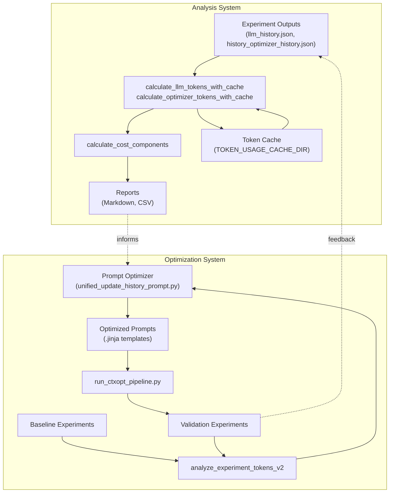
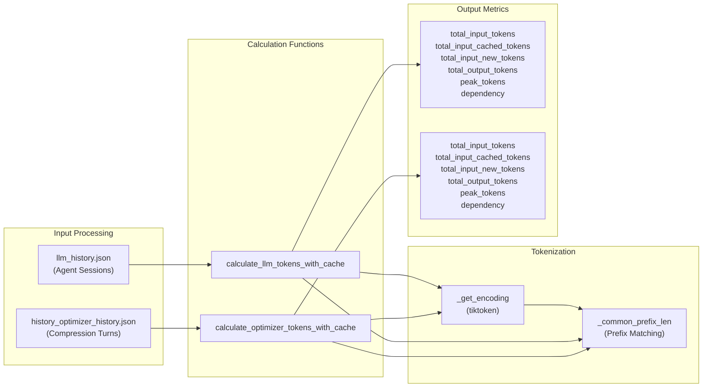
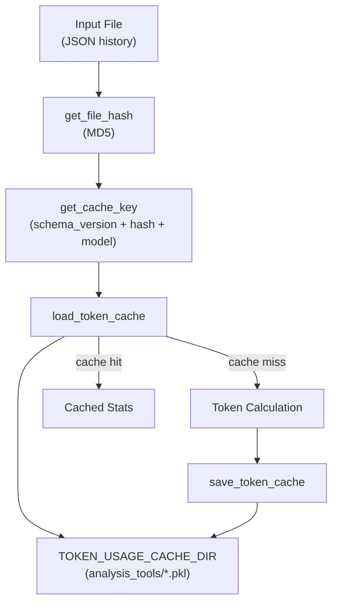
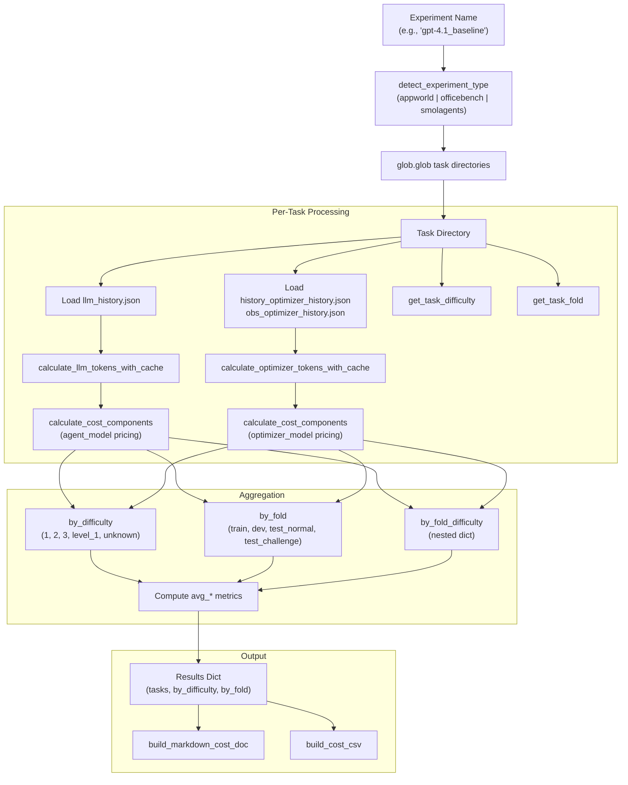
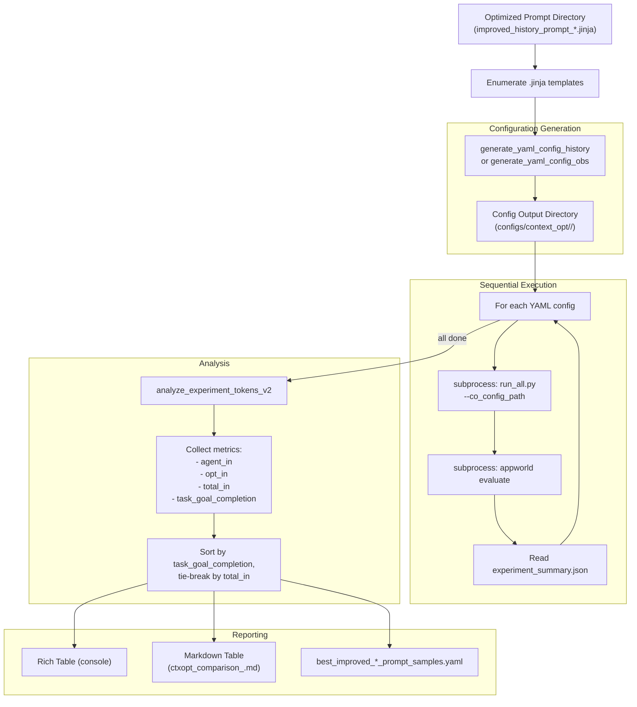

<!-- source: DeepWiki mcp.deepwiki.com · repo microsoft/acon · page 7 Analysis and Optimization · fetched 2026-10-26 -->

# Analysis and Optimization

<details>
<summary>Relevant source files</summary>

The following files were used as context for generating this wiki page:

- [experiments/analysis_tools/utils.py](experiments/analysis_tools/utils.py)
- [experiments/appworld/run_ctxopt_pipeline.py](experiments/appworld/run_ctxopt_pipeline.py)

</details>


This page covers the analysis and optimization systems in ACON. **Analysis** refers to measuring token usage, costs, and performance metrics across experiments. **Optimization** refers to the automated pipeline for improving context compression prompts based on analysis results.

For detailed implementation of token counting and cost reporting, see [Token and Cost Analysis](#7.1). For the automated prompt optimization pipeline, see [Context Optimization Pipeline](#7.2).

## Overview

The ACON framework provides two complementary capabilities:

1. **Token and Cost Analysis**: Comprehensive measurement of token consumption, caching efficiency, and inference costs across all experiments
2. **Context Optimization**: Automated pipeline for iteratively improving compression prompts to reduce token usage while maintaining agent performance

These systems work together in a feedback loop: analysis identifies opportunities for improvement, optimization generates better prompts, and subsequent analysis validates the gains.



**Sources**: [experiments/analysis_tools/utils.py:1-1446](), [experiments/appworld/run_ctxopt_pipeline.py:1-449]()

## Analysis Architecture

The analysis system calculates token usage and costs from experiment outputs using a cache-aware approach that simulates provider billing for prompt caching.

### Token Calculation Engine

The core token calculation functions implement prefix-aware caching to accurately measure token consumption:



**Sources**: [experiments/analysis_tools/utils.py:95-127](), [experiments/analysis_tools/utils.py:131-232](), [experiments/analysis_tools/utils.py:234-438]()

### Key Components

| Component | Function | Location |
|-----------|----------|----------|
| `_get_encoding` | Returns tiktoken encoder with model-specific fallbacks | [utils.py:95-117]() |
| `_common_prefix_len` | Computes token sequence prefix overlap for cache simulation | [utils.py:120-127]() |
| `calculate_llm_tokens_with_cache` | Counts agent tokens with cache-aware input tracking | [utils.py:131-232]() |
| `calculate_optimizer_tokens_with_cache` | Counts optimizer tokens with advanced cache reuse detection | [utils.py:234-438]() |
| `calculate_cost_components` | Converts token counts to dollar costs using `MODEL_PRICING` | [utils.py:55-91]() |

### Cache System

The token calculation cache prevents redundant computation across multiple analyses:



The cache key includes `CACHE_SCHEMA_VERSION` (currently `v2.2`) to invalidate stale caches when calculation logic changes.

**Sources**: [experiments/analysis_tools/utils.py:42-44](), [experiments/analysis_tools/utils.py:464-504]()

### Advanced Optimizer Caching

The optimizer token calculator supports two formats and implements sophisticated cache reuse:

| Format | Structure | Cache Strategy |
|--------|-----------|----------------|
| **Format A (Legacy)** | `[system_prompt, user_text, assistant_response]` | Simple previous-turn prefix caching |
| **Format B (Advanced)** | `[system_prompt, [messages...], optimizer_response]` | Multi-source caching: reuses from previous optimizer turn OR any matching agent step |

Format B automatically loads `llm_history.json` from the same directory to detect cache reuse opportunities when the optimizer receives agent conversation prefixes.

**Sources**: [experiments/analysis_tools/utils.py:234-438]()

## Experiment Analysis Workflow

The `analyze_experiment_tokens_v2` function orchestrates comprehensive token and cost analysis across all tasks in an experiment:



**Sources**: [experiments/analysis_tools/utils.py:638-1136]()

### Aggregation Dimensions

Analysis results are aggregated across three dimensions:

1. **by_difficulty**: Groups tasks by difficulty level (1, 2, 3 for AppWorld; level_1, level_2, level_3 for OfficeBench)
2. **by_fold**: Groups tasks by data split (train, dev, test_normal, test_challenge)
3. **by_fold_difficulty**: Nested grouping by both fold and difficulty

Each aggregation includes separate statistics for `agent` and `optimizer` components:

| Metric | Description |
|--------|-------------|
| `input_tokens` | Total input tokens across all tasks |
| `input_cached_tokens` | Total tokens served from cache |
| `input_new_tokens` | Total tokens not cached (billable at full rate) |
| `output_tokens` | Total output tokens generated |
| `peak_tokens` | Sum of peak input token counts across tasks |
| `dependency` | Sum of dependency metric (context-output interaction) |
| `avg_*` | Per-task averages of all metrics |
| `*_cost_total` | Total costs across all tasks |

**Sources**: [experiments/analysis_tools/utils.py:652-752](), [experiments/analysis_tools/utils.py:1039-1134]()

## Context Optimization Pipeline

The `run_ctxopt_pipeline.py` script automates the process of testing multiple optimized prompts and selecting the best performer:



**Sources**: [experiments/appworld/run_ctxopt_pipeline.py:1-449]()

### Pipeline Inputs and Outputs

**Inputs**:
- `--prompts-dir`: Directory containing optimized `.jinja` prompt templates
- `--model-name`: Model to use for context compression (e.g., `gpt-4.1-mini`)
- `--main-model-name`: Model to use for agent reasoning (e.g., `gpt-4.1`)
- `--split`: Dataset split to evaluate (e.g., `train_history_tiny`)
- `--ctxopt-type`: Either `history` or `obs` for history/observation compression

**Outputs**:
- Generated YAML configs in `configs/context_opt/<derived>/`
- Experiment outputs for each prompt variant
- Comparison table (console and markdown)
- `best_improved_history_prompt_samples.yaml` or `best_improved_observation_prompt_samples.yaml`

**Sources**: [experiments/appworld/run_ctxopt_pipeline.py:88-100]()

### Configuration Generation

The pipeline generates context optimization configs for each prompt template:

```python
# For history optimization
{
    "type": "history",
    "model": "gpt-4.1-mini",
    "compressor_type": "full",
    "prompts": {
        "prompt_system": "system_prompt",
        "prompt_history_user": "improved_history_prompt_42"
    },
    "history_summarization_threshold": 4096,
    "preserve_last_k_turns": 1,
    "history_summary_rule": "reset",
    "history_prompt_dir": "/path/to/optimized_prompts",
    "history_version": 1
}
```

**Sources**: [experiments/appworld/run_ctxopt_pipeline.py:51-68](), [experiments/appworld/run_ctxopt_pipeline.py:70-84]()

### Evaluation and Ranking

After running experiments with each prompt variant, the pipeline:

1. Collects `experiment_summary.json` for initial success rates
2. Runs `appworld evaluate` to compute `task_goal_completion` metrics
3. Invokes `analyze_experiment_tokens_v2` to count total input tokens
4. Ranks variants by `task_goal_completion` (primary) and `total_in` tokens (tie-breaker)
5. Generates a comparison table showing performance vs. token efficiency

**Sources**: [experiments/appworld/run_ctxopt_pipeline.py:266-298](), [experiments/appworld/run_ctxopt_pipeline.py:302-373]()

### Comparison Output

The pipeline generates a Rich-formatted table (if available) or plain text table showing:

| Column | Description |
|--------|-------------|
| Rank | Ranking by task_goal_completion (descending) |
| Config | YAML filename |
| Tag | Experiment tag identifier |
| Tasks | Number of tasks evaluated |
| Avg Steps | Average agent steps per task |
| Task GC | Task goal completion percentage |
| Agent In | Total agent input tokens |
| Opt In | Total optimizer input tokens |
| Total In | Combined input tokens |

The markdown table is saved to the prompts directory as `ctxopt_comparison_<timestamp>.md` for documentation.

**Sources**: [experiments/appworld/run_ctxopt_pipeline.py:343-373](), [experiments/appworld/run_ctxopt_pipeline.py:376-395]()

## Cost Calculation and Pricing

Token counts are converted to costs using the `MODEL_PRICING` table and `calculate_cost_components`:

```python
MODEL_PRICING = {
    'gpt-4.1': {
        'input': 3 / 1000,           # $3 per 1M tokens = $0.003 per 1K
        'cached_input': 0.75 / 1000, # $0.75 per 1M cached
        'output': 12 / 1000,         # $12 per 1M output
    },
    'gpt-4.1-mini': {
        'input': 0.8 / 1000,
        'cached_input': 0.2 / 1000,
        'output': 3.2 / 1000,
    },
}
```

The cost calculation produces:
- `input_cost_no_cache`: Input tokens billed at full rate
- `input_cost_with_cache`: Cached tokens at discount rate + new tokens at full rate
- `output_cost`: Output tokens (no caching)
- `total_cost_no_cache`: Total without cache discount
- `total_cost_with_cache`: Total with cache discount applied

**Sources**: [experiments/analysis_tools/utils.py:26-40](), [experiments/analysis_tools/utils.py:55-91]()

## Dependency Metric

The analysis system computes a "dependency" metric that quantifies the interaction between context length and output length:

```
dependency = ((n_input + 2 * n_output) * n_output) / 2
```

Where:
- `n_input`: Input tokens excluding system prompt
- `n_output`: Output tokens

This metric grows quadratically with output length and linearly with input length, capturing the cost of long-context generation. Higher values indicate more context-dependent generation.

**Sources**: [experiments/analysis_tools/utils.py:200-203](), [experiments/analysis_tools/utils.py:415-416]()

## Report Generation

The analysis system provides two report formats:

### Markdown Reports

`build_markdown_cost_doc` generates human-readable tables with:
- Overall statistics across all difficulties
- Per-fold breakdowns (train, dev, test_normal, test_challenge)
- Per-difficulty statistics within each fold
- Average metrics including steps, peak tokens, dependency, and costs

**Sources**: [experiments/analysis_tools/utils.py:1243-1273]()

### CSV Reports

`build_cost_csv` generates machine-readable CSV files with columns:
- `fold`: Data split identifier
- `difficulty`: Task difficulty level
- Agent metrics: `agent_num_tasks`, `agent_avg_steps`, `agent_avg_peak_tokens`, `agent_avg_dependency`, `agent_avg_total_cost_no_cache`, `agent_avg_total_cost_with_cache`
- Optimizer metrics: `optimizer_num_tasks`, `optimizer_avg_peak_tokens`, `optimizer_avg_dependency`, `optimizer_avg_total_cost_no_cache`, `optimizer_avg_total_cost_with_cache`

**Sources**: [experiments/analysis_tools/utils.py:1276-1413]()

---

