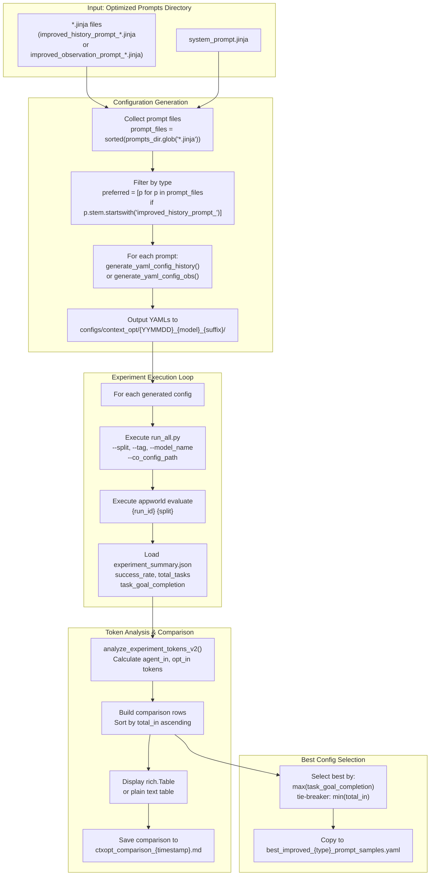
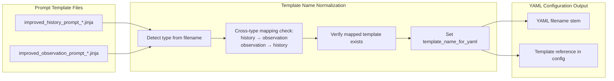
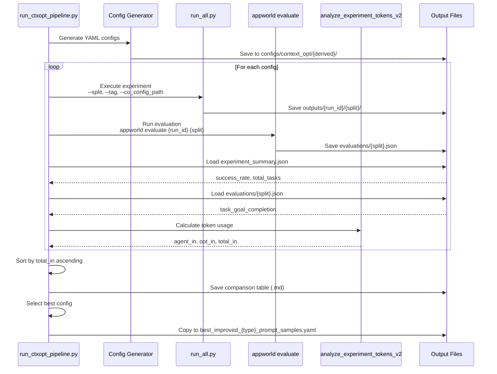
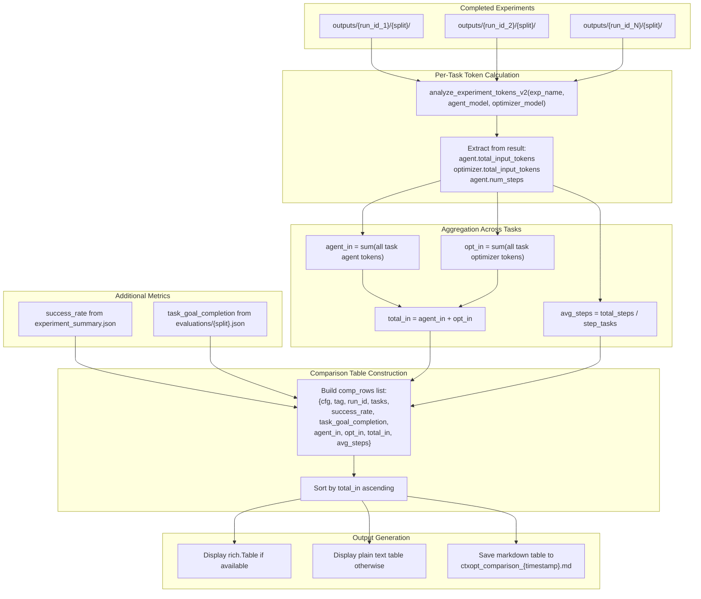

<!-- source: DeepWiki mcp.deepwiki.com · repo microsoft/acon · page 7.2 Context Optimization Pipeline · fetched 2026-10-26 -->

# Context Optimization Pipeline

<details>
<summary>Relevant source files</summary>

The following files were used as context for generating this wiki page:

- [experiments/appworld/README.md](experiments/appworld/README.md)
- [experiments/appworld/run_ctxopt_pipeline.py](experiments/appworld/run_ctxopt_pipeline.py)
- [experiments/appworld/scripts/run_ctxopt_history.sh](experiments/appworld/scripts/run_ctxopt_history.sh)

</details>


## Purpose and Scope

This document describes the automated context optimization pipeline that systematically evaluates and selects compression prompts. The pipeline generates multiple experiment configurations from optimized prompt templates, executes them in batch, and compares results to identify the best-performing compression strategy.

For information about running individual experiments, see [Running Experiments](#5). For details on the prompt optimization process that generates inputs to this pipeline, see [Context Optimization](#3.1). For configuration of compression parameters, see [Context Optimization Configuration](#6.2).

---

## Overview

The context optimization pipeline automates the evaluation phase of prompt engineering. After generating candidate compression prompts (via `unified_update_history_prompt.py`), this pipeline:

1. **Generates** YAML configuration files for each prompt variant
2. **Executes** AppWorld experiments with each configuration
3. **Evaluates** task completion and token usage
4. **Compares** all variants in a ranked table
5. **Selects** the best-performing configuration

The pipeline is implemented in [experiments/appworld/run_ctxopt_pipeline.py]() and supports both history compression and observation compression optimization.

**Sources:** [experiments/appworld/run_ctxopt_pipeline.py:1-18](), [experiments/appworld/README.md:90-134]()

---

## Pipeline Architecture

The following diagram shows the complete pipeline execution flow, from input prompts to best configuration selection:



**Sources:** [experiments/appworld/run_ctxopt_pipeline.py:87-299]()

---

## Configuration Generation

The pipeline generates experiment configurations from prompt templates using type-specific generators:

### YAML Schema for History Optimization

The `generate_yaml_config_history()` function creates configurations with the following structure:

| Field | Value | Description |
|-------|-------|-------------|
| `type` | `"history"` | Optimizer type |
| `model` | `model_name` parameter | Model to use for compression |
| `compressor_type` | `"full"` | Full context compression |
| `prompts.prompt_system` | `"system_prompt"` | System prompt template name |
| `prompts.prompt_history_user` | template stem | History compression prompt template |
| `history_summarization_threshold` | `4096` | Token threshold for triggering compression |
| `preserve_last_k_turns` | `1` | Number of recent turns to preserve uncompressed |
| `history_summary_rule` | `"reset"` | Compression accumulation strategy |
| `history_prompt_dir` | prompts directory path | Directory containing .jinja templates |
| `history_version` | `opt_version` parameter | Version number for tracking |

**Sources:** [experiments/appworld/run_ctxopt_pipeline.py:51-67]()

### YAML Schema for Observation Optimization

The `generate_yaml_config_obs()` function creates configurations for observation compression:

| Field | Value | Description |
|-------|-------|-------------|
| `type` | `"obs"` | Optimizer type |
| `model` | `model_name` parameter | Model to use for compression |
| `compressor_type` | `"full"` | Full observation compression |
| `prompts.prompt_system` | `"system_prompt"` | System prompt template name |
| `prompts.prompt_user` | template stem | Observation compression prompt template |
| `obs_summarization_threshold` | `1024` | Token threshold for observation compression |
| `obs_prompt_dir` | prompts directory path | Directory containing .jinja templates |
| `obs_version` | `opt_version` parameter | Version number for tracking |

**Sources:** [experiments/appworld/run_ctxopt_pipeline.py:70-84]()

### Template Naming and Mapping

The pipeline handles template naming conventions intelligently:



This allows the pipeline to use history prompts for observation optimization and vice versa, if the corresponding template files exist in the prompts directory.

**Sources:** [experiments/appworld/run_ctxopt_pipeline.py:144-168]()

---

## Execution Workflow

The pipeline orchestrates multiple experiment runs and collects their results:



**Sources:** [experiments/appworld/run_ctxopt_pipeline.py:233-298]()

### Per-Config Execution Steps

For each generated configuration, the pipeline:

1. **Constructs tag**: Combines base tag with config-specific suffix extracted from the YAML stem
   - Example: `base_tag="250818_hist_opt"` + `suffix="samples"` → `"250818_hist_opt_samples"`

2. **Executes run_all.py**: Launches with parameters:
   - `--split`: Dataset split to run (e.g., `train_history_tiny`)
   - `--tag`: Per-run tag for output directory naming
   - `--model_name`: Model for agent execution
   - `--co_config_path`: Path to generated YAML config
   - `--debug`: Optional flag to reduce workload

3. **Runs evaluation**: Calls external CLI `appworld evaluate {run_id} {split}`

4. **Collects metrics**:
   - `experiment_summary.json`: success_rate, total_tasks
   - `evaluations/{split}.json`: task_goal_completion

**Sources:** [experiments/appworld/run_ctxopt_pipeline.py:233-274]()

---

## Command-Line Interface

### Main Pipeline Script

The pipeline is invoked via `run_ctxopt_pipeline.py`:

```bash
python experiments/appworld/run_ctxopt_pipeline.py \
  --prompts-dir /path/to/optimized_prompts \
  --model-name gpt-4.1-mini \
  --tag 250818_hist_opt \
  --split train_history_tiny \
  --ctxopt-type history
```

**Complete Parameter Reference**

| Parameter | Default | Description |
|-----------|---------|-------------|
| `--ctxopt-type` | `history` | Context optimization type: `history` or `obs` |
| `--prompts-dir` | *required* | Directory containing optimized .jinja prompt templates |
| `--model-name` | `gpt-4.1-mini` | Model name to record in YAML configs |
| `--main-model-name` | `gpt-4.1-mini` | Model name for run_all execution |
| `--tag` | derived from dir | Experiment tag (defaults to prompts directory name) |
| `--split` | `train_history_tiny` | Dataset split to run experiments on |
| `--config-out-dir` | auto-generated | Custom output directory for generated YAMLs |
| `--dry-run` | `false` | Generate configs only; skip execution |
| `--task-ids` | `null` | Comma-separated task IDs or path to file with task IDs |
| `--debug` | `false` | Pass --debug flag to run_all to reduce workload |
| `--opt-version` | `1` | Version number for tracking optimizer iterations |

**Sources:** [experiments/appworld/run_ctxopt_pipeline.py:87-100]()

### Convenience Shell Script

For history optimization, a shell wrapper is provided:

```bash
# Use default prompts directory
bash experiments/appworld/scripts/run_ctxopt_history.sh

# Specify custom prompts directory
bash experiments/appworld/scripts/run_ctxopt_history.sh /path/to/prompts

# Override defaults via environment variables
MODEL=gpt-4.1 TAG=my_experiment bash experiments/appworld/scripts/run_ctxopt_history.sh
```

**Environment Variables**

| Variable | Default | Description |
|----------|---------|-------------|
| `MODEL` | `gpt-4.1-mini` | Model name to use |
| `TAG` | `2501013_prompteval_hist_opt` | Experiment tag |
| `SPLIT` | `train_history_tiny` | Dataset split |
| `CTXOPT_TYPE` | `history` | Optimization type |

**Sources:** [experiments/appworld/scripts/run_ctxopt_history.sh:1-44]()

---

## Token Analysis and Comparison

After executing all experiments, the pipeline performs comprehensive token analysis:



**Sources:** [experiments/appworld/run_ctxopt_pipeline.py:302-397]()

### Comparison Table Columns

The generated comparison table includes:

| Column | Source | Description |
|--------|--------|-------------|
| Rank | Computed | Ranking by total input tokens (ascending) |
| Config | YAML filename | Configuration file name |
| Tag | Pipeline parameter | Experiment tag |
| Tasks | `experiment_summary.json` | Total number of tasks executed |
| Avg Steps | Token analysis | Average steps per task |
| Task GC | `evaluations/{split}.json` | Task goal completion percentage |
| Agent In | Token analysis | Total agent input tokens across all tasks |
| Opt In | Token analysis | Total optimizer input tokens across all tasks |
| Total In | Computed | `Agent In + Opt In` |

**Sources:** [experiments/appworld/run_ctxopt_pipeline.py:345-373]()

---

## Best Configuration Selection

The pipeline automatically selects the best-performing configuration:

### Selection Criteria

The best configuration is determined by:

1. **Primary criterion**: Highest `task_goal_completion` percentage
2. **Tie-breaker**: Lowest `total_in` (total input tokens)

This prioritizes task performance while favoring efficiency when multiple configs achieve similar results.

**Sources:** [experiments/appworld/run_ctxopt_pipeline.py:399-444]()

### Output Files

The selected configuration is saved to the config output directory:

| File | Description |
|------|-------------|
| `best_improved_history_prompt_samples.yaml` | Best config for history optimization |
| `best_improved_observation_prompt_samples.yaml` | Best config for observation optimization |

These files are copies of the best-performing generated config and can be directly used as `--co_config_path` in subsequent experiments.

### Integration with Subsequent Experiments

After pipeline completion, use the best config for full dataset runs:

```bash
python run_all.py \
    --split train \
    --model_name gpt-4.1 \
    --tag history_optimized_best \
    --co_config_path configs/context_opt/YYMMDD_gpt-4.1-mini_history_optimized_prompt/best_improved_history_prompt_samples.yaml
```

**Sources:** [experiments/appworld/README.md:127-133]()

---

## Pipeline Output Structure

The pipeline generates outputs in two locations:

### 1. Configuration Directory

Generated under `experiments/appworld/configs/context_opt/`:

```
configs/context_opt/
└── YYMMDD_{model}_{type}_optimized_prompt/
    ├── improved_history_prompt_samples.yaml
    ├── improved_history_prompt_samples_variant2.yaml
    ├── improved_history_prompt_samples_variantN.yaml
    └── best_improved_history_prompt_samples.yaml
```

The directory name format is:
- `YYMMDD`: Date when pipeline was run
- `{model}`: Model name (e.g., `gpt-4.1-mini`)
- `{type}`: `history_optimized_prompt` or `obs_optimized_prompt`
- Optional version tag (e.g., `_v2`) if detected in prompts directory

**Sources:** [experiments/appworld/run_ctxopt_pipeline.py:119-141]()

### 2. Comparison Results

Saved in the prompts directory:

```
{prompts_dir}/
├── improved_history_prompt_samples.jinja
├── improved_history_prompt_samples_variant2.jinja
├── system_prompt.jinja
└── ctxopt_comparison_YYYYMMDD_HHMMSS.md
```

The markdown file contains the complete comparison table for reference.

**Sources:** [experiments/appworld/run_ctxopt_pipeline.py:376-395]()

---

## Example Usage

### Complete Workflow

From prompt optimization through best config selection:

```bash
# Step 1: Generate optimized prompts (covered in other sections)
cd experiments/prompt_optimizer
python unified_update_history_prompt.py \
    --baseline-run gpt-4.1_baseline \
    --optimized-run gpt-4.1_history_compression \
    --benchmark appworld \
    --base-prompt-template ../appworld/prompts/context_opt/prompt_history_v2.jinja \
    --output-dir outputs_appworld/history_regression

# Step 2: Run context optimization pipeline
cd ../appworld
bash scripts/run_ctxopt_history.sh \
    ../prompt_optimizer/outputs_appworld/history_regression/optimized_prompts

# Step 3: Use best config for full training run
python run_all.py \
    --split train \
    --model_name gpt-4.1 \
    --tag history_optimized_best \
    --co_config_path configs/context_opt/YYMMDD_gpt-4.1-mini_history_optimized_prompt/best_improved_history_prompt_samples.yaml
```

**Sources:** [experiments/appworld/README.md:90-133]()

### Debug Mode Execution

For testing with reduced workload:

```bash
python run_ctxopt_pipeline.py \
    --prompts-dir /path/to/prompts \
    --model-name gpt-4.1-mini \
    --tag debug_test \
    --split train_history_tiny \
    --debug
```

The `--debug` flag is passed through to `run_all.py`, limiting the number of tasks executed per config.

**Sources:** [experiments/appworld/run_ctxopt_pipeline.py:98-258]()

---

## Error Handling and Robustness

The pipeline includes several robustness features:

### Graceful Degradation

1. **YAML library**: If `yaml` is unavailable, uses minimal custom YAML writer
2. **Rich library**: If `rich` is unavailable, falls back to plain text tables
3. **Evaluation failures**: Logged as warnings; pipeline continues to next config
4. **Token analysis failures**: Logged as warnings; comparison uses available data

**Sources:** [experiments/appworld/run_ctxopt_pipeline.py:28-42](), [experiments/appworld/run_ctxopt_pipeline.py:366-397]()

### Environment Setup

The pipeline ensures proper Python path configuration:

```python
repo_root = Path(__file__).resolve().parents[2]
env = os.environ.copy()
src_path = str(repo_root / "src")
env["PYTHONPATH"] = f"{src_path}:{env.get('PYTHONPATH','')}"
```

This guarantees that `run_all.py` can import from `src/productive_agents/` regardless of the user's environment setup.

**Sources:** [experiments/appworld/run_ctxopt_pipeline.py:217-220]()

---

