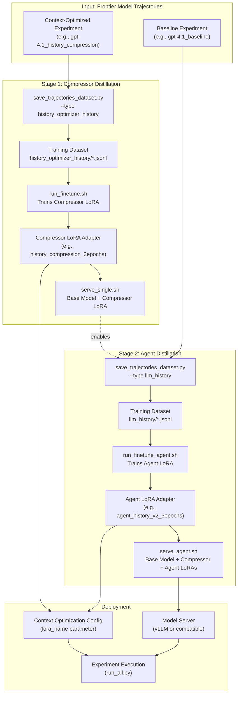
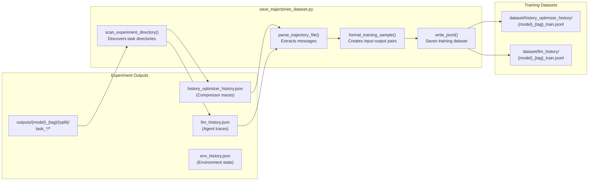
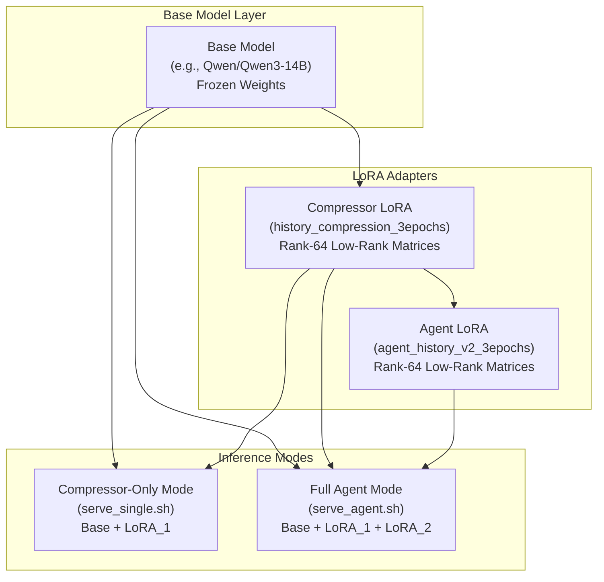
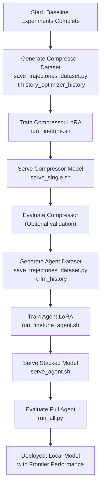

<!-- source: DeepWiki mcp.deepwiki.com · repo microsoft/acon · page 8 Model Distillation · fetched 2026-10-26 -->

# Model Distillation

<details>
<summary>Relevant source files</summary>

The following files were used as context for generating this wiki page:

- [README.md](README.md)
- [experiments/appworld/README.md](experiments/appworld/README.md)

</details>


This page describes the model distillation process in ACON, which enables training local models to replicate the behavior of frontier models through a two-stage LoRA fine-tuning approach. For configuration details about context optimization that produces the training data, see [Context Optimization Configuration](#6.2). For details on running experiments with distilled models, see [Batch Experiment Execution](#5.2).

## Purpose and Scope

Model distillation in ACON transforms expensive frontier model capabilities (e.g., GPT-4) into efficient local models (e.g., Qwen3-14B) through Low-Rank Adaptation (LoRA) fine-tuning. This enables cost-effective deployment while maintaining performance on context compression and agent reasoning tasks.

The distillation pipeline consists of two sequential stages:
1. **Compressor LoRA**: Distills context compression capabilities from frontier model optimizer traces
2. **Agent LoRA**: Distills agent reasoning and action selection from frontier model agent traces

Both stages operate on trajectories generated from baseline experiments, creating supervised fine-tuning datasets that teach the local model to mimic frontier model behavior.

## Two-Stage Distillation Architecture



**Diagram: Two-Stage Distillation Pipeline**

This architecture shows the complete distillation workflow. Stage 1 extracts context compression interactions from frontier model trajectories to train a compressor LoRA. Stage 2 builds upon the compressor by extracting agent reasoning traces to train an agent LoRA. The final deployment stacks both LoRAs on a base model for inference.

**Sources:** [experiments/appworld/README.md:135-237](), [README.md:132-137]()

## Training Data Generation

Training data for distillation is extracted from completed experiment trajectories using `save_trajectories_dataset.py`. This script converts interaction histories into supervised fine-tuning format.

### Data Extraction Process



**Diagram: Training Data Extraction Pipeline**

The extraction process scans experiment output directories, parses trajectory JSON files, and formats interactions as training samples in JSONL format.

**Sources:** [experiments/appworld/README.md:144-152](), [experiments/appworld/README.md:201-209]()

### Training Data Format

Each training sample in the JSONL dataset follows this structure:

| Field | Description | Source |
|-------|-------------|--------|
| `messages` | List of conversation turns | Extracted from trajectory history |
| `messages[].role` | Role identifier (`system`, `user`, `assistant`) | Determined by message type |
| `messages[].content` | Message text | Verbatim from trajectory |

**Compressor Training Data** (`history_optimizer_history`):
- Extracts interactions between the agent and the history optimizer
- Teaches the model to compress long context into concise summaries
- Input: Full history + compression guidelines
- Output: Compressed summary

**Agent Training Data** (`llm_history`):
- Extracts interactions between the agent and the LLM
- Teaches the model to perform reasoning and action selection
- Input: Task description + observation + (compressed) history
- Output: Reasoning chain + selected action

**Sources:** [experiments/appworld/README.md:144-152](), [experiments/appworld/README.md:201-209]()

## LoRA Architecture and Stacking

ACON uses Low-Rank Adaptation (LoRA) to efficiently fine-tune large language models without modifying the base model weights. The two-stage approach creates specialized LoRA adapters that can be stacked during inference.



**Diagram: LoRA Adapter Stacking Architecture**

The base model remains frozen during training. Compressor LoRA adapts the model for context compression. Agent LoRA builds on top for reasoning. During inference, adapters can be loaded individually or stacked together.

**Sources:** [experiments/appworld/README.md:163-169](), [experiments/appworld/README.md:220-227]()

### Training Configuration

Fine-tuning is performed using the `unsloth` library for efficient LoRA training. Key training parameters:

| Parameter | Value | Purpose |
|-----------|-------|---------|
| `max_seq_length` | 2048 | Maximum sequence length for training |
| `lora_r` | 64 | LoRA rank (adapter dimension) |
| `lora_alpha` | 16 | LoRA scaling factor |
| `learning_rate` | 2e-4 | Optimizer learning rate |
| `num_train_epochs` | 3 | Number of training epochs |

**Sources:** [experiments/appworld/README.md:154-161](), [experiments/appworld/README.md:211-218]()

## File and Component Reference

### Training Scripts

| Script | Location | Purpose |
|--------|----------|---------|
| `save_trajectories_dataset.py` | [experiments/training/]() | Extracts training data from experiment outputs |
| `run_finetune.sh` | [experiments/training/scripts/]() | Trains compressor LoRA adapter |
| `run_finetune_agent.sh` | [experiments/training/scripts/]() | Trains agent LoRA adapter |

### Serving Scripts

| Script | Location | Purpose |
|--------|----------|---------|
| `serve_single.sh` | [experiments/training/scripts/]() | Serves base model + compressor LoRA |
| `serve_agent.sh` | [experiments/training/scripts/]() | Serves base model + stacked LoRAs |

### Configuration Integration

Distilled models are specified in context optimization configuration files via the `lora_name` parameter:

```yaml
type: history
model: "Qwen/Qwen3-14B"
lora_name: "finetune=finetuned_models/qwen-14B/history_compression_3epochs"
compressor_type: full
prompts:
    prompt_system: system_prompt
    prompt_history_user: prompt_history_v2
history_summarization_threshold: 4096
preserve_last_k_turns: 1
history_summary_rule: reset
```

The `lora_name` field uses the format `finetune={path_to_lora_adapter}` to load the specified adapter during inference. For stacked LoRAs (compressor + agent), the serving script manages multiple adapter loading.

**Sources:** [experiments/appworld/README.md:171-184](), [experiments/appworld/README.md:229-236]()

## Distillation Workflow Summary



**Diagram: Complete Distillation Workflow**

This flowchart shows the sequential execution of the two-stage distillation process, from initial data generation through final deployment of the stacked LoRA model.

**Sources:** [experiments/appworld/README.md:135-237](), [README.md:132-137]()

## Key Concepts

### Progressive Distillation

ACON uses a progressive approach where each stage builds upon the previous:

1. **Stage 1 (Compressor)**: Teaches the model to compress context efficiently
2. **Stage 2 (Agent)**: Assumes compression capability and teaches reasoning/action selection

This sequential approach allows the agent LoRA to focus on high-level decision-making while relying on the compressor LoRA for context management.

### Training Data Source Requirements

| Distillation Stage | Required Experiment Type | Trajectory File |
|-------------------|-------------------------|-----------------|
| Compressor LoRA | Context-optimized run | `history_optimizer_history.json` |
| Agent LoRA | Baseline or optimized run | `llm_history.json` |

The compressor requires trajectories where context compression was active, while the agent can use any complete run where the frontier model demonstrated effective reasoning.

### Model Serving Modes

ACON supports two serving configurations:

1. **Compressor-Only**: Base model + compressor LoRA only
   - Use case: Validating compression quality before agent training
   - Served via: `serve_single.sh`

2. **Full Agent**: Base model + compressor LoRA + agent LoRA
   - Use case: Production deployment with full capabilities
   - Served via: `serve_agent.sh`

**Sources:** [experiments/appworld/README.md:135-237]()

---

