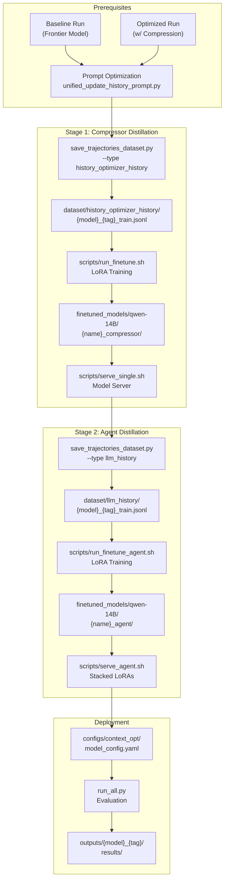
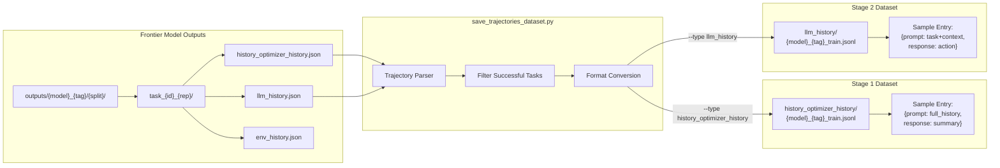
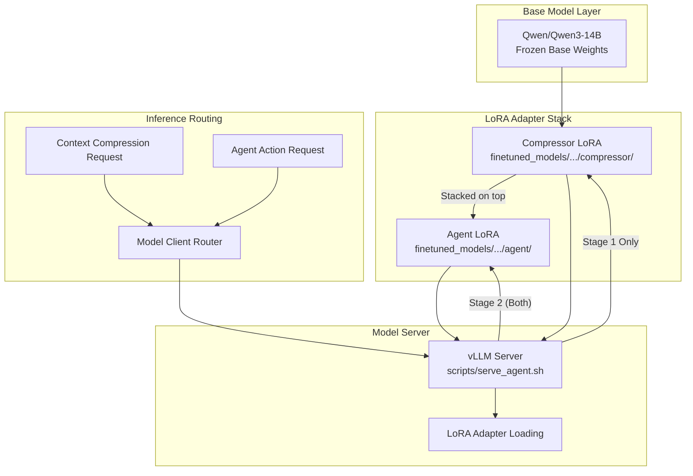

<!-- source: DeepWiki mcp.deepwiki.com · repo microsoft/acon · page 8.1 Distillation Overview · fetched 2026-10-26 -->

# Distillation Overview

<details>
<summary>Relevant source files</summary>

The following files were used as context for generating this wiki page:

- [README.md](README.md)
- [experiments/appworld/README.md](experiments/appworld/README.md)

</details>


## Purpose and Scope

This document provides a comprehensive overview of ACON's two-stage distillation process, which enables knowledge transfer from frontier models (e.g., GPT-4) to local open-source models (e.g., Qwen3-14B) through LoRA fine-tuning. This page covers the conceptual architecture, training data generation, and model serving infrastructure.

For specific training procedures, see [Stage 1: Compressor LoRA](#8.2) and [Stage 2: Agent LoRA](#8.3). For model deployment details, see [Model Serving](#8.4). For information about optimizing compression guidelines before distillation, see [Context Optimization Pipeline](#7.2).

---

## Distillation in ACON

Distillation in ACON refers to the process of training smaller, locally-hosted models to replicate the behavior of larger frontier models across two distinct capabilities:

1. **Context Compression** - Summarizing long interaction histories into concise representations
2. **Agent Reasoning** - Making action decisions based on compressed context

Unlike traditional knowledge distillation, ACON uses a **two-stage sequential approach** where each stage produces a separate LoRA adapter that can be stacked on a base model. This design allows flexible deployment configurations and incremental improvement.

**Sources:** [README.md:1-41](), [README.md:132-136](), [experiments/appworld/README.md:135-237]()

---

## Motivation

The distillation pipeline addresses three core challenges in deploying long-horizon LLM agents:

| Challenge | Frontier Models | Distilled Local Models |
|-----------|----------------|------------------------|
| **Cost** | High API costs for long contexts | One-time training cost, no per-token inference fees |
| **Latency** | Network round-trips to cloud APIs | Local inference with controllable latency |
| **Privacy** | Task data sent to third-party services | All data remains on-premise |
| **Customization** | Limited to prompt engineering | Full model fine-tuning capabilities |

By the end of the distillation pipeline, ACON produces a local model that:
- Achieves comparable performance to frontier models on benchmark tasks
- Reduces inference costs by 10-100× depending on task length
- Enables on-premise deployment for privacy-sensitive applications

**Sources:** [README.md:22-29]()

---

## Two-Stage Architecture

The following diagram illustrates the complete two-stage distillation architecture and how it fits into the broader ACON pipeline:

**Diagram: Two-Stage Distillation Architecture**



**Sources:** [experiments/appworld/README.md:135-237](), [README.md:132-136]()

---

## Stage Breakdown

### Stage 1: Compressor LoRA

**Objective:** Train a model to compress long interaction histories into concise summaries.

**Input Data:** Trajectories from frontier model runs where context compression was applied (`history_optimizer_history.json` files)

**Training Target:** The model learns to map full histories to compressed summaries, mimicking the frontier model's compression strategy.

**Output:** A LoRA adapter specializing in context compression

| Component | Details |
|-----------|---------|
| **Base Model** | `Qwen/Qwen3-14B` |
| **Training Script** | `experiments/training/scripts/run_finetune.sh` |
| **Dataset Generator** | `experiments/training/save_trajectories_dataset.py` |
| **LoRA Rank** | Configurable (typically 16-64) |
| **Training Data Format** | JSONL with `prompt` and `response` fields |

**Sources:** [experiments/appworld/README.md:135-195]()

---

### Stage 2: Agent LoRA

**Objective:** Train a model to perform agent reasoning and action selection based on compressed context.

**Input Data:** Trajectories from frontier model runs showing agent decisions (`llm_history.json` files)

**Training Target:** The model learns to generate appropriate actions given task descriptions, compressed histories, and current observations.

**Output:** A second LoRA adapter specializing in agent reasoning, designed to stack with the compressor LoRA

| Component | Details |
|-----------|---------|
| **Base Model** | `Qwen/Qwen3-14B` (same as Stage 1) |
| **Training Script** | `experiments/training/scripts/run_finetune_agent.sh` |
| **Dataset Generator** | `experiments/training/save_trajectories_dataset.py` |
| **LoRA Stacking** | Loaded on top of compressor LoRA |
| **Training Data Format** | JSONL with full agent interaction traces |

**Sources:** [experiments/appworld/README.md:196-237]()

---

## Training Data Generation

The following diagram shows how training data is extracted from frontier model experiment outputs:

**Diagram: Training Data Generation Pipeline**



**Key Data Extraction Points:**

1. **`history_optimizer_history.json`** - Contains pairs of (full history, compressed summary) generated by the context optimizer during frontier model runs
2. **`llm_history.json`** - Contains full agent interaction traces including prompts sent to the agent LLM and its responses
3. **`env_history.json`** - Contains environment observations and state transitions (used for validation but not direct training)

**Sources:** [experiments/appworld/README.md:144-152](), [experiments/appworld/README.md:201-209]()

---

## Model Serving Architecture

ACON supports two serving modes for distilled models:

**Diagram: Stacked LoRA Serving Architecture**



**Serving Modes:**

| Mode | Script | LoRAs Loaded | Use Case |
|------|--------|--------------|----------|
| **Compressor Only** | `scripts/serve_single.sh` | Compressor LoRA only | Test compression performance in isolation |
| **Full Agent** | `scripts/serve_agent.sh` | Compressor + Agent LoRAs stacked | Production deployment with both capabilities |

**Configuration Example:**

```yaml
# configs/context_opt/qwen3-14B/history_baseline.yaml
type: history
model: "Qwen/Qwen3-14B"
lora_name: "finetune=finetuned_models/qwen-14B/history_compression_3epochs"
compressor_type: full
prompts:
    prompt_system: system_prompt
    prompt_history_user: prompt_history_v2
history_summarization_threshold: 4096
preserve_last_k_turns: 1
history_summary_rule: reset
```

**Sources:** [experiments/appworld/README.md:163-195](), [experiments/appworld/README.md:220-237]()

---

## Training Scripts and Tools

The following table summarizes key scripts and their purposes:

| Script | Purpose | Key Arguments | Output |
|--------|---------|---------------|--------|
| `save_trajectories_dataset.py` | Extract training data from experiment outputs | `-f` (folder), `-t` (type: `history_optimizer_history` or `llm_history`) | JSONL datasets |
| `scripts/run_finetune.sh` | Train compressor LoRA | Base model path, dataset path, output name | LoRA adapter weights |
| `scripts/run_finetune_agent.sh` | Train agent LoRA | Base model path, dataset path, output name | LoRA adapter weights |
| `scripts/serve_single.sh` | Serve compressor-only model | Base model path, compressor LoRA path | Model server endpoint |
| `scripts/serve_agent.sh` | Serve stacked LoRAs | Base model path, compressor LoRA path, agent LoRA path | Model server endpoint |

**Sources:** [experiments/appworld/README.md:144-237]()

---

## Integration with ACON Pipeline

The distillation stages integrate with the broader ACON pipeline as follows:

**Pipeline Position:**

```
Stage 1: Baseline (Frontier Model)
    ↓
Stage 2: Context Optimization (Prompt Engineering)
    ↓
Stage 3: Compressor Distillation (LoRA Training)  ← This section
    ↓
Stage 4: Agent Distillation (LoRA Training)       ← This section
    ↓
Evaluation & Analysis
```

**Dependencies:**

- **Requires:** Successful frontier model runs with optimized compression guidelines (from [Context Optimization Pipeline](#7.2))
- **Produces:** Deployable local models that can be evaluated using the same evaluation pipeline as frontier models
- **Feeds into:** Cost/performance analysis showing the trade-offs between frontier and distilled models

**Sources:** [README.md:132-136](), [experiments/appworld/README.md:1-237]()

---

## Key Design Decisions

### Why Two Stages?

The separation of compression and reasoning into two stages provides:

1. **Modularity** - Each capability can be trained, tested, and improved independently
2. **Incremental Deployment** - Stage 1 can be deployed alone to test compression quality before committing to agent training
3. **Data Efficiency** - Compression data (history pairs) is more abundant than full task trajectories, allowing focused training

### Why LoRA Instead of Full Fine-tuning?

ACON uses LoRA (Low-Rank Adaptation) because:

1. **Parameter Efficiency** - Only 0.1-1% of parameters are trainable, reducing memory requirements
2. **Stackability** - Multiple LoRAs can be loaded simultaneously on the same base model
3. **Preservation** - Base model capabilities remain intact, reducing catastrophic forgetting
4. **Deployment Flexibility** - LoRAs can be swapped without reloading the base model

**Sources:** [experiments/appworld/README.md:135-237]()

---

## Expected Outcomes

After completing both distillation stages, the resulting model should demonstrate:

| Metric | Target Performance |
|--------|-------------------|
| **Task Success Rate** | Within 5-10% of frontier model performance |
| **Context Compression Ratio** | 3-5× reduction in context length |
| **Inference Cost** | 10-100× reduction compared to frontier model APIs |
| **Compression Quality** | Maintains critical task-relevant information while removing redundancy |

These outcomes are validated through the evaluation pipeline described in [Token and Cost Analysis](#7.1).

**Sources:** [README.md:22-29]()

---

