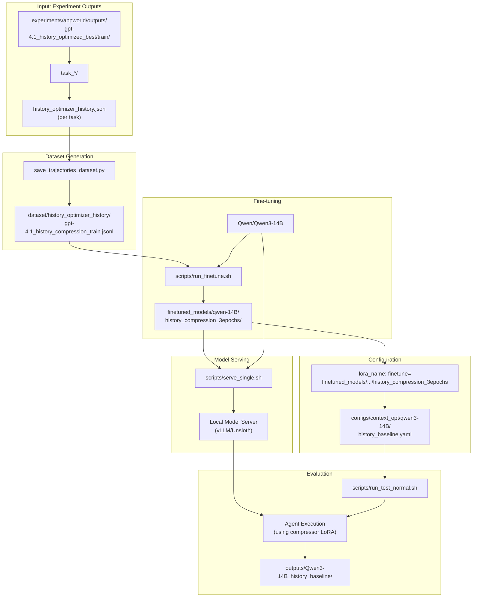
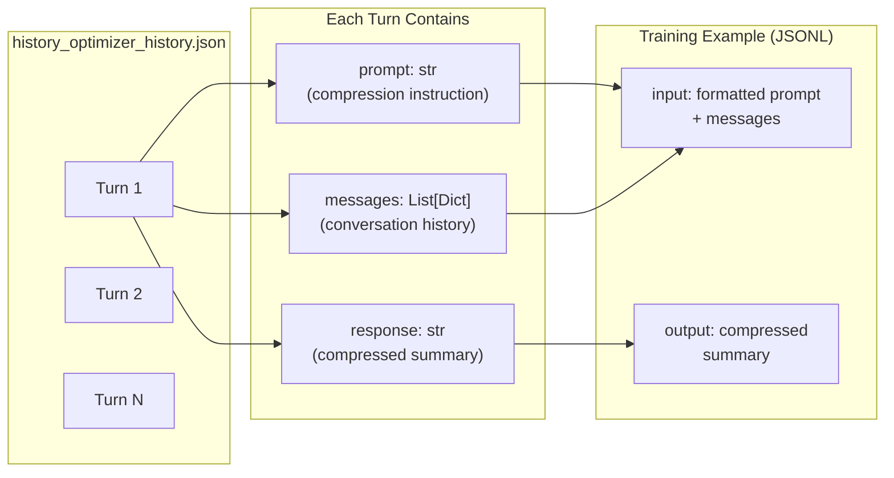
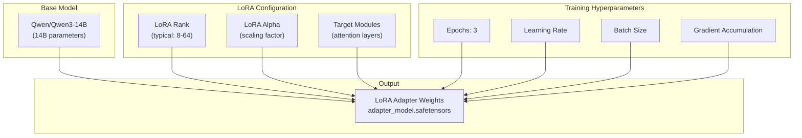
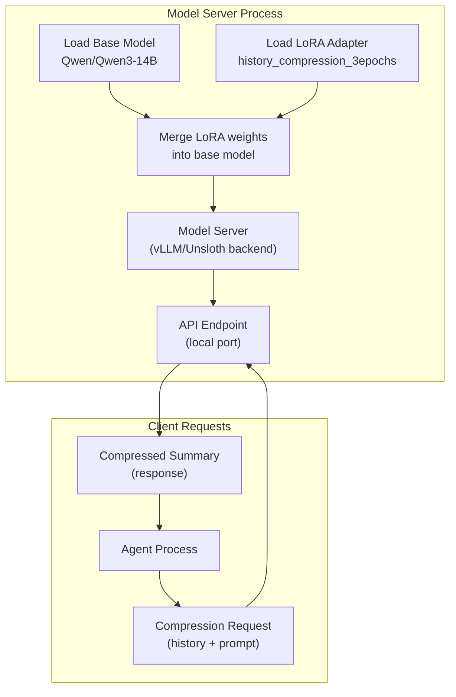
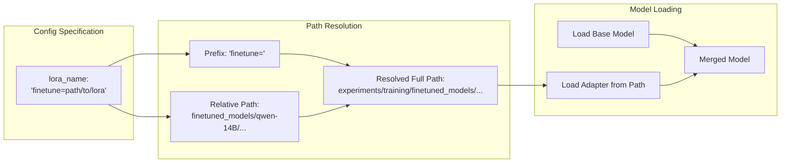
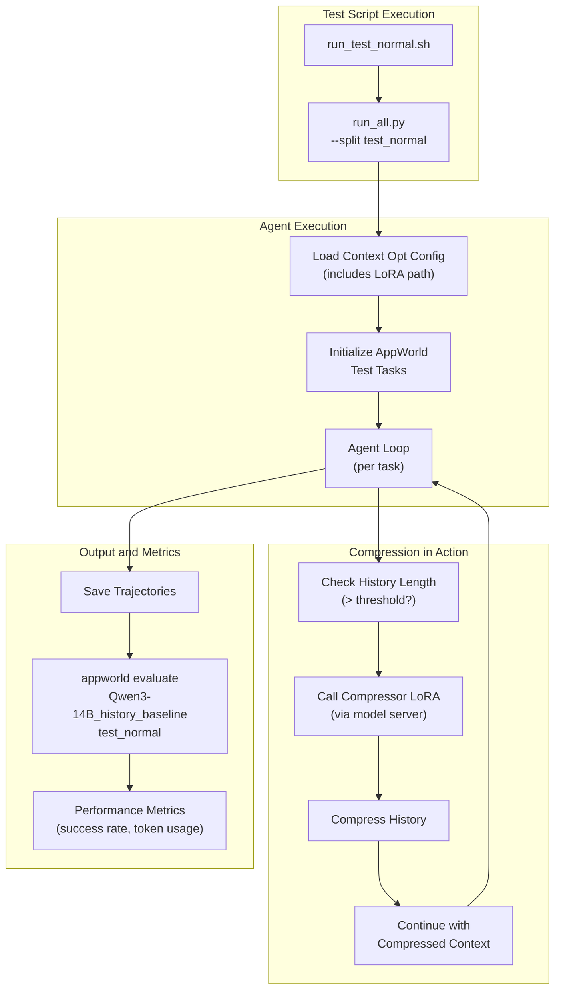
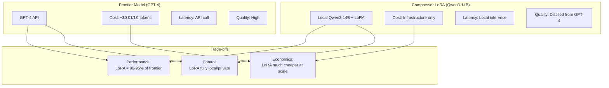

<!-- source: DeepWiki mcp.deepwiki.com · repo microsoft/acon · page 8.2 Stage 1: Compressor LoRA · fetched 2026-10-26 -->

# Stage 1: Compressor LoRA

<details>
<summary>Relevant source files</summary>

The following files were used as context for generating this wiki page:

- [experiments/appworld/README.md](experiments/appworld/README.md)

</details>


## Purpose and Scope

Stage 1 of the model distillation pipeline trains a local **compressor LoRA adapter** to perform context compression. This stage distills the context optimization behavior from frontier models (e.g., GPT-4) into a smaller, locally-hosted model (e.g., Qwen3-14B). The compressor learns to summarize agent interaction histories while preserving task-relevant information.

This page covers the complete process of training and deploying a compressor LoRA. For information about the subsequent agent reasoning model, see [Stage 2: Agent LoRA](#8.3). For the overall distillation strategy, see [Distillation Overview](#8.1).

Sources: [experiments/appworld/README.md:135-195]()

---

## Prerequisites

Before training a compressor LoRA, you must have:

1. **Completed baseline and optimized experiments** with a frontier model using context compression
2. **Full training split trajectories** that include `history_optimizer_history.json` files
3. **Optimized compression prompts** from the context optimization pipeline (see [Context Optimization Pipeline](#7.2))
4. **Training infrastructure** with GPU access for fine-tuning

The training process requires experiment outputs from runs that used history compression. These outputs contain the optimizer's input-output pairs that become training examples.

**Recommended prerequisite experiments:**
- Baseline run without compression (for comparison)
- Optimized run with best compression prompts from prompt optimization

Sources: [experiments/appworld/README.md:135-143]()

---

## Training Pipeline Overview



**Pipeline Stages:**

| Stage | Script/Tool | Input | Output | Purpose |
|-------|-------------|-------|--------|---------|
| Dataset Generation | `save_trajectories_dataset.py` | `history_optimizer_history.json` files | `.jsonl` training dataset | Extract optimizer input-output pairs |
| Fine-tuning | `run_finetune.sh` | Training dataset + base model | LoRA adapter weights | Train compression behavior |
| Model Serving | `serve_single.sh` | Base model + LoRA adapter | Running model server | Deploy for inference |
| Configuration | Manual YAML creation | LoRA path | Context optimization config | Point agent to use LoRA |
| Evaluation | `run_test_normal.sh` | Config + model server | Experiment outputs | Validate performance |

Sources: [experiments/appworld/README.md:135-195]()

---

## Dataset Generation

### Extracting Training Data

The `save_trajectories_dataset.py` script extracts training examples from experiment outputs by parsing `history_optimizer_history.json` files. Each file contains the interaction history between the agent and the history optimizer (compressor).

**Command:**

```bash
cd experiments/training
python save_trajectories_dataset.py \
    -f gpt-4.1_history_compression \
    -t history_optimizer_history
```

**Arguments:**

| Argument | Description | Example |
|----------|-------------|---------|
| `-f`, `--folder` | Experiment folder name (under `experiments/appworld/outputs/`) | `gpt-4.1_history_compression` |
| `-t`, `--trajectory_type` | Type of trajectory to extract | `history_optimizer_history` |

**Output Location:**

```
experiments/training/dataset/history_optimizer_history/
└── gpt-4.1_history_compression_train.jsonl
```

Sources: [experiments/appworld/README.md:144-152]()

### Dataset Format



Each line in the generated `.jsonl` file represents a single training example with:

- **Input:** The system prompt, compression guidelines, and the full conversation history to compress
- **Output:** The compressed summary produced by the frontier model's optimizer

The script aggregates examples from all tasks in the training split, creating a comprehensive dataset that captures various compression scenarios.

Sources: [experiments/appworld/README.md:144-152]()

---

## Fine-tuning the Compressor LoRA

### Fine-tuning Script

The `run_finetune.sh` script orchestrates LoRA fine-tuning using the Unsloth library for efficient training.

**Command:**

```bash
cd experiments/training
bash scripts/run_finetune.sh \
    Qwen/Qwen3-14B \
    dataset/history_optimizer_history/gpt-4.1_history_compression_train.jsonl \
    history_compression_3epochs
```

**Script Arguments:**

| Position | Argument | Description | Example |
|----------|----------|-------------|---------|
| 1 | Base Model | HuggingFace model identifier | `Qwen/Qwen3-14B` |
| 2 | Dataset Path | Path to training `.jsonl` file | `dataset/history_optimizer_history/...` |
| 3 | Output Name | Name for saved LoRA adapter | `history_compression_3epochs` |

**Output Location:**

```
experiments/training/finetuned_models/qwen-14B/history_compression_3epochs/
├── adapter_config.json
├── adapter_model.safetensors
└── training_args.json
```

Sources: [experiments/appworld/README.md:154-161]()

### Training Configuration



The fine-tuning process uses Low-Rank Adaptation (LoRA) to efficiently train the model on compression tasks without modifying the full base model weights. This approach:

- **Reduces memory requirements** by only training small adapter matrices
- **Enables fast iteration** with shorter training times
- **Preserves base model capabilities** while specializing for compression
- **Allows stacking multiple LoRAs** for the two-stage distillation process

The typical training run uses **3 epochs**, which provides a good balance between learning the compression behavior and avoiding overfitting.

Sources: [experiments/appworld/README.md:154-161]()

---

## Model Serving

### Starting the Model Server

After training, the compressor LoRA must be served via a model server for inference.

**Command:**

```bash
cd experiments/training
bash scripts/serve_single.sh \
    Qwen/Qwen3-14B \
    finetuned_models/qwen-14B/history_compression_3epochs
```

**Script Arguments:**

| Position | Argument | Description |
|----------|----------|-------------|
| 1 | Base Model | HuggingFace model identifier |
| 2 | LoRA Path | Path to the trained LoRA adapter |

### Model Server Architecture



The model server:

- **Loads the base model** into GPU memory
- **Applies the LoRA adapter** by merging adapter weights
- **Exposes an API endpoint** for inference requests
- **Handles batching and caching** for efficient serving

The server remains running in a separate terminal/process while experiments execute.

Sources: [experiments/appworld/README.md:163-169]()

---

## Configuration

### Context Optimization Config

To use the trained compressor LoRA, create or modify a context optimization configuration file.

**Example Config:** `configs/context_opt/qwen3-14B/history_baseline.yaml`

```yaml
type: history
model: "Qwen/Qwen3-14B"
lora_name: "finetune=finetuned_models/qwen-14B/history_compression_3epochs"
compressor_type: full
prompts:
    prompt_system: system_prompt
    prompt_history_user: prompt_history_v2
history_summarization_threshold: 4096
preserve_last_k_turns: 1
history_summary_rule: reset
```

### Configuration Parameters

| Parameter | Description | Value |
|-----------|-------------|-------|
| `type` | Type of context optimization | `history` |
| `model` | Base model identifier | `Qwen/Qwen3-14B` |
| `lora_name` | LoRA adapter path with `finetune=` prefix | `finetune=finetuned_models/...` |
| `compressor_type` | Compression strategy | `full` |
| `prompts.prompt_system` | System prompt template name | `system_prompt` |
| `prompts.prompt_history_user` | History compression prompt template | `prompt_history_v2` |
| `history_summarization_threshold` | Token threshold triggering compression | `4096` |
| `preserve_last_k_turns` | Number of recent turns to keep uncompressed | `1` |
| `history_summary_rule` | How to handle existing summaries | `reset` |

### LoRA Path Syntax



The `finetune=` prefix indicates that the path points to a locally trained LoRA adapter rather than a pre-trained model from HuggingFace or other sources.

Sources: [experiments/appworld/README.md:171-184]()

---

## Evaluation

### Running Evaluation Experiments

Test the trained compressor LoRA on the test set to measure performance.

**Command:**

```bash
cd experiments/appworld
bash scripts/run_test_normal.sh \
    gpt-4.1 \
    Qwen3-14B_history_baseline \
    configs/context_opt/qwen3-14B/history_baseline.yaml
```

**Script Arguments:**

| Position | Argument | Description | Example |
|----------|----------|-------------|---------|
| 1 | Base Agent Model | Model for agent reasoning (can differ from compressor) | `gpt-4.1` |
| 2 | Experiment Tag | Name for output directory | `Qwen3-14B_history_baseline` |
| 3 | Config Path | Context optimization config with LoRA specification | `configs/context_opt/...` |

### Evaluation Flow



The evaluation process:

1. **Loads the context optimization config** specifying the compressor LoRA
2. **Executes test tasks** with the agent using the compressor when history exceeds threshold
3. **Saves complete trajectories** including compression interactions
4. **Runs AppWorld evaluation** to compute task success metrics
5. **Analyzes token usage** to measure compression efficiency

Sources: [experiments/appworld/README.md:186-195]()

### Evaluation Metrics

| Metric Category | Specific Metrics | Purpose |
|-----------------|------------------|---------|
| **Task Performance** | Success rate, completion rate | Validate compression doesn't hurt agent capability |
| **Token Efficiency** | Total tokens, input tokens, cached tokens | Measure compression effectiveness |
| **Cost Analysis** | API costs (if applicable), token costs | Calculate economic benefit |
| **Compression Quality** | Summary length, information retention | Assess compression behavior |

Use the token analysis tools (see [Token and Cost Analysis](#7.1)) to generate detailed reports:

```bash
cd experiments/analysis_tools
python -c "from utils import analyze_experiment_tokens_v2; \
           analyze_experiment_tokens_v2('appworld', 'Qwen3-14B_history_baseline', 'test_normal')"
```

Sources: [experiments/appworld/README.md:186-195]()

---

## Output and Artifacts

### Training Artifacts

**Location:** `experiments/training/finetuned_models/qwen-14B/history_compression_3epochs/`

| File | Description | Size |
|------|-------------|------|
| `adapter_config.json` | LoRA configuration (rank, alpha, target modules) | ~1 KB |
| `adapter_model.safetensors` | Trained adapter weights | ~50-200 MB |
| `training_args.json` | Training hyperparameters and settings | ~1 KB |

### Evaluation Artifacts

**Location:** `experiments/appworld/outputs/Qwen3-14B_history_baseline/test_normal/`

```
Qwen3-14B_history_baseline/
└── test_normal/
    ├── experiment_summary.json          # Overall metrics
    └── task_<id>_<rep>/
        ├── appworld_trajectory.json     # Task execution trace
        ├── env_history.json             # Environment interactions
        ├── history_optimizer_history.json  # Compression operations
        ├── llm_history.json             # Agent LLM calls
        ├── step_alignment.json          # Step-level alignment
        └── results.json                 # Task results
```

### Dataset Artifacts

**Location:** `experiments/training/dataset/history_optimizer_history/`

| File | Description | Lines | Use |
|------|-------------|-------|-----|
| `gpt-4.1_history_compression_train.jsonl` | Training examples | ~1000-10000 | Fine-tuning |
| `gpt-4.1_history_compression_dev.jsonl` | Validation examples | ~100-1000 | Validation (if created) |

Sources: [experiments/appworld/README.md:67-84](), [experiments/appworld/README.md:144-152]()

---

## Comparison: Frontier vs. Compressor LoRA



| Aspect | Frontier Model (GPT-4) | Compressor LoRA (Qwen3-14B) |
|--------|------------------------|------------------------------|
| **Cost per request** | ~$0.01/1K tokens | Infrastructure amortized |
| **Latency** | 500-2000ms (API) | 50-500ms (local GPU) |
| **Quality** | Highest | 90-95% of frontier |
| **Privacy** | Data sent to API | Fully local |
| **Scalability** | Rate limited | GPU memory limited |
| **Best for** | Low volume, highest quality | High volume, cost-sensitive |

The compressor LoRA enables cost-effective deployment at scale while maintaining competitive performance. For maximum quality on small-scale experiments, frontier models remain preferable.

Sources: [experiments/appworld/README.md:135-195]()

---

## Next Steps

After training and validating the compressor LoRA:

1. **Proceed to Stage 2:** Train the agent LoRA to handle reasoning and action selection (see [Stage 2: Agent LoRA](#8.3))
2. **Analyze performance:** Use token analysis tools to quantify compression benefits (see [Token and Cost Analysis](#7.1))
3. **Iterate on prompts:** If compression quality is insufficient, refine compression prompts (see [Context Optimization Pipeline](#7.2))
4. **Deploy to production:** Serve the stacked compressor + agent LoRAs for production use (see [Model Serving](#8.4))

The compressor LoRA serves as the foundation for the complete distilled agent system. Stage 2 builds upon this foundation by adding task-specific reasoning capabilities.

Sources: [experiments/appworld/README.md:135-237]()

---

