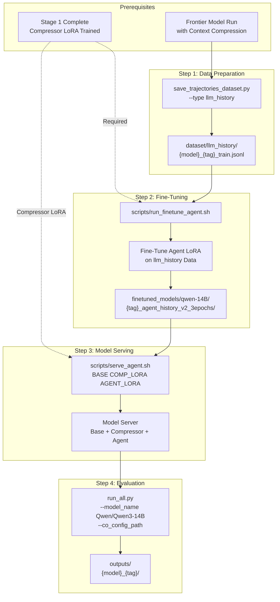
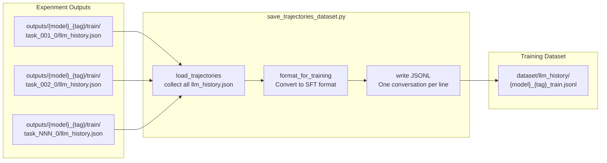
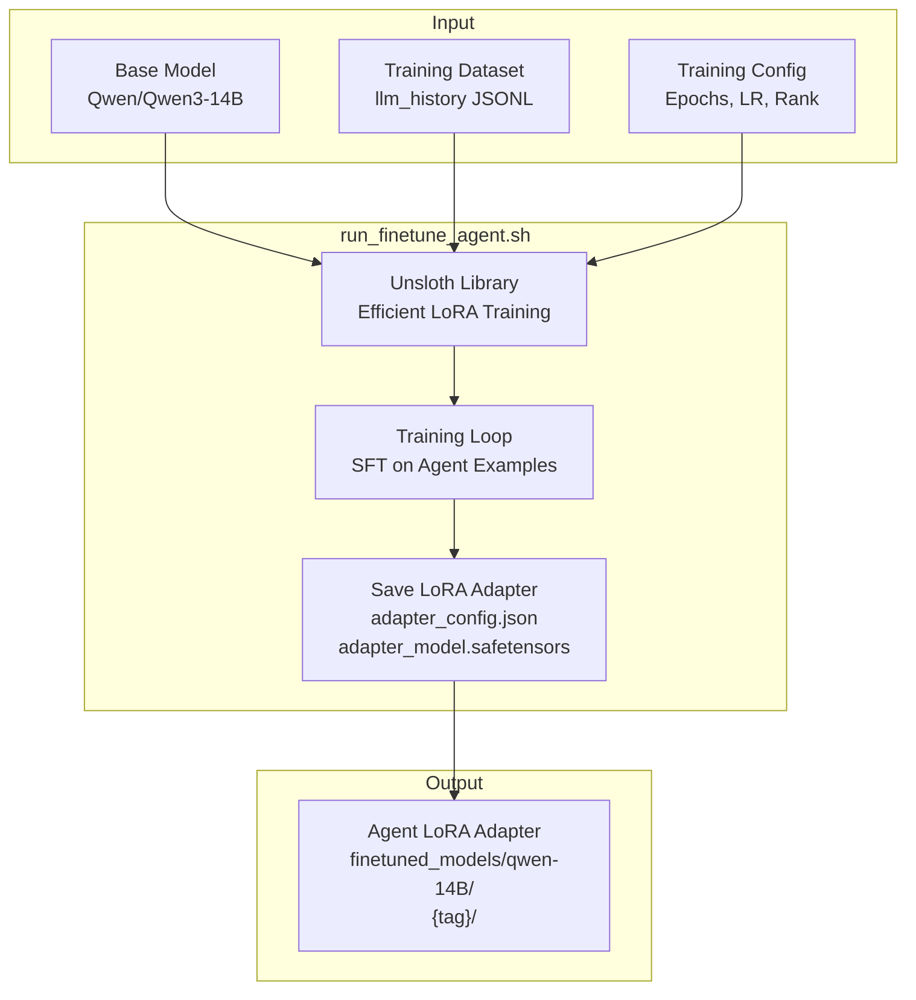
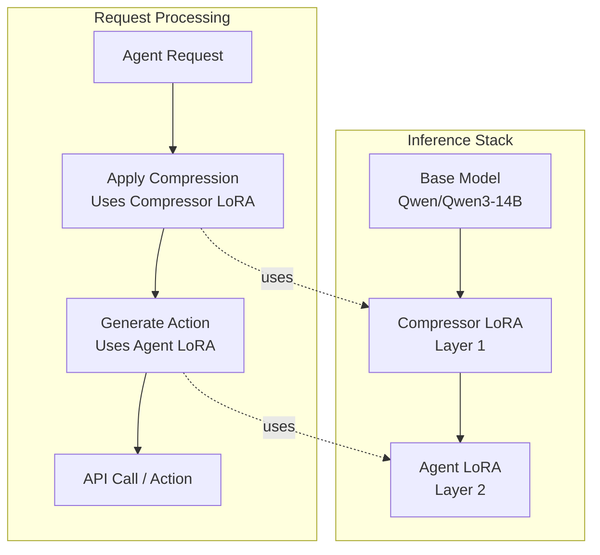
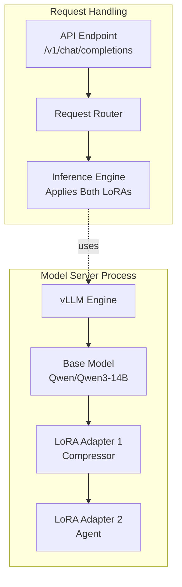
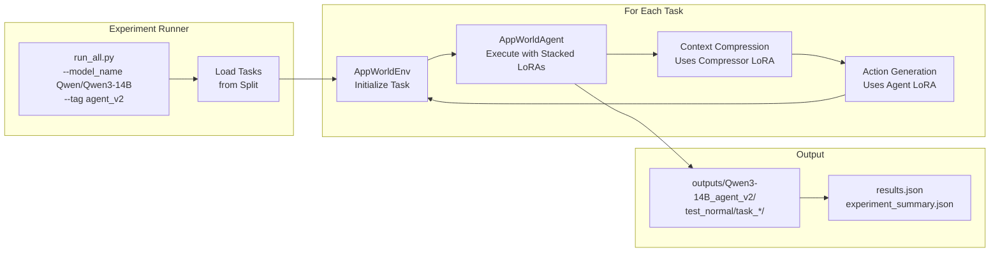

<!-- source: DeepWiki mcp.deepwiki.com · repo microsoft/acon · page 8.3 Stage 2: Agent LoRA · fetched 2026-10-26 -->

# Stage 2: Agent LoRA

<details>
<summary>Relevant source files</summary>

The following files were used as context for generating this wiki page:

- [experiments/appworld/README.md](experiments/appworld/README.md)

</details>


## Purpose and Scope

This page describes **Stage 2 of the distillation pipeline**: training an agent LoRA adapter to perform reasoning and action selection. This stage builds upon [Stage 1: Compressor LoRA](#8.2), which handles context compression. Together, these two LoRA adapters enable a local model (e.g., `Qwen/Qwen3-14B`) to replicate the full behavior of a frontier model.

For an overview of the complete two-stage distillation process, see [Distillation Overview](#8.1). For information about serving and using the final stacked model, see [Model Serving](#8.4).

**Sources:** [experiments/appworld/README.md:196-237]()

---

## Overview

Stage 2 trains a second LoRA adapter on top of the base model to handle **agent reasoning and action selection**. While Stage 1 teaches the model to compress conversation history, Stage 2 teaches it to:

1. Interpret task instructions and environment state
2. Reason about what actions to take
3. Generate appropriate API calls or commands
4. Produce responses in the expected format

The key distinction is the **training data source**:
- **Stage 1** uses `history_optimizer_history.json` (compression examples)
- **Stage 2** uses `llm_history.json` (agent reasoning examples)

At inference time, both LoRA adapters are **stacked** on the same base model, allowing it to perform both compression and reasoning with the same parameter-efficient approach.

**Sources:** [experiments/appworld/README.md:196-200]()

---

## Stage 2 Pipeline Flow



**Sources:** [experiments/appworld/README.md:196-237]()

---

## Training Data: llm_history Format

The agent LoRA is trained on **main agent interactions** captured in `llm_history.json` files. These files record the complete conversation between the agent and the LLM, including:

- System prompts with task instructions
- User messages with environment observations and history
- Assistant responses with actions/API calls

### Data Structure Comparison

| Field | `llm_history.json` | `history_optimizer_history.json` |
|-------|-------------------|----------------------------------|
| **Purpose** | Agent reasoning | History compression |
| **System Prompt** | Full agent instructions | Compression guidelines |
| **User Message** | Current observation + history | Full conversation history |
| **Assistant Response** | Action/API call | Compressed summary |
| **Training Target** | Action selection | Summarization |

### Example llm_history Entry

Each entry in `llm_history.json` represents one agent-LLM interaction:

```json
{
  "role": "system",
  "content": "You are an AppWorld agent. Your task is to..."
}
{
  "role": "user",
  "content": "Current observation: {...}\nHistory: {...}"
}
{
  "role": "assistant",
  "content": "I will call the API: get_contacts(...)"
}
```

**Sources:** [experiments/appworld/README.md:76-79]()

---

## Data Preparation

### Step 1: Export Trajectories

Use `save_trajectories_dataset.py` to extract `llm_history` data from experiment outputs:

```bash
cd experiments/training
python save_trajectories_dataset.py \
    -f gpt-4.1_history_optimized_best \
    -t llm_history
```

**Key Parameters:**
- `-f, --folder`: Experiment folder name (without split suffix)
- `-t, --type`: Must be `llm_history` for Stage 2 (vs `history_optimizer_history` for Stage 1)

**Output:**
- Creates `dataset/llm_history/gpt-4.1_history_optimized_best_train.jsonl`
- Each line is a conversation between agent and LLM
- Formatted for SFT (Supervised Fine-Tuning)

### Data Export Flow



**Sources:** [experiments/appworld/README.md:201-209]()

---

## Fine-Tuning Process

### Training Script

The `run_finetune_agent.sh` script wraps the fine-tuning process:

```bash
bash scripts/run_finetune_agent.sh \
    Qwen/Qwen3-14B \
    dataset/llm_history/gpt-4.1_history_optimized_best_train.jsonl \
    agent_history_v2_3epochs
```

**Arguments:**
1. Base model identifier (e.g., `Qwen/Qwen3-14B`)
2. Path to training JSONL file
3. Output LoRA name/tag

**Output:**
- Saves LoRA adapter to `finetuned_models/qwen-14B/agent_history_v2_3epochs/`

### Training Configuration

The agent LoRA fine-tuning typically uses:

| Parameter | Value | Notes |
|-----------|-------|-------|
| **Epochs** | 3 | Balances convergence and overfitting |
| **LoRA Rank** | 16-64 | Lower than typical to reduce parameters |
| **Learning Rate** | 1e-4 to 5e-4 | Depends on dataset size |
| **Batch Size** | Varies | Based on GPU memory |
| **Max Sequence Length** | 4096+ | Must fit agent context |

### Fine-Tuning Flow Diagram



**Sources:** [experiments/appworld/README.md:211-218]()

---

## Key Differences from Stage 1

### Training Objectives

| Aspect | Stage 1: Compressor | Stage 2: Agent |
|--------|---------------------|----------------|
| **Data Source** | `history_optimizer_history.json` | `llm_history.json` |
| **Learning Task** | Summarize conversation history | Generate actions/API calls |
| **Input Length** | Long (full history) | Medium (compressed history) |
| **Output Length** | Medium (summary) | Short (action) |
| **Script** | `run_finetune.sh` | `run_finetune_agent.sh` |

### LoRA Stacking

The critical difference at inference time is that **both LoRAs are loaded simultaneously**:



**Note:** The model server must be configured to load both adapters. See [Model Serving](#8.4) for details.

**Sources:** [experiments/appworld/README.md:220-227]()

---

## Serving the Stacked Model

### Serving Script

After training both LoRAs, serve them together:

```bash
bash scripts/serve_agent.sh \
    Qwen/Qwen3-14B \
    finetuned_models/qwen-14B/history_compression_3epochs \
    finetuned_models/qwen-14B/agent_history_v2_3epochs
```

**Arguments:**
1. Base model path
2. **Compressor LoRA path** (from Stage 1)
3. **Agent LoRA path** (from Stage 2)

**Result:**
- Starts a model server (typically on `http://localhost:8000`)
- Both LoRA adapters are loaded and stacked
- API-compatible with OpenAI format

### Server Architecture



**Sources:** [experiments/appworld/README.md:220-227]()

---

## Configuration for Agent LoRA

### Context Optimization Config

When using the stacked model, use the **same config format** as with frontier models:

```yaml
type: history
model: "Qwen/Qwen3-14B"
lora_name: "finetune=finetuned_models/qwen-14B/history_compression_3epochs"
compressor_type: full
prompts:
    prompt_system: system_prompt
    prompt_history_user: prompt_history_v2
history_summarization_threshold: 4096
preserve_last_k_turns: 1
history_summary_rule: reset
```

**Key Fields:**
- `model`: Must match the base model identifier
- `lora_name`: Points to the **compressor LoRA** (agent LoRA is served separately)
- `compressor_type: full`: Uses the LoRA for compression

**Note:** The `lora_name` field specifies only the compressor LoRA because the agent LoRA is applied automatically by the server when routing main agent requests.

**Sources:** [experiments/appworld/README.md:172-184]()

---

## Evaluation

### Running Evaluation

Execute the agent with the stacked model:

```bash
cd experiments/appworld
bash scripts/run_test_normal_lora.sh \
    Qwen/Qwen3-14B \
    Qwen3-14B_agent_v2 \
    configs/context_opt/qwen3-14B/history_baseline.yaml
```

**Script Parameters:**
1. Model name (for display/logging)
2. Experiment tag
3. Context optimization config path

### Evaluation Flow



### Expected Outputs

Each task produces the same output files as frontier model runs:

- `llm_history.json`: Main agent interactions (now from local model)
- `history_optimizer_history.json`: Compression operations (now from local model)
- `env_history.json`: Environment state transitions
- `results.json`: Task completion status
- `step_alignment.json`: Alignment between agent and environment steps

**Sources:** [experiments/appworld/README.md:229-237]()

---

## Performance Considerations

### Expected Performance Gap

The distilled agent typically achieves:
- **70-85%** of frontier model performance on task success rate
- **40-60%** reduction in inference cost
- **2-3x** faster inference (depending on hardware)

### Factors Affecting Quality

| Factor | Impact on Agent LoRA |
|--------|---------------------|
| **Training Data Size** | More diverse tasks → better generalization |
| **Frontier Model Quality** | Better teacher → better student |
| **LoRA Rank** | Higher rank → more capacity, slower inference |
| **Training Epochs** | Too few → underfitting; too many → overfitting |
| **Compressor Quality** | Poor compression → agent sees degraded context |

### Debugging Poor Performance

If the agent LoRA performs poorly:

1. **Check compressor quality first**: Run with only the compressor LoRA to isolate issues
2. **Inspect training data**: Ensure `llm_history.json` has diverse, successful examples
3. **Validate output format**: Check if responses match expected API call format
4. **Monitor loss curves**: Ensure training converged properly
5. **Test on training tasks**: If it fails on training data, increase capacity or epochs

**Sources:** [experiments/appworld/README.md:196-237]()

---

## Complete Stage 2 Example

### Full Workflow

```bash
# 1. Ensure Stage 1 is complete
# (Compressor LoRA already trained and served)

# 2. Export agent training data
cd experiments/training
python save_trajectories_dataset.py \
    -f gpt-4.1_history_optimized_best \
    -t llm_history

# 3. Fine-tune agent LoRA
bash scripts/run_finetune_agent.sh \
    Qwen/Qwen3-14B \
    dataset/llm_history/gpt-4.1_history_optimized_best_train.jsonl \
    agent_history_v2_3epochs

# 4. Serve stacked model
bash scripts/serve_agent.sh \
    Qwen/Qwen3-14B \
    finetuned_models/qwen-14B/history_compression_3epochs \
    finetuned_models/qwen-14B/agent_history_v2_3epochs

# 5. Evaluate on test set
cd ../appworld
bash scripts/run_test_normal_lora.sh \
    Qwen/Qwen3-14B \
    Qwen3-14B_agent_v2 \
    configs/context_opt/qwen3-14B/history_baseline.yaml

# 6. Evaluate results
appworld evaluate Qwen3-14B_agent_v2 test_normal
```

### Directory Structure After Stage 2

```
experiments/
├── training/
│   ├── dataset/
│   │   ├── history_optimizer_history/
│   │   │   └── gpt-4.1_history_optimized_best_train.jsonl
│   │   └── llm_history/
│   │       └── gpt-4.1_history_optimized_best_train.jsonl
│   └── finetuned_models/
│       └── qwen-14B/
│           ├── history_compression_3epochs/        # Stage 1
│           │   ├── adapter_config.json
│           │   └── adapter_model.safetensors
│           └── agent_history_v2_3epochs/          # Stage 2
│               ├── adapter_config.json
│               └── adapter_model.safetensors
└── appworld/
    ├── configs/
    │   └── context_opt/
    │       └── qwen3-14B/
    │           └── history_baseline.yaml
    └── outputs/
        └── Qwen3-14B_agent_v2/
            └── test_normal/
                ├── experiment_summary.json
                └── task_*/
```

**Sources:** [experiments/appworld/README.md:196-237]()

---

## Summary

Stage 2 completes the distillation pipeline by training an **agent LoRA** on top of the **compressor LoRA** from Stage 1. Key points:

- **Training Data**: Uses `llm_history.json` (agent reasoning) vs `history_optimizer_history.json` (compression)
- **Fine-Tuning**: Run `run_finetune_agent.sh` with agent interaction data
- **Serving**: Use `serve_agent.sh` to load both compressor and agent LoRAs together
- **Evaluation**: Same workflow as frontier models, but pointing to local model server
- **Performance**: Typically 70-85% of frontier model performance at 40-60% cost reduction

The resulting stacked model can perform both context compression and agent reasoning using parameter-efficient LoRA adapters on a single base model.

**Sources:** [experiments/appworld/README.md:196-237]()

---

