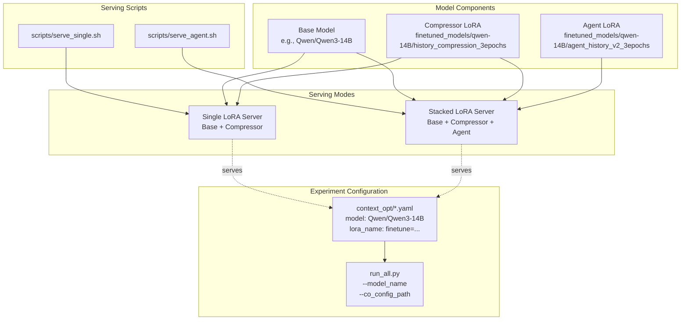
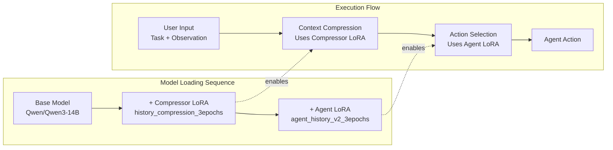

<!-- source: DeepWiki mcp.deepwiki.com · repo microsoft/acon · page 8.4 Model Serving · fetched 2026-10-26 -->

# Model Serving

<details>
<summary>Relevant source files</summary>

The following files were used as context for generating this wiki page:

- [experiments/appworld/README.md](experiments/appworld/README.md)
- [experiments/appworld/configs/context_opt/gpt-4.1-mini_history.yaml](experiments/appworld/configs/context_opt/gpt-4.1-mini_history.yaml)

</details>


## Purpose and Scope

This document describes how to serve and use distilled models after completing the two-stage LoRA fine-tuning process. Model serving enables running experiments with local fine-tuned models instead of frontier models via API calls.

For information about training the LoRA adapters, see [Stage 1: Compressor LoRA](#8.2) and [Stage 2: Agent LoRA](#8.3). For an overview of the complete distillation pipeline, see [Distillation Overview](#8.1).

---

## Model Serving Options

ACON supports two distinct model serving configurations based on the distillation stage completed:

| Serving Mode | LoRA Layers | Use Case | Training Stage |
|--------------|-------------|----------|----------------|
| **Single LoRA** | Base Model + Compressor LoRA | Context compression only; agent logic uses frontier model | After Stage 1 |
| **Stacked LoRA** | Base Model + Compressor LoRA + Agent LoRA | Full local execution; both compression and agent reasoning | After Stage 2 |

Both modes use the same base model (e.g., `Qwen/Qwen3-14B`) with different LoRA adapter configurations.

**Sources:** [experiments/appworld/README.md:135-237]()

---

## Serving Architecture

The model serving system consists of a model server that loads the base model with one or more LoRA adapters, and configuration files that specify which served model to use for experiments.

### Model Server Components



**Sources:** [experiments/appworld/README.md:163-237]()

---

## Single LoRA Serving (Compressor Only)

Single LoRA serving loads only the compressor LoRA adapter on top of the base model. This configuration uses the local model for context compression while the main agent still uses a frontier model.

### Starting the Single LoRA Server

The `serve_single.sh` script starts a model server with a single LoRA adapter:

```bash
bash scripts/serve_single.sh \
    Qwen/Qwen3-14B \
    finetuned_models/qwen-14B/history_compression_3epochs
```

**Parameters:**
- **Argument 1:** Base model identifier (e.g., `Qwen/Qwen3-14B`)
- **Argument 2:** Path to the compressor LoRA adapter directory

### Configuration File Structure

To use the served compressor model, create a context optimization configuration file:

```yaml
type: "history"
model: "Qwen/Qwen3-14B"
lora_name: "finetune=finetuned_models/qwen-14B/history_compression_3epochs"
compressor_type: "full"
prompts:
  prompt_system: "system_prompt"
  prompt_history_user: "prompt_history_v2"
history_summarization_threshold: 4096
preserve_last_k_turns: 1
history_summary_rule: "reset"
```

**Key Fields:**
- `model`: Base model identifier matching the served model
- `lora_name`: Path to LoRA adapter with `finetune=` prefix
- `type`: Compression type (`history` or `observation`)
- `compressor_type`: Compression strategy (`full`, `incremental`, etc.)

### Running Experiments with Single LoRA

Execute experiments using the configuration file:

```bash
cd experiments/appworld
python run_all.py \
    --split test_normal \
    --model_name gpt-4.1 \
    --tag Qwen3-14B_history_baseline \
    --co_config_path configs/context_opt/qwen3-14B/history_baseline.yaml
```

**Note:** The `--model_name` parameter specifies the frontier model used for agent reasoning, while the compressor model is specified in the `--co_config_path` configuration.

**Sources:** [experiments/appworld/README.md:163-194](), [experiments/appworld/configs/context_opt/gpt-4.1-mini_history.yaml:1-9]()

---

## Stacked LoRA Serving (Compressor + Agent)

Stacked LoRA serving loads both compressor and agent LoRA adapters, enabling fully local execution without frontier model API calls.

### Stacked LoRA Architecture



### Starting the Stacked LoRA Server

The `serve_agent.sh` script starts a model server with stacked LoRA adapters:

```bash
bash scripts/serve_agent.sh \
    Qwen/Qwen3-14B \
    finetuned_models/qwen-14B/250916_history_v2_3epochs \
    finetuned_models/qwen-14B/250916_agent_history_v2_3epochs
```

**Parameters:**
- **Argument 1:** Base model identifier
- **Argument 2:** Path to the compressor LoRA adapter
- **Argument 3:** Path to the agent LoRA adapter

The adapters are loaded in order: base model → compressor LoRA → agent LoRA.

### Configuration for Stacked LoRAs

The same context optimization configuration file format is used, but the served model now handles both compression and agent reasoning:

```yaml
type: "history"
model: "Qwen/Qwen3-14B"
lora_name: "finetune=finetuned_models/qwen-14B/history_compression_3epochs"
compressor_type: "full"
prompts:
  prompt_system: "system_prompt"
  prompt_history_user: "prompt_history_v2"
history_summarization_threshold: 4096
preserve_last_k_turns: 1
history_summary_rule: "reset"
```

**Important:** The `lora_name` field specifies only the compressor LoRA path. The agent LoRA is implicitly loaded when using `serve_agent.sh`.

### Running Experiments with Stacked LoRAs

Execute experiments with the stacked model:

```bash
cd experiments/appworld
bash scripts/run_test_normal_lora.sh \
    Qwen/Qwen3-14B \
    250916_Qwen3-14B_history_baseline \
    configs/context_opt/qwen3-14B/history_baseline.yaml
```

Or using `run_all.py` directly:

```bash
python run_all.py \
    --split test_normal \
    --model_name Qwen/Qwen3-14B \
    --tag stacked_lora_test \
    --co_config_path configs/context_opt/qwen3-14B/history_baseline.yaml
```

**Note:** When using stacked LoRAs, the `--model_name` parameter should match the base model specified in the configuration file, indicating full local execution.

**Sources:** [experiments/appworld/README.md:196-237]()

---

## Configuration Field Reference

### Context Optimization Configuration Fields

The following table documents the key configuration fields used when serving models:

| Field | Type | Description | Example |
|-------|------|-------------|---------|
| `type` | string | Compression type | `"history"` or `"observation"` |
| `model` | string | Base model identifier | `"Qwen/Qwen3-14B"` |
| `lora_name` | string | LoRA adapter path with prefix | `"finetune=finetuned_models/qwen-14B/history_compression_3epochs"` |
| `compressor_type` | string | Compression strategy | `"full"`, `"incremental"` |
| `prompts.prompt_system` | string | System prompt template name | `"system_prompt"` |
| `prompts.prompt_history_user` | string | History compression prompt template | `"prompt_history_v2"` |
| `history_summarization_threshold` | integer | Token threshold triggering compression | `4096` |
| `preserve_last_k_turns` | integer | Number of recent turns to preserve | `1` |
| `history_summary_rule` | string | Compression behavior | `"reset"` |

### LoRA Name Format

The `lora_name` field uses a special format to indicate fine-tuned adapters:

```
finetune=<path_to_lora_directory>
```

This prefix signals to the system that the specified path contains a LoRA adapter to load on top of the base model.

**Sources:** [experiments/appworld/README.md:171-184](), [experiments/appworld/configs/context_opt/gpt-4.1-mini_history.yaml:1-9]()

---

## Serving vs Frontier Models

The following diagram illustrates the difference in execution flow between frontier models and served local models:

```mermaid
graph TB
    subgraph "Frontier Model Execution"
        F_INPUT["Task Input"]
        F_COMPRESS_API["OpenAI API Call<br/>gpt-4.1-mini<br/>Context Compression"]
        F_AGENT_API["OpenAI API Call<br/>gpt-4.1<br/>Agent Reasoning"]
        F_OUTPUT["Action Output"]
        
        F_INPUT --> F_COMPRESS_API
        F_COMPRESS_API --> F_AGENT_API
        F_AGENT_API --> F_OUTPUT
    end
    
    subgraph "Single LoRA Execution"
        S_INPUT["Task Input"]
        S_COMPRESS_LOCAL["Local Model Server<br/>Qwen3-14B + Compressor LoRA<br/>Context Compression"]
        S_AGENT_API["OpenAI API Call<br/>gpt-4.1<br/>Agent Reasoning"]
        S_OUTPUT["Action Output"]
        
        S_INPUT --> S_COMPRESS_LOCAL
        S_COMPRESS_LOCAL --> S_AGENT_API
        S_AGENT_API --> S_OUTPUT
    end
    
    subgraph "Stacked LoRA Execution"
        T_INPUT["Task Input"]
        T_COMPRESS_LOCAL["Local Model Server<br/>Qwen3-14B + Compressor LoRA<br/>Context Compression"]
        T_AGENT_LOCAL["Local Model Server<br/>Qwen3-14B + Agent LoRA<br/>Agent Reasoning"]
        T_OUTPUT["Action Output"]
        
        T_INPUT --> T_COMPRESS_LOCAL
        T_COMPRESS_LOCAL --> T_AGENT_LOCAL
        T_AGENT_LOCAL --> T_OUTPUT
    end
```



**Performance Characteristics:**

| Mode | API Calls | Latency | Cost | Use Case |
|------|-----------|---------|------|----------|
| Frontier | All components use API | Highest (network + compute) | Highest (per-token pricing) | Baseline, validation |
| Single LoRA | Compression local, agent via API | Medium | Medium | Testing compressor quality |
| Stacked LoRA | All components local | Lowest (no network) | Lowest (compute only) | Production, large-scale experiments |

**Sources:** [experiments/appworld/README.md:135-237]()

---

## Practical Workflow

### Complete Serving Workflow

The following steps demonstrate the complete workflow from training to serving:

#### 1. Train Compressor LoRA (Stage 1)

```bash
cd experiments/training
python save_trajectories_dataset.py -f gpt-4.1_history_compression -t history_optimizer_history
bash scripts/run_finetune.sh \
    Qwen/Qwen3-14B \
    dataset/history_optimizer_history/gpt-4.1_history_compression_train.jsonl \
    history_compression_3epochs
```

#### 2. Serve and Test Compressor

```bash
# Start server
bash scripts/serve_single.sh \
    Qwen/Qwen3-14B \
    finetuned_models/qwen-14B/history_compression_3epochs

# Run experiment
cd ../appworld
python run_all.py \
    --split test_normal \
    --model_name gpt-4.1 \
    --tag Qwen3-14B_compressor_test \
    --co_config_path configs/context_opt/qwen3-14B/history_baseline.yaml
```

#### 3. Train Agent LoRA (Stage 2)

```bash
cd experiments/training
python save_trajectories_dataset.py -f gpt-4.1_history_v2 -t llm_history
bash scripts/run_finetune_agent.sh \
    Qwen/Qwen3-14B \
    dataset/llm_history/gpt-4.1_history_v2_train.jsonl \
    agent_history_v2_3epochs
```

#### 4. Serve and Test Stacked Model

```bash
# Start stacked server
bash scripts/serve_agent.sh \
    Qwen/Qwen3-14B \
    finetuned_models/qwen-14B/history_compression_3epochs \
    finetuned_models/qwen-14B/agent_history_v2_3epochs

# Run experiment with full local execution
cd ../appworld
python run_all.py \
    --split test_normal \
    --model_name Qwen/Qwen3-14B \
    --tag Qwen3-14B_full_local \
    --co_config_path configs/context_opt/qwen3-14B/history_baseline.yaml
```

### Model Server Management

**Starting a Server:**
- Use `serve_single.sh` for compressor-only serving
- Use `serve_agent.sh` for stacked LoRA serving
- Servers typically listen on a default port (check script for details)

**Stopping a Server:**
- Terminate the process running the serve script
- Multiple model servers can run simultaneously on different ports

**Monitoring:**
- Server logs show model loading progress and inference requests
- Check for successful LoRA adapter loading in startup logs

**Sources:** [experiments/appworld/README.md:135-237]()

---

## Configuration Examples

### Example 1: Single LoRA with gpt-4.1 Agent

```yaml
# configs/context_opt/qwen3-14B/history_baseline.yaml
type: "history"
model: "Qwen/Qwen3-14B"
lora_name: "finetune=finetuned_models/qwen-14B/history_compression_3epochs"
compressor_type: "full"
prompts:
  prompt_system: "system_prompt"
  prompt_history_user: "prompt_history_v2"
history_summarization_threshold: 4096
preserve_last_k_turns: 1
history_summary_rule: "reset"
```

**Usage:**
```bash
python run_all.py \
    --model_name gpt-4.1 \
    --co_config_path configs/context_opt/qwen3-14B/history_baseline.yaml
```

### Example 2: Stacked LoRA with Full Local Execution

Same configuration file, different model_name:

```bash
python run_all.py \
    --model_name Qwen/Qwen3-14B \
    --co_config_path configs/context_opt/qwen3-14B/history_baseline.yaml
```

The distinction between single and stacked LoRA serving is determined by:
1. Which serve script was used (`serve_single.sh` vs `serve_agent.sh`)
2. The `--model_name` parameter (frontier model vs base model identifier)

**Sources:** [experiments/appworld/README.md:171-237](), [experiments/appworld/configs/context_opt/gpt-4.1-mini_history.yaml:1-9]()

---

## Troubleshooting

### Common Issues

| Issue | Cause | Solution |
|-------|-------|----------|
| Model not found | Server not running or wrong model identifier | Verify server is running; check `model` field matches served model |
| LoRA adapter error | Incorrect path or adapter not compatible | Verify `lora_name` path exists; ensure adapter trained for correct base model |
| Configuration mismatch | Wrong compression type in config | Ensure `type` field matches the LoRA adapter's training objective |
| High latency | Network issues or server overload | Check server logs; consider local deployment |

### Verification Steps

1. **Verify Server Status:**
   - Check server logs for successful startup
   - Confirm LoRA adapters loaded successfully
   - Test inference with a simple prompt

2. **Validate Configuration:**
   - Ensure `model` field matches served model
   - Verify `lora_name` path is correct
   - Check prompt template references exist

3. **Test Inference:**
   - Run a single task with `--debug` flag
   - Review output logs for compression and agent calls
   - Verify expected model is being used

**Sources:** [experiments/appworld/README.md:1-237]()

---

