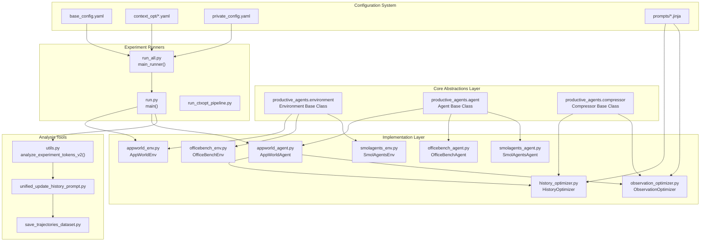
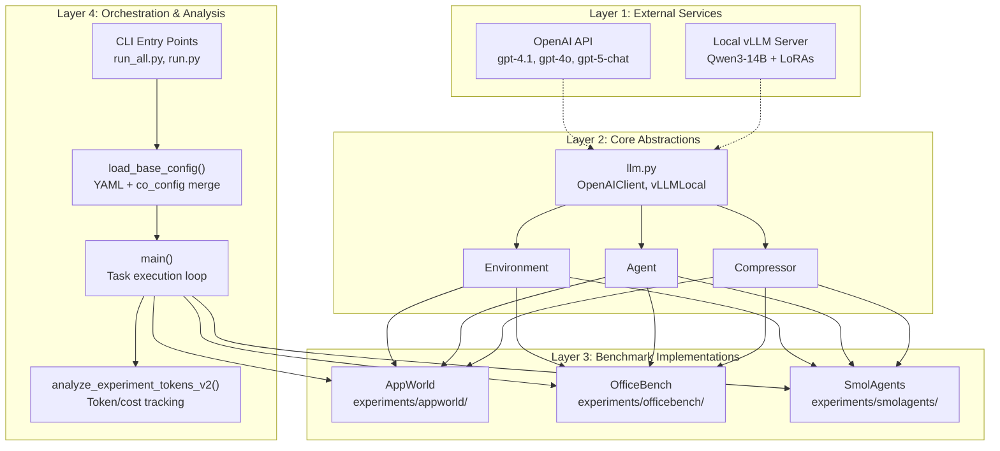
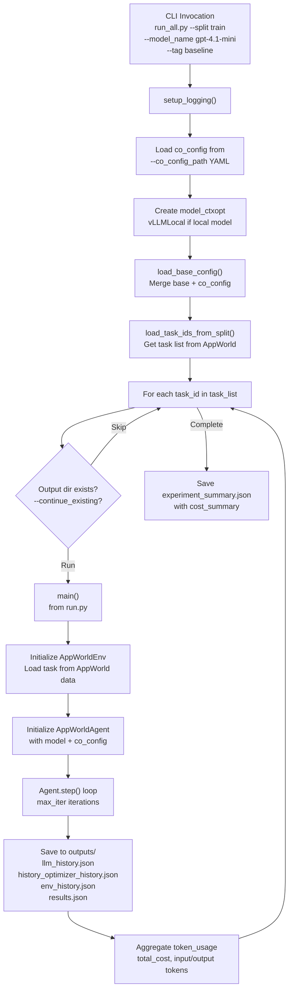
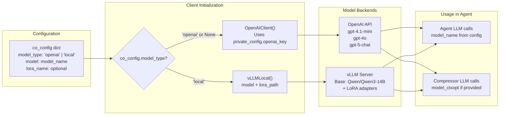

<!-- source: DeepWiki mcp.deepwiki.com · repo microsoft/acon · page 9 Architecture · fetched 2026-10-26 -->

# Architecture

<details>
<summary>Relevant source files</summary>

The following files were used as context for generating this wiki page:

- [README.md](README.md)
- [assets/concept.png](assets/concept.png)
- [experiments/appworld/run_all.py](experiments/appworld/run_all.py)

</details>


This document describes the system architecture and design patterns of the ACON (Agent Context Optimization) framework. It provides a technical overview of how the framework is structured, how components interact, and the key architectural decisions that enable flexible experimentation across multiple benchmarks.

For specific implementation details of experiments, see [Running Experiments](#5). For configuration system internals, see [Configuration System](#9.3). For details on how experiments are orchestrated, see [Experiment Orchestration](#9.2).

## System Overview

ACON implements a modular, layered architecture that separates concerns across three dimensions: **benchmark environments**, **agent implementations**, and **context compression strategies**. This design enables systematic experimentation with different combinations of these components.



**Sources:** [README.md:112-131](), [experiments/appworld/run_all.py:1-364]()

### Key Components

| Component | Location | Purpose |
|-----------|----------|---------|
| **Environment Abstractions** | `src/productive_agents/environment/` | Define task interface and observation/action spaces |
| **Agent Abstractions** | `src/productive_agents/agent/` | Implement decision-making and action selection logic |
| **Compressor Abstractions** | `src/productive_agents/compressor/` | Handle context compression strategies |
| **Experiment Runners** | `experiments/{benchmark}/` | Orchestrate task execution and collect results |
| **Configuration System** | `configs/` and `experiments/{benchmark}/configs/` | Manage experiment parameters and model settings |
| **Analysis Tools** | `experiments/analysis_tools/` | Analyze token usage, costs, and performance |

**Sources:** [README.md:112-131]()

## Layered Architecture

The framework follows a four-layer architecture pattern that separates abstractions from implementations and orchestration from analysis.



**Sources:** [README.md:112-131](), [experiments/appworld/run_all.py:33-57]()

### Layer 1: External Services

Provides LLM inference capabilities through two backends:
- **OpenAI API**: Direct API calls to frontier models (gpt-4.1-mini, gpt-4o, gpt-5-chat)
- **Local vLLM Server**: Self-hosted models with optional LoRA adapters for distilled models

**Sources:** [experiments/appworld/run_all.py:112-119]()

### Layer 2: Core Abstractions

Defines base classes and interfaces in `src/productive_agents/`:
- **LLM Clients**: `OpenAIClient` and `vLLMLocal` provide uniform interface to models
- **Environment**: Manages task state and validates actions
- **Agent**: Implements reasoning and action selection
- **Compressor**: Performs context compression with configurable strategies

**Sources:** [README.md:118]()

### Layer 3: Benchmark Implementations

Each benchmark in `experiments/{benchmark}/` provides:
- Environment implementation for the specific task domain
- Agent implementation with benchmark-specific prompting
- Configuration files and prompt templates
- Evaluation scripts

**Sources:** [README.md:126-142]()

### Layer 4: Orchestration & Analysis

Coordinates experiment execution:
- **CLI Entry Points**: `run_all.py` for batch execution, `run.py` for single tasks
- **Configuration Loading**: Merges base config, context optimization config, and runtime arguments
- **Execution Loop**: Iterates through tasks, captures outputs, tracks token usage
- **Analysis Tools**: Post-process results for cost/performance evaluation

**Sources:** [experiments/appworld/run_all.py:75-363]()

## Experiment Execution Architecture

The experiment execution follows a hierarchical orchestration pattern where `run_all.py` coordinates multiple task executions through `run.py`.



**Sources:** [experiments/appworld/run_all.py:75-363]()

### Configuration Loading Flow

Configuration is assembled through a multi-stage merge process:

1. **Load base configuration** from `configs/base_config.yaml` ([run_all.py:33-57]())
2. **Load context optimization config** from `--co_config_path` if provided ([run_all.py:104-111]())
3. **Override with runtime arguments** from CLI ([run_all.py:131-137]())
4. **Initialize model backend** based on `co_config.model_type` ([run_all.py:112-119]())

The resulting `exp_config` dictionary contains:
- `exp_id`: Experiment identifier (format: `{tag}_{model_name}`)
- `model_name`: LLM to use for agent reasoning
- `max_iter`: Maximum action iterations per task
- `co_config`: Context optimization parameters and model settings
- `seed`: Random seed for LLM generation

**Sources:** [experiments/appworld/run_all.py:33-137]()

### Task Execution Loop

For each task, the `main()` function in `run.py`:

1. **Initialize environment** with task data from AppWorld
2. **Initialize agent** with loaded configuration and model clients
3. **Execute action loop** for up to `max_iter` iterations
4. **Collect outputs**:
   - `llm_history.json`: Agent LLM interactions
   - `history_optimizer_history.json`: Context compression LLM calls
   - `env_history.json`: Environment state transitions
   - `results.json`: Task success/failure and termination reason
5. **Return result** with token usage statistics

**Sources:** [experiments/appworld/run_all.py:195-261]()

### Cost Tracking

Token usage and costs are tracked at two levels:

**Per-Task Tracking**: Each `result` from `main()` includes:
```
{
  "token_usage": {
    "total_cost_usd": float,
    "total_input_tokens": int,
    "total_output_tokens": int,
    "total_requests": int
  }
}
```

**Experiment-Level Aggregation**: `run_all.py` accumulates across all tasks:
- Total costs across all tasks ([run_all.py:209-216](), [run_all.py:264-271]())
- Average cost per task
- Breakdown by input/output tokens
- Saved to `experiment_summary.json` ([run_all.py:321-345]())

**Sources:** [experiments/appworld/run_all.py:179-315]()

## Directory Structure and Data Flow

The framework organizes code, configurations, and outputs in a structured hierarchy:

| Directory | Purpose | Key Contents |
|-----------|---------|--------------|
| `src/productive_agents/` | Core abstractions | `environment/`, `agent/`, `compressor/`, `llm.py` |
| `experiments/appworld/` | AppWorld benchmark | `run_all.py`, `run.py`, `configs/`, `prompts/` |
| `experiments/officebench/` | OfficeBench benchmark | Similar structure to AppWorld |
| `experiments/smolagents/` | SmolAgents benchmark | Similar structure to AppWorld |
| `experiments/analysis_tools/` | Analysis utilities | `utils.py`, `unified_update_history_prompt.py` |
| `configs/` | Global configuration | `private_config.yaml` (API keys) |
| `experiments/{benchmark}/configs/` | Benchmark configs | `base_config.yaml`, `context_opt/*.yaml` |
| `experiments/{benchmark}/prompts/` | Prompt templates | `*.jinja` files for agents and compressors |
| `outputs/` or `outputs_gpt5/` | Experiment results | Organized by `{model}_{tag}/{split}/task_{id}/` |
| `experiments/outputs/` | Training datasets | Generated from experiment trajectories |

**Sources:** [README.md:112-131](), [experiments/appworld/run_all.py:154-159]()

### Output Directory Structure

Experiment outputs follow a hierarchical structure:

```
outputs/{model_name}_{tag}/{split}/
├── task_{task_id_1}/
│   ├── llm_history.json              # Agent LLM interactions
│   ├── history_optimizer_history.json # Compression LLM calls
│   ├── env_history.json              # Environment state transitions
│   └── results.json                  # Task result and metrics
├── task_{task_id_2}/
│   └── ...
└── experiment_summary.json           # Aggregated statistics and costs
```

**Special Handling for GPT-5**: Models containing `'gpt-5-chat'` route outputs to `outputs_gpt5/` directory instead of `outputs/` ([run_all.py:155-159]()).

**Sources:** [experiments/appworld/run_all.py:154-159]()

## Model Serving Architecture

The framework supports two model serving backends with a unified client interface:



**Sources:** [experiments/appworld/run_all.py:112-119]()

### Model Client Selection

When a context optimization config includes `model_type: local`:

1. Import `vLLMLocal` from `productive_agents.llm` ([run_all.py:114]())
2. Create client with base model and optional LoRA path ([run_all.py:115]())
3. Pass `model_ctxopt` to `main()` for use in compressor ([run_all.py:204](), [run_all.py:259]())

Otherwise, clients default to OpenAI API using credentials from `private_config.yaml`.

**Sources:** [experiments/appworld/run_all.py:112-119](), [README.md:106-110]()

### LoRA Adapter Stacking

For distilled models, LoRA adapters can be stacked:
- **Compressor LoRA**: Loaded via `co_config.lora_name` for context compression
- **Agent LoRA**: Loaded via `--lora_name` CLI argument for agent reasoning

This enables using a distilled compressor with either a frontier agent or a distilled agent.

**Sources:** [experiments/appworld/run_all.py:94](), [experiments/appworld/run_all.py:115]()

## Design Patterns

### 1. Strategy Pattern for Context Compression

Context compressors implement different compression strategies (history vs observation) through a common interface. The agent delegates compression to the configured compressor based on `co_config`.

**Sources:** [README.md:118]()

### 2. Template Method for Benchmark Execution

Each benchmark implements a common experiment pipeline:
1. Load task data
2. Initialize environment and agent
3. Execute action loop
4. Save outputs and evaluate

The `run_all.py` structure is replicated across AppWorld, OfficeBench, and SmolAgents with benchmark-specific implementations.

**Sources:** [README.md:132-142]()

### 3. Configuration Composition

Configurations are composed through hierarchical merging:
- Base defaults from `base_config.yaml`
- Context optimization parameters from `context_opt/*.yaml`
- Runtime overrides from CLI arguments

This enables reusable configuration while maintaining flexibility.

**Sources:** [experiments/appworld/run_all.py:33-137]()

### 4. Progressive Enhancement for Cost Tracking

The framework incrementally adds features through progressive enhancement:
- Basic execution captures outputs
- Token tracking adds usage statistics
- Cost calculation adds pricing
- Caching optimizes repeated analysis

Each layer builds on the previous without breaking compatibility.

**Sources:** [experiments/appworld/run_all.py:179-340]()

### 5. Separation of Concerns

The architecture strictly separates:
- **Abstractions** (`src/productive_agents/`) from **implementations** (`experiments/{benchmark}/`)
- **Execution** (`run.py`, `run_all.py`) from **analysis** (`analysis_tools/`)
- **Configuration** (YAML files) from **code** (Python modules)
- **Prompts** (Jinja templates) from **logic** (agent code)

This enables independent evolution of each concern.

**Sources:** [README.md:112-131]()

## Extension Points

The architecture provides several extension points for customization:

| Extension Point | Location | Purpose |
|-----------------|----------|---------|
| **New Benchmark** | `experiments/{new_benchmark}/` | Add support for additional task domains |
| **Custom Compressor** | `src/productive_agents/compressor/` | Implement alternative compression strategies |
| **Custom Agent** | `src/productive_agents/agent/` | Change reasoning or action selection logic |
| **New Model Backend** | `src/productive_agents/llm.py` | Support additional LLM providers |
| **Analysis Function** | `experiments/analysis_tools/utils.py` | Add custom metrics or visualizations |
| **Prompt Template** | `experiments/{benchmark}/prompts/` | Customize agent or compressor prompts |

**Sources:** [README.md:112-131]()

---

