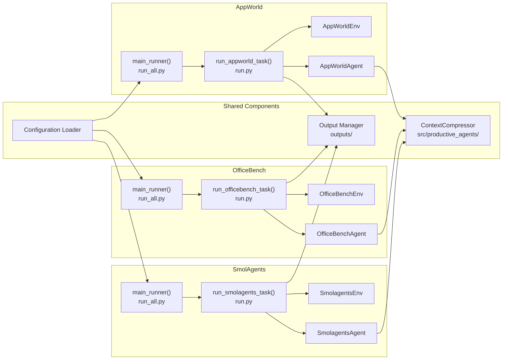
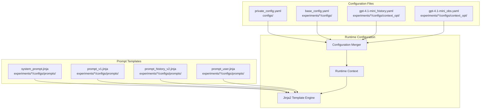
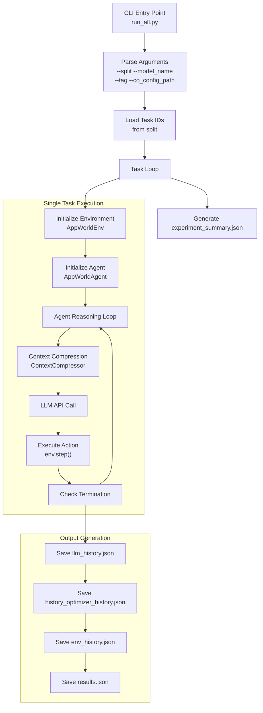
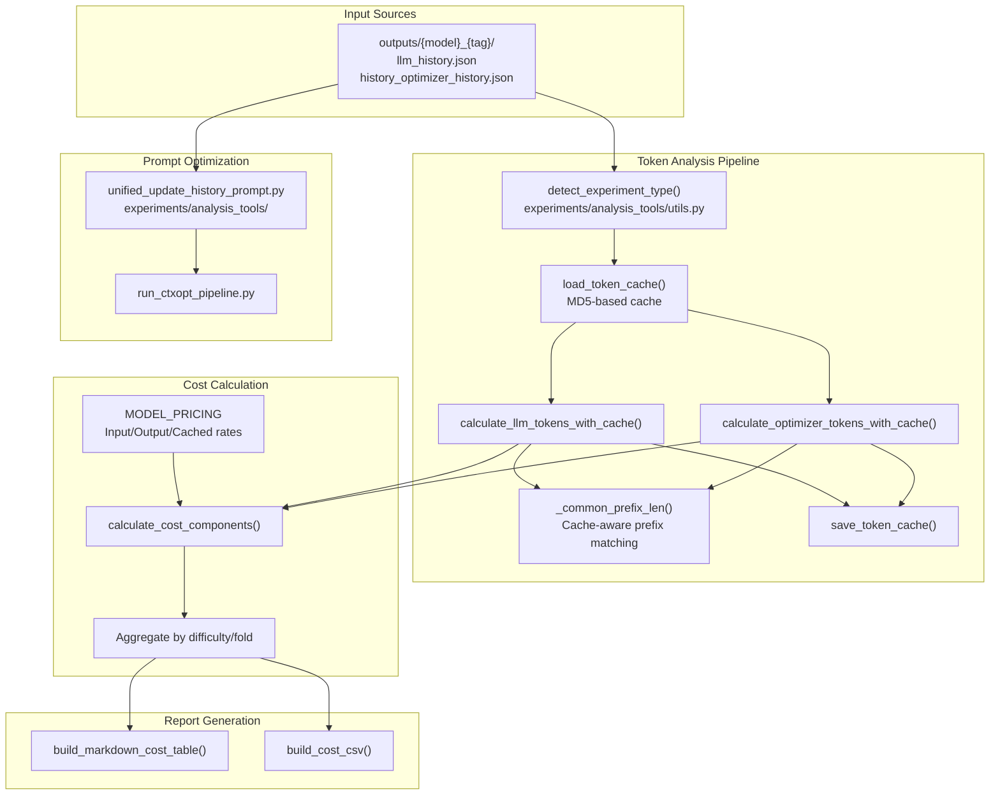
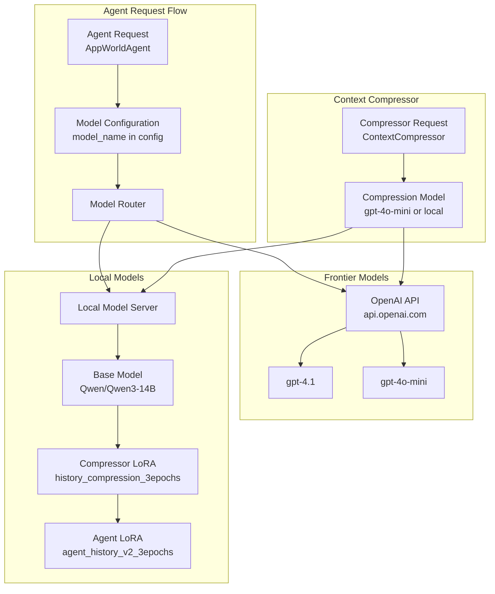

<!-- source: DeepWiki mcp.deepwiki.com · repo microsoft/acon · page 9.1 System Overview · fetched 2026-10-26 -->

# System Overview

<details>
<summary>Relevant source files</summary>

The following files were used as context for generating this wiki page:

- [README.md](README.md)
- [assets/concept.png](assets/concept.png)

</details>


## Purpose and Scope

This document provides a high-level overview of the ACON (Agent Context Optimization) framework architecture, describing the major system components and how they interact. It covers the core abstractions, execution pipeline, configuration system, and analysis infrastructure.

For detailed information about:
- Installing and running experiments, see [Getting Started](#2)
- Understanding the four-stage optimization pipeline, see [Four-Stage Pipeline](#3.2)
- Configuration file formats and options, see [Configuration](#6)
- Running analysis tools, see [Analysis and Optimization](#7)

## System Architecture

ACON implements a modular research framework for optimizing context compression in long-horizon LLM agents. The system is organized into three primary layers: **core abstractions**, **benchmark implementations**, and **supporting infrastructure**.

```mermaid
graph TB
    subgraph "Core Abstractions Layer"
        ENV["Environment<br/>src/productive_agents/base_env.py"]
        AGENT["Agent<br/>src/productive_agents/base_agent.py"]
        COMP["Context Compressor<br/>src/productive_agents/context_compressor.py"]
    end
    
    subgraph "Benchmark Implementations"
        AW_ENV["AppWorldEnv<br/>experiments/appworld/productive_agents/appworld_env.py"]
        AW_AGENT["AppWorldAgent<br/>experiments/appworld/productive_agents/appworld_agent.py"]
        OB_ENV["OfficeBenchEnv<br/>experiments/officebench/productive_agents/officebench_env.py"]
        OB_AGENT["OfficeBenchAgent<br/>experiments/officebench/productive_agents/officebench_agent.py"]
        SM_ENV["SmolagentsEnv<br/>experiments/smolagents/productive_agents/smolagents_env.py"]
        SM_AGENT["SmolagentsAgent<br/>experiments/smolagents/productive_agents/smolagents_agent.py"]
    end
    
    subgraph "Experiment Runners"
        AW_RUN["run.py / run_all.py<br/>experiments/appworld/"]
        OB_RUN["run.py / run_all.py<br/>experiments/officebench/"]
        SM_RUN["run.py / run_all.py<br/>experiments/smolagents/"]
    end
    
    subgraph "Configuration System"
        BASE_CFG["base_config.yaml<br/>experiments/appworld/configs/"]
        CTXOPT_CFG["context_opt/*.yaml<br/>experiments/appworld/configs/"]
        PROMPTS["*.jinja<br/>experiments/appworld/configs/prompts/"]
        PRIVATE["private_config.yaml<br/>configs/"]
    end
    
    subgraph "Analysis Infrastructure"
        TOKEN_ANALYSIS["analyze_experiment_tokens_v2<br/>experiments/analysis_tools/utils.py"]
        PROMPT_OPT["unified_update_history_prompt.py<br/>experiments/analysis_tools/"]
        EVAL["appworld evaluate"]
    end
    
    subgraph "Model Services"
        OPENAI["OpenAI API<br/>gpt-4.1, gpt-4o-mini"]
        LOCAL["Local Models<br/>Qwen3-14B + LoRAs"]
    end
    
    ENV --> AW_ENV
    ENV --> OB_ENV
    ENV --> SM_ENV
    AGENT --> AW_AGENT
    AGENT --> OB_AGENT
    AGENT --> SM_AGENT
    COMP --> AW_AGENT
    COMP --> OB_AGENT
    COMP --> SM_AGENT
    
    AW_ENV --> AW_RUN
    AW_AGENT --> AW_RUN
    OB_ENV --> OB_RUN
    OB_AGENT --> OB_RUN
    SM_ENV --> SM_RUN
    SM_AGENT --> SM_RUN
    
    BASE_CFG --> AW_RUN
    CTXOPT_CFG --> AW_RUN
    PROMPTS --> AW_RUN
    PRIVATE --> AW_RUN
    
    AW_RUN --> TOKEN_ANALYSIS
    OB_RUN --> TOKEN_ANALYSIS
    SM_RUN --> TOKEN_ANALYSIS
    
    TOKEN_ANALYSIS --> PROMPT_OPT
    
    AW_AGENT -.uses.-> OPENAI
    AW_AGENT -.uses.-> LOCAL
    COMP -.uses.-> OPENAI
    COMP -.uses.-> LOCAL
```



**Sources:** [README.md:114-119](), [README.md:126-131](), [README.md:132-137]()

## Core Abstractions

The framework defines three fundamental abstractions that provide a uniform interface across all benchmarks:

| Abstraction | Location | Purpose |
|-------------|----------|---------|
| `Environment` | `src/productive_agents/base_env.py` | Defines task execution environments and observation handling |
| `Agent` | `src/productive_agents/base_agent.py` | Implements agent reasoning and action selection logic |
| `ContextCompressor` | `src/productive_agents/context_compressor.py` | Handles context compression for both history and observations |

### Environment Abstraction

The `Environment` base class provides a standardized interface for benchmark tasks. Each benchmark implements its own environment subclass:

- **AppWorld**: `AppWorldEnv` in [experiments/appworld/productive_agents/appworld_env.py]()
- **OfficeBench**: `OfficeBenchEnv` in [experiments/officebench/productive_agents/officebench_env.py]()
- **SmolAgents**: `SmolagentsEnv` in [experiments/smolagents/productive_agents/smolagents_env.py]()

The environment handles task initialization, observation generation, action execution, and termination conditions.

### Agent Abstraction

The `Agent` base class defines the agent reasoning loop. Benchmark-specific implementations include:

- **AppWorld**: `AppWorldAgent` in [experiments/appworld/productive_agents/appworld_agent.py]()
- **OfficeBench**: `OfficeBenchAgent` in [experiments/officebench/productive_agents/officebench_agent.py]()
- **SmolAgents**: `SmolagentsAgent` in [experiments/smolagents/productive_agents/smolagents_agent.py]()

Each agent implementation integrates with the `ContextCompressor` to manage growing context windows during long-horizon task execution.

### Context Compressor

The `ContextCompressor` class in [src/productive_agents/context_compressor.py]() provides two compression strategies:

1. **History Compression**: Summarizes previous agent actions and observations
2. **Observation Compression**: Refines current observations to remove redundant information

Both strategies use configurable LLM-based compression with guidelines defined in YAML configuration files.

**Sources:** [README.md:114-119]()

## Benchmark Implementations



Each benchmark follows the same execution pattern:

1. **Runner Script** (`run_all.py`): Orchestrates batch execution across multiple tasks
2. **Task Runner** (`run.py`): Executes a single task with specified configuration
3. **Environment**: Initializes task state and handles observations
4. **Agent**: Executes the reasoning loop using context compression
5. **Output Manager**: Saves execution traces to the `outputs/` directory

**Sources:** [README.md:126-137]()

## Configuration System

The configuration system uses a hierarchical YAML structure with Jinja2 prompt templates:



### Configuration Hierarchy

| File | Purpose | Example Path |
|------|---------|--------------|
| `private_config.yaml` | API credentials | `configs/private_config.yaml` |
| `base_config.yaml` | Default agent settings | `experiments/appworld/configs/base_config.yaml` |
| Context optimization configs | Compression guidelines | `experiments/appworld/configs/context_opt/gpt-4.1-mini_history.yaml` |
| Prompt templates | Jinja2 prompt definitions | `experiments/appworld/configs/prompts/*.jinja` |

Configuration files are merged at runtime with command-line arguments taking precedence. The `--co_config_path` argument in `run_all.py` specifies context optimization configurations.

**Sources:** [README.md:104-110](), [README.md:66-80]()

## Execution Pipeline

The execution pipeline processes tasks through several stages:



### Output Structure

Each experiment generates a structured output directory:

```
experiments/appworld/outputs/{model_name}_{tag}/{split}/
├── task_1/
│   ├── llm_history.json              # Agent LLM interactions
│   ├── history_optimizer_history.json # Context compression logs
│   ├── env_history.json              # Environment state transitions
│   └── results.json                  # Task execution results
├── task_2/
│   └── ...
└── experiment_summary.json           # Aggregated results
```

**Sources:** [README.md:82-87]()

## Analysis Infrastructure

The framework provides sophisticated tools for analyzing experiment results:



### Key Analysis Functions

| Function | Location | Purpose |
|----------|----------|---------|
| `analyze_experiment_tokens_v2` | `experiments/analysis_tools/utils.py` | Main token analysis entry point |
| `detect_experiment_type` | `experiments/analysis_tools/utils.py` | Identifies benchmark type from directory structure |
| `calculate_llm_tokens_with_cache` | `experiments/analysis_tools/utils.py` | Computes agent LLM token usage with caching |
| `calculate_optimizer_tokens_with_cache` | `experiments/analysis_tools/utils.py` | Computes compressor token usage with caching |
| `unified_update_history_prompt.py` | `experiments/analysis_tools/` | Optimizes compression prompts based on results |

The cache system uses MD5 hashing and schema versioning to avoid redundant token calculations across analyses.

**Sources:** Based on high-level diagrams provided

## Model Serving Architecture

ACON supports two model serving modes:



### Model Configuration

The framework uses the `model_name` parameter to determine routing:

- **Frontier Models**: Direct API calls to OpenAI for models like `gpt-4.1`, `gpt-4o-mini`
- **Local Models**: Qwen3-14B base model with stacked LoRA adapters for compression and agent reasoning

The same configuration and prompt templates work with both model types, enabling seamless comparison between frontier and distilled models.

**Sources:** [README.md:132-137]()

## System Data Flow

The complete data flow through the system follows this pattern:

1. **Configuration Loading**: YAML configs and Jinja templates loaded at startup
2. **Task Initialization**: Environment creates initial task state and observation
3. **Agent Reasoning Loop**:
   - Context compression applied to history and/or observations
   - Compressed context + prompts sent to LLM
   - LLM response parsed into action
   - Action executed in environment
   - New observation generated
4. **Output Generation**: All interactions logged to JSON files
5. **Post-Processing**: Token analysis and cost calculation performed
6. **Prompt Optimization**: Results feed into guideline optimization pipeline

This modular architecture enables systematic experimentation across benchmarks, model types, and compression strategies while maintaining consistent analysis and evaluation procedures.

**Sources:** [README.md:1-165]()

---

