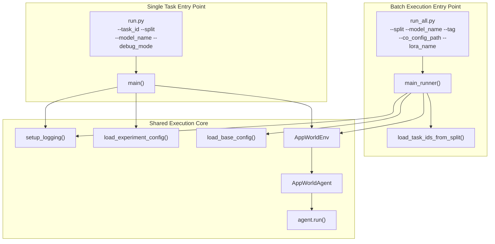
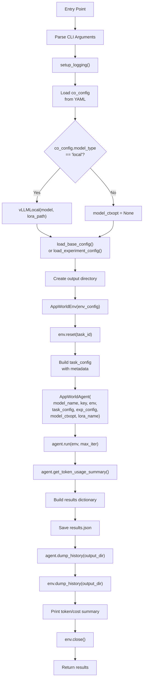
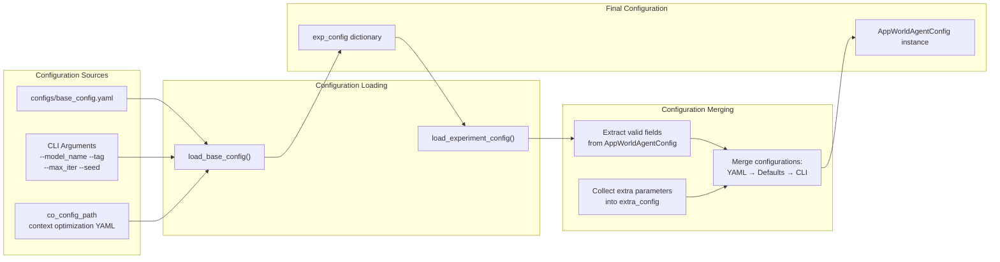
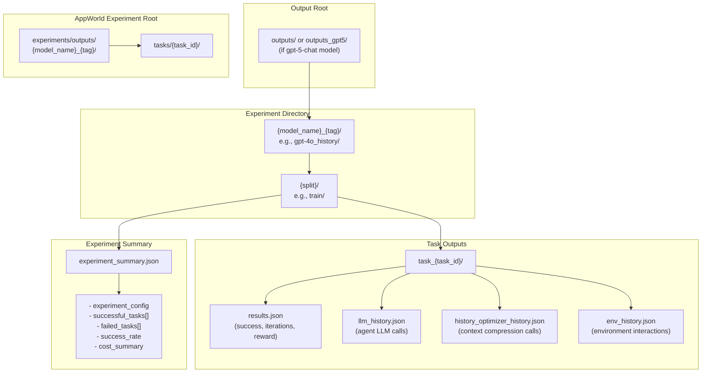
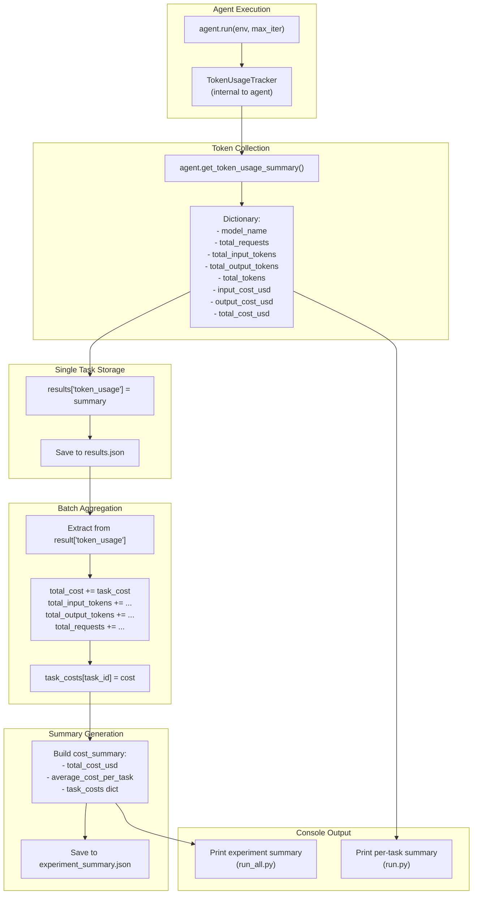
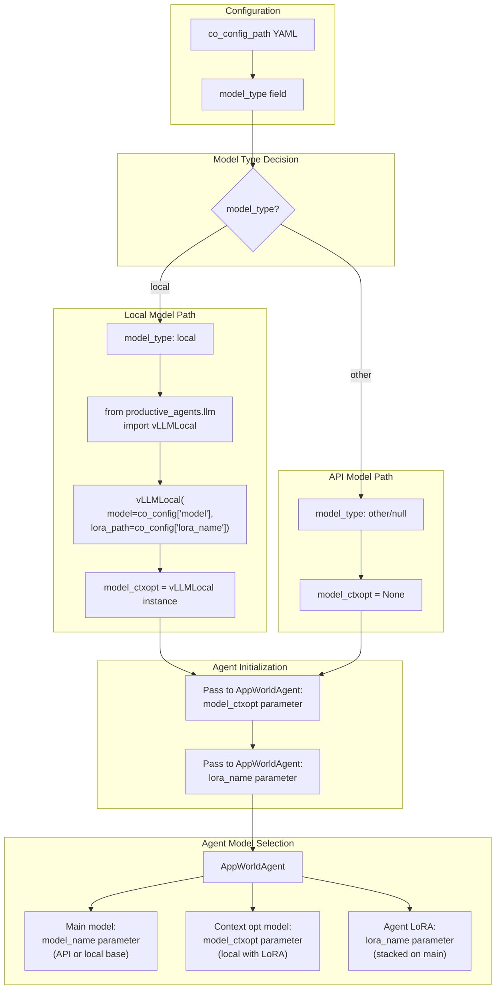
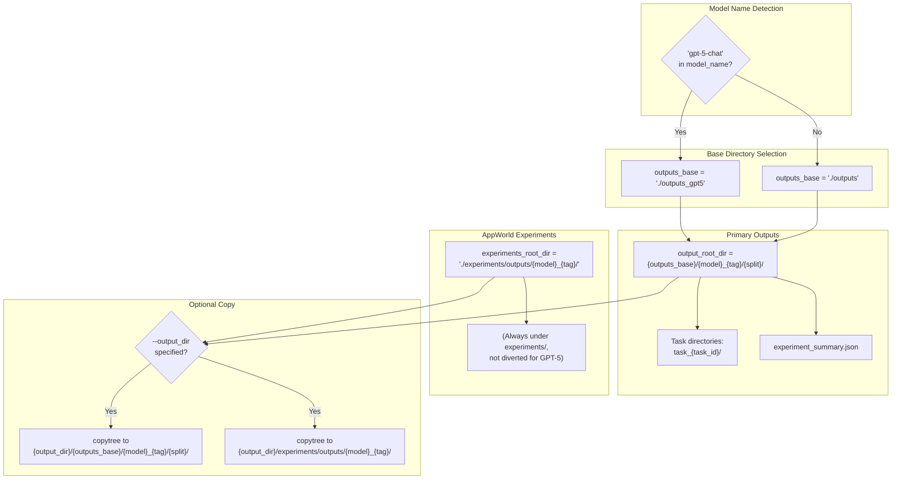

<!-- source: DeepWiki mcp.deepwiki.com · repo microsoft/acon · page 9.2 Experiment Orchestration · fetched 2026-10-26 -->

# Experiment Orchestration

<details>
<summary>Relevant source files</summary>

The following files were used as context for generating this wiki page:

- [experiments/__init__.py](experiments/__init__.py)
- [experiments/appworld/run.py](experiments/appworld/run.py)
- [experiments/appworld/run_all.py](experiments/appworld/run_all.py)

</details>


This page describes how experiments are orchestrated and executed in the ACON framework. It covers the CLI entry points, task execution flow, batch orchestration, progress tracking, and result aggregation. For information about the configuration system that feeds into experiment orchestration, see [Configuration System](#9.3). For details on post-execution analysis tools, see [Analysis Tools Architecture](#9.4).

## Overview

The ACON framework provides two primary entry points for running experiments:

- **Single Task Execution**: `experiments/appworld/run.py` executes a single task with specified configuration
- **Batch Execution**: `experiments/appworld/run_all.py` orchestrates multiple tasks across dataset splits with progress tracking and aggregated reporting

Both entry points share the same core execution logic but differ in orchestration and reporting capabilities.

**Sources**: [experiments/appworld/run.py:1-233](), [experiments/appworld/run_all.py:1-364]()

## CLI Entry Points



**Figure 1: CLI Entry Points and Execution Flow**

The framework provides distinct entry points optimized for different use cases:

| Entry Point | Purpose | Key Parameters | Use Case |
|-------------|---------|----------------|----------|
| `run.py` | Single task execution | `task_id`, `split`, `model_name` | Development, debugging, manual testing |
| `run_all.py` | Batch orchestration | `split`, `tag`, `co_config_path` | Production runs, benchmarking, experiments |

**Sources**: [experiments/appworld/run.py:54-205](), [experiments/appworld/run_all.py:75-363]()

## Task Execution Flow



**Figure 2: Single Task Execution Flow**

The single task execution flow in `run.py` follows this sequence:

1. **Initialization Phase**: Parse arguments, setup logging, load context optimization config
2. **Model Setup**: Initialize local model (vLLM) or configure for API-based models
3. **Environment Setup**: Create `AppWorldEnv`, reset with specific task
4. **Agent Initialization**: Create `AppWorldAgent` with all configuration
5. **Execution**: Run agent for up to `max_iter` iterations
6. **Collection**: Gather token usage, cost metrics, and results
7. **Persistence**: Save results, agent history, and environment history
8. **Cleanup**: Close environment and return results

**Sources**: [experiments/appworld/run.py:54-205](), [experiments/appworld/run.py:28-51]()

## Batch Orchestration

```mermaid
graph TB
    START["main_runner()"] --> PARSE["Parse Arguments"]
    PARSE --> LOAD_CO_CFG["Load co_config_path YAML"]
    LOAD_CO_CFG --> INIT_CTXOPT{"Model type?"}
    INIT_CTXOPT -->|local| VLLM["vLLMLocal(model, lora)"]
    INIT_CTXOPT -->|API| NO_MODEL["model_ctxopt = None"]
    
    VLLM --> BUILD_BASE
    NO_MODEL --> BUILD_BASE["load_base_config(<br/>tag, model_name, co_config)"]
    BUILD_BASE --> CLEAR_LOG["Clear error.log"]
    
    CLEAR_LOG --> GET_TASKS{"Task source?"}
    GET_TASKS -->|task_id| SINGLE["task_list = [task_id]"]
    GET_TASKS -->|task_ids| MULTI["task_list = task_ids"]
    GET_TASKS -->|split| LOAD_SPLIT["load_task_ids_from_split(split)"]
    
    SINGLE --> CHECK_RERUN
    MULTI --> CHECK_RERUN
    LOAD_SPLIT --> CHECK_RERUN{"rerun_failed?"}
    
    CHECK_RERUN -->|Yes| LOAD_SUMMARY["Load experiment_summary.json"]
    LOAD_SUMMARY --> GET_FAILED["task_list = failed_tasks"]
    GET_FAILED --> REMOVE_DIRS["Remove existing output dirs"]
    CHECK_RERUN -->|No| SET_DIRS
    REMOVE_DIRS --> SET_DIRS
    
    SET_DIRS["Setup output directories"] --> INIT_VARS["Initialize tracking variables:<br/>successful_tasks,<br/>failed_tasks,<br/>total_cost, etc."]
    
    INIT_VARS --> DEBUG_CHECK{"debug mode?"}
    DEBUG_CHECK -->|Yes| SINGLE_ITER["Run first task only"]
    DEBUG_CHECK -->|No| PROGRESS["Create Progress bar"]
    
    PROGRESS --> LOOP_START["For each task in task_list"]
    SINGLE_ITER --> LOOP_START
    
    LOOP_START --> CHECK_EXISTS{"continue_existing<br/>and dir exists?"}
    CHECK_EXISTS -->|Yes| SKIP["Skip task"]
    CHECK_EXISTS -->|No| RUN_TASK["main(task_id, split,<br/>output_dir, exp_config,<br/>model_name, model_ctxopt,<br/>lora_name)"]
    
    RUN_TASK --> COLLECT_COST["Extract token_usage:<br/>total_cost_usd,<br/>input/output tokens"]
    COLLECT_COST --> UPDATE_TOTALS["Update total_cost,<br/>total_input_tokens,<br/>total_output_tokens,<br/>total_requests"]
    UPDATE_TOTALS --> CHECK_SUCCESS{"result.success?"}
    
    CHECK_SUCCESS -->|Yes| ADD_SUCCESS["successful_tasks.append()"]
    CHECK_SUCCESS -->|No| ADD_FAILED["failed_tasks.append()"]
    
    ADD_SUCCESS --> ADVANCE
    ADD_FAILED --> ADVANCE["progress.advance(1)"]
    SKIP --> ADVANCE
    
    ADVANCE --> LOOP_END{"More tasks?"}
    LOOP_END -->|Yes| LOOP_START
    LOOP_END -->|No| CALC_SUMMARY
    
    CALC_SUMMARY["Calculate summary:<br/>success_rate,<br/>total_time,<br/>cost_summary"] --> PRINT_SUMMARY["Print experiment summary"]
    PRINT_SUMMARY --> SAVE_SUMMARY["Save experiment_summary.json"]
    SAVE_SUMMARY --> COPY_OUT{"output_dir specified?"}
    COPY_OUT -->|Yes| COPY["copytree to target"]
    COPY_OUT -->|No| END
    COPY --> END["Return"]
```



**Figure 3: Batch Orchestration Flow**

The `main_runner()` function in `run_all.py` orchestrates batch execution with these key features:

### Task Loading Strategies

The orchestrator supports multiple task loading strategies:

| Strategy | Trigger | Source | Use Case |
|----------|---------|--------|----------|
| Single Task | `--task_id` | Direct argument | Testing specific task |
| Task List | `--task_ids` | Argument list | Custom subset |
| Split-based | `--split` | `load_task_ids_from_split()` | Full split execution |
| Failed Tasks | `--rerun_failed` | `experiment_summary.json` | Retry failures |

**Sources**: [experiments/appworld/run_all.py:143-172]()

### Progress Tracking

Two modes of execution are supported based on the `--debug` flag:

**Debug Mode** [experiments/appworld/run_all.py:187-225]():
- Runs only first task
- No progress bar
- Detailed console output
- Always reruns task (ignores existing output)

**Production Mode** [experiments/appworld/run_all.py:226-280]():
- Uses `rich.Progress` with multiple columns
- Shows spinner, progress bar, task count, elapsed time, ETA
- Supports `--continue_existing` to skip completed tasks
- Parallel-friendly output

**Sources**: [experiments/appworld/run_all.py:187-280]()

## Configuration Assembly



**Figure 4: Configuration Assembly Process**

Configuration assembly follows a multi-stage process:

### Stage 1: Base Configuration Loading

The `load_base_config()` function [experiments/appworld/run_all.py:33-57]() creates the base configuration:

```python
def load_base_config(tag: str, model_name: str, 
                     use_workflow_memory: bool = False, 
                     co_config: dict = None) -> dict
```

It performs:
1. Load `configs/base_config.yaml` if exists
2. Override with runtime parameters (`tag`, `model_name`, `max_iter`)
3. Add context optimization config (`co_config`)
4. Set derived fields (`exp_id`, `experiment_name`)

### Stage 2: Experiment Configuration Validation

The `load_experiment_config()` function [experiments/appworld/run.py:28-51]() validates and structures configuration:

1. Extract valid field names from `AppWorldAgentConfig.__dataclass_fields__`
2. Separate recognized fields from extra parameters
3. Place unrecognized parameters into `extra_config` dictionary
4. Remove `None` values to allow defaults
5. Instantiate `AppWorldAgentConfig` dataclass

This two-stage process ensures type safety while maintaining flexibility for custom parameters.

**Sources**: [experiments/appworld/run_all.py:33-57](), [experiments/appworld/run.py:28-51]()

## Output Directory Structure



**Figure 5: Output Directory Structure**

The framework creates a hierarchical output structure:

### Primary Outputs Directory

**Path Pattern**: `outputs/{model_name}_{tag}/{split}/`

For GPT-5 models, outputs are diverted to `outputs_gpt5/` [experiments/appworld/run_all.py:155-156]().

**Contents**:
- `task_{task_id}/` - Per-task output directory
- `experiment_summary.json` - Aggregated experiment metadata

### Task-Level Outputs

Each task directory contains:

| File | Source | Purpose |
|------|--------|---------|
| `results.json` | `main()` return value | Success status, iterations, reward, config |
| `llm_history.json` | `agent.dump_history()` | All agent LLM interactions |
| `history_optimizer_history.json` | `agent.dump_history()` | Context compression LLM calls |
| `env_history.json` | `env.dump_history()` | Environment state transitions |

**Sources**: [experiments/appworld/run.py:168-176](), [experiments/appworld/run_all.py:155-159]()

### Experiment Summary Schema

The `experiment_summary.json` file [experiments/appworld/run_all.py:321-345]() contains:

```json
{
  "experiment_config": {...},
  "split": "train",
  "total_tasks": 100,
  "successful_tasks": ["task_1", "task_2", ...],
  "failed_tasks": ["task_42", ...],
  "success_rate": 0.95,
  "total_time_seconds": 3600,
  "run_timestamp": 1234567890.123,
  "cost_summary": {
    "total_cost_usd": 12.34,
    "total_input_tokens": 1000000,
    "total_output_tokens": 250000,
    "total_tokens": 1250000,
    "total_requests": 500,
    "average_cost_per_task": 0.1234,
    "task_costs": {
      "task_1": 0.05,
      "task_2": 0.08
    }
  }
}
```

**Sources**: [experiments/appworld/run_all.py:321-345]()

## Cost and Token Tracking



**Figure 6: Cost and Token Tracking Flow**

The framework provides comprehensive cost tracking at multiple levels:

### Task-Level Tracking

After each task execution, token usage is collected [experiments/appworld/run.py:154-193]():

1. Call `agent.get_token_usage_summary()` to retrieve aggregated metrics
2. Add to results dictionary under `token_usage` key
3. Print formatted summary to console
4. Save with results to `results.json`

### Batch-Level Aggregation

During batch execution [experiments/appworld/run_all.py:263-271]():

1. Extract `token_usage` from each task result
2. Accumulate into running totals (`total_cost`, `total_input_tokens`, etc.)
3. Store individual task costs in `task_costs` dictionary
4. Calculate average cost per task

### Cost Summary Output

The final cost summary [experiments/appworld/run_all.py:304-315]() includes:
- Total requests across all tasks
- Total input/output tokens
- Total cost in USD
- Average cost per task
- Per-task cost breakdown

This enables detailed cost analysis using the analysis tools (see [Token and Cost Analysis](#7.1)).

**Sources**: [experiments/appworld/run.py:154-193](), [experiments/appworld/run_all.py:263-315]()

## Execution Modes

The orchestration system supports several execution modes controlled by CLI flags:

### Standard Execution

**Command**: `python -m experiments.appworld.run_all --split train --model_name gpt-4o`

Executes all tasks in the split sequentially.

### Debug Mode

**Command**: `python -m experiments.appworld.run_all --split train --debug`

- Runs only first task [experiments/appworld/run_all.py:187-225]()
- Disables progress bar for cleaner console output
- Always reruns task (ignores existing output)
- Enables debug-level logging

### Continue Existing

**Command**: `python -m experiments.appworld.run_all --split train --continue_existing`

- Skips tasks with existing output directories [experiments/appworld/run_all.py:245-248]()
- Useful for resuming interrupted runs
- Does not recompute results for completed tasks

### Rerun Failed

**Command**: `python -m experiments.appworld.run_all --split train --rerun_failed`

1. Loads `experiment_summary.json` [experiments/appworld/run_all.py:161-165]()
2. Extracts `failed_tasks` list
3. Removes existing output directories for failed tasks [experiments/appworld/run_all.py:166-171]()
4. Reruns only those tasks

### Custom Task Subset

**Single Task**: `python -m experiments.appworld.run.py --task_id task_123`

**Multiple Tasks**: `python -m experiments.appworld.run_all --task_ids task_1 task_2 task_3`

Executes only specified tasks, useful for targeted testing.

**Sources**: [experiments/appworld/run_all.py:83-96](), [experiments/appworld/run_all.py:143-172]()

## Model Serving Integration



**Figure 7: Model Serving Integration**

The orchestration system integrates with both API-based and local model serving:

### Context Optimization Model Setup

If a context optimization config is provided via `--co_config_path` [experiments/appworld/run_all.py:104-119]():

1. Load YAML configuration
2. Check `model_type` field
3. If `"local"`:
   - Import `vLLMLocal` from `productive_agents.llm`
   - Initialize with `model` and `lora_name` from config
   - Pass instance as `model_ctxopt` to agent
4. Otherwise:
   - Set `model_ctxopt = None` (uses API-based model)

### Agent Model Configuration

The agent supports three model parameters [experiments/appworld/run.py:138-147]():

| Parameter | Purpose | Source |
|-----------|---------|--------|
| `model_name` | Main reasoning model | CLI `--model_name` |
| `model_ctxopt` | Context compression model | Context optimization config |
| `lora_name` | Agent LoRA adapter | CLI `--lora_name` |

This architecture enables:
- **Frontier models**: Both agent and context compression via API (`model_ctxopt=None`)
- **Hybrid**: Frontier agent with local context compression (`model_ctxopt=vLLMLocal`)
- **Fully local**: Local base model with stacked LoRAs for both context compression and agent reasoning

**Sources**: [experiments/appworld/run_all.py:104-119](), [experiments/appworld/run.py:138-147]()

## Error Handling and Logging

The orchestration system implements multi-level logging and error handling:

### Logging Setup

The `setup_logging()` function [experiments/appworld/run.py:19-26]() configures:

```python
logging.basicConfig(
    level=logging.DEBUG if debug_mode else logging.INFO,
    format="%(asctime)s - %(name)s - %(levelname)s - %(message)s"
)
```

Additionally, noisy loggers are suppressed in batch mode [experiments/appworld/run_all.py:28-30]():
- `httpx` (HTTP client)
- `azure.identity` (Azure authentication)
- `azure.core` (Azure SDK core)

### Task-Level Error Handling

Each task execution is wrapped to capture:
1. Success/failure status in `results['success']`
2. Termination reason in `results['termination_reason']`
3. Final reward and iteration count

Failed tasks are:
- Added to `failed_tasks` list [experiments/appworld/run_all.py:222, 277]()
- Printed with failure indicator [experiments/appworld/run_all.py:223, 278]()
- Included in experiment summary [experiments/appworld/run_all.py:326]()

### Error Log

An `error.log` file is created if errors occur during execution. The batch orchestrator clears this file at the start of each run [experiments/appworld/run_all.py:139-141]().

**Sources**: [experiments/appworld/run.py:19-26](), [experiments/appworld/run_all.py:22-30](), [experiments/appworld/run_all.py:139-141]()

## Output Directory Routing



**Figure 8: Output Directory Routing Logic**

The framework implements special routing for different model families:

### GPT-5 Diversion

To separate GPT-5 experiments from other models [experiments/appworld/run_all.py:155-156]():

```python
is_gpt5 = 'gpt-5-chat' in args.model_name
outputs_base = './outputs_gpt5' if is_gpt5 else './outputs'
```

This creates parallel directory trees for GPT-5 models.

### Dual Output Paths

Two separate directory trees are maintained:

1. **Primary Outputs** (`outputs/` or `outputs_gpt5/`):
   - Contains task results, histories, and summaries
   - Pattern: `{outputs_base}/{model}_{tag}/{split}/`

2. **AppWorld Experiments** (`experiments/outputs/`):
   - Contains AppWorld-specific experiment data
   - Pattern: `experiments/outputs/{model}_{tag}/`
   - Always under `experiments/`, never diverted for GPT-5

### Optional Output Copy

If `--output_dir` is specified [experiments/appworld/run_all.py:349-359]():
1. Copy entire primary outputs tree to specified location
2. Copy experiments tree to specified location
3. Preserve directory structure in target location

This enables collecting outputs to a shared storage location while maintaining local copies.

**Sources**: [experiments/appworld/run_all.py:155-159](), [experiments/appworld/run_all.py:349-359]()

## Integration with Evaluation Pipeline

The orchestration system produces outputs compatible with downstream evaluation:

### AppWorld Evaluation

After experiment completion, results can be evaluated using:

```bash
appworld evaluate {model_name}_{tag} {split}
```

The evaluator expects the directory structure created by the orchestrator:
- Task directories under `{split}/`
- Each containing `results.json` with success status

### Analysis Tools

The output structure enables analysis via [Token and Cost Analysis](#7.1):

```python
from experiments.analysis_tools.utils import analyze_experiment_tokens_v2

stats = analyze_experiment_tokens_v2(
    experiment_dir="outputs/gpt-4o_history",
    split="train"
)
```

The analysis tools automatically detect:
- Experiment type (AppWorld, OfficeBench, SmolAgents)
- Output directory structure
- History files (`llm_history.json`, `history_optimizer_history.json`)
- Task metadata for aggregation

**Sources**: [experiments/appworld/run_all.py:321-345]()

---

