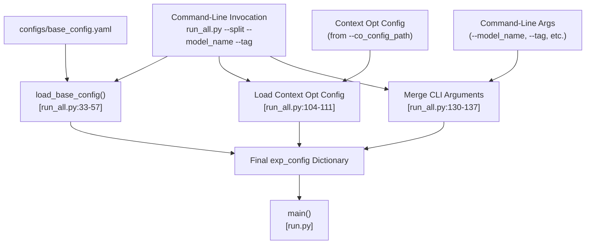
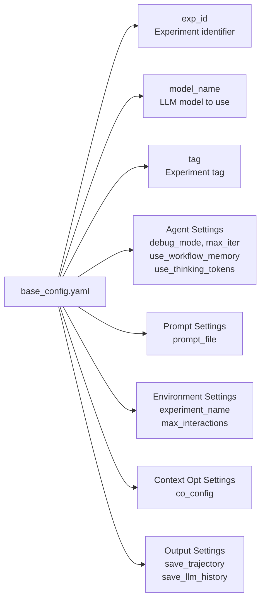
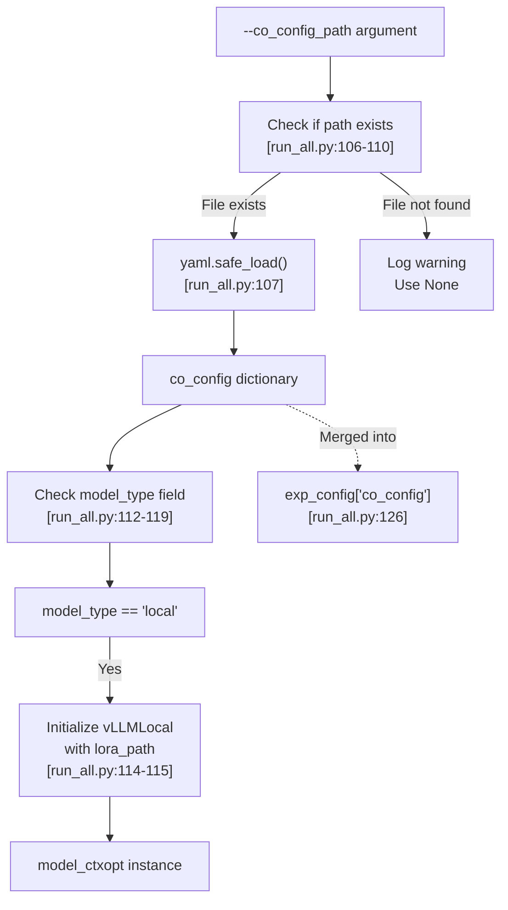
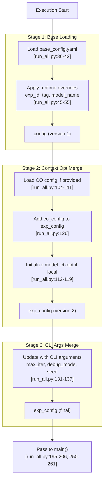
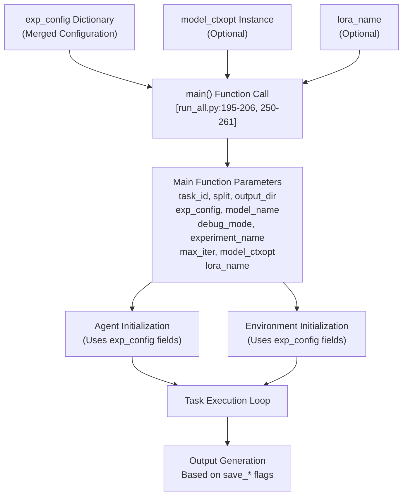

<!-- source: DeepWiki mcp.deepwiki.com · repo microsoft/acon · page 9.3 Configuration System · fetched 2026-10-26 -->

# Configuration System

<details>
<summary>Relevant source files</summary>

The following files were used as context for generating this wiki page:

- [experiments/appworld/configs/base_config.yaml](experiments/appworld/configs/base_config.yaml)
- [experiments/appworld/run_all.py](experiments/appworld/run_all.py)

</details>


## Purpose and Scope

The Configuration System provides a multi-layered approach to configuring ACON experiments through YAML files, command-line arguments, and runtime defaults. This document describes the architecture of the configuration loading and merging system, including how different configuration sources are combined and applied during experiment execution.

For details on specific configuration file formats and options, see [Base Configuration](#6.1) and [Context Optimization Configuration](#6.2). For information on command-line usage, see [Command-Line Reference](#5.3).

## Configuration Architecture Overview

The configuration system implements a hierarchical merge strategy where multiple configuration sources are combined with well-defined precedence rules. The system supports three primary configuration sources that are merged at runtime.

### Configuration Loading Flow



Sources: [experiments/appworld/run_all.py:33-137]()

### Configuration Precedence Hierarchy

Configuration values are merged according to this precedence order (highest to lowest):

| Priority | Source | Example | Applied At |
|----------|--------|---------|------------|
| 1 (Highest) | Command-line arguments | `--max_iter 100` | [run_all.py:130-137]() |
| 2 | Runtime overrides | `exp_id`, `tag`, `model_name` | [run_all.py:45-55]() |
| 3 | Context optimization config | Loaded from `--co_config_path` | [run_all.py:104-111]() |
| 4 (Lowest) | Base configuration file | `configs/base_config.yaml` | [run_all.py:36-42]() |

## Configuration Sources

### Base Configuration File

The base configuration file provides default values for all experiment parameters. This file is loaded first and serves as the foundation for all subsequent configuration.

**File Structure:**



Sources: [experiments/appworld/configs/base_config.yaml:1-25]()

**Loading Logic:**

The base configuration is loaded using a fallback strategy. If the file exists, it is loaded via YAML parsing; otherwise, an empty dictionary is used as a minimal fallback.

```
Function: load_base_config(tag, model_name, use_workflow_memory, co_config)
Location: [run_all.py:33-57]()

Steps:
1. Check if base_config.yaml exists at configs/base_config.yaml
2. If exists: Load YAML content into config dict
3. If not exists: Initialize empty config dict (fallback)
4. Override with runtime values (exp_id, model_name, tag, etc.)
5. Return merged config dictionary
```

### Context Optimization Configuration

Context optimization configurations are optional YAML files that define parameters for history and observation compression. These configurations are loaded separately and merged into the main configuration.

**Loading Process:**



Sources: [experiments/appworld/run_all.py:104-127]()

**Special Handling:**

When a context optimization configuration specifies a local model (`model_type: "local"`), the system initializes a `vLLMLocal` instance with the specified LoRA adapter. This instance is passed separately to the main execution function as `model_ctxopt`.

### Command-Line Arguments

Command-line arguments provide the highest precedence configuration values. These arguments can override any values from configuration files.

**Argument Processing:**

| Argument | Type | Default | Overrides | Applied At |
|----------|------|---------|-----------|------------|
| `--split` | str | `"train"` | N/A | Task list loading |
| `--task_id` | str | `None` | N/A | Single task mode |
| `--tag` | str | `"debug"` | Base config `tag` | [run_all.py:48]() |
| `--model_name` | str | `"gpt-4o"` | Base config `model_name` | [run_all.py:47]() |
| `--max_iter` | int | `50` | Base config `max_iter` | [run_all.py:132]() |
| `--use_workflow_memory` | flag | `False` | Base config setting | [run_all.py:50]() |
| `--co_config_path` | str | `None` | Base config `co_config` | [run_all.py:105-111]() |
| `--debug` | flag | `False` | Base config `debug_mode` | [run_all.py:134]() |
| `--seed` | int | `42` | N/A | [run_all.py:136]() |
| `--lora_name` | str | `None` | N/A | Agent LoRA selection |

Sources: [experiments/appworld/run_all.py:79-96]()

## Configuration Merging Process

The configuration merging process follows a three-stage pattern that ensures proper precedence and allows for flexible configuration composition.

### Three-Stage Merge Process



Sources: [experiments/appworld/run_all.py:33-137]()

### Stage 1: Base Configuration Loading

**Code Reference:** [experiments/appworld/run_all.py:33-57]()

The first stage loads the base configuration file and applies runtime-specific values. The `load_base_config()` function:

1. Attempts to load `configs/base_config.yaml`
2. Creates empty dict if file doesn't exist (fallback mode)
3. Applies `.update()` with runtime values including:
   - `exp_id`: Formatted as `{tag}_{model_name}`
   - `model_name`: From function argument
   - `tag`: From function argument
   - `max_iter`: Default 50
   - `use_workflow_memory`: From function argument
   - `use_thinking_tokens`: Always `True`
   - `prompt_file`: Default `"./prompts/prompts_v1.json"`
   - `co_config`: From function argument (may be None)
   - `experiment_name`: Formatted as `experiment_{tag}`

### Stage 2: Context Optimization Integration

**Code Reference:** [experiments/appworld/run_all.py:104-127]()

The second stage loads and integrates context optimization configuration:

1. If `--co_config_path` provided:
   - Load YAML file into `co_config` dict
   - Warn if file doesn't exist
2. Check `co_config["model_type"]`:
   - If `"local"`: Initialize `vLLMLocal` with LoRA path
   - Otherwise: Set `model_ctxopt` to None
3. Add `co_config` to `exp_config` via function argument
4. Store `co_config_path` in `exp_config`

### Stage 3: Command-Line Argument Override

**Code Reference:** [experiments/appworld/run_all.py:130-137]()

The final stage applies command-line argument overrides using `exp_config.update()`:

```python
exp_config.update({
    'max_iter': args.max_iter,
    'experiment_name': experiment_name,
    'debug_mode': args.debug,
    'co_config_path': args.co_config_path,
    'seed': args.seed
})
```

This ensures command-line arguments have the highest precedence and will override any conflicting values from previous stages.

## Configuration Schema and Field Definitions

### Core Configuration Fields

| Field | Type | Purpose | Default | Source |
|-------|------|---------|---------|--------|
| `exp_id` | str | Unique experiment identifier | `"{tag}_{model}"` | Runtime |
| `model_name` | str | LLM model to use | `"gpt-4o"` | CLI/Base |
| `tag` | str | Experiment tag for organization | `"base"` | CLI/Base |
| `debug_mode` | bool | Enable debug output | `true` | CLI/Base |
| `max_iter` | int | Maximum agent iterations | `50` | CLI/Base |
| `use_workflow_memory` | bool | Enable workflow memory | `false` | CLI/Base |
| `use_thinking_tokens` | bool | Enable thinking token usage | `true` | Runtime |
| `experiment_name` | str | Experiment name for outputs | `"minimal_test"` | Runtime |
| `max_interactions` | int | Max environment interactions | `50` | Base |
| `save_trajectory` | bool | Save trajectory data | `true` | Base |
| `save_llm_history` | bool | Save LLM history | `true` | Base |
| `prompt_file` | str/null | Path to prompt definitions | `null` | Base |
| `co_config` | dict/null | Context optimization config | `null` | CO Config |
| `co_config_path` | str/null | Path to CO config file | `null` | CLI |
| `seed` | int | Random seed for LLM | `42` | CLI |

Sources: [experiments/appworld/configs/base_config.yaml:1-25](), [experiments/appworld/run_all.py:33-137]()

### Context Optimization Configuration Fields

When a context optimization config is loaded via `--co_config_path`, the following fields may be present in the `co_config` dictionary:

| Field | Type | Purpose | Example |
|-------|------|---------|---------|
| `model_type` | str | Type of model serving | `"local"` or `"api"` |
| `model` | str | Model identifier | `"Qwen/Qwen3-14B"` |
| `lora_name` | str | LoRA adapter path | `"history_compression_3epochs"` |
| `history_compression` | dict | History compression settings | See [History Compression](#6.2.1) |
| `observation_compression` | dict | Observation compression settings | See [Observation Compression](#6.2.2) |

## Configuration Flow Through System Components

### From Configuration to Execution



Sources: [experiments/appworld/run_all.py:195-261]()

### Configuration Usage Patterns

The configuration system supports several common usage patterns for different experimental scenarios:

**Pattern 1: Baseline Experiment (No Context Optimization)**
```bash
python run_all.py --split train --model_name gpt-4o --tag baseline
```
- Uses `base_config.yaml` defaults
- No context optimization applied
- All configuration from base file + CLI args

**Pattern 2: Context-Optimized Experiment**
```bash
python run_all.py --split train --model_name gpt-4.1-mini \
  --tag history_v2 --co_config_path configs/context_opt/gpt-4.1-mini_history.yaml
```
- Loads base configuration
- Merges context optimization config
- Applies history compression during execution

**Pattern 3: Local Model with LoRA**
```bash
python run_all.py --split train --model_name Qwen/Qwen3-14B \
  --tag local_agent --lora_name agent_history_v2_3epochs \
  --co_config_path configs/context_opt/local_history.yaml
```
- Base config + CO config
- Initializes `vLLMLocal` for context optimization
- Loads LoRA adapter for agent model

**Pattern 4: Debug Mode Override**
```bash
python run_all.py --split train --model_name gpt-4o --tag test --debug
```
- Overrides `debug_mode` to `True` regardless of base config
- Runs single task only
- Enhanced logging output

## Special Configuration Behaviors

### Output Directory Routing

The configuration system implements special routing logic for certain model names:

**Code Reference:** [experiments/appworld/run_all.py:155-159]()

```python
is_gpt5 = 'gpt-5-chat' in args.model_name
outputs_base = './outputs_gpt5' if is_gpt5 else './outputs'
output_root_dir = f'{outputs_base}/{args.model_name.replace("/","_")}_{args.tag}/{args.split}/'
experiments_root_dir = f'./experiments/outputs/{args.model_name.replace("/","_")}_{args.tag}/'
```

Models containing `'gpt-5-chat'` in their name are routed to `./outputs_gpt5/` instead of `./outputs/`, allowing separation of preview model results.

### Experiment Name Formatting

The `experiment_name` field is constructed from configuration values and follows specific formatting rules:

**Code Reference:** [experiments/appworld/run_all.py:128-133]()

```python
experiment_name = f'{args.model_name.replace("/","_")}_{args.tag}'
exp_config.update({
    'experiment_name': experiment_name,
    # ...
})
```

Forward slashes in model names are replaced with underscores to ensure filesystem compatibility.

### Continue and Rerun Logic

The configuration system supports resuming experiments and rerunning failed tasks through special flags:

**Continue Existing (`--continue_existing`):**
- Code: [run_all.py:245-248]()
- Allows running tasks even if output directory exists
- Useful for adding more tasks to an existing experiment

**Rerun Failed (`--rerun_failed`):**
- Code: [run_all.py:161-172]()
- Loads `experiment_summary.json` from previous run
- Extracts failed task IDs
- Removes existing experiment folders for those tasks
- Runs only the failed tasks

## Configuration Validation and Error Handling

### File Existence Checks

The system performs defensive checks for configuration file existence:

**Base Config:** [run_all.py:36-42]()
- If `base_config.yaml` doesn't exist, uses empty dict as fallback
- No error thrown, allows minimal configuration mode

**Context Opt Config:** [run_all.py:109-110]()
- If specified path doesn't exist, logs warning
- Continues execution with `co_config = None`

### Configuration Pass-Through

The final merged configuration is passed through the system as an `exp_config` dictionary parameter. This dictionary-based approach provides flexibility and allows dynamic configuration at runtime without requiring schema validation.

Sources: [experiments/appworld/run_all.py:1-364]()

---

