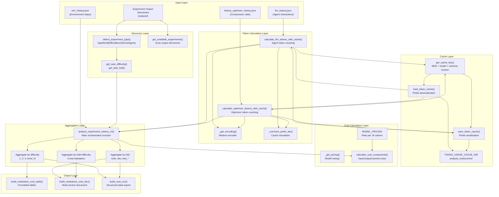
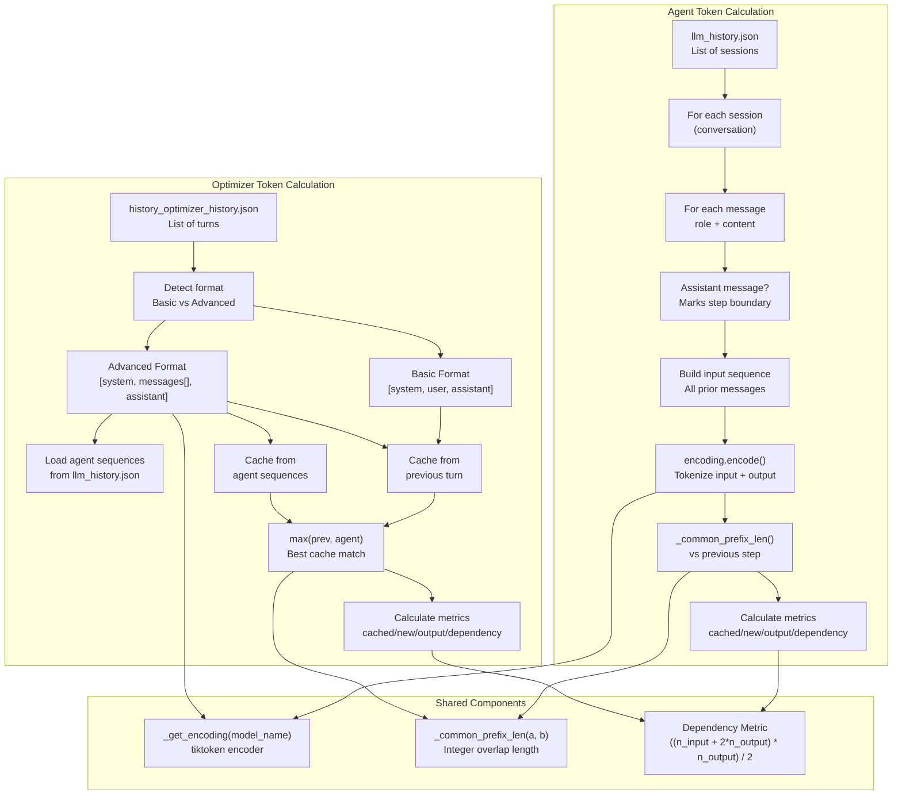
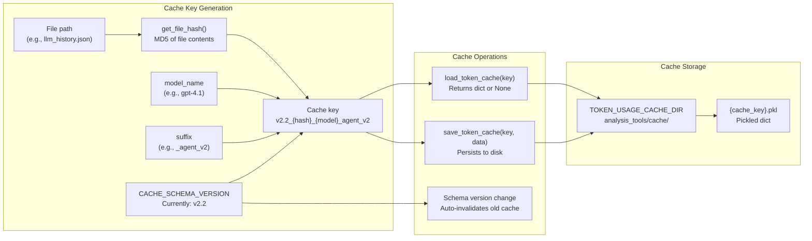
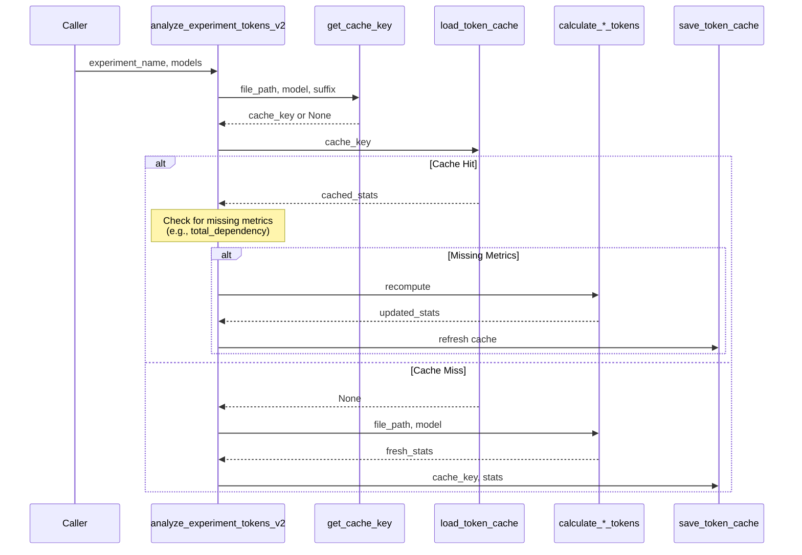
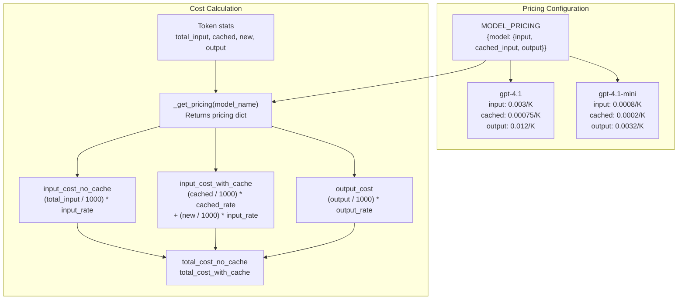
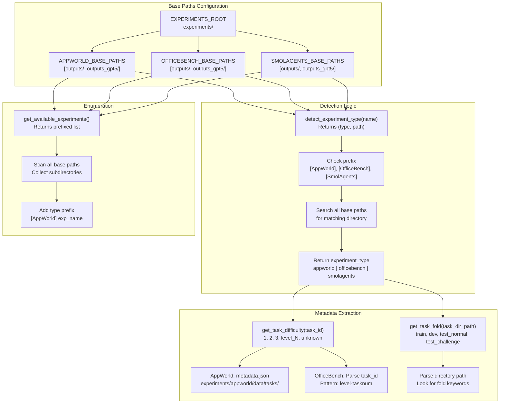
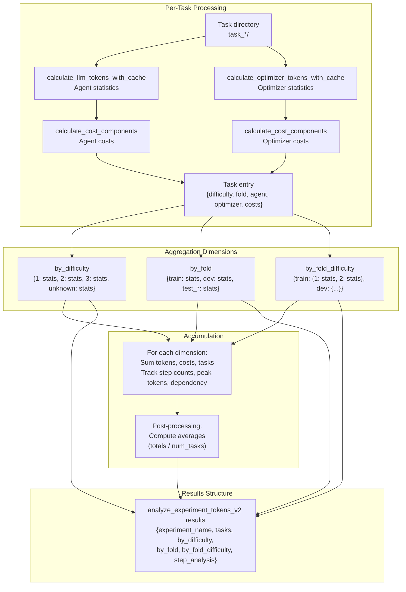
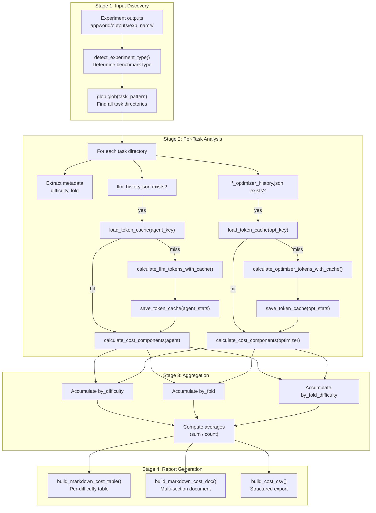

<!-- source: DeepWiki mcp.deepwiki.com · repo microsoft/acon · page 9.4 Analysis Tools Architecture · fetched 2026-10-26 -->

# Analysis Tools Architecture

<details>
<summary>Relevant source files</summary>

The following files were used as context for generating this wiki page:

- [experiments/analysis_tools/utils.py](experiments/analysis_tools/utils.py)

</details>


## Purpose and Scope

This page documents the architecture and design of the token analysis and reporting system, which provides cost tracking and token usage analysis for ACON experiments. The system is implemented primarily in [experiments/analysis_tools/utils.py:1-1446]() and serves as the foundation for analyzing experiment efficiency across all benchmarks.

For usage guides and step-by-step instructions on running analyses, see [Token and Cost Analysis](#7.1). For detailed API reference, see [Analysis Functions Reference](#11.3).

---

## System Overview

The analysis tools system implements a multi-stage pipeline for calculating token usage, computing costs, and generating reports. The architecture emphasizes performance through caching and supports multiple experiment types (AppWorld, OfficeBench, SmolAgents) through a unified interface.

**Architecture Overview**



**Sources:** [experiments/analysis_tools/utils.py:1-1446]()

---

## Token Calculation Pipeline

The token calculation pipeline implements cache-aware token counting that simulates provider billing for cached prompts. The architecture distinguishes between agent token calculations and optimizer token calculations, each with specialized logic.

**Token Calculation Architecture**



**Key Design Decisions:**

| Component | Design Decision | Rationale |
|-----------|----------------|-----------|
| `calculate_llm_tokens_with_cache` | Session-based iteration with step boundary detection | Agent interactions are structured as sessions; assistant messages mark natural step boundaries |
| `calculate_optimizer_tokens_with_cache` | Dual-format support (basic/advanced) | Legacy format used simple strings; advanced format uses structured message lists for better cache simulation |
| `_common_prefix_len` | Token-level prefix matching | Accurately simulates provider caching behavior where cached tokens are billed at reduced rates |
| Dependency metric | `((n_input + 2*n_output) * n_output) / 2` | Research metric quantifying context dependency; excludes system tokens from input |

**Sources:** [experiments/analysis_tools/utils.py:131-232](), [experiments/analysis_tools/utils.py:234-439](), [experiments/analysis_tools/utils.py:120-127]()

---

## Cache System Design

The cache system prevents redundant token calculations through content-based keying and schema versioning. It uses MD5 hashing of file contents combined with model names and schema versions to create unique cache keys.

**Cache System Architecture**



**Cache Invalidation Strategy:**

The system implements automatic cache invalidation through `CACHE_SCHEMA_VERSION` [experiments/analysis_tools/utils.py:44](). When the schema version changes, all existing cache entries become invalid because cache keys include the version. This occurs when:

1. **Token counting logic changes** - e.g., advanced optimizer output logic updated
2. **New metrics added** - e.g., addition of dependency metric
3. **Calculation algorithm improvements** - e.g., better prefix matching

**Cache Workflow:**



**Sources:** [experiments/analysis_tools/utils.py:464-504](), [experiments/analysis_tools/utils.py:44](), [experiments/analysis_tools/utils.py:790-841]()

---

## Cost Calculation Engine

The cost calculation engine applies model-specific pricing to token counts, accounting for cached input, new input, and output tokens separately. The design supports asymmetric pricing where cached tokens are billed at reduced rates.

**Pricing Model**



**Cost Components Structure:**

The `calculate_cost_components` function [experiments/analysis_tools/utils.py:55-91]() returns a dictionary with the following structure:

| Field | Formula | Purpose |
|-------|---------|---------|
| `input_cost_no_cache` | `(total_input / 1000) * input_rate` | Cost if no caching |
| `input_cost_with_cache` | `(cached / 1000) * cached_rate + (new / 1000) * input_rate` | Cost with provider caching |
| `output_cost` | `(output / 1000) * output_rate` | Generation cost |
| `total_cost_no_cache` | `input_cost_no_cache + output_cost` | Total without caching benefit |
| `total_cost_with_cache` | `input_cost_with_cache + output_cost` | Total with caching benefit |

**Sources:** [experiments/analysis_tools/utils.py:27-40](), [experiments/analysis_tools/utils.py:47-53](), [experiments/analysis_tools/utils.py:55-91]()

---

## Experiment Discovery and Metadata

The discovery layer implements a flexible experiment type detection system that supports multiple output directory structures and naming conventions. It provides metadata extraction for task categorization and filtering.

**Experiment Discovery Architecture**



**Task Pattern Matching:**

Different experiment types use different directory structures:

| Experiment Type | Task Pattern | Example |
|----------------|--------------|---------|
| AppWorld | `{experiment_path}/{split}/task_{id}` | `outputs/exp1/train/task_123/` |
| OfficeBench | `{experiment_path}/{split}/{level}-{id}/{subtask}` | `outputs/exp2/test/1-45/subtask1/` |
| SmolAgents | `{experiment_path}/{fold}/samples/{id}` | `outputs/exp3/test/samples/sample_001/` |

The `analyze_experiment_tokens_v2` function [experiments/analysis_tools/utils.py:755-762]() uses these patterns to discover all tasks within an experiment.

**Sources:** [experiments/analysis_tools/utils.py:454-462](), [experiments/analysis_tools/utils.py:543-577](), [experiments/analysis_tools/utils.py:579-597](), [experiments/analysis_tools/utils.py:599-620](), [experiments/analysis_tools/utils.py:622-634]()

---

## Aggregation and Reporting Pipeline

The aggregation layer processes per-task token statistics into hierarchical summaries organized by difficulty, fold, and their cross-product. The design maintains separate agent and optimizer statistics while computing averages and totals.

**Aggregation Architecture**



**Statistics Accumulation:**

For each aggregation dimension, the system maintains parallel agent and optimizer statistics:

```python
# Agent statistics (per dimension)
{
    'input_tokens': 0,              # Total input tokens
    'input_cached_tokens': 0,       # Cached input tokens
    'input_new_tokens': 0,          # New input tokens
    'output_tokens': 0,             # Output tokens
    'num_tasks': 0,                 # Number of tasks
    'avg_steps': 0,                 # Average environment steps
    'peak_tokens_total': 0,         # Sum of peak tokens per task
    'dependency_total': 0.0,        # Sum of dependency metric
    'input_cost_no_cache_total': 0.0,
    'input_cost_with_cache_total': 0.0,
    'output_cost_total': 0.0,
    'total_cost_no_cache_total': 0.0,
    'total_cost_with_cache_total': 0.0,
}
```

**Reporting Formats:**

The system generates three output formats:

1. **Markdown Tables** (`build_markdown_cost_table`) - Per-difficulty summaries with overall averages
2. **Markdown Documents** (`build_markdown_cost_doc`) - Multi-section reports with fold-specific tables
3. **CSV Export** (`build_cost_csv`) - Structured data for external analysis

**Sources:** [experiments/analysis_tools/utils.py:638-1137](), [experiments/analysis_tools/utils.py:1039-1135](), [experiments/analysis_tools/utils.py:1141-1241](), [experiments/analysis_tools/utils.py:1243-1274](), [experiments/analysis_tools/utils.py:1276-1414]()

---

## Data Flow Architecture

The following diagram illustrates the complete end-to-end data flow from experiment outputs to final reports, showing how each architectural component contributes to the pipeline.

**End-to-End Data Flow**



**Performance Characteristics:**

The architecture is optimized for repeated analysis through several mechanisms:

| Mechanism | Impact | Location |
|-----------|--------|----------|
| **Content-based caching** | O(1) cache lookup prevents recomputation for unchanged files | [experiments/analysis_tools/utils.py:466-479]() |
| **Schema versioning** | Automatic invalidation when calculation logic changes | [experiments/analysis_tools/utils.py:44]() |
| **Lazy computation** | Only computes statistics for tasks with existing output files | [experiments/analysis_tools/utils.py:764-817]() |
| **Incremental aggregation** | Single-pass aggregation across all dimensions | [experiments/analysis_tools/utils.py:938-1032]() |

**Sources:** [experiments/analysis_tools/utils.py:638-1137]()

---

## Extension Points

The architecture provides several extension points for adding new functionality:

### Adding New Metrics

To add a new metric to token calculations:

1. **Update calculation functions** - Modify `calculate_llm_tokens_with_cache` or `calculate_optimizer_tokens_with_cache` to compute the new metric
2. **Increment `CACHE_SCHEMA_VERSION`** - Force cache invalidation [experiments/analysis_tools/utils.py:44]()
3. **Update aggregation** - Add accumulation logic in `analyze_experiment_tokens_v2` [experiments/analysis_tools/utils.py:938-1032]()
4. **Update reporting** - Modify `build_markdown_cost_table` and `build_cost_csv` to include new metric [experiments/analysis_tools/utils.py:1141-1414]()

### Adding New Experiment Types

To support a new benchmark:

1. **Add base path** - Define `NEW_BENCHMARK_BASE_PATH` and `NEW_BENCHMARK_BASE_PATHS` [experiments/analysis_tools/utils.py:454-462]()
2. **Update detection** - Extend `detect_experiment_type` with new prefix pattern [experiments/analysis_tools/utils.py:543-577]()
3. **Add task pattern** - Define glob pattern in `analyze_experiment_tokens_v2` [experiments/analysis_tools/utils.py:755-762]()
4. **Implement difficulty extraction** - Extend `get_task_difficulty` if needed [experiments/analysis_tools/utils.py:599-620]()

### Adding New Pricing Models

To add pricing for a new model:

1. **Update `MODEL_PRICING`** - Add entry with `input`, `cached_input`, and `output` rates per 1K tokens [experiments/analysis_tools/utils.py:27-40]()
2. **Fallback handling** - `_get_pricing` automatically returns empty dict for unknown models (zero cost) [experiments/analysis_tools/utils.py:47-53]()

**Sources:** [experiments/analysis_tools/utils.py:27-53](), [experiments/analysis_tools/utils.py:454-577](), [experiments/analysis_tools/utils.py:638-1137]()

---

