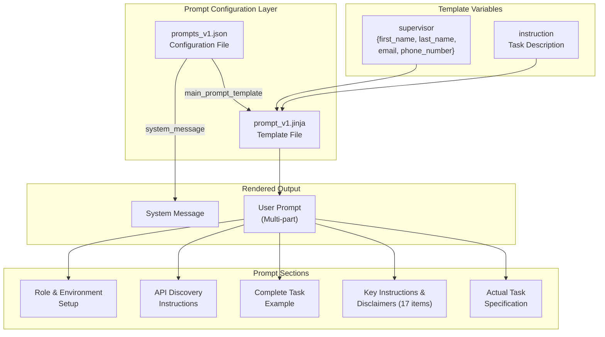
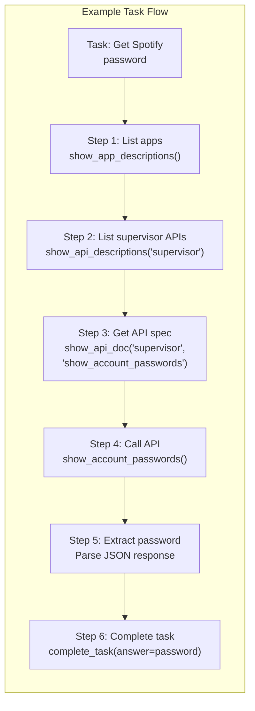
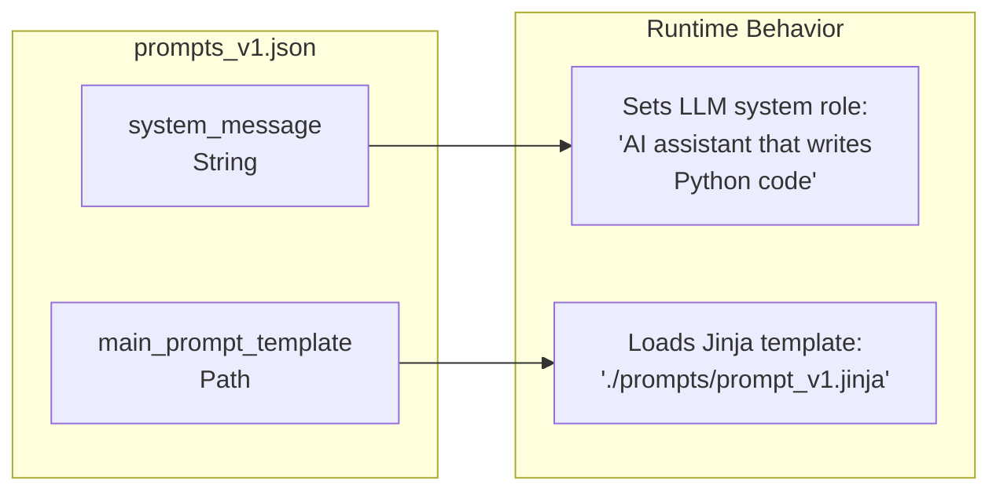
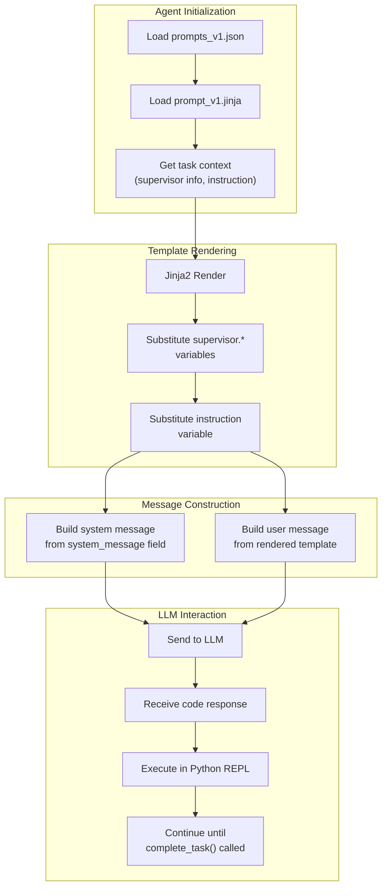

<!-- source: DeepWiki mcp.deepwiki.com · repo microsoft/acon · extra page Agent Prompts · fetched 2026-10-26 -->

# Agent Prompts

<details>
<summary>Relevant source files</summary>

The following files were used as context for generating this wiki page:

- [experiments/appworld/prompts/prompt_v1.jinja](experiments/appworld/prompts/prompt_v1.jinja)
- [experiments/appworld/prompts/prompts_v1.json](experiments/appworld/prompts/prompts_v1.json)

</details>


## Purpose and Scope

This page documents the main agent prompt templates that define how agents interact with task environments in ACON. Agent prompts provide the core instructions, examples, and operational guidelines that shape agent behavior during task execution.

For system-level prompts that define agent identity and capabilities, see [System Prompts](#6.3.1). For prompts related to context compression and optimization, see [Context Optimization Prompts](#6.3.3).

## Overview

Agent prompts are Jinja2 templates that combine static instructions with dynamic task-specific content. The primary agent prompt (`prompt_v1.jinja`) serves as the comprehensive instruction set for autonomous task completion through API interactions.



**Sources:** [experiments/appworld/prompts/prompt_v1.jinja:1-152](), [experiments/appworld/prompts/prompts_v1.json:1-5]()

## Prompt Structure

The agent prompt (`prompt_v1.jinja`) consists of five major sections, each delimited by `USER:` markers to simulate a multi-turn conversation structure.

### Section 1: Role and Environment Setup

This section establishes the agent's identity and operational context.

| Component | Purpose | Lines |
|-----------|---------|-------|
| Role Definition | Defines agent as "super intelligent AI Assistant" for autonomous task completion | 2 |
| Environment Description | Explains multi-step Python REPL interaction model | 4 |
| API Discovery Framework | Introduces three core API introspection functions | 6-16 |

**Key Instructions Provided:**

```
show_app_descriptions()      # List available apps
show_api_descriptions(app)   # List APIs for specific app
show_api_doc(app, api)       # Get detailed API specification
```

**Sources:** [experiments/appworld/prompts/prompt_v1.jinja:1-17]()

### Section 2: Complete Example Walkthrough

A detailed example demonstrates the full task completion workflow, from API discovery to task completion.



The example includes:
- **Initial task setup** with supervisor context variables ([line 21]())
- **Six-step interaction sequence** showing code generation and execution ([lines 28-119]())
- **Response parsing and answer extraction** ([lines 104-106]())
- **Task completion API call** ([line 114]())

**Sources:** [experiments/appworld/prompts/prompt_v1.jinja:19-121]()

### Section 3: Key Instructions and Disclaimers

A comprehensive set of 17 operational rules and constraints that govern agent behavior.

| Rule # | Category | Description |
|--------|----------|-------------|
| 1 | Context | Example data is demonstration only; obtain actual data via APIs |
| 2-3 | Code Format | Generate valid code blocks without markdown formatting; reuse variables |
| 4 | Execution Safety | Write small chunks; verify before irreversible changes |
| 5-7 | Environment Constraints | Standard library only; no OS-level operations; use app APIs not packages |
| 8-9 | API Usage | Follow documentation for inputs/outputs; handle paginated results |
| 10-11 | Temporal Handling | Use Python datetime; respect time boundaries |
| 12-13 | Data Sources | Use contacts for people; use supervisor app for credentials |
| 14-16 | Task Completion | Call `complete_task()`; format answers correctly; can pass `status="fail"` |
| 17 | Autonomy | Make all decisions autonomously without asking for clarification |

**Sources:** [experiments/appworld/prompts/prompt_v1.jinja:124-143]()

### Section 4: Actual Task Specification

The final section presents the real task to be solved, populated with template variables.

**Template Variables:**

| Variable | Source | Purpose |
|----------|--------|---------|
| `supervisor.first_name` | Task context | User's first name |
| `supervisor.last_name` | Task context | User's last name |
| `supervisor.email` | Task context | User's email address |
| `supervisor.phone_number` | Task context | User's phone number |
| `instruction` | Task context | The actual task description to complete |

**Sources:** [experiments/appworld/prompts/prompt_v1.jinja:144-152]()

## Configuration File Structure

The `prompts_v1.json` configuration file binds the system message and main prompt template together.



**Configuration Schema:**

```json
{
  "system_message": "<string>",
  "main_prompt_template": "<relative_path>"
}
```

The system message ([line 2]()) establishes the high-level agent role: *"You are an AI assistant that writes Python code to complete tasks. You should respond with clear, executable Python code to interact with APIs and solve the given task completely autonomously."*

**Sources:** [experiments/appworld/prompts/prompts_v1.json:1-5]()

## Prompt Flow During Task Execution

The prompt assembly process during task execution follows this flow:



**Sources:** [experiments/appworld/prompts/prompt_v1.jinja:1-152](), [experiments/appworld/prompts/prompts_v1.json:1-5]()

## Template Variable Injection

The Jinja template uses two primary variable sources:

### Supervisor Context Variables

These are injected at the beginning of both the example and actual task sections:

```jinja
My name is: {{ supervisor.first_name }} {{ supervisor.last_name }}.
My personal email is {{ supervisor.email }} and phone number is {{ supervisor.phone_number }}.
```

Appears at:
- **Example task context** ([line 21]())
- **Actual task context** ([line 147]())

### Task Instruction Variable

The core task description is injected via the `instruction` variable:

```jinja
Task:

{{ instruction }}
```

This appears at [line 151]() and contains the specific task the agent must complete.

**Sources:** [experiments/appworld/prompts/prompt_v1.jinja:21](), [experiments/appworld/prompts/prompt_v1.jinja:147-151]()

## Customization Guidelines

### Modifying the Agent Prompt

To customize the agent prompt:

1. **Edit the template file:** Modify [experiments/appworld/prompts/prompt_v1.jinja]()
2. **Key customization points:**
   - **Role definition** ([lines 1-5]()): Change agent identity and capabilities
   - **API discovery instructions** ([lines 6-16]()): Add or modify introspection methods
   - **Example walkthrough** ([lines 19-121]()): Replace with domain-specific example
   - **Instructions and disclaimers** ([lines 124-143]()): Add domain-specific constraints
3. **Variable requirements:** Ensure `supervisor.*` and `instruction` variables remain defined

### Creating Alternative Prompt Versions

To create a new prompt variant:

1. Create new template file: `experiments/appworld/prompts/prompt_v2.jinja`
2. Create corresponding configuration: `experiments/appworld/prompts/prompts_v2.json`
3. Update configuration to reference new template:
   ```json
   {
     "system_message": "<your system message>",
     "main_prompt_template": "./prompts/prompt_v2.jinja"
   }
   ```
4. Reference new configuration in experiment configuration files

**Sources:** [experiments/appworld/prompts/prompt_v1.jinja:1-152](), [experiments/appworld/prompts/prompts_v1.json:1-5]()

## Design Principles

The agent prompt is structured according to several key design principles:

| Principle | Implementation | Location |
|-----------|----------------|----------|
| **Learning by Example** | Complete 6-step walkthrough before actual task | [lines 19-121]() |
| **Graduated Complexity** | Simple example task before complex real task | [lines 23-26]() |
| **Explicit Constraints** | 17 numbered rules covering all edge cases | [lines 124-143]() |
| **API-First Discovery** | Teach introspection before specific APIs | [lines 6-16]() |
| **Iterative Execution** | Multi-step conversation with environment feedback | [lines 4]() |
| **Autonomous Operation** | Explicit prohibition of asking for help | [line 142]() |
| **Answer Formatting** | Specific guidance on entity vs. sentence answers | [lines 140-141]() |

**Sources:** [experiments/appworld/prompts/prompt_v1.jinja:1-152]()

## Usage in Codebase

The agent prompt is loaded and used by the AppWorld agent implementation. The configuration file (`prompts_v1.json`) is referenced in base configuration files, which specify which prompt template to use for a given experiment.

For information on how these prompts integrate with the broader configuration system, see [Configuration System](#9.3).

**Sources:** [experiments/appworld/prompts/prompts_v1.json:1-5]()

---

