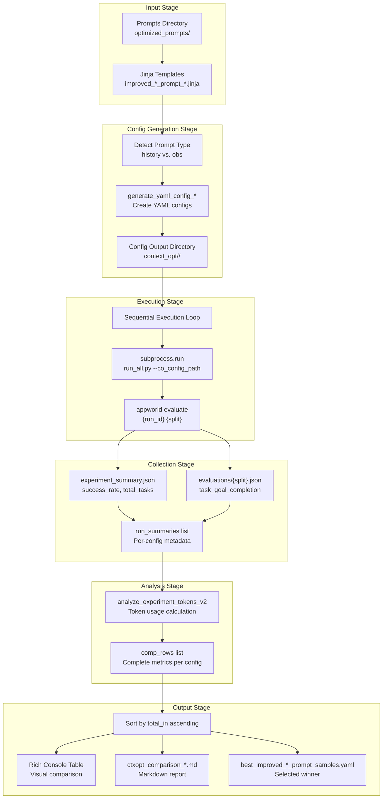
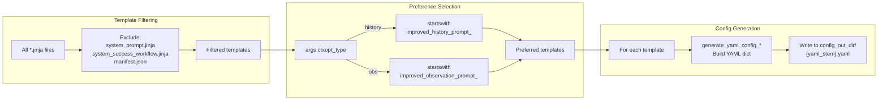
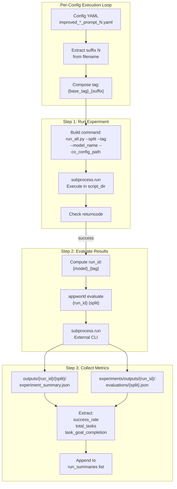
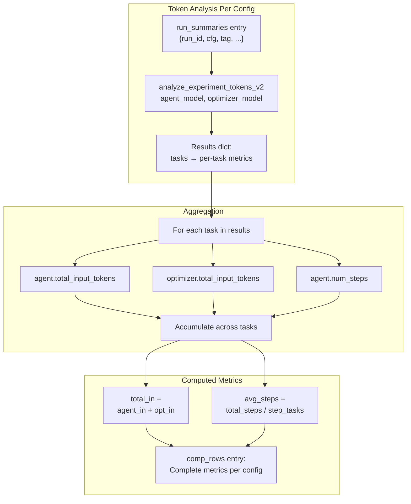
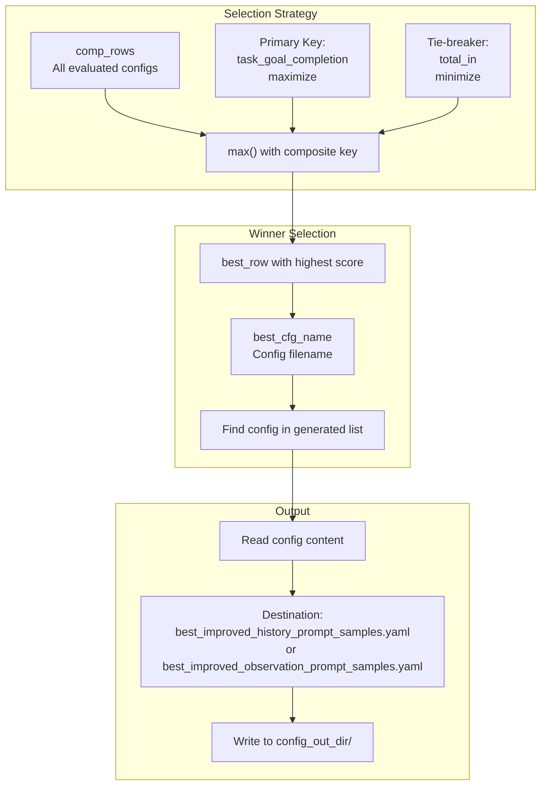

<!-- source: DeepWiki mcp.deepwiki.com · repo microsoft/acon · extra page Prompt Evaluation · fetched 2026-10-26 -->

# Prompt Evaluation

<details>
<summary>Relevant source files</summary>

The following files were used as context for generating this wiki page:

- [experiments/appworld/run_ctxopt_pipeline.py](experiments/appworld/run_ctxopt_pipeline.py)

</details>


This page describes how the ACON framework evaluates optimized prompts to determine which performs best for context optimization tasks. The evaluation system runs experiments with multiple prompt variants, collects performance metrics, and automatically selects the optimal prompt configuration.

For information about configuring the optimization pipeline itself, see [Pipeline Configuration](#7.2.1). For details on the underlying token analysis system, see [analyze_experiment_tokens_v2](#7.1.1).

## Overview

The prompt evaluation system in `run_ctxopt_pipeline.py` implements an automated comparative evaluation workflow. After prompts have been optimized (typically by external optimization tools), this pipeline:

1. Generates context optimization configuration files for each prompt variant
2. Executes experiments using each configuration on a designated dataset split
3. Collects performance metrics including token usage and task success rates
4. Ranks prompts by specified criteria
5. Automatically selects and saves the best-performing configuration

**Sources:** [experiments/appworld/run_ctxopt_pipeline.py:1-17]()

## Evaluation Workflow



**Sources:** [experiments/appworld/run_ctxopt_pipeline.py:87-448]()

## Prompt Discovery and Configuration Generation

The pipeline begins by scanning the specified prompts directory for Jinja template files. It preferentially selects templates with specific naming patterns based on the context optimization type.

### Template Discovery Logic

For history optimization, the system searches for files matching `improved_history_prompt_*.jinja`. For observation optimization, it searches for `improved_observation_prompt_*.jinja`. If no preferred templates are found, the system falls back to all `.jinja` files excluding system prompts.



**Sources:** [experiments/appworld/run_ctxopt_pipeline.py:107-116](), [experiments/appworld/run_ctxopt_pipeline.py:144-195]()

### Configuration Parameters

For history optimization, the generated YAML configuration includes:

| Parameter | Value | Purpose |
|-----------|-------|---------|
| `type` | "history" | Identifies optimizer type |
| `model` | From `--model-name` arg | Model for compression |
| `compressor_type` | "full" | Full compression mode |
| `history_summarization_threshold` | 4096 | Token threshold for summarization |
| `preserve_last_k_turns` | 1 | Recent turns to preserve |
| `history_summary_rule` | "reset" | Summary accumulation strategy |
| `history_prompt_dir` | Path to prompts directory | Template location |
| `history_version` | From `--opt-version` arg | Version identifier |

For observation optimization, the configuration includes:

| Parameter | Value | Purpose |
|-----------|-------|---------|
| `type` | "obs" | Identifies optimizer type |
| `model` | From `--model-name` arg | Model for compression |
| `compressor_type` | "full" | Full compression mode |
| `obs_summarization_threshold` | 1024 | Token threshold for summarization |
| `obs_prompt_dir` | Path to prompts directory | Template location |
| `obs_version` | From `--opt-version` arg | Version identifier |

**Sources:** [experiments/appworld/run_ctxopt_pipeline.py:51-84]()

## Experiment Execution

Once configurations are generated, the pipeline sequentially executes experiments for each prompt variant. Each execution follows a three-step process:



**Sources:** [experiments/appworld/run_ctxopt_pipeline.py:232-299]()

### Command Construction

The command for each experiment run includes:

- **`--split`**: Dataset split to evaluate (e.g., `train_history_tiny`)
- **`--tag`**: Unique tag composed from base tag and config suffix
- **`--model_name`**: Agent model name (from `--main-model-name`)
- **`--co_config_path`**: Path to the generated YAML configuration
- **`--debug`**: Optional flag to reduce workload (if provided)
- **`--task_ids`**: Optional list of specific task IDs to run

The execution environment ensures the `PYTHONPATH` includes `src/` for local imports.

**Sources:** [experiments/appworld/run_ctxopt_pipeline.py:246-264](), [experiments/appworld/run_ctxopt_pipeline.py:216-221]()

## Metrics Collection

After each experiment completes, the pipeline collects metrics from two sources:

### Experiment Summary Metrics

The `experiment_summary.json` file provides basic execution statistics:

- **`success_rate`**: Percentage of successful task completions
- **`total_tasks`**: Number of tasks executed

### Evaluation Metrics

The evaluation output at `evaluations/{split}.json` provides the official AppWorld metric:

- **`aggregate.task_goal_completion`**: Official task completion score

**Sources:** [experiments/appworld/run_ctxopt_pipeline.py:276-298]()

## Token Analysis and Comparison

After all configurations have been executed, the pipeline performs comprehensive token analysis using the `analyze_experiment_tokens_v2` function from the analysis tools.



**Sources:** [experiments/appworld/run_ctxopt_pipeline.py:303-338]()

### Collected Metrics

For each configuration, the comparison row contains:

| Field | Source | Description |
|-------|--------|-------------|
| `cfg` | Config filename | YAML configuration name |
| `tag` | Experiment tag | Unique identifier for this run |
| `run_id` | Computed | `{model}_{tag}` format |
| `tasks` | `experiment_summary.json` | Total tasks executed |
| `success_rate` | `experiment_summary.json` | Basic success percentage |
| `task_goal_completion` | `evaluations/{split}.json` | Official AppWorld metric |
| `agent_in` | Token analysis | Total agent input tokens |
| `opt_in` | Token analysis | Total optimizer input tokens |
| `total_in` | Computed | Sum of agent and optimizer tokens |
| `avg_steps` | Token analysis | Average steps per task |

**Sources:** [experiments/appworld/run_ctxopt_pipeline.py:327-338]()

## Ranking and Selection

The pipeline ranks configurations using a two-stage process:

### Initial Ranking by Token Usage

First, all configurations are sorted by `total_in` (total input tokens) in ascending order. This provides a baseline ranking focused on efficiency.

**Sources:** [experiments/appworld/run_ctxopt_pipeline.py:340-341]()

### Best Prompt Selection

The final "best" configuration is selected using a more sophisticated strategy:



The selection uses this composite key:

1. **Primary criterion**: Maximize `task_goal_completion` (AppWorld's official metric)
2. **Tie-breaker**: Minimize `total_in` (total input tokens) for efficiency

This ensures the best prompt achieves the highest task completion while preferring more efficient prompts when multiple configurations perform equally well.

**Sources:** [experiments/appworld/run_ctxopt_pipeline.py:399-444]()

## Output Artifacts

The evaluation process generates several output files for analysis and record-keeping:

### Rich Console Table

If the `rich` library is available, the pipeline displays a formatted comparison table in the console with columns:

- Rank (by total input tokens)
- Config filename
- Experiment tag
- Tasks executed
- Average steps
- Task goal completion percentage
- Agent input tokens
- Optimizer input tokens
- Total input tokens

The table is sorted by ascending `total_in`, with the lowest-token configuration listed first.

**Sources:** [experiments/appworld/run_ctxopt_pipeline.py:343-364]()

### Markdown Comparison Table

A markdown file named `ctxopt_comparison_{timestamp}.md` is saved to the prompts directory containing:

- Experiment metadata (model, split)
- Full comparison table with all metrics
- Identification of the best configuration by total input tokens
- Timestamp for reference

This file provides a permanent record of the evaluation results.

**Sources:** [experiments/appworld/run_ctxopt_pipeline.py:376-395]()

### Best Configuration File

The winning configuration is copied to a standardized filename in the `config_out_dir`:

- **For history optimization**: `best_improved_history_prompt_samples.yaml`
- **For observation optimization**: `best_improved_observation_prompt_samples.yaml`

This allows downstream processes to easily reference the optimal configuration without needing to parse comparison results.

**Sources:** [experiments/appworld/run_ctxopt_pipeline.py:429-444]()

## Fallback Mechanisms

The pipeline includes several fallback mechanisms to ensure robustness:

### YAML Library Fallback

If the `yaml` library is not available, the pipeline implements a minimal YAML writer specifically for the configuration schema. This writer manually constructs YAML-formatted text for the required fields.

**Sources:** [experiments/appworld/run_ctxopt_pipeline.py:28-33](), [experiments/appworld/run_ctxopt_pipeline.py:175-194]()

### Rich Library Fallback

If the `rich` library is not available, the pipeline outputs a plain-text comparison table with the same information in a simpler format.

**Sources:** [experiments/appworld/run_ctxopt_pipeline.py:36-42](), [experiments/appworld/run_ctxopt_pipeline.py:365-373]()

### Evaluation Failure Handling

If the external `appworld evaluate` command fails, the pipeline logs a warning but continues processing other configurations. Similarly, if token analysis fails for a specific configuration, the pipeline continues with available data.

**Sources:** [experiments/appworld/run_ctxopt_pipeline.py:267-273](), [experiments/appworld/run_ctxopt_pipeline.py:396-397]()

## Example Usage

To run prompt evaluation for history optimization:

```bash
python experiments/appworld/run_ctxopt_pipeline.py \
  --ctxopt-type history \
  --prompts-dir /path/to/optimized_prompts \
  --model-name gpt-4.1-mini \
  --main-model-name gpt-4.1-mini \
  --tag my_optimization_run \
  --split train_history_tiny
```

This command will:

1. Scan `/path/to/optimized_prompts` for history prompt templates
2. Generate YAML configs for each template
3. Run experiments using `gpt-4.1-mini` on the `train_history_tiny` split
4. Evaluate results using AppWorld's evaluator
5. Analyze token usage across all configurations
6. Display comparison table and save markdown report
7. Save the best configuration as `best_improved_history_prompt_samples.yaml`

For a dry run (config generation only, no execution):

```bash
python experiments/appworld/run_ctxopt_pipeline.py \
  --ctxopt-type history \
  --prompts-dir /path/to/optimized_prompts \
  --model-name gpt-4.1-mini \
  --dry-run
```

**Sources:** [experiments/appworld/run_ctxopt_pipeline.py:8-16](), [experiments/appworld/run_ctxopt_pipeline.py:87-101](), [experiments/appworld/run_ctxopt_pipeline.py:201-203]()

---

