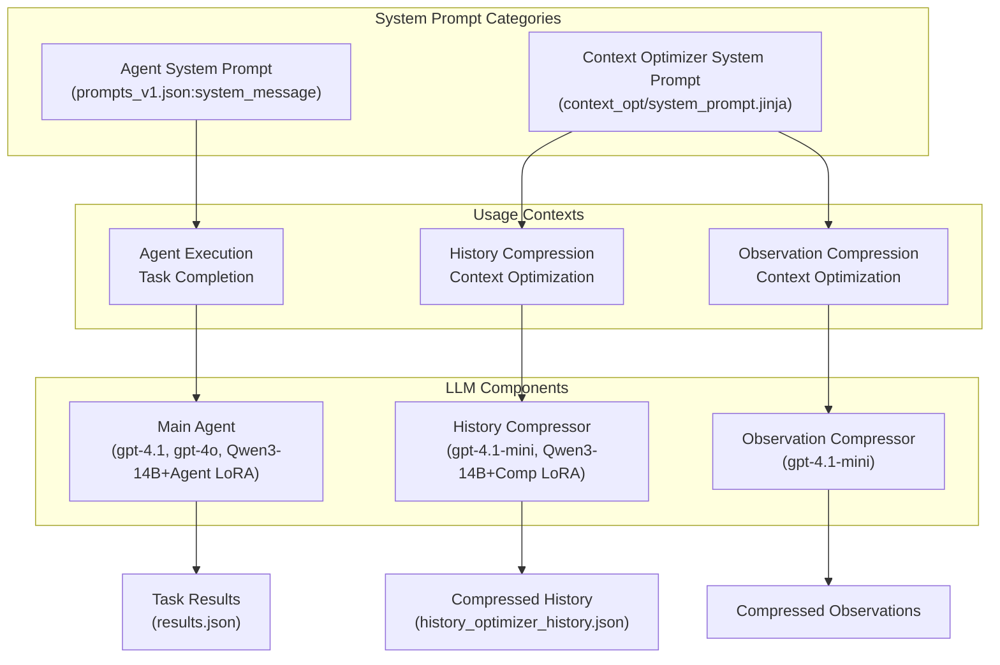
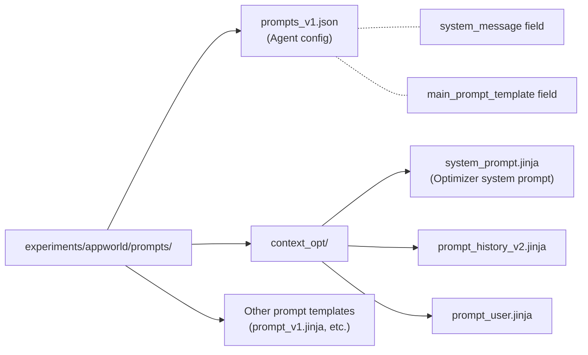
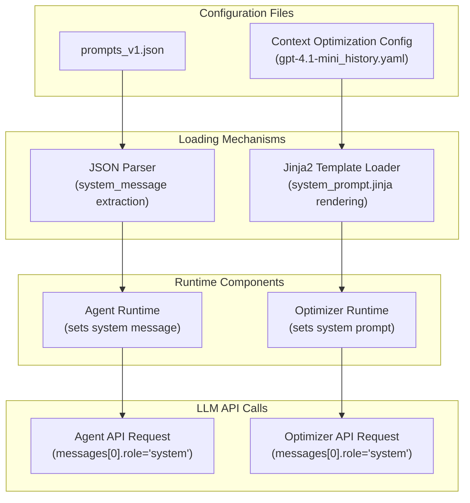
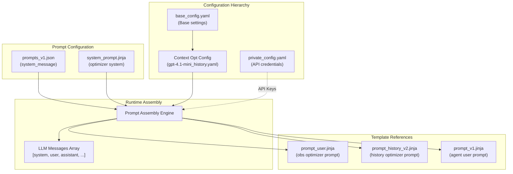

<!-- source: DeepWiki mcp.deepwiki.com · repo microsoft/acon · extra page System Prompts · fetched 2026-10-26 -->

# System Prompts

<details>
<summary>Relevant source files</summary>

The following files were used as context for generating this wiki page:

- [experiments/appworld/prompts/context_opt/system_prompt.jinja](experiments/appworld/prompts/context_opt/system_prompt.jinja)
- [experiments/appworld/prompts/prompts_v1.json](experiments/appworld/prompts/prompts_v1.json)

</details>


This document describes system prompts in the ACON framework, which define the fundamental instructions and behavioral guidelines for LLM-based components. System prompts establish the role, capabilities, and constraints of both agents and context optimizers.

For information about main agent prompts and user prompts, see [Agent Prompts](#6.3.2). For history and observation summarization prompts, see [Context Optimization Prompts](#6.3.3). For the overall configuration structure, see [Prompt Templates](#6.3).

---

## Overview

System prompts in ACON serve as the foundational instruction layer that defines:

- **Role and capabilities** of the LLM component (agent or optimizer)
- **Behavioral guidelines** for completing tasks
- **Output format expectations** and constraints
- **Operational context** within which the component executes

Unlike user prompts which vary per task, system prompts remain relatively stable across tasks of the same type and establish the persistent identity and behavior of the component.

**Sources:** [experiments/appworld/prompts/prompts_v1.json:1-5]()

---

## System Prompt Categories

ACON employs two distinct categories of system prompts, each serving a different component in the execution pipeline.

### Agent System Prompts

Agent system prompts define the behavior of the primary task-execution agent. These prompts establish the agent as an autonomous code-writing assistant capable of interacting with APIs.

The agent system message is defined in the configuration file:

```json
{
  "system_message": "You are an AI assistant that writes Python code to complete tasks. You should respond with clear, executable Python code to interact with APIs and solve the given task completely autonomously."
}
```

This system prompt:
- Establishes the agent's role as an **AI assistant**
- Defines the primary capability: **writing Python code**
- Sets the expectation for **clear, executable code**
- Specifies the operational mode: **completely autonomous**
- Indicates the interaction method: **API interaction**

### Context Optimizer System Prompts

Context optimizer system prompts define the behavior of components responsible for compressing and refining context (history and observations). These prompts focus on extraction and optimization rather than task completion.

```jinja
You are an agent tasked with extracting and refining a concise and optimized version of the context based on the user instruction and other provided information.
```

This system prompt:
- Establishes the role as a **context extraction agent**
- Defines the primary task: **extracting and refining**
- Sets quality expectations: **concise and optimized**
- Specifies inputs: **user instruction and provided information**

**Sources:** [experiments/appworld/prompts/prompts_v1.json:2](), [experiments/appworld/prompts/context_opt/system_prompt.jinja:1]()

---

## System Prompt Architecture

The following diagram illustrates how different system prompt types are used across ACON components:



**Sources:** [experiments/appworld/prompts/prompts_v1.json:2](), [experiments/appworld/prompts/context_opt/system_prompt.jinja:1]()

---

## File Structure and Locations

System prompts are organized within the benchmark-specific prompt directories:

| System Prompt Type | File Path | Format | Purpose |
|-------------------|-----------|--------|---------|
| Agent System Message | `experiments/appworld/prompts/prompts_v1.json` | JSON field | Defines agent role and behavior |
| Context Optimizer System | `experiments/appworld/prompts/context_opt/system_prompt.jinja` | Jinja template | Defines context extraction role |

### Directory Structure



**Sources:** [experiments/appworld/prompts/prompts_v1.json:1-5](), [experiments/appworld/prompts/context_opt/system_prompt.jinja:1]()

---

## Configuration Loading Flow

System prompts are loaded through different mechanisms depending on their type:



### Agent System Prompt Loading

Agent system prompts are loaded from the `prompts_v1.json` configuration:

1. Configuration file is parsed as JSON
2. The `system_message` field is extracted
3. The message is set as the first message in the conversation with `role="system"`
4. Subsequent user prompts and assistant responses follow

### Context Optimizer System Prompt Loading

Context optimizer system prompts are loaded from Jinja templates:

1. Configuration specifies the system prompt template path
2. Jinja2 template engine loads and renders the template
3. Rendered prompt is set as the system message for optimizer API calls
4. Template variables may be provided for dynamic customization

**Sources:** [experiments/appworld/prompts/prompts_v1.json:1-5](), [experiments/appworld/prompts/context_opt/system_prompt.jinja:1]()

---

## System Prompt Components

### Agent System Prompt Fields

The agent system prompt in `prompts_v1.json` contains two fields:

| Field | Type | Purpose | Example Value |
|-------|------|---------|---------------|
| `system_message` | String | Defines agent role and capabilities | "You are an AI assistant that writes Python code..." |
| `main_prompt_template` | String | Path to main prompt template | "./prompts/prompt_v1.jinja" |

The `system_message` is used directly, while `main_prompt_template` points to the user prompt template (see [Agent Prompts](#6.3.2)).

### Context Optimizer System Prompt Structure

The context optimizer system prompt is a single-line Jinja template that can be:

- **Static**: Used as-is without variable substitution
- **Dynamic**: Rendered with variables if needed for customization

Current implementation uses a static prompt focusing on:
- **Extraction**: Pulling relevant information from context
- **Refinement**: Improving clarity and conciseness
- **Optimization**: Reducing token count while preserving meaning

**Sources:** [experiments/appworld/prompts/prompts_v1.json:2-3](), [experiments/appworld/prompts/context_opt/system_prompt.jinja:1]()

---

## Customization Guidelines

### Modifying Agent System Prompts

To customize the agent system prompt:

1. Edit `experiments/appworld/prompts/prompts_v1.json`
2. Update the `system_message` field
3. Maintain key elements:
   - Agent role definition
   - Primary capability (code writing)
   - Output format expectations
   - Autonomy level

**Example customization:**
```json
{
  "system_message": "You are an expert AI agent specializing in API automation. Generate Python code that efficiently completes tasks using available APIs. Prioritize code correctness and minimal API calls.",
  "main_prompt_template": "./prompts/prompt_v1.jinja"
}
```

### Modifying Context Optimizer System Prompts

To customize context optimizer system prompts:

1. Edit `experiments/appworld/prompts/context_opt/system_prompt.jinja`
2. Maintain focus on extraction and optimization
3. Consider adding Jinja variables for dynamic behavior:

**Example customization:**
```jinja
You are an expert context optimizer. Extract and condense the most relevant information from the provided context. Target a {{ compression_ratio }}% reduction in length while preserving all critical details needed for {{ task_type }} tasks.
```

### Best Practices

| Aspect | Recommendation | Rationale |
|--------|----------------|-----------|
| **Clarity** | Use simple, direct language | Reduces ambiguity in LLM interpretation |
| **Specificity** | Define expected output format | Ensures consistent response structure |
| **Constraints** | Explicitly state limitations | Prevents out-of-scope behavior |
| **Role Definition** | Clearly establish agent identity | Helps LLM maintain consistent behavior |
| **Autonomy Level** | Specify decision-making authority | Controls agent independence |

**Sources:** [experiments/appworld/prompts/prompts_v1.json:2](), [experiments/appworld/prompts/context_opt/system_prompt.jinja:1]()

---

## Integration with Configuration System

System prompts integrate with the broader ACON configuration system as follows:



System prompts are loaded early in the initialization process and remain constant throughout task execution, while user prompts (main, history, observation) are assembled dynamically for each LLM call.

**Sources:** [experiments/appworld/prompts/prompts_v1.json:1-5](), [experiments/appworld/prompts/context_opt/system_prompt.jinja:1]()

---

## Relationship to Other Prompt Types

The following table distinguishes system prompts from other prompt types in ACON:

| Prompt Type | System Prompt | Agent Prompt | Context Optimization Prompt |
|-------------|---------------|--------------|----------------------------|
| **Purpose** | Define agent role and capabilities | Provide task-specific instructions | Request context compression |
| **Frequency** | Set once per conversation | Generated per LLM call | Generated per compression call |
| **Variability** | Static across tasks | Dynamic per task | Dynamic per context window |
| **Message Role** | `system` | `user` | `user` |
| **Template Type** | JSON string or simple Jinja | Complex Jinja with variables | Complex Jinja with context |
| **Configuration** | `prompts_v1.json` or `system_prompt.jinja` | `prompt_v1.jinja` | `prompt_history_v2.jinja`, `prompt_user.jinja` |

System prompts establish the **what** (agent identity), while other prompts provide the **how** (specific tasks) and **when** (context-specific optimization).

**Sources:** [experiments/appworld/prompts/prompts_v1.json:1-5](), [experiments/appworld/prompts/context_opt/system_prompt.jinja:1]()

---

## Related Configuration

For complete prompt configuration information, see:

- **[Agent Prompts](#6.3.2)** - Main task execution prompts (`prompt_v1.jinja`)
- **[Context Optimization Prompts](#6.3.3)** - History and observation compression prompts
- **[Base Configuration](#6.1)** - Overall agent configuration settings
- **[Context Optimization Configuration](#6.2)** - Compression strategy configuration

**Sources:** [experiments/appworld/prompts/prompts_v1.json:1-5](), [experiments/appworld/prompts/context_opt/system_prompt.jinja:1]()

---

