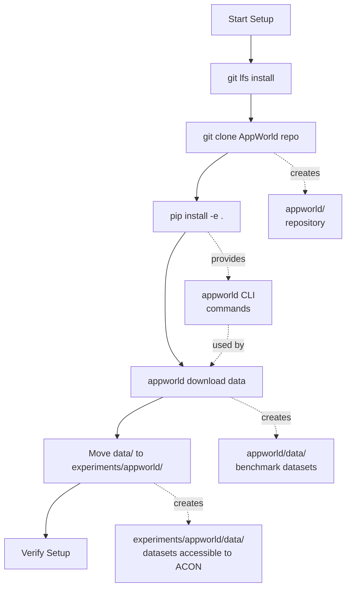
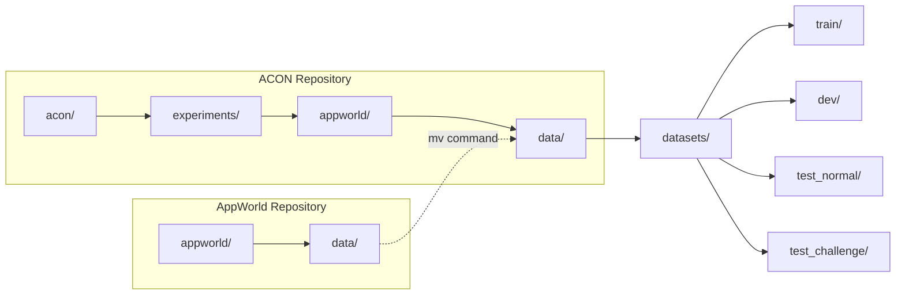
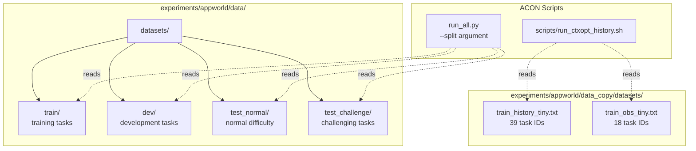

<!-- source: DeepWiki mcp.deepwiki.com · repo microsoft/acon · extra page AppWorld Setup · fetched 2026-10-26 -->

# AppWorld Setup

<details>
<summary>Relevant source files</summary>

The following files were used as context for generating this wiki page:

- [experiments/appworld/README.md](experiments/appworld/README.md)
- [experiments/appworld/data_copy/datasets/train_history_tiny.txt](experiments/appworld/data_copy/datasets/train_history_tiny.txt)
- [experiments/appworld/data_copy/datasets/train_obs_tiny.txt](experiments/appworld/data_copy/datasets/train_obs_tiny.txt)

</details>


## Purpose and Scope

This page covers the installation and configuration of the AppWorld benchmark environment required to run ACON experiments. It includes installing the upstream AppWorld package, downloading benchmark data, and configuring the local directory structure.

For running AppWorld experiments after setup, see [Running Experiments](#5). For understanding the AppWorld task structure and data formats, see [AppWorld Task Structure](#4.1.2).

## Overview

AppWorld is an external benchmark that must be installed separately before running ACON experiments. The setup process involves three main steps: cloning the upstream repository, downloading benchmark data, and relocating data files to the ACON directory structure.

**Installation Flow**



Sources: [experiments/appworld/README.md:6-23]()

## Prerequisites

Before beginning the AppWorld setup, ensure you have:

- **Git LFS** (Large File Storage) installed on your system
- **Python 3.11+** with pip
- **ACON repository** cloned locally
- Sufficient disk space (AppWorld data is approximately several GB)

## Installation Steps

### Step 1: Install Git LFS

Git LFS is required to download large files from the AppWorld repository.

```bash
git lfs install
```

### Step 2: Clone AppWorld Repository

Clone the upstream AppWorld repository from StonyBrookNLP:

```bash
git clone https://github.com/StonyBrookNLP/appworld
cd appworld
```

This creates an `appworld/` directory containing the benchmark implementation.

### Step 3: Install AppWorld Package

Install the AppWorld package in editable mode:

```bash
pip install -e .
```

This makes the `appworld` CLI command available and installs all required dependencies.

**Key CLI Commands Available After Installation**

| Command | Purpose |
|---------|---------|
| `appworld install --repo` | Installs repository-level dependencies |
| `appworld download data` | Downloads benchmark datasets |
| `appworld evaluate <model> <split>` | Evaluates experiment results |

### Step 4: Download Benchmark Data

Download the AppWorld benchmark datasets:

```bash
appworld install --repo
appworld download data
```

This creates a `data/` directory inside the `appworld/` repository containing:
- Task definitions
- Ground truth annotations
- Test splits (train, dev, test_normal, test_challenge)

### Step 5: Relocate Data to ACON Directory

Move the downloaded `data/` directory into the ACON AppWorld experiments directory:

```bash
mv data /path/to/acon/experiments/appworld/
```

Replace `/path/to/acon` with the actual path to your ACON repository.

**Directory Relocation Diagram**



Sources: [experiments/appworld/README.md:19-23]()

## Directory Structure After Setup

After completing the setup, the `experiments/appworld/` directory should have the following structure:

```
experiments/appworld/
├── data/                              # Benchmark data (moved from appworld repo)
│   ├── datasets/
│   │   ├── train/                     # Training split task definitions
│   │   ├── dev/                       # Development split task definitions
│   │   ├── test_normal/               # Normal test split
│   │   └── test_challenge/            # Challenge test split
│   └── ...                            # Other AppWorld data files
├── data_copy/                         # Subset datasets for testing
│   └── datasets/
│       ├── train_history_tiny.txt     # Tiny subset for history compression
│       └── train_obs_tiny.txt         # Tiny subset for observation compression
├── configs/                           # Configuration files
├── prompts/                           # Prompt templates
├── scripts/                           # Execution scripts
├── run.py                             # Single task runner
├── run_all.py                         # Batch experiment runner
└── README.md                          # AppWorld-specific documentation
```

**Data Dependencies**



Sources: [experiments/appworld/README.md:69-84](), [experiments/appworld/data_copy/datasets/train_history_tiny.txt:1-39](), [experiments/appworld/data_copy/datasets/train_obs_tiny.txt:1-18]()

## Test Datasets

ACON includes pre-defined subsets of the training data for rapid testing and validation:

### train_history_tiny.txt

A curated subset of 39 task instances used for testing history compression configurations. Each line contains a task ID in the format `<hash>_<repetition>`.

**Sample Task IDs:**
```
07b42fd_1
07b42fd_2
07b42fd_3
229360a_1
229360a_3
...
```

This dataset is referenced by `scripts/run_ctxopt_history.sh` for validating history compression prompts.

### train_obs_tiny.txt

A curated subset of 18 task instances used for testing observation compression configurations.

**Sample Task IDs:**
```
229360a_1
229360a_3
22cc237_1
22cc237_3
...
```

These subsets enable rapid iteration on context optimization configurations without running full experiments.

Sources: [experiments/appworld/data_copy/datasets/train_history_tiny.txt:1-39](), [experiments/appworld/data_copy/datasets/train_obs_tiny.txt:1-18](), [experiments/appworld/README.md:118-120]()

## Verification

To verify that AppWorld is correctly installed and configured:

### 1. Check AppWorld CLI

Verify the `appworld` command is available:

```bash
appworld --help
```

Expected output should show available commands including `evaluate`, `download`, and `install`.

### 2. Check Data Directory Structure

Verify the data directory exists and contains datasets:

```bash
ls experiments/appworld/data/datasets/
```

Expected output:
```
train  dev  test_normal  test_challenge
```

### 3. Check Dataset Splits

Verify each split contains task files:

```bash
ls experiments/appworld/data/datasets/train/ | head -5
```

This should show task definition files.

### 4. Run Debug Mode (Optional)

Test the setup by running a single task in debug mode:

```bash
cd experiments/appworld
python run_all.py \
    --split train \
    --model_name gpt-4.1 \
    --tag setup_test \
    --debug
```

The `--debug` flag limits execution to verify configuration without consuming API credits.

Sources: [experiments/appworld/README.md:42]()

## Common Issues

| Issue | Cause | Solution |
|-------|-------|----------|
| `appworld: command not found` | Package not installed or not in PATH | Re-run `pip install -e .` in appworld directory |
| `data/` directory not found | Data not downloaded or not moved | Run `appworld download data` and move to `experiments/appworld/` |
| Git LFS files appear as pointers | Git LFS not installed before cloning | Install Git LFS, re-clone repository |
| Permission errors on data files | Insufficient permissions | Check file ownership and permissions on moved data directory |

## Next Steps

After completing the AppWorld setup:

1. **Configure API Keys**: Set up OpenAI API credentials (see [API Configuration](#2.2))
2. **Understand Task Structure**: Learn about AppWorld task formats (see [AppWorld Task Structure](#4.1.2))
3. **Run First Experiment**: Execute a baseline experiment (see [Running Your First Experiment](#2.3))

Sources: [experiments/appworld/README.md:1-24]()

---

