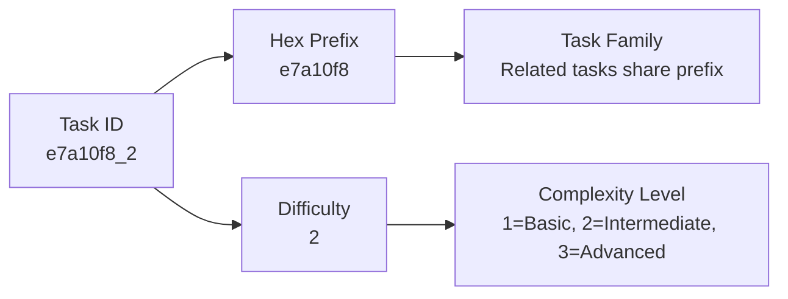
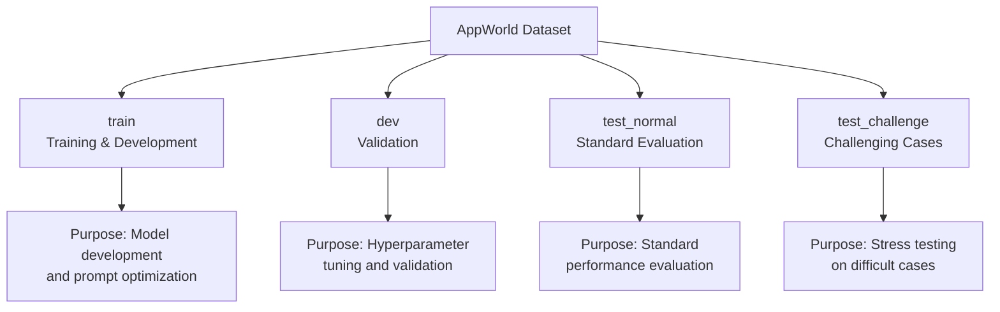
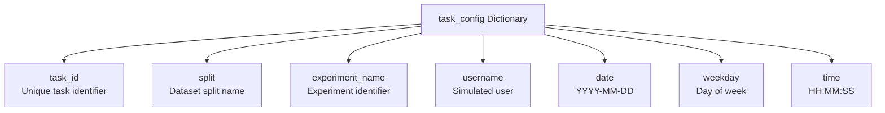
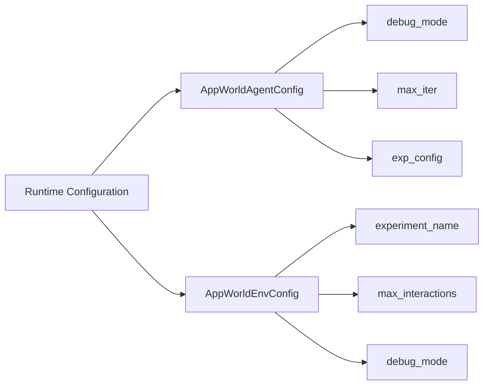
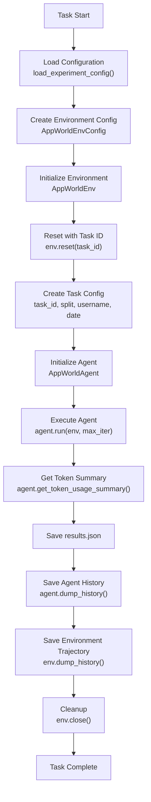
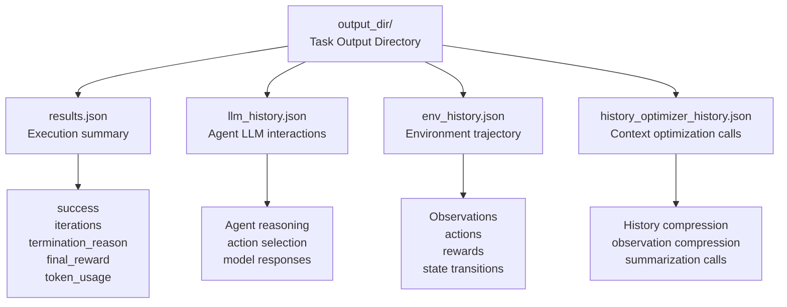
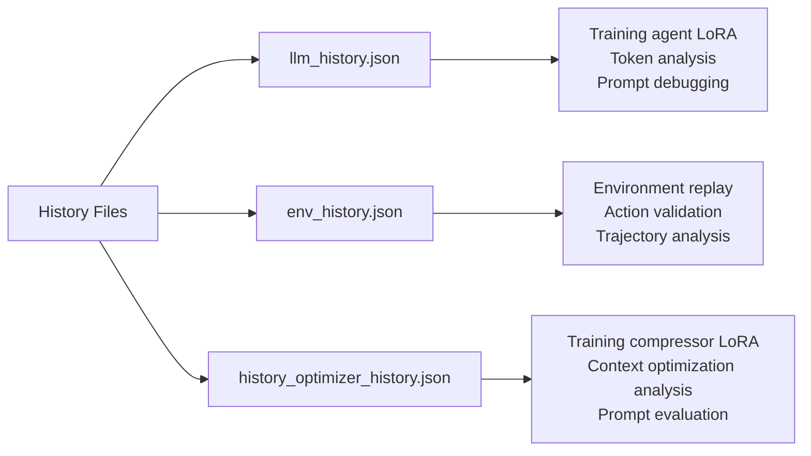

<!-- source: DeepWiki mcp.deepwiki.com · repo microsoft/acon · extra page AppWorld Task Structure · fetched 2026-10-26 -->

# AppWorld Task Structure

<details>
<summary>Relevant source files</summary>

The following files were used as context for generating this wiki page:

- [experiments/appworld/data_copy/datasets/train_history_tiny.txt](experiments/appworld/data_copy/datasets/train_history_tiny.txt)
- [experiments/appworld/data_copy/datasets/train_obs_tiny.txt](experiments/appworld/data_copy/datasets/train_obs_tiny.txt)
- [experiments/appworld/run.py](experiments/appworld/run.py)

</details>


## Purpose and Scope

This page describes the structure and organization of tasks in the AppWorld benchmark, including task identification, configuration, and output formats. For information on setting up the AppWorld environment, see [AppWorld Setup](#4.1.1). For guidance on executing tasks, see [Single Task Execution](#5.1) and [Batch Experiment Execution](#5.2).

## Task Identification

### Task ID Format

AppWorld tasks are identified by a unique ID composed of two parts: a hexadecimal prefix and a numeric suffix, separated by an underscore.

```
Format: {hex_prefix}_{difficulty_level}
Example: 07b42fd_1, 229360a_3, e7a10f8_2
```

The structure follows this pattern:
- **Hex Prefix**: A 7-character hexadecimal identifier that groups related tasks
- **Difficulty Level**: A numeric suffix (1, 2, or 3) indicating task complexity

**Task Difficulty Levels:**

| Level | Description |
|-------|-------------|
| 1 | Basic tasks with straightforward requirements |
| 2 | Intermediate tasks with moderate complexity |
| 3 | Advanced tasks requiring multi-step reasoning |



**Sources:** [experiments/appworld/data_copy/datasets/train_history_tiny.txt:1-39](), [experiments/appworld/data_copy/datasets/train_obs_tiny.txt:1-18]()

### Dataset Splits

AppWorld tasks are organized into four dataset splits for different stages of experimentation:



**Sources:** [experiments/appworld/run.py:56](), based on analysis of codebase patterns

### Task List Files

Tasks for each split are organized in text files containing one task ID per line:

```
experiments/appworld/data_copy/datasets/
├── train_history_tiny.txt      # Subset for history compression experiments
├── train_obs_tiny.txt           # Subset for observation compression experiments
├── dev_tasks.txt                # Development set tasks
├── test_normal_tasks.txt        # Standard test tasks
└── test_challenge_tasks.txt     # Challenging test tasks
```

Example task list format:
```
07b42fd_1
07b42fd_2
07b42fd_3
229360a_1
229360a_3
```

**Sources:** [experiments/appworld/data_copy/datasets/train_history_tiny.txt:1-39](), [experiments/appworld/data_copy/datasets/train_obs_tiny.txt:1-18]()

## Task Configuration

### Task Parameters

Each AppWorld task is initialized with configuration parameters that define the execution context:



**Task Configuration Structure** (as defined in [experiments/appworld/run.py:127-135]()):

| Field | Type | Description | Example |
|-------|------|-------------|---------|
| `task_id` | str | Unique task identifier | `"e7a10f8_2"` |
| `split` | str | Dataset split | `"train"`, `"dev"`, `"test_normal"` |
| `experiment_name` | str | Name of the experiment | `"minimal_test"` |
| `username` | str | Simulated user account | `"user"` |
| `date` | str | Current date | `"2024-01-15"` |
| `weekday` | str | Current day of week | `"Monday"` |
| `time` | str | Current time | `"14:30:00"` |

**Sources:** [experiments/appworld/run.py:127-135]()

### Runtime Configuration

Tasks are executed with additional runtime parameters controlled through `AppWorldAgentConfig` and `AppWorldEnvConfig`:



**Agent Configuration** ([experiments/appworld/run.py:28-51]()):
- Loaded from experiment configuration dictionary
- Valid fields extracted from `AppWorldAgentConfig` dataclass
- Extra configuration stored in `extra_config` field
- None values removed to allow defaults

**Environment Configuration** ([experiments/appworld/run.py:103-107]()):
- `experiment_name`: Identifier for the AppWorld experiment
- `max_interactions`: Maximum number of agent-environment interactions (default: 50)
- `debug_mode`: Enable verbose logging

**Sources:** [experiments/appworld/run.py:28-51](), [experiments/appworld/run.py:103-107]()

## Task Execution Flow

The following diagram illustrates the complete lifecycle of a single AppWorld task from initialization through result output:



**Execution Steps:**

1. **Configuration Loading** ([experiments/appworld/run.py:100]()): Experiment configuration loaded and validated against `AppWorldAgentConfig` fields
2. **Environment Setup** ([experiments/appworld/run.py:103-107]()): `AppWorldEnvConfig` created and `AppWorldEnv` initialized
3. **Task Reset** ([experiments/appworld/run.py:120]()): Environment reset with specific `task_id`
4. **Task Configuration** ([experiments/appworld/run.py:127-135]()): Task-specific parameters assembled
5. **Agent Initialization** ([experiments/appworld/run.py:138-147]()): `AppWorldAgent` created with model, API key, environment, and configurations
6. **Agent Execution** ([experiments/appworld/run.py:152]()): `agent.run(env, max_iter)` executes task
7. **Result Collection** ([experiments/appworld/run.py:155-165]()): Token usage and execution results gathered
8. **Output Persistence** ([experiments/appworld/run.py:168-176]()): Results and histories saved to disk
9. **Cleanup** ([experiments/appworld/run.py:203]()): Environment resources released

**Sources:** [experiments/appworld/run.py:54-206]()

## Output Structure

Each task execution produces a structured output directory containing multiple files that capture different aspects of the agent's execution:



**Sources:** [experiments/appworld/run.py:168-176]()

### Results Format

The `results.json` file contains a comprehensive summary of task execution ([experiments/appworld/run.py:158-170]()):

**Core Result Fields:**

| Field | Type | Description |
|-------|------|-------------|
| `success` | bool | Whether task completed successfully |
| `iterations` | int | Number of agent-environment interactions |
| `termination_reason` | str | Why execution stopped |
| `final_reward` | float | Final task score |
| `task_id` | str | Task identifier |
| `split` | str | Dataset split |
| `model_name` | str | Model used for execution |
| `experiment_name` | str | Experiment identifier |
| `config` | dict | Experiment configuration |
| `token_usage` | dict | Token consumption summary |

**Token Usage Summary Structure** ([experiments/appworld/run.py:155](), [experiments/appworld/run.py:179-193]()):

```json
{
  "model_name": "gpt-4o",
  "total_requests": 42,
  "total_input_tokens": 125340,
  "total_output_tokens": 8921,
  "total_tokens": 134261,
  "input_cost_usd": 0.626700,
  "output_cost_usd": 0.178420,
  "total_cost_usd": 0.805120
}
```

**Sources:** [experiments/appworld/run.py:155-170](), [experiments/appworld/run.py:179-193]()

### History Files

Three history files capture detailed execution traces:



**File Purposes:**

1. **`llm_history.json`** ([experiments/appworld/run.py:173]()):
   - Contains all agent LLM interactions
   - Used for agent LoRA fine-tuning (Stage 4 distillation)
   - Input to token analysis for cost calculation
   - Source: `agent.dump_history(output_dir)`

2. **`env_history.json`** ([experiments/appworld/run.py:176]()):
   - Complete environment interaction trace
   - Records observations, actions, rewards, and state transitions
   - Used for environment replay and debugging
   - Source: `env.dump_history(output_dir)`

3. **`history_optimizer_history.json`**:
   - Context compression and optimization calls
   - Used for compressor LoRA fine-tuning (Stage 3 distillation)
   - Input to token analysis and prompt optimization
   - Generated when context optimization is enabled

**Sources:** [experiments/appworld/run.py:173-176]()

### Output Directory Organization

Tasks executed as part of batch experiments produce organized output directories:

```
outputs/
└── {model_name}_{tag}/
    └── {split}/
        ├── task_{task_id_1}/
        │   ├── results.json
        │   ├── llm_history.json
        │   ├── env_history.json
        │   └── history_optimizer_history.json
        ├── task_{task_id_2}/
        │   └── ...
        └── experiment_summary.json
```

Example:
```
outputs/
└── gpt-4o-mini_baseline/
    └── train/
        ├── task_07b42fd_1/
        ├── task_07b42fd_2/
        ├── task_229360a_1/
        └── experiment_summary.json
```

The `experiment_summary.json` file aggregates results across all tasks in the batch and is used by evaluation and analysis tools.

**Sources:** Based on analysis of execution patterns in [experiments/appworld/run.py:89]() and codebase structure

---

