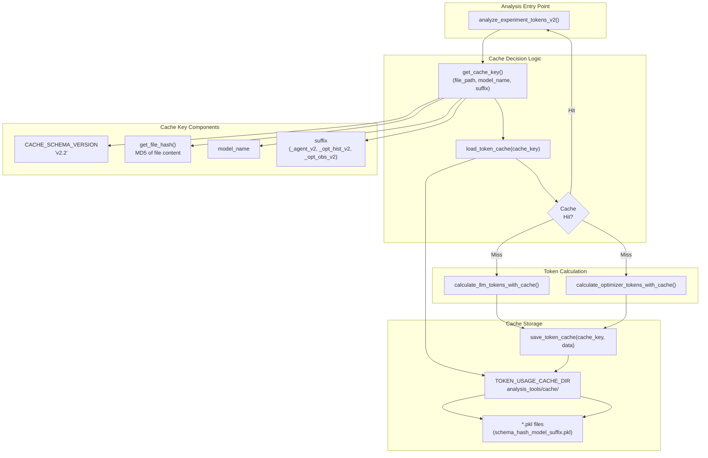
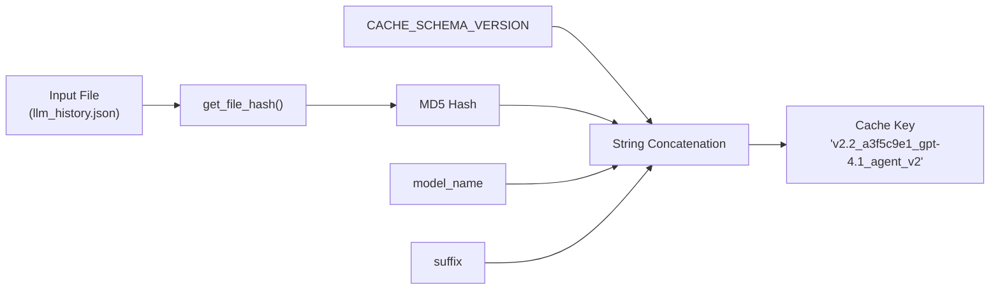
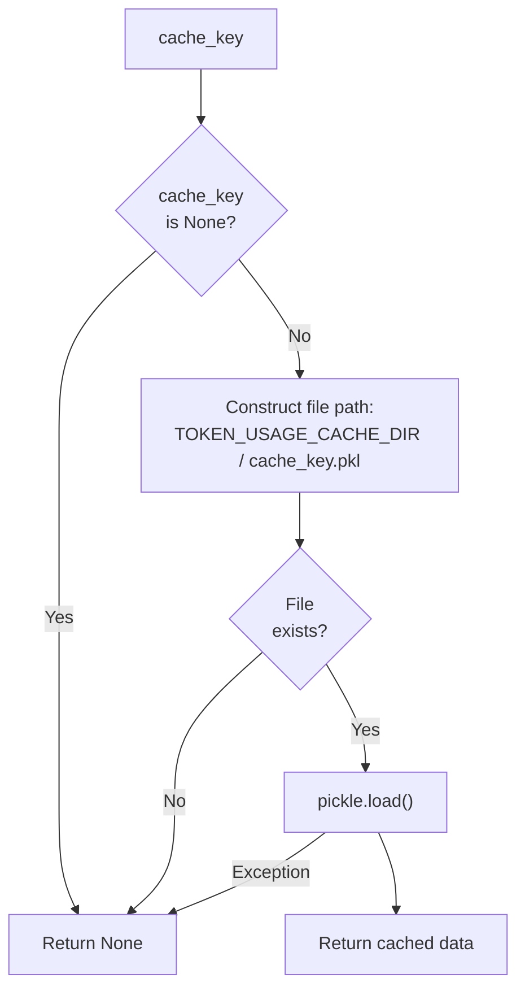
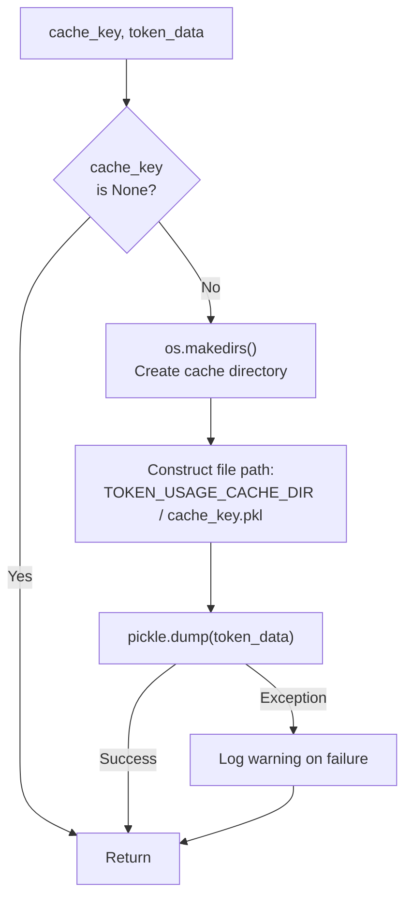
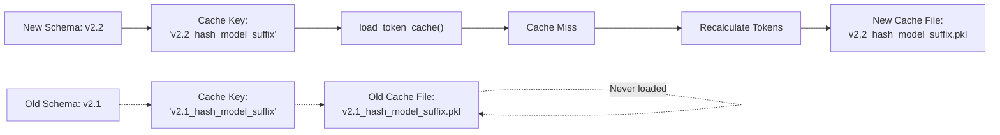
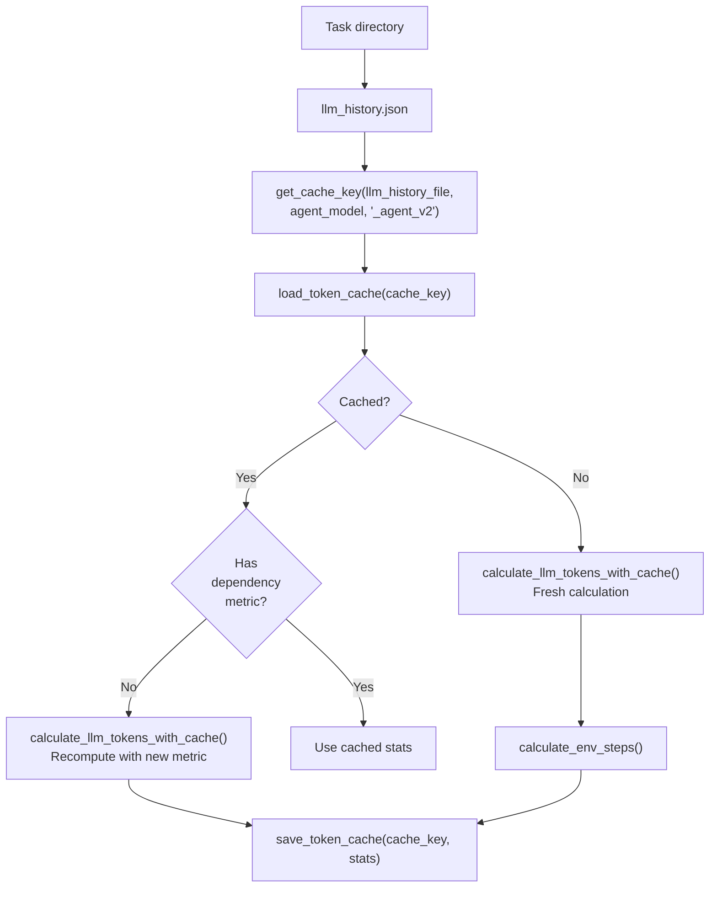
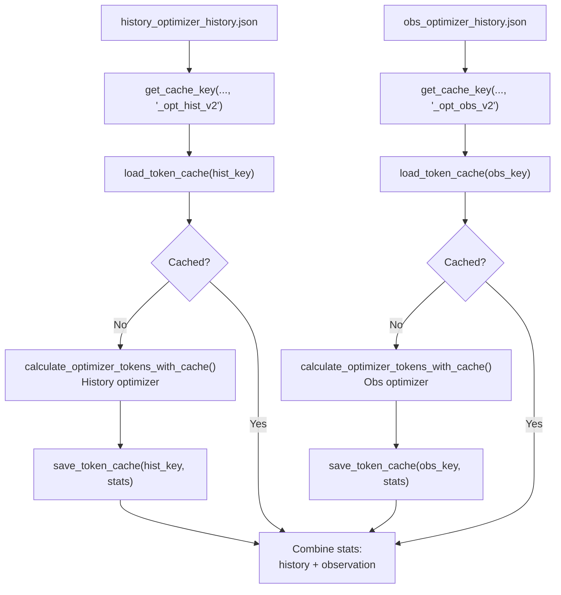
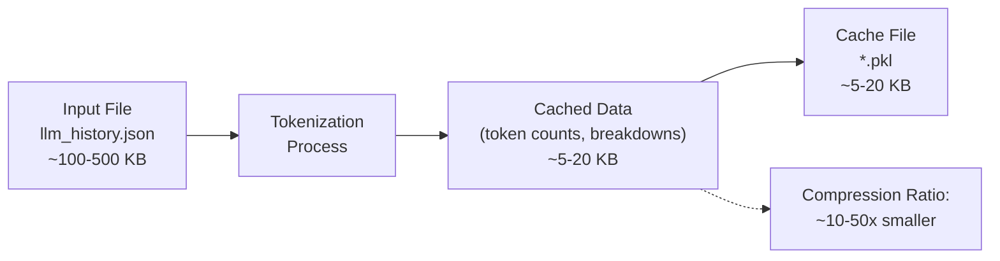
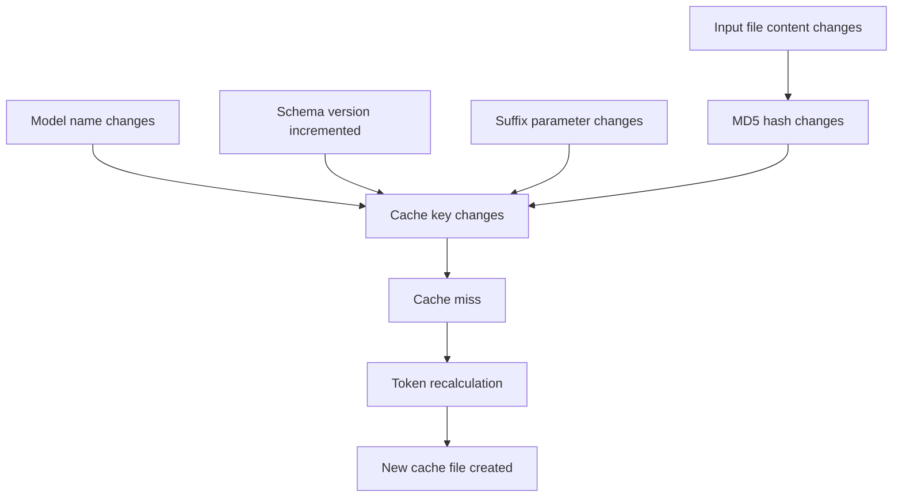
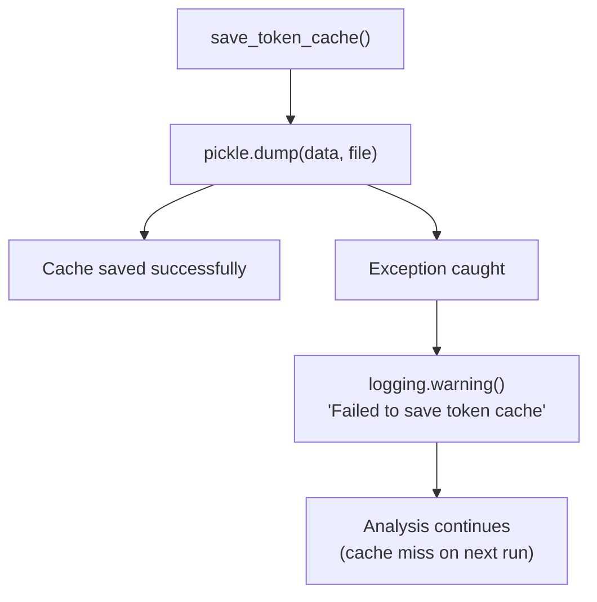

<!-- source: DeepWiki mcp.deepwiki.com · repo microsoft/acon · extra page Cache System · fetched 2026-10-26 -->

# Cache System

<details>
<summary>Relevant source files</summary>

The following files were used as context for generating this wiki page:

- [experiments/analysis_tools/utils.py](experiments/analysis_tools/utils.py)

</details>


This document describes the token calculation cache system used by the ACON analysis tools. The cache system prevents redundant tokenization operations during experiment analysis by storing pre-computed token statistics in persistent pickle files.

For information about the broader token analysis system, see [Token and Cost Analysis](#7.1). For details on the specific token calculation functions, see [analyze_experiment_tokens_v2](#7.1.1).

**Scope**: This page covers the cache implementation in [experiments/analysis_tools/utils.py:464-504](), including cache key generation, storage, retrieval, and schema versioning mechanisms.

---

## Cache Architecture Overview

The cache system provides a transparent layer between token calculation functions and their results, using file-based persistent storage with schema versioning for invalidation.

### System Components



**Sources**: [experiments/analysis_tools/utils.py:444-504](), [experiments/analysis_tools/utils.py:638-1136]()

---

## Cache Key Generation

Cache keys uniquely identify cached token statistics based on input file content, model configuration, and calculation schema version.

### Key Construction

The cache key format is: `{CACHE_SCHEMA_VERSION}_{file_hash}_{model_name}{suffix}`

| Component | Purpose | Example Value |
|-----------|---------|---------------|
| `CACHE_SCHEMA_VERSION` | Invalidates cache when logic changes | `v2.2` |
| `file_hash` | MD5 hash of input file content | `a3f5c9e1b2d4...` |
| `model_name` | Token encoding model | `gpt-4.1` |
| `suffix` | Distinguishes cache types | `_agent_v2`, `_opt_hist_v2` |



**Sources**: [experiments/analysis_tools/utils.py:466-478]()

### File Hashing Implementation

The `get_file_hash()` function computes an MD5 digest of the entire file content:

```python
# Simplified from experiments/analysis_tools/utils.py:466-473
def get_file_hash(file_path: str) -> Optional[str]:
    if not os.path.exists(file_path):
        return None
    with open(file_path, 'rb') as f:
        return hashlib.md5(f.read()).hexdigest()
```

**Sources**: [experiments/analysis_tools/utils.py:466-473]()

### Cache Key Usage Pattern

Different suffixes identify different cache types:

| Suffix | Usage Context | Input File |
|--------|---------------|------------|
| `_agent_v2` | Agent token calculations | `llm_history.json` |
| `_opt_hist_v2` | History optimizer calculations | `history_optimizer_history.json` |
| `_opt_obs_v2` | Observation optimizer calculations | `obs_optimizer_history.json` |

**Sources**: [experiments/analysis_tools/utils.py:791](), [experiments/analysis_tools/utils.py:864](), [experiments/analysis_tools/utils.py:888]()

---

## Cache Operations

### Loading from Cache

The `load_token_cache()` function attempts to retrieve cached data using the cache key:



**Sources**: [experiments/analysis_tools/utils.py:481-491]()

### Saving to Cache

The `save_token_cache()` function persists calculated token data:



**Sources**: [experiments/analysis_tools/utils.py:494-503]()

### Cache Directory Configuration

The cache directory is configured with fallback logic:

```python
# From experiments/analysis_tools/utils.py:444-452
try:
    from experiments.analysis_tools.config import TOKEN_USAGE_CACHE_DIR
except Exception:
    try:
        from .config import TOKEN_USAGE_CACHE_DIR
    except Exception:
        TOKEN_USAGE_CACHE_DIR = Path('analysis/cache/token_usage')
        TOKEN_USAGE_CACHE_DIR.mkdir(parents=True, exist_ok=True)
```

**Sources**: [experiments/analysis_tools/utils.py:444-452]()

---

## Schema Versioning

The `CACHE_SCHEMA_VERSION` constant ensures cache invalidation when token calculation logic changes.

### Version History

| Version | Description |
|---------|-------------|
| `v2.2` | Current version (as of codebase snapshot) |
| Earlier | Incremented when advanced optimizer output logic updated |
| Earlier | Incremented when dependency metric added |

**Sources**: [experiments/analysis_tools/utils.py:42-44]()

### Automatic Cache Invalidation

When `CACHE_SCHEMA_VERSION` changes:
- All existing cache keys become invalid (different prefix)
- Old cache files remain on disk but are never loaded
- New calculations generate new cache files with updated version prefix
- No manual cache clearing required



**Sources**: [experiments/analysis_tools/utils.py:42-44](), [experiments/analysis_tools/utils.py:476-478]()

---

## Integration with Token Analysis

The cache system is transparently integrated into the main analysis function `analyze_experiment_tokens_v2()`.

### Agent Token Calculation Caching



**Sources**: [experiments/analysis_tools/utils.py:779-817]()

### Optimizer Token Calculation Caching

The same pattern applies to optimizer history files:



**Sources**: [experiments/analysis_tools/utils.py:843-920]()

### Cache Backfill Logic

When cached data exists but lacks newly-added metrics (e.g., `total_dependency`, `peak_tokens`), the system automatically recomputes:

```python
# Simplified from experiments/analysis_tools/utils.py:795-807
if cached:
    agent_stats = cached
    if 'total_dependency' not in agent_stats:
        # Backfill new metric by recomputing
        with open(llm_history_file, 'r') as f:
            llm_history = json.load(f)
        recomputed = calculate_llm_tokens_with_cache(llm_history, agent_model)
        agent_stats = recomputed
        save_token_cache(cache_key, agent_stats)
```

**Sources**: [experiments/analysis_tools/utils.py:795-807](), [experiments/analysis_tools/utils.py:868-873]()

---

## Cache Performance Characteristics

### Benefits

| Aspect | Impact |
|--------|--------|
| **Repeated Analysis** | 100x+ speedup when re-analyzing same experiments |
| **Tokenization Cost** | Eliminates expensive `tiktoken.encode()` calls |
| **Memory Efficiency** | Loads only needed cached results, not all files |
| **Experiment Iteration** | Fast feedback when testing analysis code changes |

### Cache Size Characteristics



Cache files store only computed statistics (token counts, breakdowns), not the original text, resulting in significant space savings.

**Sources**: [experiments/analysis_tools/utils.py:131-231](), [experiments/analysis_tools/utils.py:234-438]()

---

## Cache File Naming Convention

Cache files follow a deterministic naming pattern based on their cache key:

### File Name Structure

```
{CACHE_SCHEMA_VERSION}_{file_hash}_{model_name}{suffix}.pkl
```

### Examples

| Cache Type | Example Filename |
|------------|------------------|
| Agent (GPT-4.1) | `v2.2_a3f5c9e1b2d4f8c7_gpt-4.1_agent_v2.pkl` |
| Agent (GPT-4.1-mini) | `v2.2_a3f5c9e1b2d4f8c7_gpt-4.1-mini_agent_v2.pkl` |
| History Optimizer | `v2.2_d7e8f9a0b1c2d3e4_gpt-4.1-mini_opt_hist_v2.pkl` |
| Obs Optimizer | `v2.2_f1e2d3c4b5a69780_gpt-4.1-mini_opt_obs_v2.pkl` |

Note: The same input file analyzed with different models generates separate cache files.

**Sources**: [experiments/analysis_tools/utils.py:476-478](), [experiments/analysis_tools/utils.py:484-485](), [experiments/analysis_tools/utils.py:498]()

---

## Cache Invalidation Scenarios

The cache is automatically invalidated in the following scenarios:



**Sources**: [experiments/analysis_tools/utils.py:466-478]()

### Manual Cache Clearing

While not typically necessary, the cache can be manually cleared by:

```bash
# Remove all cache files
rm -rf analysis_tools/cache/token_usage/*.pkl

# Remove caches for specific schema version
rm -rf analysis_tools/cache/token_usage/v2.2_*.pkl

# Remove caches for specific model
rm -rf analysis_tools/cache/token_usage/*_gpt-4.1_*.pkl
```

**Sources**: [experiments/analysis_tools/utils.py:450-452]()

---

## Error Handling

The cache system implements defensive error handling to ensure analysis continues even if cache operations fail:



Similarly, `load_token_cache()` returns `None` on any exception, causing a cache miss rather than failing the analysis.

**Sources**: [experiments/analysis_tools/utils.py:494-503](), [experiments/analysis_tools/utils.py:481-491]()

---

## Summary

The cache system provides transparent, schema-versioned persistence for token calculation results:

- **Cache keys** combine schema version, file hash, model name, and suffix to uniquely identify cached data
- **Pickle files** store computed token statistics in `TOKEN_USAGE_CACHE_DIR`
- **Schema versioning** (`CACHE_SCHEMA_VERSION`) automatically invalidates outdated caches
- **Backfill logic** recomputes cache entries when new metrics are added
- **Error handling** ensures analysis continues even if cache operations fail

This design enables fast re-analysis of experiments while maintaining correctness when calculation logic evolves.

**Sources**: [experiments/analysis_tools/utils.py:1-1446]()

---

