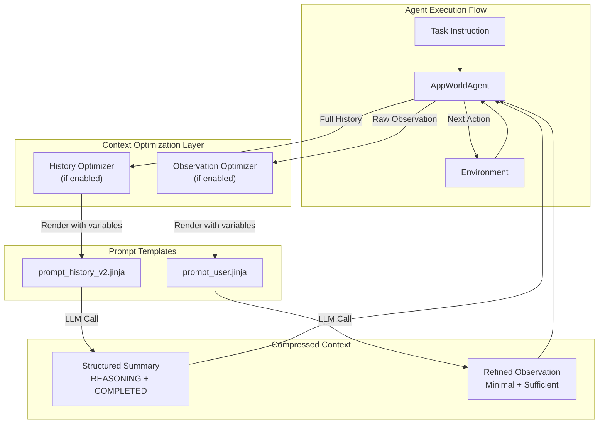
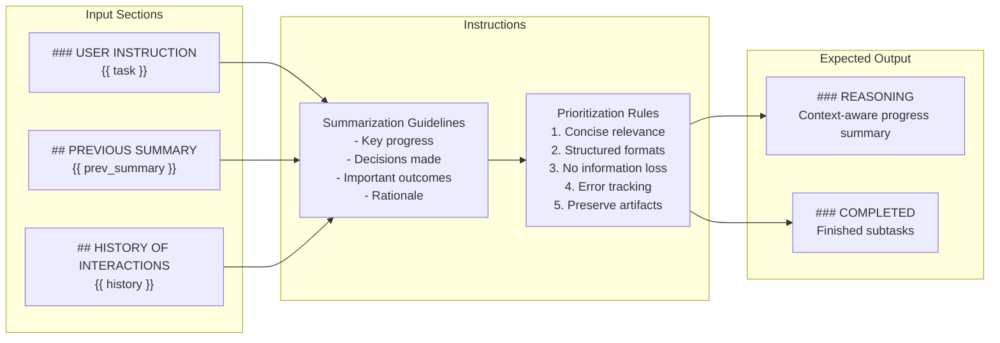
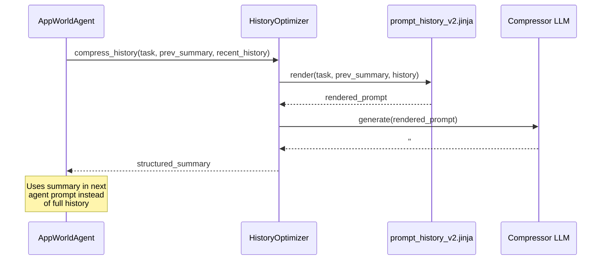
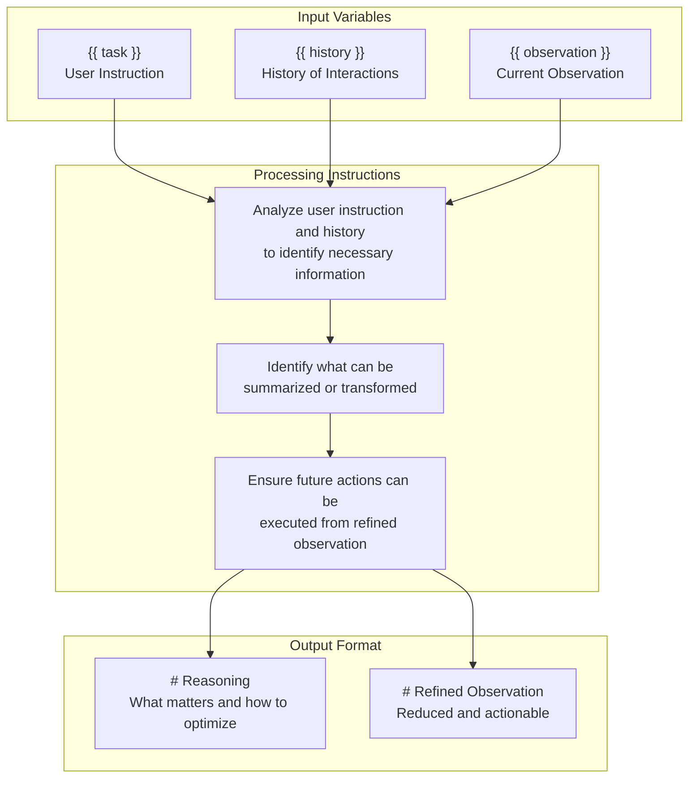
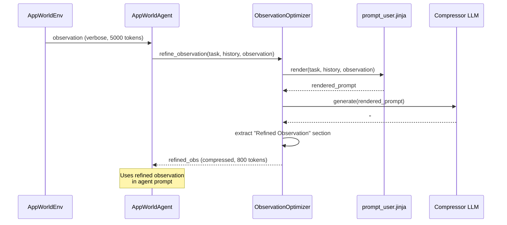
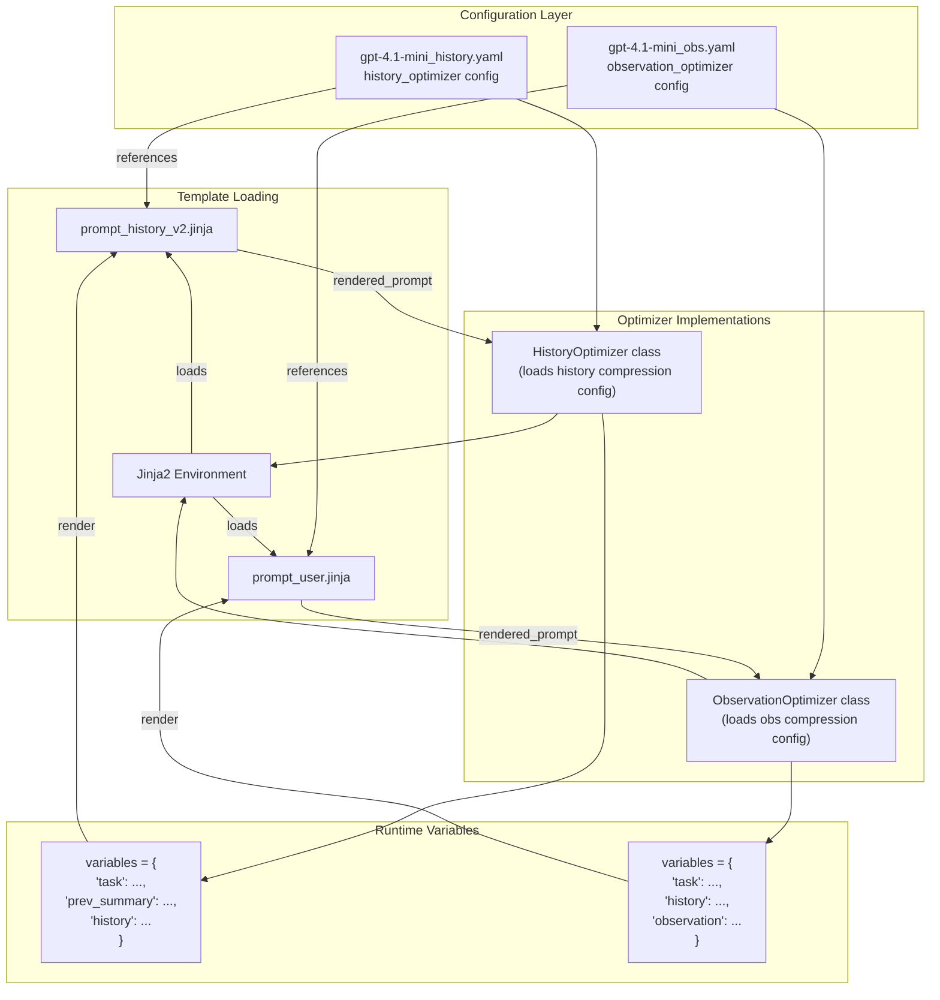
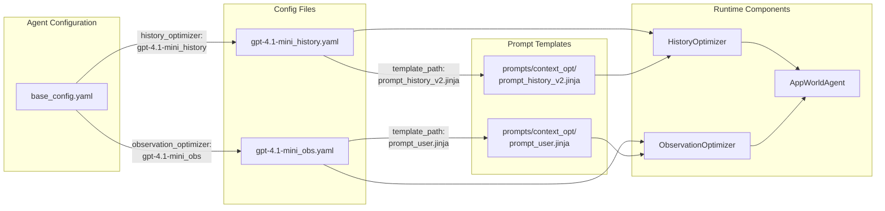
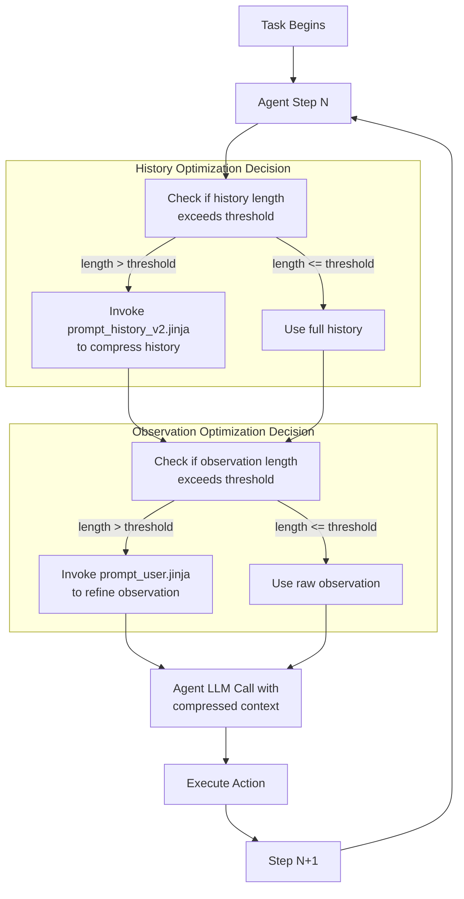

<!-- source: DeepWiki mcp.deepwiki.com · repo microsoft/acon · extra page Context Optimization Prompts · fetched 2026-10-26 -->

# Context Optimization Prompts

<details>
<summary>Relevant source files</summary>

The following files were used as context for generating this wiki page:

- [experiments/appworld/prompts/context_opt/prompt_history_v2.jinja](experiments/appworld/prompts/context_opt/prompt_history_v2.jinja)
- [experiments/appworld/prompts/context_opt/prompt_user.jinja](experiments/appworld/prompts/context_opt/prompt_user.jinja)

</details>


## Purpose and Scope

This page documents the Jinja prompt templates used for context optimization in ACON experiments. These prompts instruct LLMs on how to compress agent history and refine observations to reduce token usage while preserving task-critical information.

For general prompt template information, see [Prompt Templates](#6.3). For the main agent reasoning prompts, see [Agent Prompts](#6.3.2). For the system-level instructions, see [System Prompts](#6.3.1).

## Overview

ACON uses two specialized prompt templates to optimize context length during agent execution:

| Prompt Template | File Path | Purpose | Configuration Reference |
|----------------|-----------|---------|------------------------|
| History Compression | `experiments/appworld/prompts/context_opt/prompt_history_v2.jinja` | Summarizes agent interaction history into structured summaries | `gpt-4.1-mini_history.yaml` |
| Observation Refinement | `experiments/appworld/prompts/context_opt/prompt_user.jinja` | Reduces observation length while preserving actionable information | `gpt-4.1-mini_obs.yaml` |

These prompts are invoked by context compressor components during agent execution to maintain manageable context windows for long-horizon tasks.

**Sources:** [experiments/appworld/prompts/context_opt/prompt_history_v2.jinja:1-39](), [experiments/appworld/prompts/context_opt/prompt_user.jinja:1-22]()

## Context Optimization in Agent Execution Loop



**Sources:** [experiments/appworld/prompts/context_opt/prompt_history_v2.jinja:1-39](), [experiments/appworld/prompts/context_opt/prompt_user.jinja:1-22]()

## History Compression Prompt

### Purpose

The history compression prompt (`prompt_history_v2.jinja`) instructs an LLM to maintain a rolling summary of agent interactions. This summary replaces the full history of observations and actions in the agent's context window, significantly reducing token usage for long-running tasks.

### Template Structure

The prompt consists of the following sections:



**Sources:** [experiments/appworld/prompts/context_opt/prompt_history_v2.jinja:1-39]()

### Template Content

The prompt template defines three input sections and specifies the expected output format:

**Input Template Variables:**

| Variable | Description | Example |
|----------|-------------|---------|
| `{{ task }}` | The original user instruction for the agent | "Schedule a meeting with John on Tuesday" |
| `{{ prev_summary }}` | Previous iteration's summary (empty on first call) | "### REASONING\nAgent searched calendar..." |
| `{{ history }}` | Recent agent interactions since last summarization | "Action: search_calendar(...)\nObservation: ..." |

**Output Requirements:**

The prompt specifies two mandatory sections [experiments/appworld/prompts/context_opt/prompt_history_v2.jinja:3-7]():

1. **### REASONING**: Summarizes key progress, decisions made, important observed outcomes, and rationale behind actions. Must explain how earlier steps influenced later ones and why certain data is retained.

2. **### COMPLETED**: Lists completed subtasks or successful outcomes with brief results if applicable.

**Prioritization Guidelines:**

The prompt enforces five prioritization rules [experiments/appworld/prompts/context_opt/prompt_history_v2.jinja:27-34]():

1. Keep all sections relevant and concise
2. Use reusable structured formats when summarizing artifacts
3. Ensure agent can resume task with no loss of information
4. Include key info from errors or failed attempts to prevent repeated mistakes
5. Preserve all essential artifacts and data needed to complete the task

**Sources:** [experiments/appworld/prompts/context_opt/prompt_history_v2.jinja:1-39]()

### Example Usage Flow



**Sources:** [experiments/appworld/prompts/context_opt/prompt_history_v2.jinja:1-39]()

## Observation Refinement Prompt

### Purpose

The observation refinement prompt (`prompt_user.jinja`) instructs an LLM to reduce the length of environment observations while preserving information necessary for the agent to execute future actions. This is particularly useful when observations contain verbose outputs, large data structures, or redundant information.

### Template Structure



**Sources:** [experiments/appworld/prompts/context_opt/prompt_user.jinja:1-22]()

### Template Content

**Input Template Variables:**

| Variable | Description | Usage |
|----------|-------------|-------|
| `{{ task }}` | Original user instruction | Provides context for determining what observation data is relevant |
| `{{ history }}` | History of interactions so far | Shows what has already been done, informing what's still needed |
| `{{ observation }}` | Current environment observation | The verbose content to be compressed |

**Processing Instructions:**

The prompt directs the LLM to [experiments/appworld/prompts/context_opt/prompt_user.jinja:3-6]():

1. **Analyze** the user instruction and history to identify what information from the current observation is necessary to complete the remaining steps
2. **Think** about what parts can be summarized or transformed to reduce length
3. **Ensure** that future actions can still be executed based on the refined observation alone

**Output Format:**

The prompt specifies two required sections [experiments/appworld/prompts/context_opt/prompt_user.jinja:18-22]():

1. **# Reasoning**: Explanation of what matters and how to optimize it
2. **# Refined Observation**: The reduced and actionable observation content

**Sources:** [experiments/appworld/prompts/context_opt/prompt_user.jinja:1-22]()

### Example Usage Flow



**Sources:** [experiments/appworld/prompts/context_opt/prompt_user.jinja:1-22]()

## Template Variables and Rendering

### Variable Sources in Code

Both prompt templates use Jinja2 syntax for variable substitution. The variables are populated by context optimizer implementations during runtime:



**Sources:** [experiments/appworld/prompts/context_opt/prompt_history_v2.jinja:1-39](), [experiments/appworld/prompts/context_opt/prompt_user.jinja:1-22]()

### Variable Population

The following table shows how each template variable is populated at runtime:

| Template | Variable | Source | Format |
|----------|----------|--------|--------|
| `prompt_history_v2.jinja` | `task` | Original user instruction passed to agent | String |
| `prompt_history_v2.jinja` | `prev_summary` | Previous iteration's summary output or empty string | String (with ### REASONING and ### COMPLETED sections) |
| `prompt_history_v2.jinja` | `history` | Concatenated recent actions and observations | String (formatted as "Action: ...\nObservation: ...") |
| `prompt_user.jinja` | `task` | Original user instruction passed to agent | String |
| `prompt_user.jinja` | `history` | Summary or full history of interactions | String |
| `prompt_user.jinja` | `observation` | Raw observation from environment | String (potentially very long) |

**Sources:** [experiments/appworld/prompts/context_opt/prompt_history_v2.jinja:13-23](), [experiments/appworld/prompts/context_opt/prompt_user.jinja:9-16]()

## Output Format Specifications

### History Compression Output

The history compression prompt produces a structured summary with two mandatory sections:

**Expected Format:**
```
### REASONING
[Narrative summary of key progress, decisions, outcomes, and rationale. 
Explains how earlier steps influenced later ones and why certain data is retained.]

### COMPLETED
- [Completed subtask 1]: [Brief result]
- [Completed subtask 2]: [Brief result]
...
```

**Parsing:** The optimizer extracts this entire output and uses it as `prev_summary` in the next iteration. The agent receives this summary in place of the full interaction history.

**Sources:** [experiments/appworld/prompts/context_opt/prompt_history_v2.jinja:3-7]()

### Observation Refinement Output

The observation refinement prompt produces a two-section response:

**Expected Format:**
```
# Reasoning
[Analysis of what information is necessary from the observation and 
how it can be optimized while preserving actionability]

# Refined Observation
[Compressed observation containing only minimal but sufficient information]
```

**Parsing:** The optimizer extracts only the "# Refined Observation" section and provides this compressed version to the agent instead of the raw observation.

**Sources:** [experiments/appworld/prompts/context_opt/prompt_user.jinja:18-22]()

## Integration with Configuration System

### Configuration File References

Context optimization prompts are referenced in configuration YAML files that define compressor behavior:



**Sources:** [experiments/appworld/prompts/context_opt/prompt_history_v2.jinja:1-39](), [experiments/appworld/prompts/context_opt/prompt_user.jinja:1-22]()

### Configuration Parameters

The context optimization configuration files specify:

| Parameter | Description | Example Value |
|-----------|-------------|---------------|
| `template_path` | Relative path to the Jinja2 prompt template | `"prompts/context_opt/prompt_history_v2.jinja"` |
| `model` | LLM model to use for compression | `"gpt-4o-mini"` or `"Qwen/Qwen3-14B"` |
| `temperature` | Sampling temperature for compression LLM | `0.0` (deterministic) |
| `max_tokens` | Maximum tokens in compressed output | `2000` |

For detailed configuration options, see [Context Optimization Configuration](#6.2).

**Sources:** [experiments/appworld/prompts/context_opt/prompt_history_v2.jinja:1-39](), [experiments/appworld/prompts/context_opt/prompt_user.jinja:1-22]()

## Usage in Execution Pipeline

### When Prompts Are Invoked

The context optimization prompts are invoked at specific points during agent execution:



**Sources:** [experiments/appworld/prompts/context_opt/prompt_history_v2.jinja:1-39](), [experiments/appworld/prompts/context_opt/prompt_user.jinja:1-22]()

### Output Tracking

When context optimization is enabled, the optimizer's inputs and outputs are logged to experiment output directories for analysis:

| Log File | Content | Purpose |
|----------|---------|---------|
| `history_optimizer_history.json` | All history compression LLM calls with inputs/outputs | Token analysis, prompt debugging |
| `llm_history.json` | All agent LLM calls with compressed context | Performance evaluation |
| `env_history.json` | Environment interactions with raw observations | Ground truth reference |

For details on analyzing these outputs, see [Token and Cost Analysis](#7.1).

**Sources:** [experiments/appworld/prompts/context_opt/prompt_history_v2.jinja:1-39](), [experiments/appworld/prompts/context_opt/prompt_user.jinja:1-22]()

## Customization and Prompt Engineering

### Modifying Templates

To customize context optimization behavior, you can edit the Jinja templates directly or create new variants:

**Steps for Creating Custom Prompts:**

1. Copy an existing template (e.g., `prompt_history_v2.jinja`) to a new file
2. Modify the instructions, prioritization rules, or output format
3. Create a new configuration YAML file referencing your custom template
4. Run experiments with `--co_config_path` pointing to your new config

**Key Sections to Customize:**

| Section | File | Lines | Purpose |
|---------|------|-------|---------|
| Summarization Guidelines | `prompt_history_v2.jinja` | [experiments/appworld/prompts/context_opt/prompt_history_v2.jinja:3-7]() | Define what to include in summaries |
| Prioritization Rules | `prompt_history_v2.jinja` | [experiments/appworld/prompts/context_opt/prompt_history_v2.jinja:27-34]() | Control compression strategy |
| Analysis Instructions | `prompt_user.jinja` | [experiments/appworld/prompts/context_opt/prompt_user.jinja:3-6]() | Define observation refinement logic |

For automated prompt optimization across multiple variants, see [Context Optimization Pipeline](#7.2).

**Sources:** [experiments/appworld/prompts/context_opt/prompt_history_v2.jinja:1-39](), [experiments/appworld/prompts/context_opt/prompt_user.jinja:1-22]()

### Template Variables Constraints

When modifying templates, preserve the expected template variables to ensure compatibility with the optimizer implementations:

**Required Variables for History Compression:**
- `{{ task }}` - User instruction
- `{{ prev_summary }}` - Previous summary (may be empty string)
- `{{ history }}` - Recent interactions

**Required Variables for Observation Refinement:**
- `{{ task }}` - User instruction
- `{{ history }}` - Interaction history
- `{{ observation }}` - Current observation

Changing variable names requires corresponding changes in the optimizer implementation code.

**Sources:** [experiments/appworld/prompts/context_opt/prompt_history_v2.jinja:13-23](), [experiments/appworld/prompts/context_opt/prompt_user.jinja:9-16]()

---

