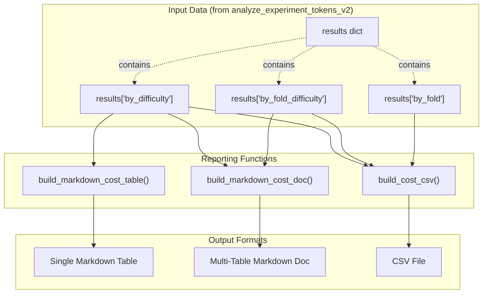
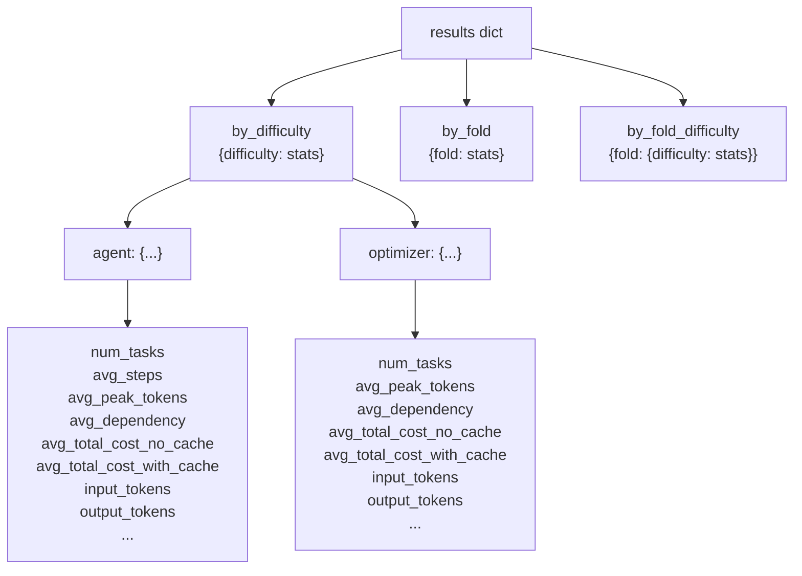
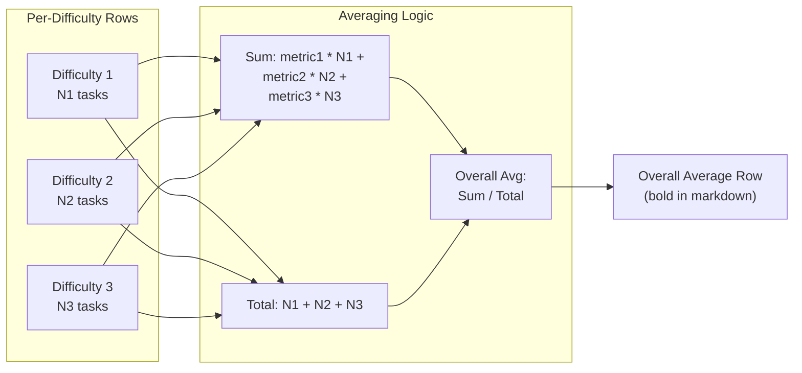
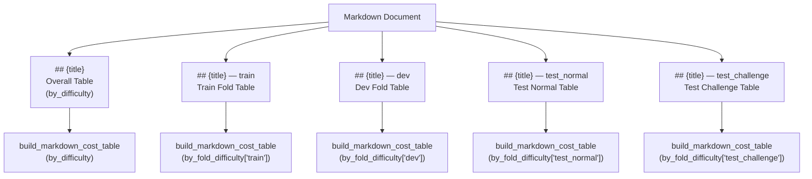

<!-- source: DeepWiki mcp.deepwiki.com · repo microsoft/acon · extra page Cost Reporting · fetched 2026-10-26 -->

# Cost Reporting

<details>
<summary>Relevant source files</summary>

The following files were used as context for generating this wiki page:

- [experiments/analysis_tools/utils.py](experiments/analysis_tools/utils.py)

</details>


This page describes the cost reporting functions that generate human-readable markdown tables and CSV exports from experiment token analysis data. For information about the underlying token analysis function that produces this data, see [analyze_experiment_tokens_v2](#7.1.1). For details on the caching mechanism, see [Cache System](#7.1.2).

## Purpose and Scope

The cost reporting system transforms the structured token usage data produced by `analyze_experiment_tokens_v2` into presentation formats suitable for analysis and publication. It provides three primary reporting functions:

- `build_markdown_cost_table` - generates a single markdown table for one aggregation dimension
- `build_markdown_cost_doc` - generates a complete markdown document with multiple tables (overall + per-fold breakdowns)
- `build_cost_csv` - generates CSV output for programmatic analysis

All reporting functions consume the nested dictionary structure returned by `analyze_experiment_tokens_v2` and produce aggregated metrics including per-task averages, peak tokens, dependency metrics, and costs with and without prompt caching.

## Data Flow Architecture

The following diagram shows how analysis results flow through the reporting pipeline:

**Data Flow from Analysis to Reports**



**Sources:** [experiments/analysis_tools/utils.py:1141-1273](), [experiments/analysis_tools/utils.py:1276-1413]()

## Input Data Structure

The reporting functions consume the nested dictionary structure returned by `analyze_experiment_tokens_v2`. The key aggregation dimensions are:

**Structure of Analysis Results**



**Sources:** [experiments/analysis_tools/utils.py:638-1136]()

Each aggregation level contains separate `agent` and `optimizer` sub-dictionaries with the following key metrics:

| Metric | Description | Unit |
|--------|-------------|------|
| `num_tasks` | Number of tasks in this group | integer |
| `avg_steps` | Average environment steps per task (agent only) | float |
| `avg_peak_tokens` | Average peak input tokens across tasks | float |
| `avg_dependency` | Average dependency metric ((n_input + 2*n_output)*n_output)/2 | float |
| `avg_total_cost_no_cache` | Average cost per task without caching discount | dollars |
| `avg_total_cost_with_cache` | Average cost per task with caching discount | dollars |

**Sources:** [experiments/analysis_tools/utils.py:1039-1134]()

## Markdown Cost Tables

### Single Table Generation

The `build_markdown_cost_table` function generates a single markdown table for one aggregation dimension (e.g., overall by difficulty, or one specific fold by difficulty).

**Function Signature:**

```python
def build_markdown_cost_table(title: str, by_difficulty: dict) -> str
```

**Table Structure:**

The generated markdown table has the following columns:

| Column Group | Columns | Description |
|--------------|---------|-------------|
| Metadata | Difficulty | Difficulty level (1, 2, 3, level_1, unknown, etc.) |
| Agent Metrics | Agent Tasks, Agent Avg Steps, Agent Avg Peak Tokens, Agent Avg Dependency | Agent execution metrics |
| Agent Costs | Agent Avg Total Cost (no cache), Agent Avg Total Cost (with cache) | Per-task agent costs |
| Optimizer Metrics | Optimizer Tasks, Optimizer Avg Peak Tokens, Optimizer Avg Dependency | Context optimizer metrics |
| Optimizer Costs | Optimizer Avg Total Cost (no cache), Optimizer Avg Total Cost (with cache) | Per-task optimizer costs |

**Overall Average Row:**

The function automatically calculates and appends an "Overall Average" row that aggregates across all difficulties:



**Sources:** [experiments/analysis_tools/utils.py:1141-1240](), [experiments/analysis_tools/utils.py:1168-1237]()

### Multi-Table Documents

The `build_markdown_cost_doc` function generates a complete markdown document with multiple tables:

1. Overall table (aggregated across all folds)
2. Per-fold tables (train, dev, test_normal, test_challenge, etc.)

**Function Signature:**

```python
def build_markdown_cost_doc(title: str, by_difficulty: dict, by_fold_difficulty: dict) -> str
```

**Document Structure:**



**Sources:** [experiments/analysis_tools/utils.py:1243-1273]()

**Fold Ordering:**

The function displays folds in a preferred order for consistency:

1. `train`
2. `dev`
3. `test_normal`
4. `test_challenge`
5. `unknown`
6. Any other folds (alphabetically)

Only folds with actual data (at least one task) are included in the output.

**Sources:** [experiments/analysis_tools/utils.py:1252-1272]()

## CSV Export

The `build_cost_csv` function generates a CSV file with all aggregation levels in a flat, tabular format suitable for spreadsheet analysis or programmatic processing.

**Function Signature:**

```python
def build_cost_csv(by_difficulty: dict, by_fold_difficulty: dict) -> str
```

**CSV Schema:**

| Column | Type | Description |
|--------|------|-------------|
| `fold` | string | "overall", "train", "dev", "test_normal", "test_challenge", "unknown", etc. |
| `difficulty` | string | "1", "2", "3", "level_1", "unknown", "Overall Average" |
| `agent_num_tasks` | int | Number of tasks processed by agent |
| `agent_avg_steps` | float | Average environment steps |
| `agent_avg_peak_tokens` | float | Average peak input tokens |
| `agent_avg_dependency` | float | Average dependency metric |
| `agent_avg_total_cost_no_cache` | float | Average cost without caching |
| `agent_avg_total_cost_with_cache` | float | Average cost with caching |
| `optimizer_num_tasks` | int | Number of tasks using optimizer |
| `optimizer_avg_peak_tokens` | float | Average peak optimizer tokens |
| `optimizer_avg_dependency` | float | Average optimizer dependency |
| `optimizer_avg_total_cost_no_cache` | float | Average optimizer cost without caching |
| `optimizer_avg_total_cost_with_cache` | float | Average optimizer cost with caching |

**Sources:** [experiments/analysis_tools/utils.py:1276-1300]()

**Row Organization:**

```mermaid
graph TB
    CSV["CSV Output"]
    
    CSV --> HEADER["Header Row"]
    
    CSV --> OVERALL_SEC["Overall Section<br/>(fold='overall')"]
    OVERALL_SEC --> OV_D1["overall,1,...]
    OVERALL_SEC --> OV_D2["overall,2,...]
    OVERALL_SEC --> OV_D3["overall,3,...]
    OVERALL_SEC --> OV_AVG["overall,Overall Average,...]
    
    CSV --> TRAIN_SEC["Train Section<br/>(fold='train')"]
    TRAIN_SEC --> TR_D1["train,1,...]
    TRAIN_SEC --> TR_D2["train,2,...]
    TRAIN_SEC --> TR_AVG["train,Overall Average,...]
    
    CSV --> DEV_SEC["Dev Section<br/>(fold='dev')"]
    DEV_SEC --> DV_D1["dev,1,...]
    DEV_SEC --> DV_AVG["dev,Overall Average,...]
    
    CSV --> TEST_SEC["Test Sections<br/>(test_normal, test_challenge)"]
```

**Sources:** [experiments/analysis_tools/utils.py:1363-1411]()

### Overall Average Calculation

For each fold section (including "overall"), an "Overall Average" row is calculated by weighted averaging across difficulties:

**Weighted Average Calculation**

```mermaid
graph LR
    subgraph "Input: Per-Difficulty Stats"
        D1["Difficulty 1<br/>N1 tasks<br/>metric = M1"]
        D2["Difficulty 2<br/>N2 tasks<br/>metric = M2"]
        D3["Difficulty 3<br/>N3 tasks<br/>metric = M3"]
    end
    
    subgraph "Calculation"
        WEIGHTED_SUM["weighted_sum =<br/>M1×N1 + M2×N2 + M3×N3"]
        TOTAL_TASKS["total_tasks =<br/>N1 + N2 + N3"]
        AVG["overall_avg =<br/>weighted_sum / total_tasks"]
    end
    
    D1 --> WEIGHTED_SUM
    D2 --> WEIGHTED_SUM
    D3 --> WEIGHTED_SUM
    
    D1 --> TOTAL_TASKS
    D2 --> TOTAL_TASKS
    D3 --> TOTAL_TASKS
    
    WEIGHTED_SUM --> AVG
    TOTAL_TASKS --> AVG
    
    AVG --> OUTPUT["CSV Row:<br/>fold,Overall Average,<br/>total_tasks,overall_avg,...]
```

**Sources:** [experiments/analysis_tools/utils.py:1303-1360]()

The weighted average ensures that difficulties with more tasks contribute proportionally more to the overall average. This is implemented in the internal `add_overall_avg` helper function.

**Sources:** [experiments/analysis_tools/utils.py:1303-1360]()

## Usage Examples

### Example 1: Generate Markdown Report

```python
from experiments.analysis_tools.utils import (
    analyze_experiment_tokens_v2,
    build_markdown_cost_doc
)

# Analyze experiment
results = analyze_experiment_tokens_v2(
    experiment_name="[AppWorld] gpt-4.1-mini_baseline",
    agent_model="gpt-4.1-mini",
    optimizer_model="gpt-4.1-mini"
)

# Generate markdown report
markdown = build_markdown_cost_doc(
    title="GPT-4.1-mini Baseline Cost Analysis",
    by_difficulty=results['by_difficulty'],
    by_fold_difficulty=results['by_fold_difficulty']
)

# Save to file
with open("cost_report.md", "w") as f:
    f.write(markdown)
```

**Sources:** [experiments/analysis_tools/utils.py:1243-1273]()

### Example 2: Generate CSV Export

```python
from experiments.analysis_tools.utils import (
    analyze_experiment_tokens_v2,
    build_cost_csv
)

# Analyze experiment
results = analyze_experiment_tokens_v2(
    experiment_name="[AppWorld] gpt-4.1_optimized",
    agent_model="gpt-4.1",
    optimizer_model="gpt-4.1-mini"
)

# Generate CSV
csv_content = build_cost_csv(
    by_difficulty=results['by_difficulty'],
    by_fold_difficulty=results['by_fold_difficulty']
)

# Save to file
with open("cost_analysis.csv", "w") as f:
    f.write(csv_content)
```

**Sources:** [experiments/analysis_tools/utils.py:1276-1413]()

### Example 3: Generate Single Table for Specific Fold

```python
from experiments.analysis_tools.utils import (
    analyze_experiment_tokens_v2,
    build_markdown_cost_table
)

# Analyze experiment
results = analyze_experiment_tokens_v2(
    experiment_name="[AppWorld] gpt-4.1_distilled",
    folds=["test_challenge"]  # Only analyze challenge set
)

# Generate table for test_challenge only
table = build_markdown_cost_table(
    title="Test Challenge Set - Cost Analysis",
    by_difficulty=results['by_fold_difficulty']['test_challenge']
)

print(table)
```

**Sources:** [experiments/analysis_tools/utils.py:1141-1240]()

## Difficulty Sorting

All reporting functions sort difficulty levels consistently using a custom sort key that handles both numeric and string difficulty values:

```python
def sort_key(k: str):
    try:
        return (0, int(str(k)))  # Numeric difficulties first
    except Exception:
        return (1, str(k))  # String difficulties second (alphabetical)
```

This ensures numeric difficulties (1, 2, 3) appear before string difficulties (level_1, level_2, unknown) and maintains consistent ordering across all reports.

**Sources:** [experiments/analysis_tools/utils.py:1148-1152](), [experiments/analysis_tools/utils.py:1287-1291]()

## Number Formatting

The reporting functions apply consistent number formatting:

| Metric Type | Format | Example |
|-------------|--------|---------|
| Task counts | Integer | `150` |
| Average steps | 2 decimal places | `12.45` |
| Peak tokens | 1 decimal place | `8543.2` |
| Dependency | 2 decimal places | `125432.78` |
| Costs | 6 decimal places | `0.004567` |

This ensures costs (which are typically small dollar amounts) display with sufficient precision while keeping tables readable.

**Sources:** [experiments/analysis_tools/utils.py:1189-1199](), [experiments/analysis_tools/utils.py:1367-1373]()

---

