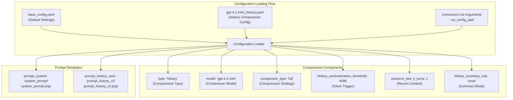
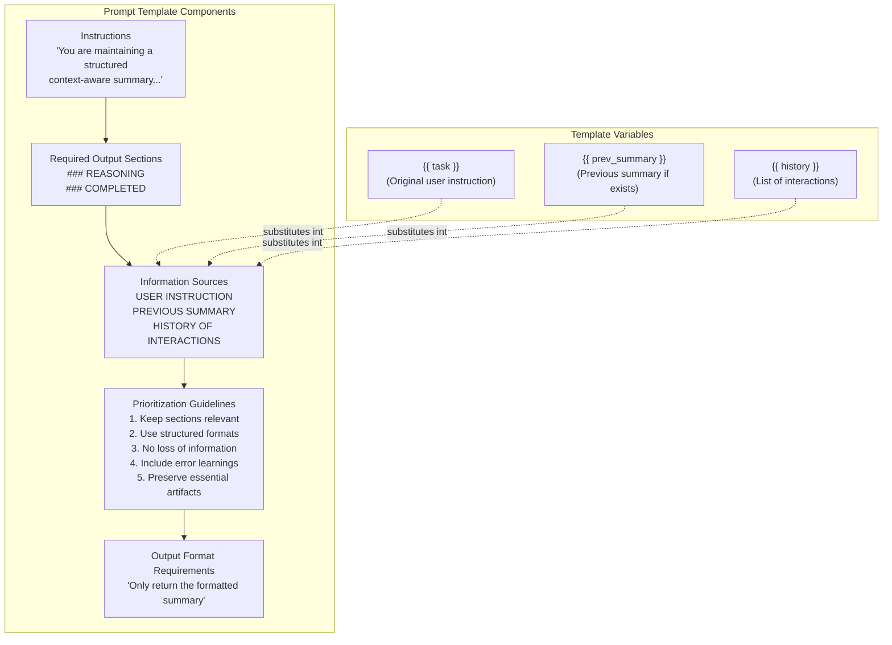
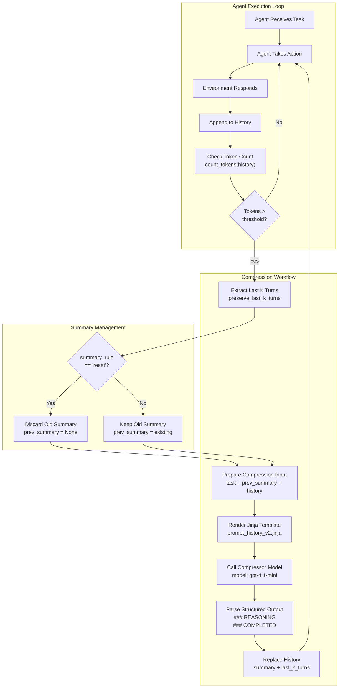
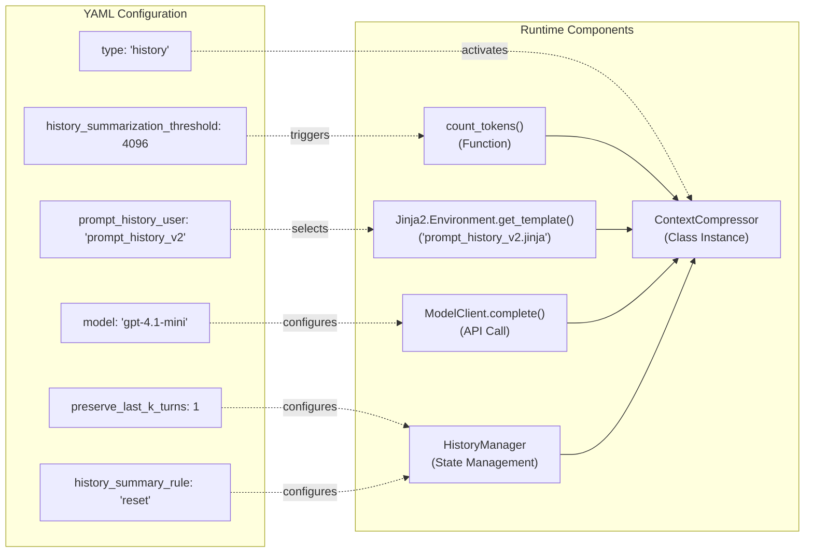

<!-- source: DeepWiki mcp.deepwiki.com · repo microsoft/acon · extra page History Compression · fetched 2026-10-26 -->

# History Compression

<details>
<summary>Relevant source files</summary>

The following files were used as context for generating this wiki page:

- [experiments/appworld/configs/context_opt/gpt-4.1-mini_history.yaml](experiments/appworld/configs/context_opt/gpt-4.1-mini_history.yaml)
- [experiments/appworld/configs/context_opt/gpt-4.1_history.yaml](experiments/appworld/configs/context_opt/gpt-4.1_history.yaml)
- [experiments/appworld/prompts/context_opt/prompt_history_v2.jinja](experiments/appworld/prompts/context_opt/prompt_history_v2.jinja)

</details>


## Purpose and Scope

This document describes the history compression feature in ACON, which compresses past agent-environment interactions into structured summaries to reduce context length in long-horizon tasks. This page focuses on the configuration files, prompt templates, and parameters that control history compression behavior.

For information about observation compression (the other type of context optimization), see [Observation Compression](#6.2.2). For the overall context optimization pipeline that uses these configurations, see [Context Optimization Pipeline](#7.2).

---

## Overview

History compression addresses the context window limitation in long-horizon agent tasks by periodically summarizing past interactions. When the conversation history exceeds a configured token threshold, ACON invokes a compressor model to create a structured summary that preserves essential information while reducing token count.

The compression process operates independently from the main agent model, allowing you to use different models or configurations for compression versus agent reasoning. This separation enables cost optimization (using cheaper models for compression) and quality tuning (optimizing compression prompts separately).

**Sources:** [experiments/appworld/configs/context_opt/gpt-4.1-mini_history.yaml:1-9]()

---

## Configuration Architecture

History compression is configured through YAML files in the `experiments/appworld/configs/context_opt/` directory. These configuration files override base configuration settings to enable and customize compression behavior.



**Configuration File Structure**

Sources: [experiments/appworld/configs/context_opt/gpt-4.1-mini_history.yaml:1-9](), [experiments/appworld/configs/context_opt/gpt-4.1_history.yaml:1-9]()

---

## Configuration Parameters

The following table documents all parameters available in history compression configuration files:

| Parameter | Type | Purpose | Example Values |
|-----------|------|---------|----------------|
| `type` | string | Specifies compression type | `"history"` (for history compression) |
| `model` | string | Model identifier for compression | `"gpt-4.1-mini"`, `"gpt-4.1"`, `"Qwen/Qwen3-14B"` |
| `compressor_type` | string | Compression strategy | `"full"` (complete rewrite) |
| `history_summarization_threshold` | integer | Token count that triggers compression | `4096`, `8192` |
| `preserve_last_k_turns` | integer | Number of recent turns to keep uncompressed | `1`, `2`, `3` |
| `history_summary_rule` | string | How to handle previous summaries | `"reset"` (discard old), `"accumulate"` (merge) |
| `prompts.prompt_system` | string | System prompt template name | `"system_prompt"` |
| `prompts.prompt_history_user` | string | User prompt template for compression | `"prompt_history_v2"` |

### Parameter Details

**`type`** [experiments/appworld/configs/context_opt/gpt-4.1-mini_history.yaml:1]()
- Must be set to `"history"` to enable history compression
- Distinguishes from observation compression (`"observation"`)

**`model`** [experiments/appworld/configs/context_opt/gpt-4.1-mini_history.yaml:2]()
- Specifies which language model to use for compression
- Can differ from the main agent model to optimize cost/quality tradeoffs
- Common choices: `gpt-4.1-mini` (cost-effective), `gpt-4.1` (higher quality)

**`compressor_type`** [experiments/appworld/configs/context_opt/gpt-4.1-mini_history.yaml:3]()
- `"full"`: Complete rewrite of history into structured summary format
- Future versions may support incremental or selective compression

**`history_summarization_threshold`** [experiments/appworld/configs/context_opt/gpt-4.1-mini_history.yaml:7]()
- Token count in conversation history that triggers compression
- Default: `4096` tokens
- Higher values reduce compression frequency but increase context costs

**`preserve_last_k_turns`** [experiments/appworld/configs/context_opt/gpt-4.1-mini_history.yaml:8]()
- Number of most recent interaction turns to keep in full detail
- Default: `1` (preserves only the last turn)
- Balances recency bias with compression efficiency

**`history_summary_rule`** [experiments/appworld/configs/context_opt/gpt-4.1-mini_history.yaml:9]()
- `"reset"`: Discards previous summary, creates fresh summary from all history
- `"accumulate"`: Incorporates previous summary into new summary (not yet implemented)

**Sources:** [experiments/appworld/configs/context_opt/gpt-4.1-mini_history.yaml:1-9]()

---

## Compression Prompt Template

History compression uses a Jinja2 template that structures the compression task for the language model. The template is located at `experiments/appworld/prompts/context_opt/prompt_history_v2.jinja`.

### Template Structure

The prompt template consists of three main sections:



### Prompt Content

The template defines a two-section output structure:

**Section 1: REASONING** [experiments/appworld/prompts/context_opt/prompt_history_v2.jinja:3-4]()
```
### REASONING
Summarize key progress, decisions made, important observed outcomes, and rationale 
behind actions taken so far. Include how earlier steps influenced later ones and why 
certain data is retained in the summary.
```

**Section 2: COMPLETED** [experiments/appworld/prompts/context_opt/prompt_history_v2.jinja:6-7]()
```
### COMPLETED
List completed subtasks or successful outcomes, with brief results if applicable.
```

### Input Variables

The template receives three variables:

| Variable | Source | Description |
|----------|--------|-------------|
| `task` | Original user instruction | The high-level task the agent is trying to accomplish |
| `prev_summary` | Previous compression output | Existing summary from earlier compression (if any) |
| `history` | Recent interactions | Formatted list of agent actions and environment responses |

**Sources:** [experiments/appworld/prompts/context_opt/prompt_history_v2.jinja:1-39]()

### Prioritization Guidelines

The template includes explicit prioritization rules [experiments/appworld/prompts/context_opt/prompt_history_v2.jinja:27-34]():

1. **Keep all sections relevant and concise** - Avoid verbose explanations
2. **Use reusable structured formats** - Enable pattern recognition across summaries
3. **Ensure agent can resume task with no loss of information** - Critical constraint
4. **Include key info from errors or failed attempts** - Prevent repeated mistakes
5. **Preserve all essential artifacts and data** - Maintain task completion capability

These guidelines ensure that compressed summaries maintain task-critical information while achieving significant token reduction.

**Sources:** [experiments/appworld/prompts/context_opt/prompt_history_v2.jinja:27-34]()

---

## Compression Process Flow

The following diagram illustrates how history compression integrates into the agent execution loop:



### Step-by-Step Process

1. **Action-Response Cycle**: Agent takes actions, environment responds, interactions appended to history
2. **Token Monitoring**: After each append, system counts tokens in current history
3. **Threshold Check**: If tokens exceed `history_summarization_threshold`, trigger compression
4. **Turn Preservation**: Extract and set aside last `preserve_last_k_turns` interactions
5. **Summary Rule**: Apply `history_summary_rule` to determine if previous summary should be included
6. **Template Rendering**: Populate `prompt_history_v2.jinja` with `task`, `prev_summary`, and `history`
7. **Model Invocation**: Call configured compressor `model` with rendered prompt
8. **Output Parsing**: Extract structured sections (`### REASONING`, `### COMPLETED`)
9. **History Replacement**: Replace full history with compressed summary plus preserved turns
10. **Resume Execution**: Continue agent loop with reduced context

**Sources:** [experiments/appworld/configs/context_opt/gpt-4.1-mini_history.yaml:7-9](), [experiments/appworld/prompts/context_opt/prompt_history_v2.jinja:1-39]()

---

## Example Configuration Files

### GPT-4.1-mini Configuration

This configuration uses the cost-effective `gpt-4.1-mini` model for compression:

```yaml
type: "history"
model: "gpt-4.1-mini"
compressor_type: "full"
prompts:
  prompt_system: "system_prompt"
  prompt_history_user: "prompt_history_v2"
history_summarization_threshold: 4096
preserve_last_k_turns: 1
history_summary_rule: "reset"
```

**Use case**: Default configuration for most experiments balancing cost and quality.

**Sources:** [experiments/appworld/configs/context_opt/gpt-4.1-mini_history.yaml:1-9]()

### GPT-4.1 Configuration

This configuration uses the more capable `gpt-4.1` model:

```yaml
type: "history"
model: "gpt-4.1"
compressor_type: "full"
prompts:
  prompt_system: "system_prompt"
  prompt_history_user: "prompt_history_v2"
history_summarization_threshold: 4096
preserve_last_k_turns: 1
history_summary_rule: "reset"
```

**Use case**: Higher-quality compression when cost is less constrained or for complex tasks requiring nuanced summarization.

**Sources:** [experiments/appworld/configs/context_opt/gpt-4.1_history.yaml:1-9]()

---

## Output Format and Storage

Compressed summaries are stored in experiment output directories and can be analyzed post-execution.

### Output Directory Structure

```
outputs/{model}_{tag}/{split}/task_{task_id}/
├── history_optimizer_history.json    # Compression events
├── llm_history.json                   # Agent interactions
├── env_history.json                   # Environment state
└── results.json                       # Task results
```

### Compression Event Schema

The `history_optimizer_history.json` file records each compression event with the following structure:

| Field | Type | Description |
|-------|------|-------------|
| `timestamp` | string | When compression occurred |
| `input_tokens` | integer | Tokens before compression |
| `output_tokens` | integer | Tokens after compression |
| `compression_ratio` | float | `output_tokens / input_tokens` |
| `model` | string | Compressor model used |
| `summary` | object | Structured output with `REASONING` and `COMPLETED` sections |
| `preserved_turns` | array | The last k turns kept in full detail |

This structured logging enables detailed analysis of compression effectiveness across experiments.

**Sources:** Based on standard output format described in high-level diagrams

---

## Usage Examples

### Running with History Compression

Use the `--co_config_path` argument to specify a history compression configuration:

```bash
python run_all.py \
  --split dev \
  --model_name gpt-4.1-mini \
  --tag history_compression_test \
  --co_config_path configs/context_opt/gpt-4.1-mini_history.yaml
```

This command runs the dev split with history compression enabled using the specified configuration.

### Multiple Configuration Testing

The context optimization pipeline can test multiple compression configurations:

```bash
python run_ctxopt_pipeline.py \
  --split dev \
  --base_model gpt-4.1-mini \
  --config_dir configs/context_opt
```

This evaluates all history compression configurations in the directory to find optimal settings.

**Sources:** Based on CLI patterns from high-level diagrams

---

## Configuration Mapping to Code

The following diagram maps configuration parameters to their usage in the codebase:



**Key Code Entities**:
- `ContextCompressor`: Main class implementing compression logic
- `count_tokens()`: Token counting function using model tokenizer
- `Jinja2.Environment.get_template()`: Template loading from prompts directory
- `ModelClient.complete()`: API wrapper for LLM inference
- `HistoryManager`: Manages conversation history and summary state

**Sources:** [experiments/appworld/configs/context_opt/gpt-4.1-mini_history.yaml:1-9](), [experiments/appworld/prompts/context_opt/prompt_history_v2.jinja:1-39]()

---

## Related Topics

- **[Observation Compression](#6.2.2)**: The complementary compression type for environment observations
- **[Context Optimization Pipeline](#7.2)**: Automated testing and optimization of compression configurations
- **[Base Configuration](#6.1)**: Default settings that history compression configs override
- **[Prompt Templates](#6.3)**: Detailed guide to Jinja template system
- **[Token and Cost Analysis](#7.1)**: Analyzing the effectiveness of compression configurations
- **[Compressor LoRA](#8.2)**: Training local models to perform compression

---

