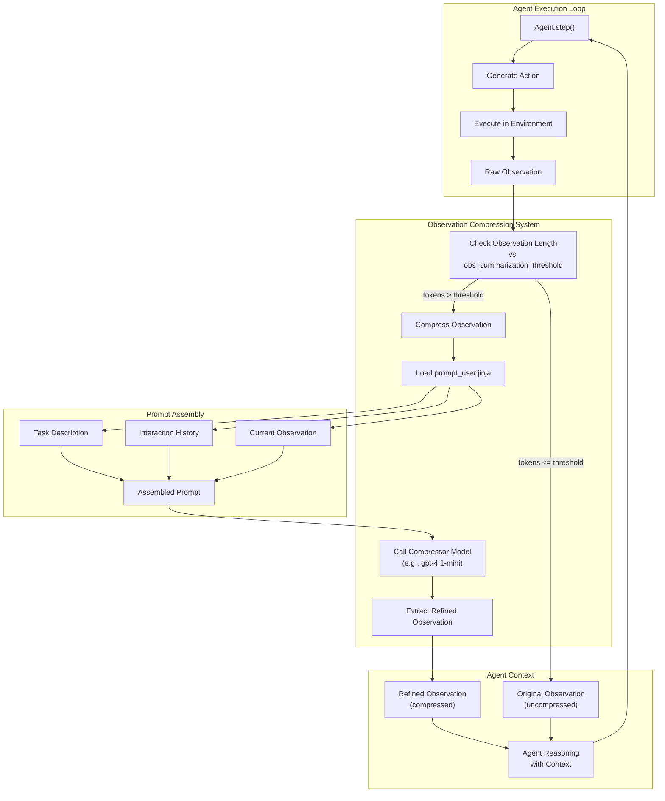
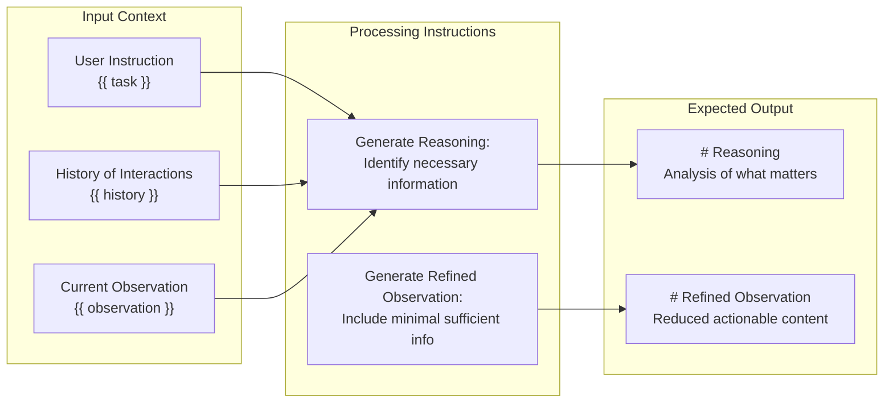
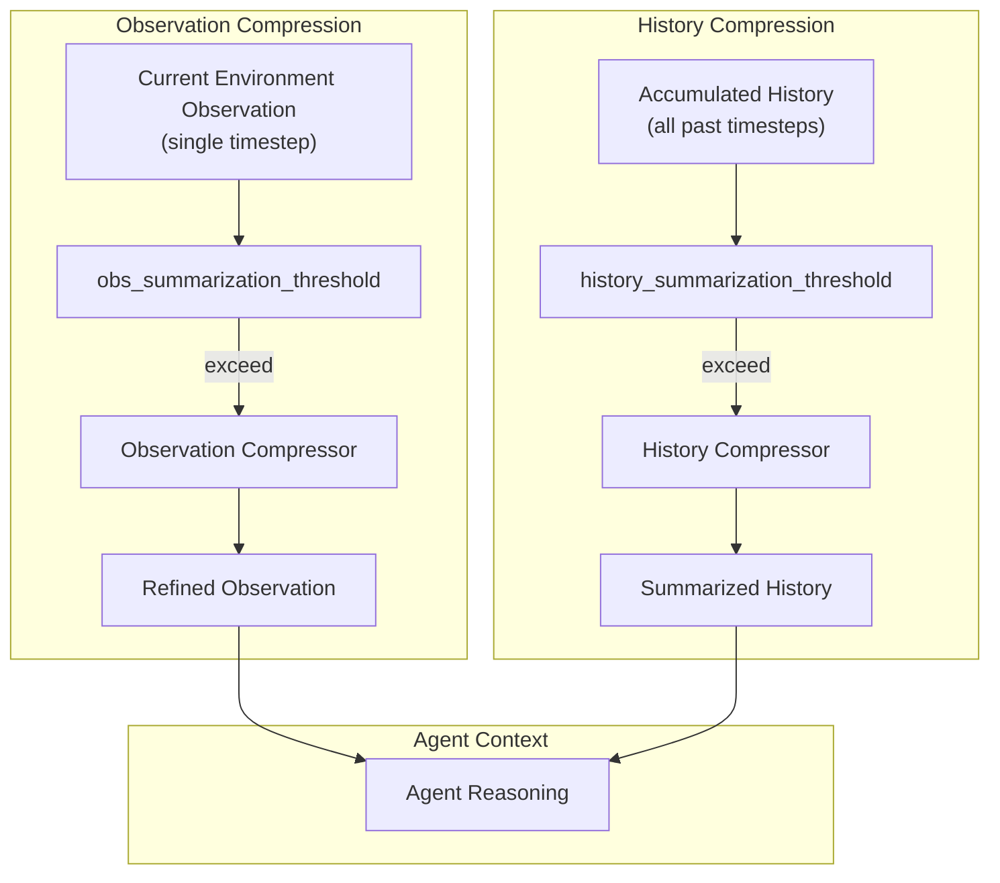

<!-- source: DeepWiki mcp.deepwiki.com · repo microsoft/acon · extra page Observation Compression · fetched 2026-10-26 -->

# Observation Compression

<details>
<summary>Relevant source files</summary>

The following files were used as context for generating this wiki page:

- [experiments/appworld/configs/context_opt/gpt-4.1-mini_obs.yaml](experiments/appworld/configs/context_opt/gpt-4.1-mini_obs.yaml)
- [experiments/appworld/configs/context_opt/gpt-4.1_obs.yaml](experiments/appworld/configs/context_opt/gpt-4.1_obs.yaml)
- [experiments/appworld/prompts/context_opt/prompt_user.jinja](experiments/appworld/prompts/context_opt/prompt_user.jinja)

</details>


## Purpose and Scope

This page describes how to configure **observation compression**, one of two context optimization strategies in ACON. Observation compression reduces the token cost of long environment observations by summarizing them before they are passed to the agent's reasoning model.

Observation compression differs from history compression ([6.2.1](#6.2.1)) in that it operates on the **current timestep's observation** from the environment, rather than the accumulated history of past actions and observations. The two compression types can be used independently or together.

For general context optimization concepts, see [Context Optimization](#6.2). For prompt template customization, see [Context Optimization Prompts](#6.3.3).

---

## Configuration File Structure

Observation compression is configured through YAML files located in `experiments/appworld/configs/context_opt/`. These files define which model performs compression, when compression is triggered, and which prompts to use.

### Basic Configuration Format

```yaml
type: "obs"
model: "gpt-4.1-mini"
compressor_type: "full"
prompts:
  prompt_system: "system_prompt"
  prompt_user: "prompt_user"
obs_summarization_threshold: 256
```

**Sources:** [experiments/appworld/configs/context_opt/gpt-4.1-mini_obs.yaml:1-7](), [experiments/appworld/configs/context_opt/gpt-4.1_obs.yaml:1-7]()

---

## Configuration Parameters

### Core Parameters

| Parameter | Type | Required | Description |
|-----------|------|----------|-------------|
| `type` | string | Yes | Must be `"obs"` for observation compression |
| `model` | string | Yes | Model identifier for the compressor (e.g., `"gpt-4.1-mini"`, `"gpt-4.1"`) |
| `compressor_type` | string | Yes | Compression strategy, typically `"full"` for complete observation refinement |
| `obs_summarization_threshold` | integer | Yes | Token count threshold above which observations are compressed |
| `prompts` | object | Yes | References to prompt template files |

### Prompt References

The `prompts` object specifies which Jinja templates to use for the compression operation:

| Prompt Key | Template File | Purpose |
|------------|---------------|---------|
| `prompt_system` | `system_prompt.jinja` | System-level instructions for the compressor |
| `prompt_user` | `prompt_user.jinja` | User prompt containing task, history, and observation |

**Sources:** [experiments/appworld/configs/context_opt/gpt-4.1-mini_obs.yaml:4-6]()

---

## Observation Compression Workflow

The following diagram illustrates how observation compression integrates into the agent execution loop:



**Diagram: Observation Compression in Agent Execution Loop**

**Sources:** [experiments/appworld/configs/context_opt/gpt-4.1-mini_obs.yaml:1-7](), [experiments/appworld/prompts/context_opt/prompt_user.jinja:1-22]()

---

## Compression Threshold Mechanism

### Token-Based Triggering

The `obs_summarization_threshold` parameter controls when compression is applied:

- **Below threshold:** Observation is passed to the agent unmodified
- **Above threshold:** Observation is compressed using the configured model and prompts

**Example:**
```yaml
obs_summarization_threshold: 256
```

With this setting, observations containing 256 tokens or fewer are not compressed, while longer observations trigger the compression pipeline.

### Rationale

This threshold-based approach provides cost-efficiency by:
1. Avoiding unnecessary API calls for short observations
2. Reducing token costs only when observations are verbose
3. Preserving full detail for concise environment outputs

**Sources:** [experiments/appworld/configs/context_opt/gpt-4.1-mini_obs.yaml:7]()

---

## Prompt Template System

### User Prompt Structure

The observation compression prompt is defined in `prompt_user.jinja` and consists of three main sections:



**Diagram: Prompt Template Data Flow**

**Sources:** [experiments/appworld/prompts/context_opt/prompt_user.jinja:1-22]()

### Template Variables

The `prompt_user.jinja` template receives three variables:

| Variable | Description | Source |
|----------|-------------|--------|
| `{{ task }}` | The original user instruction or task description | Task configuration |
| `{{ history }}` | Formatted history of previous actions and observations | Agent state |
| `{{ observation }}` | Raw observation from the current timestep | Environment output |

**Sources:** [experiments/appworld/prompts/context_opt/prompt_user.jinja:10-16]()

### Prompt Instructions

The template instructs the compressor to perform two steps:

**Step 1: Reasoning**
```
Analyze the user instruction and history to identify what 
information from the current observation is necessary to 
complete the remaining steps.
```

**Step 2: Refined Observation**
```
Include only the information that is minimal but sufficient 
for the next steps.
```

This two-step structure ensures the compressor provides explanatory reasoning alongside the compressed output, which can be useful for debugging and analysis.

**Sources:** [experiments/appworld/prompts/context_opt/prompt_user.jinja:1-22]()

---

## Configuration Examples

### Minimal Configuration (GPT-4.1-mini)

```yaml
type: "obs"
model: "gpt-4.1-mini"
compressor_type: "full"
prompts:
  prompt_system: "system_prompt"
  prompt_user: "prompt_user"
obs_summarization_threshold: 256
```

This configuration uses `gpt-4.1-mini` for cost-effective observation compression with a 256-token threshold.

**Sources:** [experiments/appworld/configs/context_opt/gpt-4.1-mini_obs.yaml:1-7]()

### Higher-Capability Configuration (GPT-4.1)

```yaml
type: "obs"
model: "gpt-4.1"
compressor_type: "full"
prompts:
  prompt_system: "system_prompt"
  prompt_user: "prompt_user"
obs_summarization_threshold: 256
```

This configuration uses the more capable `gpt-4.1` model for compression, which may provide better quality at higher cost.

**Sources:** [experiments/appworld/configs/context_opt/gpt-4.1_obs.yaml:1-7]()

---

## Model Selection Considerations

### Compressor Model Trade-offs

| Model | Token Cost | Quality | Use Case |
|-------|------------|---------|----------|
| `gpt-4.1-mini` | Low | Good | Cost-sensitive experiments, rapid iteration |
| `gpt-4.1` | Medium | Excellent | High-quality compression, critical tasks |
| Local LoRA | Minimal (after training) | Variable | Production deployment, offline usage |

The model specified in the `model` field determines:
1. **API endpoint:** Which OpenAI model receives the compression request
2. **Token pricing:** Input/output token costs for the compression operation
3. **Quality:** Sophistication of the compression reasoning

**Sources:** [experiments/appworld/configs/context_opt/gpt-4.1-mini_obs.yaml:2](), [experiments/appworld/configs/context_opt/gpt-4.1_obs.yaml:2]()

---

## Integration with Experiment Execution

### Loading Observation Compression Config

When running experiments with observation compression, specify the config file path using the `--co_config_path` flag:

```bash
python experiments/appworld/run_all.py \
  --split dev \
  --model_name gpt-4o \
  --co_config_path experiments/appworld/configs/context_opt/gpt-4.1-mini_obs.yaml
```

This tells the experiment runner to:
1. Load the observation compression configuration
2. Apply compression when observations exceed the threshold
3. Use the specified model and prompts for compression

### Output Artifacts

Experiments with observation compression generate additional output files:

| File | Content |
|------|---------|
| `history_optimizer_history.json` | Log of all compression operations |
| `llm_history.json` | Agent LLM calls with compressed observations |
| `env_history.json` | Environment interactions with original observations |

The `history_optimizer_history.json` file contains detailed records of each compression, including:
- Original observation text and token count
- Compressed observation text and token count
- Compression ratio achieved
- Model used for compression

For more on experiment outputs, see [Output and Results](#5.4).

**Sources:** [experiments/appworld/configs/context_opt/gpt-4.1-mini_obs.yaml:1-7]()

---

## Observation Compression vs History Compression

### Key Differences



**Diagram: Observation vs History Compression**

| Aspect | Observation Compression (6.2.2) | History Compression (6.2.1) |
|--------|--------------------------------|----------------------------|
| **Scope** | Single timestep's environment output | Accumulated past actions and observations |
| **Config Type** | `type: "obs"` | `type: "history"` |
| **Threshold Param** | `obs_summarization_threshold` | `history_summarization_threshold` |
| **Prompt Template** | `prompt_user.jinja` | `prompt_history_v2.jinja` |
| **When Applied** | After each environment step | Before each agent reasoning step |
| **Typical Use** | Reducing verbose API responses | Managing long task trajectories |

**Sources:** [experiments/appworld/configs/context_opt/gpt-4.1-mini_obs.yaml:1-7]()

---

## Best Practices

### Threshold Selection

**Conservative (256 tokens):**
- Minimizes compression overhead
- Preserves detail for shorter observations
- Recommended for initial experiments

**Aggressive (128 tokens):**
- Maximizes cost savings
- May compress observations that could remain uncompressed
- Suitable for production with validated compression quality

**Very Conservative (512 tokens):**
- Only compresses very long observations
- Higher token costs but safer compression
- Useful when observation detail is critical

### Prompt Customization

To modify the compression behavior:

1. Copy `experiments/appworld/prompts/context_opt/prompt_user.jinja` to a new file
2. Modify the reasoning instructions or output format
3. Reference the new template in your config YAML:

```yaml
prompts:
  prompt_system: "system_prompt"
  prompt_user: "my_custom_prompt_user"
```

For detailed prompt customization, see [Context Optimization Prompts](#6.3.3).

### Combined Compression Strategies

Observation and history compression can be used together by running multiple experiments with different config files or by implementing combined configs in custom experiment scripts. This provides maximum context reduction for long-horizon tasks.

**Sources:** [experiments/appworld/configs/context_opt/gpt-4.1-mini_obs.yaml:1-7](), [experiments/appworld/prompts/context_opt/prompt_user.jinja:1-22]()

---

## Related Pages

- [History Compression](#6.2.1) - Compressing accumulated action/observation history
- [Context Optimization Configuration](#6.2) - Overview of both compression types
- [Context Optimization Prompts](#6.3.3) - Customizing compression prompt templates
- [Token and Cost Analysis](#7.1) - Measuring compression effectiveness
- [Running Experiments](#5) - Using compression configs in experiments

---

