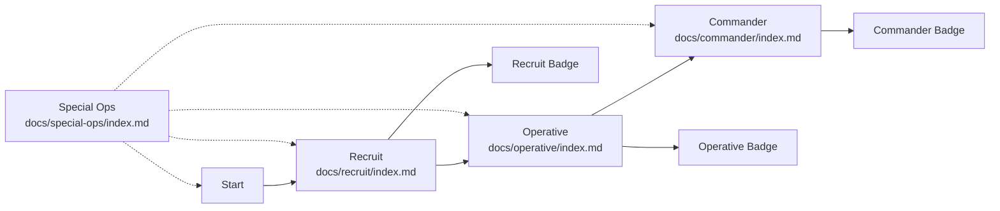
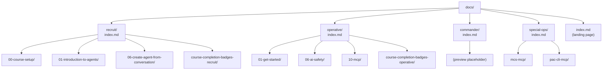

<!-- source: DeepWiki mcp.deepwiki.com · repo microsoft/agent-academy · page 2 Course Tracks · fetched 2026-10-26 -->

# Course Tracks

Relevant source files

The following files were used as context for generating this wiki page:

- [README.md](README.md)
- [docs/commander/index.md](docs/commander/index.md)
- [docs/index.md](docs/index.md)
- [docs/operative/index.md](docs/operative/index.md)
- [docs/our-team/index.md](docs/our-team/index.md)
- [docs/recruit/index.md](docs/recruit/index.md)

This page describes the three-rank progression model used in Copilot Studio Agent Academy, the prerequisite relationship between ranks, and the Special Ops standalone lab system. It also summarizes the curriculum philosophy and intended audiences for each track.

For detailed module-by-module documentation of each track, see:
- [Recruit Track](#2.1)
- [Operative Track](#2.2)
- [Commander Track](#2.3)
- [Special Ops Labs](#3)

---

## Rank Progression Model

The Academy is structured as a three-rank system. Each rank represents a distinct skill tier and awards a digital badge upon completion. Ranks must be completed in order; each rank is a prerequisite for the next.

| Rank | Symbol | Status | Starting Point |
|---|:---:|---|---|
| 🟢 **Recruit** | `•` | Available | `docs/recruit/index.md` |
| 🔵 **Operative** | `••` | Available | `docs/operative/index.md` |
| 🟡 **Commander** | `•••` | Preview / Coming Soon | `docs/commander/index.md` |

Sources: [docs/index.md:17-23]()

---

## Prerequisite Chain

**Rank progression is strictly sequential.** A learner must complete Recruit before starting Operative, and Operative before starting Commander. The Operative track index explicitly states this requirement.

**Rank dependency diagram:**

*Dashed lines from Special Ops indicate that these labs can be started at any point in the progression, with no prerequisite.*

Sources: [docs/index.md:23-29](), [docs/operative/index.md:29-35](), [docs/recruit/index.md:65-67]()

---

## Track Summaries

### Recruit

The Recruit track is the entry point to the Academy. It is structured as 14 sequential lessons (modules `00` through `13`) and builds a single project — an **IT Help Desk Agent** — across the course.

**Target audience:**

| Audience | Description |
|---|---|
| Makers | Exploring Copilot Studio for the first time |
| Developers | Building Microsoft 365 Copilot extensions |
| Power Platform users | Leveling up with intelligent agents |
| Hands-on learners | Prefer to learn by doing |

**Prerequisites:**
- Microsoft 365 Developer tenant (with SharePoint enabled)
- Microsoft Copilot Studio (trial or licensed)
- Optional: Basic knowledge of SharePoint, Power Platform, or Power Fx

**Curriculum snapshot:**

| Module | Title |
|---|---|
| `00` | Course Setup |
| `01` | Introduction to Agents |
| `02` | Copilot Studio Fundamentals |
| `03` | Create a Declarative Agent |
| `04` | Creating a Solution |
| `05` | Get Started with Pre-Built Agents |
| `06` | Build a Custom Agent |
| `07` | Add a Topic with Triggers |
| `08` | Enhance with Adaptive Cards |
| `09` | Automate with Agent Flows |
| `10` | Add Event Triggers |
| `11` | Publish Your Agent |
| `12` | Understanding Licensing |
| `13` | Securing Your Recruit Badge |

Sources: [docs/recruit/index.md:36-67]()

---

### Operative

The Operative track assumes Recruit completion. It consists of 12 missions (modules `01` through `12`) and builds a **Hiring Agent** — a multi-agent system that automates an enterprise hiring workflow.

**Target audience:**

| Audience | Description |
|---|---|
| Solution architects | Designing enterprise AI systems |
| Developers | Building production-ready agent solutions |
| IT professionals | Implementing AI governance and safety |
| Business analysts | Creating complex automation workflows |

**Prerequisites:**
- Completed Recruit training
- Power Platform environment with Copilot Studio license or trial
- Access to Microsoft Dataverse
- Administrative permissions to create solutions and agents
- Access to the Frontier Program (required for MCP module)

**Curriculum snapshot:**

| Mission | Title |
|---|---|
| `01` | Get Started with the Hiring Agent |
| `02` | Authoring Agent Instructions |
| `03` | Make Your Agent Multi-Agent Ready |
| `04` | Automate Your Agent with Triggers |
| `05` | Understanding Agent Models and Response Formatting |
| `06` | Content Moderation and AI Safety Essentials |
| `07` | Extracting Resume Contents with Multi-Modal Prompts |
| `08` | Prompts — Dataverse Grounding |
| `09` | Generating an Interview Prep Document |
| `10` | Integrate with MCP Servers |
| `11` | Obtain User Feedback with Adaptive Cards |
| `12` | Course Completion Badges |

Sources: [docs/operative/index.md:56-74]()

---

### Commander (Preview)

The Commander track is currently in preview and not yet publicly available. Its index page at `docs/commander/index.md` contains only a placeholder. When released, it will require completion of the Operative track.

See [Commander (Preview)](#2.3) for full documentation of its planned curriculum.

Sources: [docs/commander/index.md:1-12]()

---

## Special Ops

Special Ops are standalone labs that are **not part of the rank progression**. They have no rank prerequisite and can be completed at any time, in any order, independently of the Recruit → Operative → Commander chain.

They are intended as focused, single-topic skill exercises — described in the docs as "side missions."

The two currently available Special Ops labs are:

| Lab | Topic |
|---|---|
| MCS MCP | Connecting a custom MCP server to Copilot Studio |
| PAC CLI MCP | Managing Power Platform environments via AI and the `pac` CLI |

See [Special Ops Labs](#3) for full documentation.

Sources: [docs/index.md:25-29]()

---

## Directory Structure

The following diagram maps each track to its corresponding directory and index file in the repository.

**Repository layout for course tracks:**

Sources: [docs/recruit/index.md:48-63](), [docs/operative/index.md:56-70](), [docs/commander/index.md:1-12](), [docs/index.md:25-29]()

---

## Curriculum Philosophy

The Academy applies several consistent design principles across all tracks:

**Progressive difficulty.** Each rank, and each module within a rank, explicitly builds on the previous one. Learners who skip modules may encounter missing dependencies (solutions, agents, data) that block progress in later modules. This is documented in the landing page as an intentional design constraint.

**Bring your own environment.** The Academy does not provision environments. Learners must supply their own Microsoft 365 tenant and Power Platform environment. Free trials are supported but time-limited.

**Skipping is allowed but has consequences.** If a module requires a capability unavailable in a learner's environment, it can be skipped. However, since many modules depend on artifacts created in prior modules, skipping may require manual workarounds.

**Badge-gated completion.** Each rank concludes with a badge submission mission. Earning the badge requires submitting evidence through the GitHub issue and badge form system described in [Badge and Completion System](#5).

Sources: [docs/index.md:33-55](), [docs/recruit/index.md:65-67](), [docs/operative/index.md:29-38]()

---

