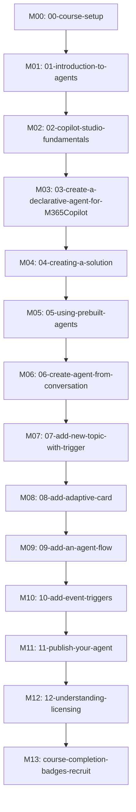
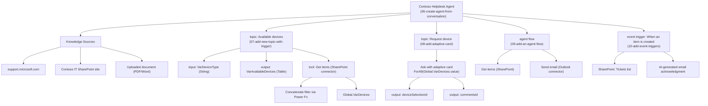
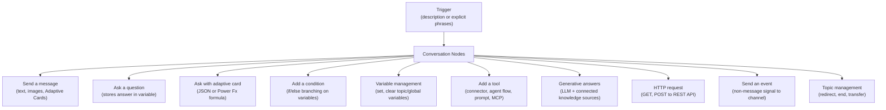
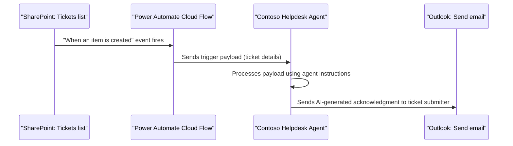

<!-- source: DeepWiki mcp.deepwiki.com · repo microsoft/agent-academy · page 2.1 Recruit Track · fetched 2026-10-26 -->

# Recruit Track

<details>
<summary>Relevant source files</summary>

The following files were used as context for generating this wiki page:

- [docs/commander/index.md](docs/commander/index.md)
- [docs/index.md](docs/index.md)
- [docs/operative/index.md](docs/operative/index.md)
- [docs/our-team/index.md](docs/our-team/index.md)
- [docs/recruit/00-course-setup/index.md](docs/recruit/00-course-setup/index.md)
- [docs/recruit/02-copilot-studio-fundamentals/index.md](docs/recruit/02-copilot-studio-fundamentals/index.md)
- [docs/recruit/03-create-a-declarative-agent-for-M365Copilot/index.md](docs/recruit/03-create-a-declarative-agent-for-M365Copilot/index.md)
- [docs/recruit/06-create-agent-from-conversation/index.md](docs/recruit/06-create-agent-from-conversation/index.md)
- [docs/recruit/07-add-new-topic-with-trigger/index.md](docs/recruit/07-add-new-topic-with-trigger/index.md)
- [docs/recruit/08-add-adaptive-card/assets/8.0_04_AdaptiveCardDesignerSamples.png](docs/recruit/08-add-adaptive-card/assets/8.0_04_AdaptiveCardDesignerSamples.png)
- [docs/recruit/08-add-adaptive-card/index.md](docs/recruit/08-add-adaptive-card/index.md)
- [docs/recruit/09-add-an-agent-flow/index.md](docs/recruit/09-add-an-agent-flow/index.md)
- [docs/recruit/10-add-event-triggers/assets/10_AllowConnector.png](docs/recruit/10-add-event-triggers/assets/10_AllowConnector.png)
- [docs/recruit/10-add-event-triggers/assets/10_ConfigureInputParameters.png](docs/recruit/10-add-event-triggers/assets/10_ConfigureInputParameters.png)
- [docs/recruit/10-add-event-triggers/assets/10_ConfigureTriggerNameAndConnections.png](docs/recruit/10-add-event-triggers/assets/10_ConfigureTriggerNameAndConnections.png)
- [docs/recruit/10-add-event-triggers/assets/10_ConfigureTriggerParams.png](docs/recruit/10-add-event-triggers/assets/10_ConfigureTriggerParams.png)
- [docs/recruit/10-add-event-triggers/assets/10_CreateTestTicket.png](docs/recruit/10-add-event-triggers/assets/10_CreateTestTicket.png)
- [docs/recruit/10-add-event-triggers/assets/10_EditTriggerInPowerAutomate.png](docs/recruit/10-add-event-triggers/assets/10_EditTriggerInPowerAutomate.png)
- [docs/recruit/10-add-event-triggers/assets/10_EnableGenerativeAI.png](docs/recruit/10-add-event-triggers/assets/10_EnableGenerativeAI.png)
- [docs/recruit/10-add-event-triggers/assets/10_InsertExpressionForTrigger.png](docs/recruit/10-add-event-triggers/assets/10_InsertExpressionForTrigger.png)
- [docs/recruit/10-add-event-triggers/assets/10_MonitorTriggerTest.png](docs/recruit/10-add-event-triggers/assets/10_MonitorTriggerTest.png)
- [docs/recruit/10-add-event-triggers/assets/10_NavigateToTrigger.png](docs/recruit/10-add-event-triggers/assets/10_NavigateToTrigger.png)
- [docs/recruit/10-add-event-triggers/assets/10_SelectOutlookConnector.png](docs/recruit/10-add-event-triggers/assets/10_SelectOutlookConnector.png)
- [docs/recruit/10-add-event-triggers/index.md](docs/recruit/10-add-event-triggers/index.md)
- [docs/recruit/12-understanding-licensing/index.md](docs/recruit/12-understanding-licensing/index.md)
- [docs/recruit/index.md](docs/recruit/index.md)

</details>


## Purpose and Scope

This page documents the Recruit training path in full: all 14 missions (numbered 00–12, plus a badge completion mission), the environment prerequisites, and the key technical concepts introduced at each stage. The primary lab artifact is the **Contoso Helpdesk Agent**, assembled incrementally across missions 06–10.

The Recruit track is the prerequisite for the [Operative Track](#2.2) and [Commander (Preview)](#2.3). For standalone labs that require no rank completion, see [Special Ops Labs](#3). For the badge awarded upon completing the track, see [Badge and Completion System](#5).

---

## Prerequisites

Defined in [docs/recruit/index.md:29-33]().

| Requirement | Details |
|---|---|
| Microsoft 365 Developer tenant | SharePoint must be enabled |
| Copilot Studio access | Trial or licensed; trial setup is in Mission 00 |
| Power Apps Developer environment | Created in Mission 00 via the Developer Plan |
| Optional | Basic familiarity with SharePoint, Power Platform, or Power Fx |

## Target Audience

From [docs/recruit/index.md:36-42]().

- Makers and developers new to Copilot Studio
- IT professionals building M365 Copilot extensions
- Power Platform users adding intelligent agents to existing workflows
- Learners who prefer hands-on labs over theory-first courses

---

## Curriculum Overview

All 14 missions are listed in [docs/recruit/index.md:48-64](). Each mission lives in a numbered subdirectory under `docs/recruit/`.

| Mission | Title | Codename | Key Concepts | Est. Time |
|---|---|---|---|---|
| `00` | Course Setup | `OPERATION DEPLOYMENT READY` | M365 tenant, Copilot Studio trial, developer environment, SharePoint site | ~30 min |
| `01` | Introduction to Agents | — | LLMs, RAG, declarative vs. custom agents | — |
| `02` | Copilot Studio Fundamentals | `OPERATION CORE PROTOCOL` | Knowledge, Tools, Topics, Instructions | ~30 min |
| `03` | Deploy a Declarative Agent for M365 Copilot | `OPERATION COPILOT EXTENSION` | Declarative agents, AI prompts, M365 Copilot + Teams publishing | ~60 min |
| `04` | Creating a Solution | — | Solution publishers, preferred solution, environment management | — |
| `05` | Get Started with Pre-Built Agents | — | Pre-built agent templates | — |
| `06` | Build a Custom Agent | `OPERATION AGENT FORGE` | Natural language authoring, knowledge sources, generative orchestration | ~75 min |
| `07` | Add a Topic with Triggers | `OPERATION STAY ON TOPIC` | Topics, trigger phrases, conversation nodes, SharePoint connector, Power Fx | ~60 min |
| `08` | Enhance with Adaptive Cards | `OPERATION INTERFACE UPLIFT` | Adaptive Cards, JSON, Power Fx `ForAll`/`IsBlank` formulas | ~45 min |
| `09` | Automate with Agent Flows | `OPERATION AUTOMATION POWERHOUSE` | Agent flows, deterministic automation, SharePoint + Outlook connectors | ~30 min |
| `10` | Add Event Triggers | `OPERATION GHOST ROUTINE` | Event triggers, autonomous agents, `When an item is created` (SharePoint) | ~45 min |
| `11` | Publish Your Agent | — | Teams channel, M365 Copilot channel, availability options | — |
| `12` | Understanding Licensing | `OPERATION KNOW WHAT YOU OWE` | Copilot Credits, PAYGO, capacity packs, CCCUs | ~15 min |
| `13` | Securing Your Recruit Badge | — | Badge submission form, evidence screenshots | — |

**Curriculum progression mapped to source directories**



Sources: [docs/recruit/index.md:48-64]()

---

## The Two Agents Built

The track builds two distinct agents at different points in the curriculum.

### Contoso Tech Support Pro (Mission 03)

Source: [docs/recruit/03-create-a-declarative-agent-for-M365Copilot/index.md]()

| Property | Value |
|---|---|
| Agent name | `Contoso Tech Support Pro` |
| Type | Declarative agent for Microsoft 365 Copilot |
| Prompt tool | `IT Expert` (parameter: `problem input`) |
| Published channels | Microsoft 365 Copilot, Microsoft Teams |
| Default model | Basic GPT-4.1 mini |

This agent is standalone — it is not extended in later missions.

### Contoso Helpdesk Agent (Missions 06–10)

Source: [docs/recruit/06-create-agent-from-conversation/index.md]() through [docs/recruit/10-add-event-triggers/index.md]()

Created in Mission 06 via natural language authoring, then extended with a topic (07), an adaptive card topic (08), an agent flow (09), and a SharePoint event trigger (10).

**Contoso Helpdesk Agent — components mapped to source files and code identifiers**



Sources: [docs/recruit/06-create-agent-from-conversation/index.md](), [docs/recruit/07-add-new-topic-with-trigger/index.md](), [docs/recruit/08-add-adaptive-card/index.md](), [docs/recruit/09-add-an-agent-flow/index.md](), [docs/recruit/10-add-event-triggers/index.md]()

---

## Key Technical Concepts

### Four Building Blocks of an Agent (Mission 02)

Introduced in [docs/recruit/02-copilot-studio-fundamentals/index.md:65-74](). Every Copilot Studio agent is composed of these four elements:

| Building Block | Role | Missions Where Applied |
|---|---|---|
| **Knowledge** | Data sources queried to answer questions (SharePoint, Dataverse, websites, uploaded files) | 02, 06 |
| **Tools** | Actions executed by the agent: connectors, agent flows, AI prompts, REST APIs, MCP servers | 03, 07, 09 |
| **Topics** | Named conversation flows activated by user input or generative orchestration | 07, 08 |
| **Instructions** | System-level prompt defining the agent's persona, tone, and behavioral constraints | 02, 03, 06 |

At runtime, the Copilot Studio orchestrator uses generative AI to decide which topic to invoke or which tool to call based on the user message and the agent's instructions. This is referred to as **generative orchestration** in the curriculum.

Sources: [docs/recruit/02-copilot-studio-fundamentals/index.md:184-220]()

---

### Knowledge Sources (Mission 06)

Source: [docs/recruit/06-create-agent-from-conversation/index.md:154-182]()

| Source Type | Backed By | Auth Required |
|---|---|---|
| Public websites | Bing search over specified URLs | No |
| Documents | Uploaded PDFs/Word files stored in Dataverse | No |
| SharePoint | SharePoint folders/files via Work IQ | Yes — user permissions respected |
| Dataverse | Structured table rows; supports synonym/glossary definitions | Yes |
| Connectors | Live data from Salesforce, ServiceNow, Dynamics 365, etc. | Yes |
| Azure AI Search | Vector and semantic search over large document collections | Yes (Azure account) |

When a knowledge source requires user authentication, the agent returns only data the authenticated user has access to. The `Contoso IT` SharePoint site added in Mission 06 uses this mechanism.

---

### Topics and Triggers (Mission 07)

Source: [docs/recruit/07-add-new-topic-with-trigger/index.md]()

A **topic** is a structured conversation unit with a trigger, a sequence of conversation nodes, and optional input/output variable declarations defined in the topic's `Details` pane.

**Topic purposes:**

| Purpose | Example user input |
|---|---|
| Informational | `"What is the VPN policy?"` |
| Task completion | `"I want to request a device"` |
| Troubleshooting | `"My laptop won't connect to Wi-Fi"` |

**Topic types:**
- **System topics** — built-in; e.g., `Conversational boosting`, `Goodbye`, `Escalate`
- **Custom topics** — user-created; e.g., `Available devices`, `Request device`

**Conversation node types in a topic**



Sources: [docs/recruit/07-add-new-topic-with-trigger/index.md:121-244]()

**Power Fx in topics** ([docs/recruit/07-add-new-topic-with-trigger/index.md:247-268]()):

Power Fx is the low-code expression language used across topics (and Adaptive Cards) to add dynamic logic. Common uses:
- Variable assignment: `Set(userName, "Adele Vance")`
- Branching: `If(score > 80, "Pass", "Fail")`
- Date formatting: `Text(DateValue, "dd/mm/yyyy")`
- Filtering a SharePoint `Get items` result in the `Available devices` topic:

```
Concatenate("Status eq 'Available' and AssetType eq '", Topic.VarDeviceType, "'")
```

The `Available devices` topic defines the following interface ([docs/recruit/07-add-new-topic-with-trigger/index.md:496-565]()):

| Property | Value |
|---|---|
| Input variable | `VarDeviceType` (String; `Identify as: User's entire response`) |
| Input description | `List of possible values: Laptop, Desktop, Smartphone` |
| Output variable | `VarAvailableDevices` (Table) |
| Global variable written | `Global.VarDevices` (stores the raw `Get items` response) |
| SharePoint tool | `Get items` connector action (site: `Contoso IT`, list: `Devices`) |

---

### Adaptive Cards (Mission 08)

Source: [docs/recruit/08-add-adaptive-card/index.md]()

Adaptive Cards are structured JSON objects defining interactive UI elements (text, images, form inputs, buttons) rendered inside Teams, M365 Copilot Chat, or other channels. In topics, they are added via the `Ask with adaptive card` node.

**Two authoring modes:**

| Mode | Description |
|---|---|
| JSON | Static card definition; can be drafted in the external Adaptive Card Designer (`adaptivecards.microsoft.com/designer`) |
| Formula (Power Fx) | Dynamic card using Power Fx; supports referencing topic variables and global variables |

The `Request device` topic uses the Formula mode to populate a device selection list by iterating over `Global.VarDevices.value` with `ForAll` and guarding with `IsBlank`. Output variables declared in element properties (`deviceSelectionId`, `commentsId`) are available downstream in the topic.

**Adaptive Card Designer panels** ([docs/recruit/08-add-adaptive-card/index.md:119-165]()):

| Panel | Purpose |
|---|---|
| Card Elements | Drag-and-drop palette: `TextBlock`, `Image`, `FactSet`, `Input.Text`, `Input.Date`, `Action.Submit`, `Action.OpenUrl` |
| Card Viewer | Live preview updated as elements are added or modified |
| Card Structure | Hierarchy view of nested elements (containers, column sets) |
| Element Properties | Per-element configuration: text, URLs, placeholder values, IDs |
| Card Payload Editor | Raw JSON; changes here are reflected in the visual designer |

**Common use cases in topics:**
- Forms and data collection (device requests, leave requests, feedback)
- Displaying dynamic data from connectors or Dataverse
- Interactive choice selection tied to SharePoint list items

Sources: [docs/recruit/08-add-adaptive-card/index.md:36-246]()

---

### Agent Flows (Mission 09)

Source: [docs/recruit/09-add-an-agent-flow/index.md]()

Agent flows are **deterministic** automation workflows built directly in Copilot Studio. Unlike the AI-driven decision-making of the orchestrator, agent flows follow the same execution path every time given the same inputs.

| Feature | Agent Flows | Power Automate Cloud Flows |
|---|---|---|
| Authoring location | Copilot Studio only | Power Automate portal |
| Licensing | Included in Copilot Studio billing | Requires separate Power Automate license |
| Sharing/co-ownership | Not supported | Supported |
| AI actions | Native support | Via AI Builder |
| Visibility | Copilot Studio only | Cross-platform |

The device request agent flow in Mission 09 runs these steps after a user submits the `Request device` adaptive card:

1. Receive `deviceSelectionId` from the topic output variable
2. `Get items` — retrieve the selected device row from the SharePoint `Devices` list
3. `Send email` (Outlook connector) — notify the manager with device request details

Expressions (Power Automate workflow functions) used in agent flows:
- Text: `concat()`, `toLower()`, `toUpper()`, `substring()`, `trim()`
- Math: `add()`, `sub()`, `mul()`, `div()`
- Date/time: `utcNow()`, `addDays()`, `formatDateTime()`
- Logic: `if()`, `equals()`, `and()`, `or()`
- Utility: `length()`, `guid()`, `coalesce()`

Sources: [docs/recruit/09-add-an-agent-flow/index.md:36-110]()

---

### Event Triggers (Mission 10)

Source: [docs/recruit/10-add-event-triggers/index.md]()

Event triggers enable **autonomous agent behavior** — the agent acts without direct user input, reacting to events in connected systems via a Power Automate cloud flow that forwards a payload to the agent.

**Event trigger execution flow**



Sources: [docs/recruit/10-add-event-triggers/index.md:71-82]()

**Event trigger vs. topic trigger** ([docs/recruit/10-add-event-triggers/index.md:83-92]()):

| | Event Trigger | Topic Trigger |
|---|---|---|
| Activation | External system event | User input / phrases |
| User interaction required | No | Yes |
| Authentication | Maker's credentials | Option for user credentials |
| Examples | `When an item is created` (SharePoint), new Dataverse record, Microsoft Forms response | User asks about available devices |

**Payload types:**
- **Default payload** — uses the standard connector schema, e.g., `Use content from {Body}`
- **Custom payload** — includes specific agent instructions and data formatting for complex workflows

**Requirements:**
- Generative AI orchestration must be enabled (`Settings → Orchestration → Use generative AI orchestration`)
- Solution-aware cloud flow sharing must be enabled in the Power Platform environment
- Tenant DLP policies must permit the connector used by the trigger

Supported event sources include: SharePoint (`When an item is created`), Dataverse, Microsoft Forms, Planner, Microsoft Teams messages, and scheduled recurrence.

---

### Declarative Agents for M365 Copilot (Mission 03)

Source: [docs/recruit/03-create-a-declarative-agent-for-M365Copilot/index.md]()

A declarative agent is a customized version of Microsoft 365 Copilot, scoped to a specific purpose via custom instructions, enterprise knowledge, and tools. Mission 03 covers building one in Copilot Studio and compares it to Agent Builder in M365 Copilot:

| Feature | Agent Builder in M365 Copilot | Copilot Studio |
|---|---|---|
| Knowledge | Web, SharePoint, Teams chats, Outlook, Copilot connectors | Web (Bing), SharePoint, Dataverse, Dynamics 365, Copilot connectors |
| Tools | Code interpreter, image generator | 1400+ Power Platform connectors, MCP, REST API, custom connectors, computer use |
| Deployment channels | M365 Copilot only | M365 Copilot + Microsoft Teams |
| User sharing | Viewers only | Editors or viewers |

**Publishing availability options after building** ([docs/recruit/03-create-a-declarative-agent-for-M365Copilot/index.md:488-497]()):

| Option | Description |
|---|---|
| Share Link | Distributed link opening the agent in M365 Copilot |
| Show to my teammates and shared users | Named users or security groups |
| Show to everyone in my org | Submitted to tenant admin for org-wide catalog |
| Download as .zip | Manual upload as a custom Teams app |

Developer mode (`-developer on` in the chat) can be used to inspect which tools were matched and executed at runtime via the `Agent Debug Info` card.

---

### Licensing (Mission 12)

Source: [docs/recruit/12-understanding-licensing/index.md]()

Copilot Studio usage is measured in **Copilot Credits**. Every topic invocation, tool call, grounding operation, and connector action consumes credits. Testing in the embedded test chat does not consume credits.

| Plan | Details |
|---|---|
| Pay-As-You-Go (PAYGO) | $0.01/credit, billed via Azure, no upfront commitment |
| Capacity Pack | 25,000 credits/month per pack; pooled at tenant level; credits do not roll over |
| Pre-Purchase (CCCUs) | Annual commitment; 1 CCCU = 100 Copilot Credits; credits do not roll over |

**Maker license requirements:**
- **Copilot Studio Tenant License** — enables Copilot Studio in the tenant (capacity pack or PAYGO)
- **Copilot Studio User License** ($0 cost) — required for any person creating or managing agents

When Microsoft 365 Copilot user licenses are in place, basic internal interactions may be covered. However, **agent flows, connector calls, external publishing, and topic/trigger execution** always draw from the tenant's Copilot Credit capacity, regardless of individual Copilot subscriptions.

---

## Course Setup Details (Mission 00)

Source: [docs/recruit/00-course-setup/index.md]()

Mission 00 consists of five steps, of which steps 1–4 apply only to new trial environments:

| Step | Action | Notes |
|---|---|---|
| 1 | Acquire a Microsoft 365 account | Microsoft 365 Business Basic trial minimum |
| 2 | Start a Copilot Studio trial | Via `aka.ms/TryCopilotStudio`; 30-day trial, extendable to 90 days |
| 3 | Create a Power Apps Developer environment | Via `aka.ms/PowerAppsDevPlan`; provides a free dev environment |
| 4 | Enable publishing | Create `AgentCreators` security group → assign it the **Copilot Studio Authors** role in Power Platform Admin Center (`admin.powerplatform.com → Tenant settings → Copilot Studio authors`) |
| 5 | Create the Contoso IT SharePoint site | Required for all users; uses the IT help desk SharePoint template |

**Devices SharePoint list** (used in missions 07–09):

The `Devices` list is created from the IT help desk template and requires the following columns populated with at least 4 sample rows: `Title`, `Status`, `Manufacturer`, `Model`, `Asset Type`, `Color`, `Serial Number`, `Purchase Date`, `Purchase Price`, `Order #`, and a custom `Image` (Hyperlink type) column. The `Asset Type` column values (`Laptop`, `Desktop`, `Smartphone`) map to the `VarDeviceType` input used in Mission 07's Power Fx filter expression.

Sources: [docs/recruit/00-course-setup/index.md:47-256]()

---

## File Structure

All Recruit track content lives under `docs/recruit/`. Each mission is a subdirectory containing `index.md` and an `assets/` folder of screenshots and supporting files.

```
docs/recruit/
├── index.md                                             ← Curriculum overview and mission table
├── 00-course-setup/index.md
├── 01-introduction-to-agents/index.md
├── 02-copilot-studio-fundamentals/index.md
├── 03-create-a-declarative-agent-for-M365Copilot/index.md
├── 04-creating-a-solution/index.md
├── 05-using-prebuilt-agents/index.md
├── 06-create-agent-from-conversation/index.md
├── 07-add-new-topic-with-trigger/index.md
├── 08-add-adaptive-card/
│   ├── index.md
│   ├── assets/8.1_RequestDevice.json                   ← Adaptive Card JSON payload (placeholder)
│   └── assets/8.1_RequestDeviceFormula.txt             ← Power Fx formula for dynamic card
├── 09-add-an-agent-flow/index.md
├── 10-add-event-triggers/index.md
├── 11-publish-your-agent/index.md
├── 12-understanding-licensing/index.md
└── course-completion-badges-recruit/index.md
```

Sources: [docs/recruit/index.md](), [docs/recruit/08-add-adaptive-card/index.md:323-364]()

---

