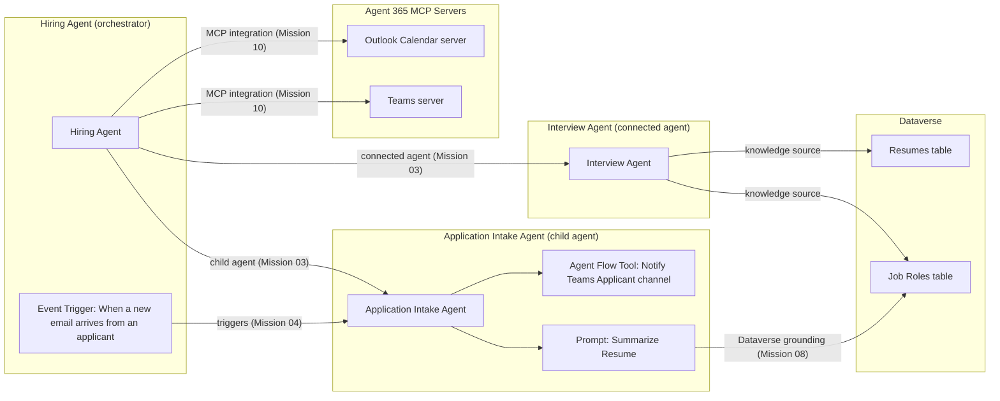
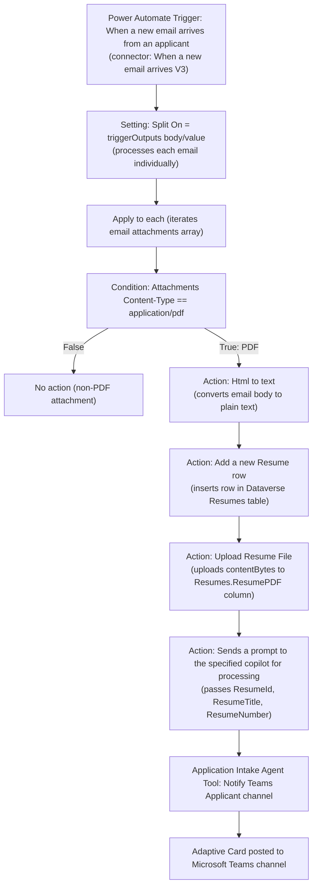
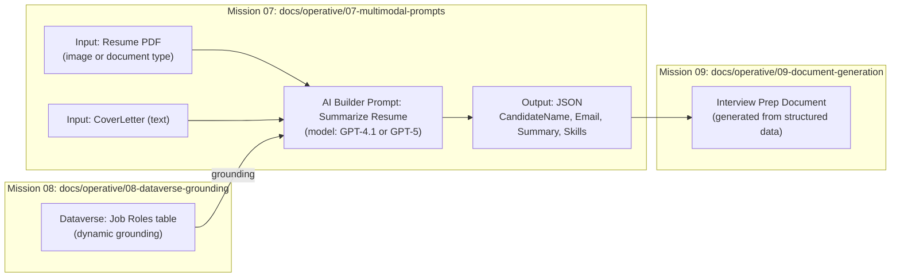

<!-- source: DeepWiki mcp.deepwiki.com · repo microsoft/agent-academy · page 2.2 Operative Track · fetched 2026-10-26 -->

# Operative Track

<details>
<summary>Relevant source files</summary>

The following files were used as context for generating this wiki page:

- [cspell.json](cspell.json)
- [docs/commander/index.md](docs/commander/index.md)
- [docs/index.md](docs/index.md)
- [docs/operative/03-multi-agent/index.md](docs/operative/03-multi-agent/index.md)
- [docs/operative/04-automate-triggers/assets/3.1.11.1_triggercondition.png](docs/operative/04-automate-triggers/assets/3.1.11.1_triggercondition.png)
- [docs/operative/04-automate-triggers/index.md](docs/operative/04-automate-triggers/index.md)
- [docs/operative/05-model-selection/assets/5.0_05_AIProvidersOperatingAsMicrosoftSubProcessors.png](docs/operative/05-model-selection/assets/5.0_05_AIProvidersOperatingAsMicrosoftSubProcessors.png)
- [docs/operative/05-model-selection/index.md](docs/operative/05-model-selection/index.md)
- [docs/operative/06-ai-safety/assets/6-conversation-boosting-moderation.png](docs/operative/06-ai-safety/assets/6-conversation-boosting-moderation.png)
- [docs/operative/06-ai-safety/assets/6-error-topic.png](docs/operative/06-ai-safety/assets/6-error-topic.png)
- [docs/operative/06-ai-safety/assets/6-generative-answer-test.png](docs/operative/06-ai-safety/assets/6-generative-answer-test.png)
- [docs/operative/06-ai-safety/assets/6-knowledge-filtered.png](docs/operative/06-ai-safety/assets/6-knowledge-filtered.png)
- [docs/operative/06-ai-safety/index.md](docs/operative/06-ai-safety/index.md)
- [docs/operative/07-multimodal-prompts/index.md](docs/operative/07-multimodal-prompts/index.md)
- [docs/operative/08-dataverse-grounding/assets/8-add-application-5.png](docs/operative/08-dataverse-grounding/assets/8-add-application-5.png)
- [docs/operative/08-dataverse-grounding/index.md](docs/operative/08-dataverse-grounding/index.md)
- [docs/operative/10-mcp/index.md](docs/operative/10-mcp/index.md)
- [docs/operative/11-obtain-user-feedback/index.md](docs/operative/11-obtain-user-feedback/index.md)
- [docs/operative/index.md](docs/operative/index.md)
- [docs/our-team/index.md](docs/our-team/index.md)
- [docs/recruit/index.md](docs/recruit/index.md)

</details>


## Purpose and Scope

This page documents the **Operative Track** — the second rank in the Agent Academy three-rank progression. It covers all 11 training missions that incrementally build an enterprise-grade **Hiring Agent** multi-agent system using Microsoft Copilot Studio. Key topics include multi-agent orchestration, autonomous event-driven triggers, AI model selection, content moderation, multimodal document processing, Dataverse grounding, MCP server integration, and user feedback collection.

For background on the three-rank structure and rank prerequisites, see [Course Tracks](#2). For the Recruit Track (required prerequisite), see [Recruit Track](#2.1). For the Commander Track, see [Commander (Preview)](#2.3). For badge issuance details, see [Badge and Completion System](#5).

---

## Prerequisites

| Requirement | Detail |
|---|---|
| Prior rank | Completed Agent Academy Recruit track |
| Platform | Microsoft Power Platform environment with Copilot Studio license or trial |
| Data | Access to Microsoft Dataverse |
| Permissions | Administrative rights to create solutions and agents |
| Program access | Frontier Program (required for experimental models and MCP features) |

The Operative course does not bundle its own environment setup. If needed, follow Steps 1–4 of the Recruit Course Setup; Step 5 (SharePoint site creation) is not required for this track.

Sources: [docs/operative/index.md:28-38]()

---

## Target Audience

This track is designed for:

- **Solution architects** designing enterprise AI systems
- **Developers** building production-ready agent solutions
- **IT professionals** implementing AI governance and safety controls
- **Business analysts** creating complex automation workflows

Sources: [docs/operative/index.md:42-51]()

---

## Curriculum Overview

All missions are documented under `docs/operative/`. Each mission depends on the agents and artifacts produced by previous missions.

| Mission | Codename | Title | Source File | Time |
|---|---|---|---|---|
| `01` | — | Get started with the Hiring Agent | `docs/operative/01-get-started/index.md` | — |
| `02` | — | Authoring Agent Instructions | `docs/operative/02-agent-instructions/index.md` | — |
| `03` | `OPERATION SYMPHONY` | Multi-Agent Systems | `docs/operative/03-multi-agent/index.md` | ~45 min |
| `04` | `OPERATION SIGNAL POINT` | Add Event Triggers | `docs/operative/04-automate-triggers/index.md` | ~45 min |
| `05` | `OPERATION ARCHETYPE` | Understanding Agent Models and Response Formatting | `docs/operative/05-model-selection/index.md` | ~45 min |
| `06` | `OPERATION SAFE HARBOR` | AI Safety and Content Moderation | `docs/operative/06-ai-safety/index.md` | ~45 min |
| `07` | `DOCUMENT RESUME RECON` | Extracting Resume Contents with Multimodal Prompts | `docs/operative/07-multimodal-prompts/index.md` | ~45 min |
| `08` | `OPERATION GROUNDING CONTROL` | Enhanced Prompts with Dataverse Grounding | `docs/operative/08-dataverse-grounding/index.md` | ~60 min |
| `09` | — | Generating an Interview Prep Document | `docs/operative/09-document-generation/index.md` | — |
| `10` | `OPERATION MCP RENDEZVOUS` | Integrate with MCP Servers | `docs/operative/10-mcp/index.md` | ~45 min |
| `11` | `OPERATION ECHO` | Collecting Feedback from Users | `docs/operative/11-obtain-user-feedback/index.md` | ~45 min |
| `12` | — | Course Completion Badges | `docs/operative/course-completion-badges-operative/index.md` | — |

Sources: [docs/operative/index.md:53-70]()

---

## The Hiring Agent System

The central artifact built across all missions is a **Hiring Agent** — an orchestrator agent coordinating specialized child and connected agents for HR recruitment automation. The system grows mission by mission; later missions add tools, grounding, safety controls, MCP integrations, and feedback collection on top of the base architecture.

**Diagram: Hiring Agent — Multi-Agent System Architecture**



Sources: [docs/operative/03-multi-agent/index.md:40-111](), [docs/operative/04-automate-triggers/index.md:136-158](), [docs/operative/10-mcp/index.md:62-98]()

---

## Mission 01–02: Agent Foundation

**Mission 01** (`docs/operative/01-get-started/index.md`) deploys the foundational infrastructure. It creates the central **Hiring Agent** orchestrator and imports the **Hiring Hub** solution, which provisions Dataverse tables including `Resumes` and `Job Roles`. A model-driven app called **Hiring Hub** is also configured for data entry and management.

**Mission 02** (`docs/operative/02-agent-instructions/index.md`) focuses on crafting precise agent instructions to control agent behavior, scope, tone, and response patterns. Instructions are the primary mechanism for defining what topics the agent will and will not address, and how it should respond.

Sources: [docs/operative/index.md:58-59](), [docs/operative/05-model-selection/index.md:347-348]()

---

## Mission 03: Multi-Agent Architecture

`docs/operative/03-multi-agent/index.md`

This mission transforms the single Hiring Agent into a coordinated multi-agent system by adding two specialist agents. Copilot Studio supports two relationship types:

### Child Agents vs. Connected Agents

| Dimension | Child Agents | Connected Agents |
|---|---|---|
| Scope | Live inside the parent; single configuration page | Fully independent, own topics and settings |
| Tools and Knowledge | Stored at the parent; flagged "Available to" the child | Own tools and knowledge |
| Topics | Share parent's topics; can reference them in instructions | Independent conversation flows |
| Publishing | No separate publish needed; share parent workspace | Must be published before connecting to another agent |
| ALM | Tested and changed within the parent workspace | Independent deployment lifecycle |
| Reusability | Not reusable across solutions | Reusable across multiple solutions |
| Best for | Single-team solutions, logical sub-specializations | Multi-team, independently maintained agents |

Two specialists are built in this mission:

- **Application Intake Agent** — a **child agent** handling resume intake and document processing. Tools and knowledge assigned at the Hiring Agent level are configured as available to this child.
- **Interview Agent** — a **connected agent** that must be published independently before it can be linked. It uses Dataverse (`Resumes` table, `Job Roles` table) as knowledge sources.

### Multi-Agent Architecture Patterns

| Pattern | Description | Applied in This System |
|---|---|---|
| **Hub and Spoke** | Orchestrator delegates tasks to specialists | ✅ Hiring Agent is the hub |
| **Pipeline** | Agents pass work sequentially stage by stage | ✅ Intake → scoring → interview prep |
| **Collaborative** | Agents work simultaneously on different aspects | Partially used |

### Agent Communication

- **Conversation history**: The orchestrator passes full conversation history to specialists by default. This can be disabled for security to prevent data leakage.
- **Explicit instructions**: The orchestrator provides task-specific instructions when invoking a specialist agent, allowing targeted delegation without full context exposure.

Sources: [docs/operative/03-multi-agent/index.md:59-134]()

---

## Mission 04: Event-Driven Automation

`docs/operative/04-automate-triggers/index.md`

This mission upgrades the Hiring Agent from **interactive** (user-initiated) to **autonomous** (event-triggered). Event triggers fire from external systems without any user message, requiring generative orchestration to be enabled.

### Interactive vs. Autonomous Agents

| Dimension | Interactive Agent | Autonomous Agent |
|---|---|---|
| Activation | User sends a message → topic runs | External event fires via connector → agent responds |
| Trigger surface | Topic triggers: `By agent`, `Phrases`, `Message received` | Event triggers: email, SharePoint, Planner, schedule |
| Planner requirement | Used for `By agent` and `Plan complete` | Required for all event triggers |
| Auth model | Channel/auth context of the conversation | Agent maker's account ("agent author authentication") |
| Capacity impact | Per user message/response | Per event delivery (e.g., 10-min recurrence = 6 msgs/hr) |
| Setup path | Create topics, define trigger type, publish | Add event trigger in Overview → Triggers, configure payload, publish |

### Use Case: Resume Email Automation

The lab builds end-to-end automation triggered by incoming applicant emails. The Hiring Agent detects the email, extracts PDF attachments, stores them in Dataverse, and notifies the HR team via a Teams Adaptive Card.

**Diagram: Event Trigger Flow — Mission 04**



Key implementation details:

- `Split On` is enabled on the trigger to process each email individually even when batched.
- `item()?['name']` retrieves the attachment filename as the `Resume Title`.
- `item()?['contentBytes']` provides the raw binary (Base64) PDF data for upload.
- `utcNow()` sets the `Upload Date` field on the new Resumes row.
- A `Cover Letter` field is populated using `if(greater(length(body('Html_to_text')), 2000), substring(..., 0, 2000), body('Html_to_text'))` to cap text at 2000 characters.
- After building the flow, its plan must be switched from **Power Automate** to **Copilot Studio** (in the flow Details panel) so it consumes Copilot Studio capacity. The flow must then be **published** to activate.

Sources: [docs/operative/04-automate-triggers/index.md:99-584]()

---

## Mission 05: Model Selection and Response Formatting

`docs/operative/05-model-selection/index.md`

This mission covers selecting the underlying AI model for an agent and configuring response output format.

### Agent Model Categories

| Tag | Strengths | Latency | Cost |
|---|---|---|---|
| **Deep** | Multi-step reasoning, long document synthesis with citations | Highest | Highest |
| **Auto** | Mixed workload routing, blending knowledge and actions dynamically | Variable | Variable |
| **General** | Everyday chat, summarization, simple action automation | Lowest | Lowest |

### Available OpenAI Models (as of 2025)

| Model | Category | Availability | Best For |
|---|---|---|---|
| `GPT-4.1` | General | **Default** | Complex text analysis, high-precision Q&A |
| `GPT-5 Chat` | General | GA | Conversational agents, IT/HR helpdesk |
| `GPT-5 Auto` | Auto | Preview | Multi-step process automation |
| `GPT-5 Reasoning` | Deep | Preview | Advanced planning, complex data analysis |
| `GPT-5.2 Chat` | General | Experimental | Latest conversational model |
| `GPT-5.2 Reasoning` | Deep | Experimental | Ultra-complex analytical tasks |

### Available Anthropic Models (Frontier Program opt-in)

| Model | Category | Availability | Notes |
|---|---|---|---|
| `Claude Sonnet 4.5` | General | Preview | Code tasks, multi-step agent workflows, tool use |
| `Claude Opus 4.1` | Deep | Experimental | In-depth analysis, compliance auditing |

> Anthropic models are hosted outside Microsoft and subject to Anthropic terms. Not recommended for production use.

### Admin Controls for Model Access

| Setting | Effect | Location |
|---|---|---|
| **Enable Anthropic as a Microsoft subprocessor** | When enabled, Anthropic models appear in the model dropdown | Microsoft 365 Admin Center |
| **Allow Preview & Experimental Models** | When OFF, only GA models appear | Power Platform admin center |
| **Move Data Across Regions** | Must be ON to allow experimental models that run in different regional datacenters | Power Platform admin center |

### Retired Models

When a model is retired, agents are automatically upgraded to the new default. The **"Continue using retired models"** toggle (in **Settings → Generative AI → Model**) allows continued use for up to **30 days** post-upgrade. This window supports compatibility testing, compliance review, and prompt adjustment.

### Response Formatting

Response formatting defines how agent output is structured. Configured in **Settings → Generative AI → Response formatting**.

| Option | Purpose |
|---|---|
| **Bold** | Highlight key values |
| _Italics_ | Secondary emphasis, denote special terms |
| **Hyperlinks** | Clickable references to external or internal resources |
| **Power Fx expressions** | Dynamic content, e.g., `Text(Now(), "MMM dd, yyyy")` for date formatting |

Lab 5.2 compares responses from `GPT-4.1`, `GPT-5 Chat`, and `Claude Sonnet 4.5` against the same set of Interview Agent queries, observing differences in depth, structure, tone, and formatting adherence.

Sources: [docs/operative/05-model-selection/index.md:38-288]()

---

## Mission 06: AI Safety and Content Moderation

`docs/operative/06-ai-safety/index.md`

This mission implements enterprise-grade content safety for the **Interview Agent**, which handles sensitive candidate data.

### Three Content Blocking Mechanisms

| Mechanism | Triggered By | User-Visible Behavior | Where to Configure |
|---|---|---|---|
| **Responsible AI Filtering & Content Moderation** | Prompts or responses violating safety policies | `ContentFiltered` error; conversation fails to produce a response | Agent level (Settings → Generative AI) or topic-level Generative Answers node |
| **Unknown Intent fallback** | No matching intent or generative answer found | System Fallback topic asks user to rephrase; eventually escalates | Add trigger phrases, verify knowledge sources, customize Fallback topic |
| **Agent instructions** | Custom instructions deliberately restrict scope | Polite refusal, even for seemingly valid questions | Review agent instructions for no-go topics |

Topic-level moderation settings override the agent-level default at runtime, enabling fine-grained control per conversation flow.

### Content Moderation Categories

Azure AI Content Safety evaluates content on four axes, each at four severity levels (Safe, Low, Medium, High):

| Category | Example in Hiring Context |
|---|---|
| **Inappropriate Language** | Biased comments about candidate demographics |
| **Unprofessional Content** | Personal questions violating workplace standards |
| **Threatening Language** | Aggressive or hostile messages toward staff or candidates |
| **Harmful Discussions** | Promotion of unsafe or illegal workplace practices |

### Prompt Injection Protection

Copilot Studio automatically scans prompts in real time for:

- **XPIA** (Cross Prompt Injection Attacks): Malicious instructions embedded in external data sources ingested by the agent.
- **UPIA** (User Prompt Injection Attacks): Attempts by users to bypass safety controls through crafted input.

The **Agent Runtime Protection Status** panel surfaces active threat detections. Organizations with stricter requirements can layer on external threat detection systems.

Sources: [docs/operative/06-ai-safety/index.md:102-192]()

---

## Missions 07–09: Document Intelligence Pipeline

These three missions build a complete pipeline: extract structured data from resume PDFs, ground that extraction with live Dataverse records, and generate an Interview Prep document as output.

**Diagram: Resume Intelligence Pipeline**



### Mission 07: Multimodal Prompts

`docs/operative/07-multimodal-prompts/index.md`

The `Summarize Resume` prompt is created under **Tools → Prompts** in Copilot Studio (via **+ New tool → Prompt**). It accepts mixed input types (document + text) and outputs structured JSON.

#### Prompt Parameters

| Parameter | Type | Description |
|---|---|---|
| `Resume` | Image or document (.PDF, .PNG, .JPG) | Candidate resume file |
| `CoverLetter` | Text | Cover letter body |

#### JSON Output Schema

```json
{
  "CandidateName": "string",
  "Email": "string",
  "Summary": "string (max 2000 characters)",
  "Skills": [{"item": "Skill name"}]
}
```

Use **temperature 0** for document extraction to maximize consistency across runs.

#### AI Builder Model Options

| Model | Cost | Speed | Best For |
|---|---|---|---|
| `GPT-4.1 mini` | Basic | Fast | Standard processing, cost-sensitive |
| `GPT-4.1` | Standard | Moderate | Complex documents, high accuracy |
| `o3` | Premium | Slow | Critical reasoning, data analysis |
| `GPT-5 chat` | Standard | Enhanced | Latest document understanding |
| `GPT-5 reasoning` | Premium | Slow | Most sophisticated analysis |

Sources: [docs/operative/07-multimodal-prompts/index.md:40-130]()

### Mission 08: Dataverse Grounding

`docs/operative/08-dataverse-grounding/index.md`

Dataverse grounding connects the `Summarize Resume` prompt to live Dataverse tables at inference time. Instead of hardcoded job role names in the prompt instructions, the prompt queries the **Job Roles** table directly to match candidates against current openings and applies current **Evaluation Criteria** records. Job roles and criteria can change in Dataverse without requiring any prompt modifications.

Sources: [docs/operative/08-dataverse-grounding/index.md:35-57]()

### Mission 09: Interview Prep Document Generation

`docs/operative/09-document-generation/index.md`

This mission extends the pipeline to produce an **Interview Prep document** using structured data from the `Summarize Resume` prompt output. Document generation is implemented in AI Builder prompts and integrated into the Interview Agent workflow.

Sources: [docs/operative/index.md:66]()

---

## Mission 10: MCP Server Integration

`docs/operative/10-mcp/index.md`

This mission connects the Hiring Agent to external services using the **Model Context Protocol (MCP)** — an open standard for AI agents to access external tools and data sources. **Agent 365** serves as the enterprise control plane, providing each agent a **Microsoft Entra Agent ID** and governing all MCP tool calls.

### Agent 365 Pre-Built MCP Servers

| MCP Server | Capability |
|---|---|
| **Outlook Calendar** | Create, update, manage calendar events |
| **Outlook Mail** | Send, read, search emails |
| **Teams** | Create chats, post messages, manage channels |
| **SharePoint & OneDrive** | Upload files, manage lists, search documents |
| **Word** | Create and edit documents, add comments |
| **Dataverse & Dynamics 365** | CRUD operations on business data |
| **User Profile** | Access user info, managers, direct reports |
| **Copilot Search** | Chat with M365 Copilot, ground responses with files |

### What This Mission Builds

The Hiring Agent is connected to the **Outlook Calendar** and **Teams** MCP servers to arrange interview prep meetings. The agent can create calendar events and post Teams messages autonomously using these servers.

### Enterprise Controls

| Control | Mechanism |
|---|---|
| Organization-wide allow/block | Microsoft 365 admin center |
| Scoped permissions per agent | Microsoft Entra scopes |
| Audit trail for all tool calls | Microsoft Defender Advanced Hunting |
| Policy enforcement | DLP, MIP, rate limits applied at runtime |

Sources: [docs/operative/10-mcp/index.md:33-115]()

---

## Mission 11: User Feedback Collection

`docs/operative/11-obtain-user-feedback/index.md`

This mission implements two complementary feedback mechanisms on the deployed Hiring Agent.

### Built-in Thumbs Up/Down Reactions

- Enabled by default on all Copilot Studio agents; active across Teams, web, and custom channels.
- Users click 👍/👎 after each agent response; an optional comment prompt follows.
- All feedback (including comments) is stored in the `conversationtranscript` Dataverse table.
- Aggregated in **Analytics → Satisfaction → Reactions** as a ratio of positive to negative responses over time.
- Toggle controlled by **"Collect user reactions to agent messages"** under **Settings → Generative AI → User feedback**.

### Custom Adaptive Card Feedback

When structured, multi-field feedback is needed, an Adaptive Card is inserted directly into the conversation flow. This collects CSAT ratings and free-text comments in a controlled format. It is triggered conditionally within topics after agent responses.

### Azure Application Insights Integration

Custom telemetry events can be logged to Azure Application Insights for advanced tracking beyond what the built-in analytics dashboard provides. This supports dashboarding, alerting, and long-term trend analysis outside of Copilot Studio.

Sources: [docs/operative/11-obtain-user-feedback/index.md:40-105]()

---

## Mission 12: Course Completion Badge

`docs/operative/course-completion-badges-operative/index.md`

Upon completing all 11 Operative missions, learners submit evidence screenshots via a GitHub issue template to claim the **Operative** digital badge through the Global AI Community platform. For full details on the submission process, evidence requirements, and automated badge delivery workflow, see [Badge and Completion System](#5).

Sources: [docs/operative/index.md:71-73]()

---

