<!-- source: DeepWiki mcp.deepwiki.com · repo microsoft/agent-academy · page 2.3 Commander (Preview) · fetched 2026-10-26 -->

# Commander (Preview)

<details>
<summary>Relevant source files</summary>

The following files were used as context for generating this wiki page:

- [docs/commander-preview/01-advanced-mcp/index.md](docs/commander-preview/01-advanced-mcp/index.md)
- [docs/commander-preview/02-computer-using-agents/index.md](docs/commander-preview/02-computer-using-agents/index.md)
- [docs/commander-preview/03-code-interpreter/index.md](docs/commander-preview/03-code-interpreter/index.md)
- [docs/commander-preview/04-human-in-the-loop/index.md](docs/commander-preview/04-human-in-the-loop/index.md)
- [docs/commander-preview/05-voice-enabled-agents/index.md](docs/commander-preview/05-voice-enabled-agents/index.md)
- [docs/commander-preview/06-localization/index.md](docs/commander-preview/06-localization/index.md)
- [docs/commander-preview/07-azure-ai-byom/index.md](docs/commander-preview/07-azure-ai-byom/index.md)
- [docs/commander-preview/08-knowledge-deep-dive/index.md](docs/commander-preview/08-knowledge-deep-dive/index.md)
- [docs/commander-preview/09-handoff-to-human/index.md](docs/commander-preview/09-handoff-to-human/index.md)
- [docs/commander-preview/10-governance-auth-dlp/index.md](docs/commander-preview/10-governance-auth-dlp/index.md)
- [docs/commander-preview/11-test-monitor-debug/index.md](docs/commander-preview/11-test-monitor-debug/index.md)
- [docs/commander-preview/12-deploy-solutions-pipelines/index.md](docs/commander-preview/12-deploy-solutions-pipelines/index.md)
- [docs/commander-preview/13-next-steps-best-practices/index.md](docs/commander-preview/13-next-steps-best-practices/index.md)
- [docs/commander-preview/index.md](docs/commander-preview/index.md)

</details>


This page documents the **Commander** track of Agent Academy — the third and most advanced rank in the curriculum. It covers the 13 missions that make up the Commander preview, including their learning objectives, technical scope, and current completion status. The Commander track assumes completion of both the Recruit and Operative tracks.

> **Note:** This curriculum is currently in preview. All 13 missions are marked as under active development.

For foundational agent concepts, see the Recruit Track ([2.1](#2.1)). For multi-agent design and intermediate skills, see the Operative Track ([2.2](#2.2)). For standalone labs that are rank-independent, see Special Ops ([3](#3)).

---

## Overview

The Commander track targets practitioners who need to build and operate **production-grade, enterprise-scale** agents in Microsoft Copilot Studio. It advances beyond multi-agent orchestration into areas such as computer automation, code execution, voice telephony, ALM, governance, and observability.

The entry point for the track is [docs/commander-preview/index.md](), which renders as the `Commander (Preview)` landing page on the documentation site.

### Target Audience

| Role | Primary Missions |
|---|---|
| Solution architects | 07, 08, 10, 12, 13 |
| Application developers | 01, 02, 03, 04, 12 |
| IT / security professionals | 10, 11, 12, 13 |
| AI / data specialists | 03, 07, 08 |
| Contact center engineers | 05, 09 |
| Localization engineers | 06 |

Sources: [docs/commander-preview/index.md:21-28]()

---

## Curriculum Structure

The Commander track is organised as 13 sequential missions. Each mission lives in its own directory under `docs/commander-preview/` and is implemented as a VitePress markdown page with `prev`/`next` frontmatter links forming a navigable chain.

**Mission sequence and directory map:**

```mermaid
flowchart LR
    IDX["docs/commander-preview/index.md"]
    M01["01-advanced-mcp"]
    M02["02-computer-using-agents"]
    M03["03-code-interpreter"]
    M04["04-human-in-the-loop"]
    M05["05-voice-enabled-agents"]
    M06["06-localization"]
    M07["07-azure-ai-byom"]
    M08["08-knowledge-deep-dive"]
    M09["09-handoff-to-human"]
    M10["10-governance-auth-dlp"]
    M11["11-test-monitor-debug"]
    M12["12-deploy-solutions-pipelines"]
    M13["13-next-steps-best-practices"]

    IDX --> M01 --> M02 --> M03 --> M04 --> M05 --> M06 --> M07
    M07 --> M08 --> M09 --> M10 --> M11 --> M12 --> M13
```



Sources: [docs/commander-preview/index.md:34-48](), [docs/commander-preview/01-advanced-mcp/index.md:1-8](), [docs/commander-preview/13-next-steps-best-practices/index.md:1-5]()

---

**Full mission reference table:**

| # | Emoji | Title | Directory | Status |
|---|---|---|---|---|
| 01 | 🔌 | Advanced MCP Server Usage | `01-advanced-mcp` | 🚧 Preview |
| 02 | 🖥️ | Computer Using Agents (CUA) | `02-computer-using-agents` | 🚧 Preview |
| 03 | 🐍 | Code Interpreter | `03-code-interpreter` | 🚧 Preview |
| 04 | 🤝 | Human in the Loop (HITL) | `04-human-in-the-loop` | 🚧 Preview |
| 05 | 🎙️ | Voice-enabled Agents | `05-voice-enabled-agents` | 🚧 Preview |
| 06 | 🌍 | Localization | `06-localization` | 🚧 Preview |
| 07 | 🧠 | Extend with Azure AI & BYOM | `07-azure-ai-byom` | 🚧 Preview |
| 08 | 📚 | Knowledge Deep Dive | `08-knowledge-deep-dive` | 🚧 Preview |
| 09 | 🔄 | Handoff to Human Agents | `09-handoff-to-human` | 🚧 Preview |
| 10 | 🔐 | Governance Essentials with Authentication, Channels & DLP | `10-governance-auth-dlp` | 🚧 Preview |
| 11 | 🧪 | Test, Monitor, Debug & Analytics | `11-test-monitor-debug` | 🚧 Preview |
| 12 | 🚀 | Deploy Agents with Solutions & Pipelines | `12-deploy-solutions-pipelines` | 🚧 Preview |
| 13 | 🏁 | Next Steps and Best Practices | `13-next-steps-best-practices` | 🚧 Preview |

Sources: [docs/commander-preview/index.md:34-48]()

---

## Technical Domain Map

The diagram below maps each mission's human-readable domain name to its concrete file path and the key Copilot Studio / Azure concepts it covers. This bridges the curriculum overview to the actual source files.

```mermaid
graph TD
    subgraph "Integration"
        M01f["docs/commander-preview/01-advanced-mcp/index.md"]
        M01c["MCP onboarding wizard\nCustom connector\nDataverse / D365 / Fabric MCP servers\nOAuth 2.0 dynamic discovery"]
        M01f --- M01c
    end

    subgraph "Automation"
        M02f["docs/commander-preview/02-computer-using-agents/index.md"]
        M02c["Computer Use\nAzure Key Vault credentials\nCUA vs RPA decision"]
        M02f --- M02c

        M03f["docs/commander-preview/03-code-interpreter/index.md"]
        M03c["Code Interpreter\nPython sandbox\nCSV / Excel ingestion\nDataverse code queries"]
        M03f --- M03c
    end

    subgraph "Workflow"
        M04f["docs/commander-preview/04-human-in-the-loop/index.md"]
        M04c["Human in the Loop connector\nMulti-stage approvals\nRequest for Information action\nApprovals center"]
        M04f --- M04c
    end

    subgraph "Channel"
        M05f["docs/commander-preview/05-voice-enabled-agents/index.md"]
        M05c["Voice template\nIVR / DTMF input\nSSML\nAzure Communication Services"]
        M05f --- M05c

        M06f["docs/commander-preview/06-localization/index.md"]
        M06c["JSON / ResX translation files\nConversation.LocalTimeZone\nNoda Time zone IDs\nPower Fx date conversion"]
        M06f --- M06c
    end

    subgraph "AI_Extension"
        M07f["docs/commander-preview/07-azure-ai-byom/index.md"]
        M07c["Azure AI Search\nAzure AI Foundry\nBYOM fine-tuned models\nReusable prompt tools"]
        M07f --- M07c

        M08f["docs/commander-preview/08-knowledge-deep-dive/index.md"]
        M08c["SharePoint / OneDrive knowledge\nBing Search\nKnowledge ingestion limits\nSecurity and identity"]
        M08f --- M08c
    end

    subgraph "Operations"
        M09f["docs/commander-preview/09-handoff-to-human/index.md"]
        M09c["Escalate system topic\nTransfer conversation node\nDynamics 365 Customer Service\nServiceNow / Salesforce / LivePerson"]
        M09f --- M09c

        M10f["docs/commander-preview/10-governance-auth-dlp/index.md"]
        M10c["SSO with Entra ID\nManual authentication\nStreaming API vs Direct Line\nDLP policies"]
        M10f --- M10c
    end

    subgraph "Quality"
        M11f["docs/commander-preview/11-test-monitor-debug/index.md"]
        M11c["Test panel / Activity map\nConversation snapshots\nAgent evaluations / test sets\nApplication Insights / Power BI"]
        M11f --- M11c

        M12f["docs/commander-preview/12-deploy-solutions-pipelines/index.md"]
        M12c["Custom solutions\nManaged vs unmanaged layers\nOn-Behalf-Of OBO auth\nPower Platform Pipelines"]
        M12f --- M12c

        M13f["docs/commander-preview/13-next-steps-best-practices/index.md"]
        M13c["Copilot Studio Implementation Guide\nPower CAT tools\nWell-Architected Framework"]
        M13f --- M13c
    end
```



Sources: All mission `index.md` files under `docs/commander-preview/`

---

## Mission Details

### Mission 01 — Advanced MCP Server Usage

[docs/commander-preview/01-advanced-mcp/index.md]()

Connects agents to existing MCP servers using either the **MCP onboarding wizard** or a **custom connector** in Power Apps. Covers all authentication modes: `None`, API key, and OAuth 2.0 (`dynamic discovery`, `dynamic`, `manual`). Students learn to selectively enable or disable individual tools from an MCP server, and explore the built-in MCP servers catalog: Dataverse, Dynamics 365, Fabric, and Microsoft 365.

For hands-on MCP server construction, see the MCS MCP Special Ops Lab ([3.1](#3.1)).

**Key objectives:**
- MCP onboarding wizard and custom connector configuration
- OAuth 2.0 authentication flow variants
- Built-in catalog: Dataverse, Dynamics 365, Fabric servers
- Tool-level enable/disable granularity
- Common MCP integration troubleshooting

---

### Mission 02 — Computer Using Agents (CUA)

[docs/commander-preview/02-computer-using-agents/index.md]()

Enables agents to control desktop applications and websites via virtual mouse and keyboard using the **Computer Use** capability. Covers the decision criteria for CUA vs traditional RPA, credential security via **Azure Key Vault**, and integrating human-in-the-loop assistance directly within CUA workflows.

**Key objectives:**
- Enabling and configuring `Computer Use`
- CUA vs RPA selection criteria
- Effective prompting for computer-using agents
- Azure Key Vault for secure credential storage
- HITL assistance, input provision, host type selection

---

### Mission 03 — Code Interpreter

[docs/commander-preview/03-code-interpreter/index.md]()

Enables **Code Interpreter** to generate and execute Python in a sandboxed environment for data analysis, forecasting, chart generation, and file output from CSV or Excel inputs. Distinguishes between *deterministic* (prompt-level) and *non-deterministic* (agent-level) execution modes. Data can be ingested via user-uploaded files in chat or via **SharePoint Documents library** knowledge sources.

**Key objectives:**
- Enabling Code Interpreter at prompt vs agent level
- Structured data ingestion (CSV, Excel)
- Deterministic vs non-deterministic execution
- Image generation and custom skill extension
- Querying and updating Dataverse using generated code

---

### Mission 04 — Human in the Loop (HITL)

[docs/commander-preview/04-human-in-the-loop/index.md]()

Builds multi-stage approval workflows in agent flows using the **Human in the Loop connector**. Configures both manual and AI-driven approval stages, dynamic routing conditions, and the **Request for Information (RFI) action** to pause a flow and collect structured reviewer input. AI stage instructions and decision rationale are reviewable in the **Approvals center**.

**Key objectives:**
- Human in the Loop connector configuration
- Manual and AI approval stage setup with input mappings
- Condition-based dynamic routing (approve / reject / skip)
- RFI action: pausing flows and collecting structured input
- Writing effective AI stage instructions; reviewing AI rationale

---

### Mission 05 — Voice-enabled Agents

[docs/commander-preview/05-voice-enabled-agents/index.md]()

Builds IVR-capable agents using the **Voice template**. Handles phone calls combining speech recognition and **DTMF** (dual-tone multi-frequency) keypad input. Configures barge-in, silence detection, timeout handling, and custom voice synthesis via **Speech Synthesis Markup Language (SSML)**. Phone number provisioning is done through **Azure Communication Services**.

**Key objectives:**
- Voice template agent creation
- Speech and DTMF input collection
- Barge-in, silence detection, and timeout configuration
- SSML voice customisation
- Call transfer, termination, and Azure Communication Services phone provisioning

---

### Mission 06 — Localization

[docs/commander-preview/06-localization/index.md]()

Configures multilingual agents using **JSON** and **ResX** translation files. Covers automatic language detection and dynamic switching via **generative orchestration**, localisation of Adaptive Cards, and time zone handling using the system variable `Conversation.LocalTimeZone` with **Noda Time** zone IDs and Power Fx date conversion functions.

**Key objectives:**
- Primary and secondary language configuration with region settings
- JSON / ResX translation file management
- Automatic language detection and dynamic switching
- Adaptive Card localisation
- `Conversation.LocalTimeZone`, Noda Time zone IDs, Power Fx date conversions

---

### Mission 07 — Extend with Azure AI & BYOM

[docs/commander-preview/07-azure-ai-byom/index.md]()

Integrates external AI services: **Azure AI Search** for enterprise knowledge retrieval, **Azure AI Foundry** for bring-your-own-data copilots, and **BYOM** (bring your own model) for custom or fine-tuned model inference. Also covers adding prompts as reusable tools within topics.

**Key objectives:**
- Azure AI Search integration for knowledge retrieval
- Azure AI Foundry for BYOD scenarios
- BYOM with custom or fine-tuned models via AI Builder
- Reusable prompt tools inside topics

---

### Mission 08 — Knowledge Deep Dive

[docs/commander-preview/08-knowledge-deep-dive/index.md]()

Covers knowledge source optimisation: preparing public websites for agent ingestion, connecting **SharePoint** and **OneDrive** content, understanding ingestion limitations, and using **Bing Search** for dynamic external retrieval. Security and identity topics govern how knowledge is accessed at runtime.

**Key objectives:**
- Public website optimisation for knowledge ingestion
- SharePoint and OneDrive content connection
- Agent reasoning over knowledge and known limitations
- Bing Search for dynamic external knowledge
- Security and identity in knowledge access

---

### Mission 09 — Handoff to Human Agents

[docs/commander-preview/09-handoff-to-human/index.md]()

Configures seamless escalation to live agents via the **Escalate system topic** and the **Transfer conversation node**. Escalation can be triggered implicitly (user requests a human) or explicitly (topic-driven). Context variables — conversation history, topics, phrases, and private messages — are passed to the engagement hub so the live agent has full context.

Supported engagement hubs: Dynamics 365 Customer Service, ServiceNow, Salesforce, LivePerson, and generic hubs via custom adapters.

**Key objectives:**
- Escalate system topic and Transfer conversation node configuration
- Implicit vs explicit escalation triggers
- Context variable transfer to engagement hubs
- Engagement hub integrations (D365, ServiceNow, Salesforce, LivePerson, generic)
- Customising escalation-related agent messages

---

### Mission 10 — Governance Essentials with Authentication, Channels & DLP

[docs/commander-preview/10-governance-auth-dlp/index.md]()

Secures agent access with **Single Sign-On (SSO)** via Entra ID and manual authentication for external APIs. Compares **Streaming API** vs **Direct Line** protocols for embedding agents in custom applications. Prevents anonymous access using **Data Loss Prevention (DLP) policies**.

**Key objectives:**
- SSO configuration with Entra ID
- Manual authentication for API access
- Streaming API vs Direct Line for custom app embedding
- DLP policy enforcement to prevent anonymous access

---

### Mission 11 — Test, Monitor, Debug & Analytics

[docs/commander-preview/11-test-monitor-debug/index.md]()

Covers the full observability lifecycle. The built-in **Test panel** provides real-time topic tracking via the **Activity map** during generative orchestration. **Conversation snapshots** capture state for diagnostics. **Agent evaluations** automate quality scoring against test sets with user profiles. Production monitoring uses **Analytics dashboards** for KPIs (session outcomes, CSAT, topic trends). Custom telemetry is captured via **Azure Application Insights** and visualised in **Power BI**.

**Key objectives:**
- Test panel, topic tracking, Activity map
- Variable inspection, conversation snapshots, support flagging
- Test set creation, user profile configuration, automated evaluations
- Evaluation score interpretation and cross-run comparison
- Analytics dashboard KPIs, Application Insights integration, Power BI reporting

---

### Mission 12 — Deploy Agents with Solutions & Pipelines

[docs/commander-preview/12-deploy-solutions-pipelines/index.md]()

Delivers Application Lifecycle Management (ALM) for agents. Covers environment strategies (dev / test / production), packaging in **custom solutions** with managed and unmanaged layers, exporting and importing solutions with required objects, **reusable component collections**, **On-Behalf-Of (OBO) authentication** for connections, sharing controls (Editor and Viewer roles), and deploying at scale via **Power Platform Pipelines**.

**Key objectives:**
- Dev / test / production environment strategies
- Custom solutions: managed vs unmanaged layers, export/import
- Reusable component collections with dependency management
- OBO authentication and connection configuration
- Power Platform Pipelines for automated deployment

---

### Mission 13 — Next Steps and Best Practices

[docs/commander-preview/13-next-steps-best-practices/index.md]()

Consolidates Commander-level knowledge into production readiness guidance using the **Copilot Studio Implementation Guide**, **Power CAT tools**, and the **Power Platform Well-Architected Framework**.

**Key objectives:**
- Applying the Copilot Studio Implementation Guide
- Power CAT tools for agent management
- Monitoring and governance dashboards
- Well-Architected Framework for operational excellence

---

## Mission Dependency and Skill Grouping

The 13 missions cluster into five skill domains. Later missions in each domain build on earlier ones, and the ALM domain (Missions 11–13) assumes concepts from all others.

```mermaid
graph TD
    subgraph "Track_Prerequisites"
        RECRUIT["Recruit Track"]
        OPERATIVE["Operative Track"]
        RECRUIT --> OPERATIVE
    end

    OPERATIVE --> COMMANDER

    subgraph "COMMANDER"
        subgraph "Integration_and_Automation"
            M01["Mission 01\nAdvanced MCP"]
            M02["Mission 02\nCUA"]
            M03["Mission 03\nCode Interpreter"]
        end

        subgraph "Workflow_and_Channels"
            M04["Mission 04\nHITL Approvals"]
            M05["Mission 05\nVoice / IVR"]
            M06["Mission 06\nLocalization"]
        end

        subgraph "AI_Extension_and_Knowledge"
            M07["Mission 07\nAzure AI + BYOM"]
            M08["Mission 08\nKnowledge Deep Dive"]
        end

        subgraph "Governance_and_Escalation"
            M09["Mission 09\nHandoff to Human"]
            M10["Mission 10\nAuth + DLP"]
        end

        subgraph "ALM_and_Operations"
            M11["Mission 11\nTest + Monitor"]
            M12["Mission 12\nSolutions + Pipelines"]
            M13["Mission 13\nBest Practices"]
        end

        M01 --> M02
        M02 --> M03
        M03 --> M04
        M04 --> M05
        M05 --> M06
        M06 --> M07
        M07 --> M08
        M08 --> M09
        M09 --> M10
        M10 --> M11
        M11 --> M12
        M12 --> M13
    end
```



Sources: [docs/commander-preview/index.md:34-48](), individual `prev`/`next` frontmatter in all mission files

---

## File Structure Reference

All Commander content resides under `docs/commander-preview/`. Each mission is a subdirectory containing a single `index.md`.

```
docs/
└── commander-preview/
    ├── index.md                            ← landing page / curriculum overview
    ├── 01-advanced-mcp/index.md
    ├── 02-computer-using-agents/index.md
    ├── 03-code-interpreter/index.md
    ├── 04-human-in-the-loop/index.md
    ├── 05-voice-enabled-agents/index.md
    ├── 06-localization/index.md
    ├── 07-azure-ai-byom/index.md
    ├── 08-knowledge-deep-dive/index.md
    ├── 09-handoff-to-human/index.md
    ├── 10-governance-auth-dlp/index.md
    ├── 11-test-monitor-debug/index.md
    ├── 12-deploy-solutions-pipelines/index.md
    └── 13-next-steps-best-practices/index.md
```

The sidebar registration for this track is handled in the VitePress configuration. For details on how the sidebar is wired up, see the Site Configuration and Navigation page ([4.1](#4.1)).

Sources: [docs/commander-preview/index.md:1-51]()

---

