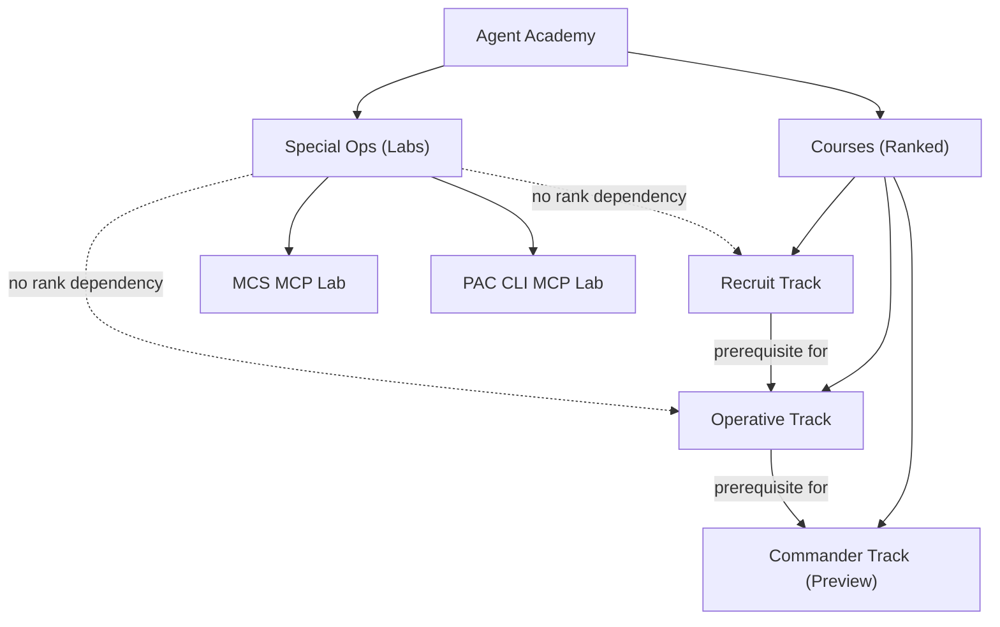
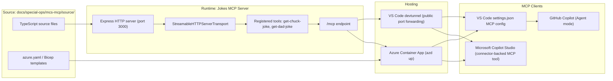
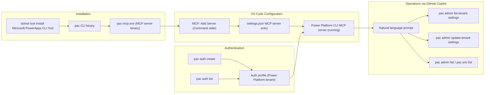

<!-- source: DeepWiki mcp.deepwiki.com · repo microsoft/agent-academy · page 3 Special Ops Labs · fetched 2026-10-26 -->

# Special Ops Labs

<details>
<summary>Relevant source files</summary>

The following files were used as context for generating this wiki page:

- [.gitignore](.gitignore)
- [docs/.vitepress/config.mts](docs/.vitepress/config.mts)
- [docs/special-ops/index.md](docs/special-ops/index.md)
- [docs/special-ops/mcs-mcp/index.md](docs/special-ops/mcs-mcp/index.md)
- [docs/special-ops/pac-cli-mcp/assets/powerplatform-cli-mcp-added-vs-code.png](docs/special-ops/pac-cli-mcp/assets/powerplatform-cli-mcp-added-vs-code.png)
- [docs/special-ops/pac-cli-mcp/assets/restrict-developer-environments-to-admins-only.png](docs/special-ops/pac-cli-mcp/assets/restrict-developer-environments-to-admins-only.png)
- [docs/special-ops/pac-cli-mcp/assets/show-trial-env-creation-setting.png](docs/special-ops/pac-cli-mcp/assets/show-trial-env-creation-setting.png)
- [docs/special-ops/pac-cli-mcp/index.md](docs/special-ops/pac-cli-mcp/index.md)
- [docs/special-ops/pac-cli-mcp/power-platform-plan/index.md](docs/special-ops/pac-cli-mcp/power-platform-plan/index.md)

</details>


This page covers the **Special Ops** section of Agent Academy — a set of standalone, rank-independent labs that focus on specific technologies rather than following the Recruit → Operative → Commander progression. Special Ops labs can be completed in any order and do not require completion of any course track as a prerequisite.

For details on the structured course tracks (Recruit, Operative, Commander), see page [2](). For details on a specific Special Ops lab, see page [3.1]() (MCS MCP) or page [3.2]() (PAC CLI MCP).

---

## What are Special Ops Labs?

Special Ops labs are self-contained missions, each covering a distinct technology or integration pattern. They are listed in the navigation under **Special Ops (Labs)**, separate from the **Courses** section.

[docs/special-ops/index.md:1-14]()

| Property | Structured Tracks | Special Ops Labs |
|---|---|---|
| Prerequisites | Sequential (Recruit → Operative → Commander) | None — rank-independent |
| Outcome | Earns a completion badge | No badge; skill-focused |
| Scope | Full agent-building curriculum | One focused technology per lab |
| Ordering | Fixed module sequence | Choose any lab in any order |

The Special Ops section appears in both the top navigation bar and the sidebar of the documentation site, as a separate nav group from Courses.

[docs/.vitepress/config.mts:31-37]()
[docs/.vitepress/config.mts:172-180]()

---

## Available Missions

**Diagram: Special Ops Labs — Structural Position**



Sources: [docs/special-ops/index.md:1-14](), [docs/.vitepress/config.mts:19-37](), [docs/.vitepress/config.mts:45-180]()

---

### Lab 1 — MCS MCP (Microsoft Copilot Studio ❤️ MCP)

Located at `docs/special-ops/mcs-mcp/`.

This lab walks through building and hosting a **Jokes MCP Server** — a TypeScript/Express HTTP server that implements the Model Context Protocol using `StreamableHTTPServerTransport`. The server exposes two tools:

| Tool name | Description |
|---|---|
| `get-chuck-joke` | Fetches a Chuck Norris joke by category |
| `get-dad-joke` | Fetches a dad joke |

The lab has two hosting paths:

| Path | Mechanism | Public URL |
|---|---|---|
| Local (dev) | VS Code port forwarding via devtunnel | `https://<id>-3000.<region>.devtunnels.ms/mcp` |
| Azure | `azd up` deploying to Azure Container Apps via Bicep | `https://<app-name>.azurecontainerapps.io/mcp` |

After hosting, the server is integrated into two clients:

1. **VS Code / GitHub Copilot** — via `MCP: Add Server` (HTTP transport), saved to `settings.json`
2. **Microsoft Copilot Studio** — as a connector-backed MCP tool added to a "Jokester" agent

The MCP endpoint is always `/mcp` (e.g., `GET` to `/mcp` returns a `Method not allowed` JSON-RPC error, which is expected).

[docs/special-ops/mcs-mcp/index.md:1-341]()

---

### Lab 2 — PAC CLI MCP (Power Platform CLI MCP)

Located at `docs/special-ops/pac-cli-mcp/`.

This lab configures the **built-in MCP server** that ships with Power Platform CLI (version 1.44+). The MCP server binary is `pac-mcp.exe`, located at:

```
%USERPROFILE%\.dotnet\tools\.store\microsoft.powerapps.cli.tool\[version]\microsoft.powerapps.cli.tool\[version]\tools\net8.0\any\pac-mcp.exe
```

The lab installs `pac` via `dotnet tool install --global Microsoft.PowerApps.CLI.Tool`, then wires `pac-mcp.exe` into VS Code as a `Command (stdio)` MCP server. GitHub Copilot then invokes PAC CLI operations using natural language.

The primary mission is tenant settings governance: using prompts to read and update Power Platform tenant settings via `pac admin list-tenant-settings` and `pac admin update-tenant-settings`, without needing to remember exact CLI syntax.

[docs/special-ops/pac-cli-mcp/index.md:1-339]()

---

## Architecture Diagrams

**Diagram: MCS MCP Lab — Source Files and Runtime Components**



Sources: [docs/special-ops/mcs-mcp/index.md:33-117](), [docs/special-ops/mcs-mcp/index.md:119-158](), [docs/special-ops/mcs-mcp/index.md:160-326]()

---

**Diagram: PAC CLI MCP Lab — Executable Path and Integration Chain**



Sources: [docs/special-ops/pac-cli-mcp/index.md:29-81](), [docs/special-ops/pac-cli-mcp/index.md:108-141](), [docs/special-ops/pac-cli-mcp/index.md:173-224]()

---

## Comparison of the Two Labs

| Dimension | MCS MCP Lab | PAC CLI MCP Lab |
|---|---|---|
| **MCP server type** | Custom HTTP server (TypeScript/Express) | Bundled binary (`pac-mcp.exe`) |
| **Transport** | `StreamableHTTPServerTransport` (HTTP/SSE) | `stdio` (`Command` type) |
| **Hosting required** | Yes — devtunnel or Azure Container App | No — runs locally as a subprocess |
| **Tools exposed** | `get-chuck-joke`, `get-dad-joke` | 20+ PAC CLI commands (`pac admin`, `pac env`, etc.) |
| **MCP client** | VS Code GitHub Copilot + Microsoft Copilot Studio | VS Code GitHub Copilot only |
| **Azure required** | Optional (local devtunnel path exists) | No |
| **Admin permissions needed** | No | Yes — Power Platform admin |
| **Primary scenario** | Build and deploy a custom MCP server | Natural language tenant governance |

Sources: [docs/special-ops/mcs-mcp/index.md:23-30](), [docs/special-ops/pac-cli-mcp/index.md:82-107]()

---

## Prerequisites Summary

### MCS MCP Lab

- Visual Studio Code
- Node.js v22 (via `nvm`)
- Docker
- Azure Developer CLI (`azd`) — required only for Azure deployment path
- Azure subscription with payment method — required only for Azure deployment path
- Microsoft Copilot Studio trial or developer account

[docs/special-ops/mcs-mcp/index.md:23-30]()

### PAC CLI MCP Lab

- .NET 8.0 or later
- Power Platform CLI v1.44+ (`dotnet tool install --global Microsoft.PowerApps.CLI.Tool`)
- Visual Studio Code with GitHub Copilot extension
- Power Platform admin account

[docs/special-ops/pac-cli-mcp/index.md:34-44](), [docs/special-ops/pac-cli-mcp/index.md:179-224]()

---

## Relationship to Course Track Content

The MCS MCP lab complements **Operative Mission 10** (`/operative/10-mcp/`), which also covers MCP integration in Microsoft Copilot Studio, but in the context of the Hiring Agent multi-mission curriculum. The Special Ops version is self-contained: it builds a server from scratch and demonstrates both the VS Code and Copilot Studio integration paths without depending on prior Operative missions.

[docs/.vitepress/config.mts:156-159]()

---

