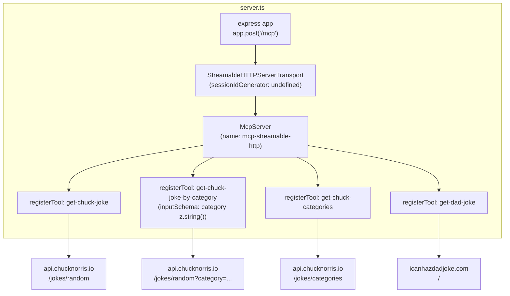
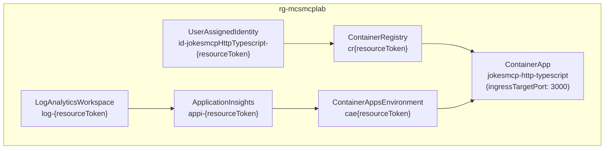
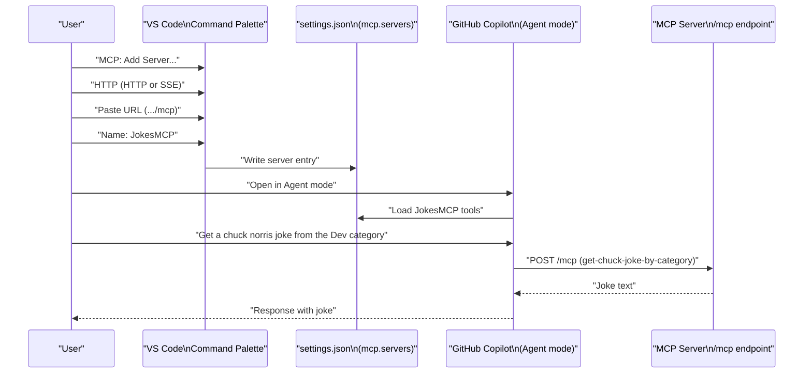
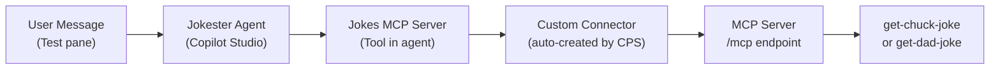
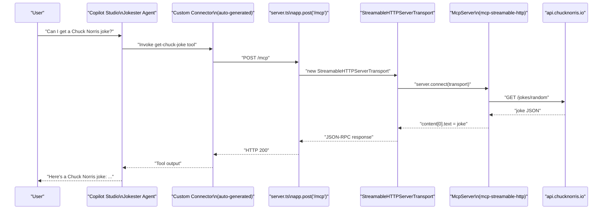

<!-- source: DeepWiki mcp.deepwiki.com · repo microsoft/agent-academy · page 3.1 MCS MCP Lab · fetched 2026-10-26 -->

# MCS MCP Lab

<details>
<summary>Relevant source files</summary>

The following files were used as context for generating this wiki page:

- [.gitignore](.gitignore)
- [docs/.vitepress/config.mts](docs/.vitepress/config.mts)
- [docs/special-ops/index.md](docs/special-ops/index.md)
- [docs/special-ops/mcs-mcp/index.md](docs/special-ops/mcs-mcp/index.md)
- [docs/special-ops/mcs-mcp/source/Dockerfile](docs/special-ops/mcs-mcp/source/Dockerfile)
- [docs/special-ops/mcs-mcp/source/azure.yaml](docs/special-ops/mcs-mcp/source/azure.yaml)
- [docs/special-ops/mcs-mcp/source/infra/abbreviations.json](docs/special-ops/mcs-mcp/source/infra/abbreviations.json)
- [docs/special-ops/mcs-mcp/source/infra/main.bicep](docs/special-ops/mcs-mcp/source/infra/main.bicep)
- [docs/special-ops/mcs-mcp/source/infra/main.parameters.json](docs/special-ops/mcs-mcp/source/infra/main.parameters.json)
- [docs/special-ops/mcs-mcp/source/infra/modules/fetch-container-image.bicep](docs/special-ops/mcs-mcp/source/infra/modules/fetch-container-image.bicep)
- [docs/special-ops/mcs-mcp/source/infra/resources.bicep](docs/special-ops/mcs-mcp/source/infra/resources.bicep)
- [docs/special-ops/mcs-mcp/source/package-lock.json](docs/special-ops/mcs-mcp/source/package-lock.json)
- [docs/special-ops/mcs-mcp/source/package.json](docs/special-ops/mcs-mcp/source/package.json)
- [docs/special-ops/mcs-mcp/source/src/server.ts](docs/special-ops/mcs-mcp/source/src/server.ts)
- [docs/special-ops/pac-cli-mcp/assets/powerplatform-cli-mcp-added-vs-code.png](docs/special-ops/pac-cli-mcp/assets/powerplatform-cli-mcp-added-vs-code.png)
- [docs/special-ops/pac-cli-mcp/assets/restrict-developer-environments-to-admins-only.png](docs/special-ops/pac-cli-mcp/assets/restrict-developer-environments-to-admins-only.png)
- [docs/special-ops/pac-cli-mcp/assets/show-trial-env-creation-setting.png](docs/special-ops/pac-cli-mcp/assets/show-trial-env-creation-setting.png)
- [docs/special-ops/pac-cli-mcp/index.md](docs/special-ops/pac-cli-mcp/index.md)
- [docs/special-ops/pac-cli-mcp/power-platform-plan/index.md](docs/special-ops/pac-cli-mcp/power-platform-plan/index.md)

</details>


This page documents the **MCS MCP Special Ops Lab** end-to-end: the Jokes MCP server source code, how to run it locally and deploy it to Azure, and how to integrate it with both VS Code GitHub Copilot and Microsoft Copilot Studio. This is a standalone lab independent of any course track rank. For an overview of all Special Ops labs, see page [3](). For the PAC CLI MCP lab, see page [3.2]().

---

## Purpose and Scope

The lab teaches you to build, deploy, and consume a custom MCP (Model Context Protocol) server. The concrete vehicle is a "Jokes" server that exposes Chuck Norris and dad joke APIs as MCP tools. By the end, the same server endpoint is usable from both VS Code GitHub Copilot and a Microsoft Copilot Studio agent.

---

## What Is MCP?

MCP (Model Context Protocol) is an open protocol defined by Anthropic that standardizes how applications provide context and tool access to LLMs. In Copilot Studio, MCP servers are surfaced through the existing connector infrastructure, so they inherit enterprise security controls (VNet integration, DLP policies, authentication methods) rather than bypassing them.

| Concern | Answer |
|---|---|
| Protocol origin | Anthropic (open standard) |
| Transport used in this lab | Streamable HTTP (POST to `/mcp`) |
| Copilot Studio integration layer | Custom connector, created automatically |
| Auth support | Connector-level (anonymous in this lab) |

Sources: [docs/special-ops/mcs-mcp/index.md:10-18]()

---

## Prerequisites

| Requirement | Notes |
|---|---|
| Node v22 | Use `nvm` or `nvm-windows` |
| Visual Studio Code | For port forwarding and MCP config |
| Docker | Required for Azure Container App build |
| Azure Developer CLI (`azd`) | Required for Azure deployment only |
| Azure Subscription | Required for Azure deployment only |
| Copilot Studio trial/dev account | Required for Copilot Studio integration |

Sources: [docs/special-ops/mcs-mcp/index.md:23-30]()

---

## Server Source Code

The server lives in [docs/special-ops/mcs-mcp/source/src/server.ts](). It is a TypeScript application with three dependencies declared in [docs/special-ops/mcs-mcp/source/package.json]():

| Package | Role |
|---|---|
| `@modelcontextprotocol/sdk` | MCP server core (`McpServer`, `StreamableHTTPServerTransport`) |
| `express` (v5) | HTTP server framework |
| `zod` (v4) | Input schema validation for parameterized tools |

### Server Architecture Diagram

**Diagram: server.ts class and route relationships**



Sources: [docs/special-ops/mcs-mcp/source/src/server.ts:1-163]()

### Registered Tools

| Tool Name | Parameters | External API |
|---|---|---|
| `get-chuck-joke` | none | `https://api.chucknorris.io/jokes/random` |
| `get-chuck-joke-by-category` | `category: string` | `https://api.chucknorris.io/jokes/random?category=${category}` |
| `get-chuck-categories` | none | `https://api.chucknorris.io/jokes/categories` |
| `get-dad-joke` | none | `https://icanhazdadjoke.com/` |

Sources: [docs/special-ops/mcs-mcp/source/src/server.ts:12-98]()

### HTTP Routes

The Express app exposes three handlers on `/mcp`:

| Method | Behavior |
|---|---|
| `POST /mcp` | Creates a `StreamableHTTPServerTransport`, connects it to the `McpServer`, and dispatches the request. Each request is stateless (`sessionIdGenerator: undefined`). |
| `GET /mcp` | Returns HTTP 405 with JSON-RPC error `"Method not allowed."` |
| `DELETE /mcp` | Returns HTTP 405 with JSON-RPC error `"Method not allowed."` |

The server listens on `process.env.PORT` or `3000` by default.

Sources: [docs/special-ops/mcs-mcp/source/src/server.ts:100-163]()

### Build Scripts

Defined in [docs/special-ops/mcs-mcp/source/package.json:6-10]():

| Script | Command |
|---|---|
| `build` | `tsc` (compiles TypeScript to `dist/`) |
| `start` | `node dist/server.js` |

---

## Running Locally

```bash
npm install
npm run build && npm run start
```

After the server starts on port `3000`, use VS Code's **Ports** panel to forward port `3000` and set visibility to **Public**. The resulting devtunnel URL (e.g. `https://something-3000.something.devtunnels.ms`) becomes your server base URL. Append `/mcp` to get the full MCP endpoint.

A `GET /mcp` to confirm the server is reachable returns the expected 405 response:

```json
{"jsonrpc":"2.0","error":{"code":-32000,"message":"Method not allowed."},"id":null}
```

This is the expected behavior — it confirms the server is up and that only POST is accepted.

Sources: [docs/special-ops/mcs-mcp/index.md:45-87](), [docs/special-ops/mcs-mcp/source/src/server.ts:131-143]()

---

## Azure Deployment

### Overview

The Azure deployment uses the Azure Developer CLI (`azd up`) and a set of Bicep templates. The container is built from the multi-stage `Dockerfile`.

**Deployment command:**

```bash
azd auth login
azd up
```

After completion, `azd` outputs the Container App URL. Append `/mcp` for the MCP endpoint.

**Cleanup:**

```bash
azd down
```

Sources: [docs/special-ops/mcs-mcp/index.md:89-117]()

### Dockerfile

The [docs/special-ops/mcs-mcp/source/Dockerfile]() uses a two-stage build:

| Stage | Base Image | Action |
|---|---|---|
| `builder` | `node:22.12-alpine` | Copies source, runs `npm install`, runs `npm run build` |
| `release` | `node:22-alpine` | Copies `dist/` and runs `npm ci --omit-dev`; sets `PORT=80` |

### Azure Infrastructure (Bicep)

The [docs/special-ops/mcs-mcp/source/azure.yaml]() defines the service `jokesmcp-http-typescript` targeting a `containerapp` host. The main Bicep files are:

| File | Purpose |
|---|---|
| `infra/main.bicep` | Creates resource group `rg-${environmentName}`, calls `resources.bicep` |
| `infra/resources.bicep` | Provisions all Azure resources |
| `infra/main.parameters.json` | Reads `AZURE_ENV_NAME`, `AZURE_LOCATION`, `AZURE_PRINCIPAL_ID` from environment |

**Diagram: Azure infrastructure provisioned by resources.bicep**



Sources: [docs/special-ops/mcs-mcp/source/infra/main.bicep:1-44](), [docs/special-ops/mcs-mcp/source/infra/resources.bicep:1-100](), [docs/special-ops/mcs-mcp/source/azure.yaml:1-12]()

---

## Integration with VS Code / GitHub Copilot

**Diagram: VS Code MCP server registration flow**



Steps:
1. Open the VS Code Command Palette and run **MCP: Add Server...**
2. Choose **HTTP (HTTP or Server-Sent Events)**
3. Paste the full MCP URL (devtunnel or Azure Container App URL + `/mcp`)
4. Name the server (e.g. `JokesMCP`) and save to **User Settings**
5. Open GitHub Copilot in **Agent** mode and verify `JokesMCP` tools appear in the tools menu

Sources: [docs/special-ops/mcs-mcp/index.md:119-158]()

---

## Integration with Microsoft Copilot Studio

### What Copilot Studio Does Behind the Scenes

When you add an MCP server in Copilot Studio, it automatically generates a custom connector that wraps the MCP endpoint. This connector inherits connector-level security and governance.

**Diagram: Copilot Studio MCP integration architecture**



Sources: [docs/special-ops/mcs-mcp/index.md:160-326]()

### Steps: Create the Jokester Agent

1. Navigate to [copilotstudio.microsoft.com](https://copilotstudio.microsoft.com) and create a **blank agent**
2. Name it `Jokester`
3. Set the description and instructions (provided in the lab)
4. Go to **Tools** → **Add a tool** → **Model Context Protocol**
5. Enter the tool name (`Jokes MCP Server`), description, and the MCP server URL (`https://.../mcp`)
6. Select **Create** — Copilot Studio provisions the connector
7. Create a connection (initially shown as **Not connected**)
8. In the test pane, send a message; when prompted, open **connection manager** and connect
9. Start a new testing session and send `Can I get a Chuck Norris joke?`

### Agent Configuration Summary

| Field | Value |
|---|---|
| Agent name | `Jokester` |
| Tool name | `Jokes MCP Server` |
| Tool type | Model Context Protocol |
| MCP URL | `https://<host>/mcp` |
| Tools exposed | `get-chuck-joke`, `get-chuck-joke-by-category`, `get-chuck-categories`, `get-dad-joke` |

Sources: [docs/special-ops/mcs-mcp/index.md:163-326]()

---

## End-to-End Request Flow Summary

**Diagram: Full request lifecycle from user prompt to joke response**



Sources: [docs/special-ops/mcs-mcp/source/src/server.ts:103-129](), [docs/special-ops/mcs-mcp/index.md:160-326]()

---

## Cleanup

After finishing the lab, if you deployed to Azure, remove all provisioned resources with:

```bash
azd down
```

This deletes the resource group and all contained resources (Container App, Container Registry, App Insights, Log Analytics workspace, managed identity).

Sources: [docs/special-ops/mcs-mcp/index.md:328-338]()

---

