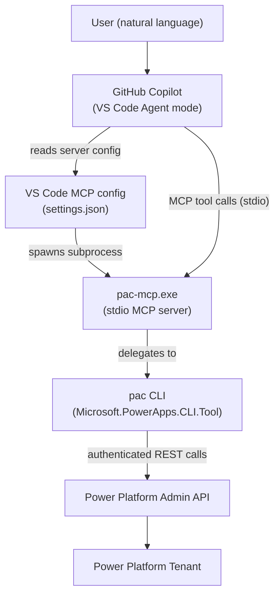
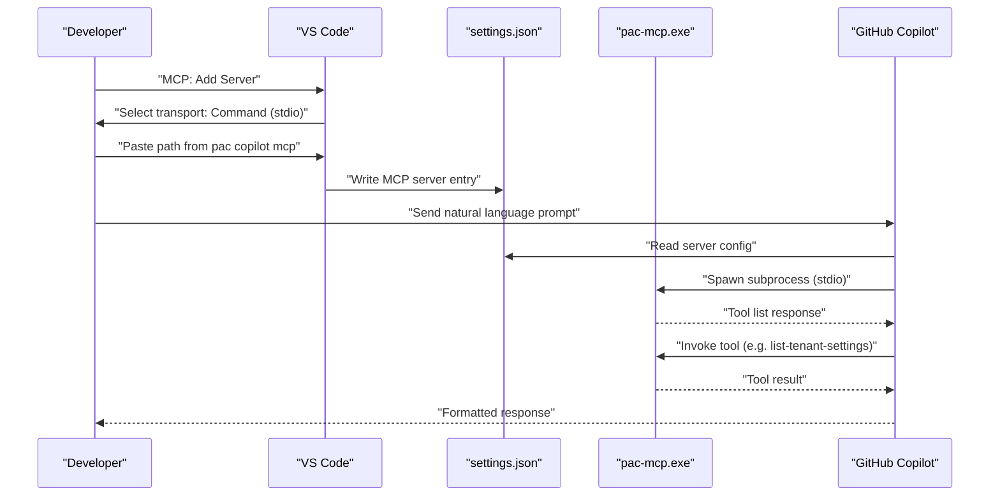
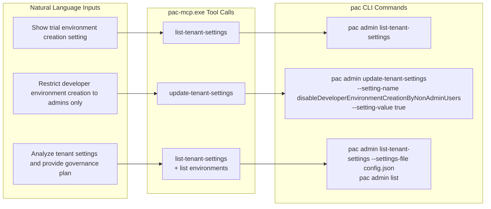

<!-- source: DeepWiki mcp.deepwiki.com · repo microsoft/agent-academy · page 3.2 PAC CLI MCP Lab · fetched 2026-10-26 -->

# PAC CLI MCP Lab

<details>
<summary>Relevant source files</summary>

The following files were used as context for generating this wiki page:

- [.gitignore](.gitignore)
- [docs/.vitepress/config.mts](docs/.vitepress/config.mts)
- [docs/special-ops/index.md](docs/special-ops/index.md)
- [docs/special-ops/mcs-mcp/index.md](docs/special-ops/mcs-mcp/index.md)
- [docs/special-ops/pac-cli-mcp/assets/powerplatform-cli-mcp-added-vs-code.png](docs/special-ops/pac-cli-mcp/assets/powerplatform-cli-mcp-added-vs-code.png)
- [docs/special-ops/pac-cli-mcp/assets/restrict-developer-environments-to-admins-only.png](docs/special-ops/pac-cli-mcp/assets/restrict-developer-environments-to-admins-only.png)
- [docs/special-ops/pac-cli-mcp/assets/show-trial-env-creation-setting.png](docs/special-ops/pac-cli-mcp/assets/show-trial-env-creation-setting.png)
- [docs/special-ops/pac-cli-mcp/index.md](docs/special-ops/pac-cli-mcp/index.md)
- [docs/special-ops/pac-cli-mcp/power-platform-plan/index.md](docs/special-ops/pac-cli-mcp/power-platform-plan/index.md)

</details>


## Purpose and Scope

This page documents the **Power Platform CLI MCP** Special Ops lab. It covers how to install the `pac` CLI tool, locate and configure the built-in `pac-mcp.exe` MCP server in VS Code, authenticate with a Power Platform tenant, and use GitHub Copilot to manage tenant settings through natural language commands.

This lab is rank-independent and standalone. For the companion Special Ops lab that builds and deploys a custom MCP server from TypeScript source, see [MCS MCP Lab](#3.1). For background on the MCP protocol itself, see [Special Ops Labs Overview](#3).

---

## What Is the Power Platform CLI?

The Microsoft Power Platform CLI (`pac`) is a command-line tool for developers and administrators to manage resources across the Power Platform. It is distributed as a .NET global tool under the NuGet package name `Microsoft.PowerApps.CLI.Tool`.

**Capability areas exposed by the CLI:**

| Area | Example Operations |
|---|---|
| Environment lifecycle | Create, list, and delete environments |
| Authentication | Manage auth profiles for multiple tenants |
| Dataverse | Work with tables, data, and configurations |
| Solutions | Import, export, and manage solution packages |
| Power Pages | Deploy and configure websites |
| Code components | Create and manage PCF controls |
| Tenant settings | Read and update admin-level tenant configuration |

Sources: [docs/special-ops/pac-cli-mcp/index.md:16-26]()

---

## Installing the CLI

The CLI is installed as a .NET global tool. The prerequisite is **.NET 8.0 or later**.

```bash
dotnet tool install --global Microsoft.PowerApps.CLI.Tool
```

After installation, verify with:

```bash
pac
```

Expected output:

```text
Microsoft PowerPlatform CLI
Version: 1.30.3+g0f0e0b9
```

To upgrade:

```bash
dotnet tool update --global Microsoft.PowerApps.CLI.Tool
```

**Installation path:** The `pac` executable is placed in `%USERPROFILE%\.dotnet\tools`, which is automatically added to the system `PATH`.

Sources: [docs/special-ops/pac-cli-mcp/index.md:29-80]()

---

## The MCP Server Component

Starting with version **1.44**, the `pac` CLI ships a built-in MCP server executable: `pac-mcp.exe`. This server uses the **stdio** transport (not HTTP), meaning it is launched as a subprocess by the MCP host (VS Code) rather than connecting to a running HTTP endpoint. This distinguishes it from the HTTP-based Jokes MCP server in the [MCS MCP Lab](#3.1).

**Location of `pac-mcp.exe`:**

```text
%USERPROFILE%\.dotnet\tools\.store\microsoft.powerapps.cli.tool\[version]\microsoft.powerapps.cli.tool\[version]\tools\net8.0\any\pac-mcp.exe
```

To resolve the exact path for the installed version:

```bash
pac copilot mcp
```

This command prints the resolved path to `pac-mcp.exe` for the current installation.

**Supported operations (20+ commands):**

| Category | Operations |
|---|---|
| Environment Management | List, create, manage environments |
| Solution Operations | Import, export, package solutions |
| Authentication | Auth profiles and tenant connections |
| Dataverse Operations | Tables, data, configurations |
| Power Pages | Website deployments |
| Component Management | PCF controls and components |
| Tenant Settings | Read/write admin-level settings |

Sources: [docs/special-ops/pac-cli-mcp/index.md:82-107]()

---

## System Architecture

The following diagram shows how the components relate at the code and process level.

**Diagram: PAC CLI MCP Runtime Architecture**



Sources: [docs/special-ops/pac-cli-mcp/index.md:82-141]()

---

## Setting Up PAC CLI MCP in VS Code

### Step 1: Locate the Executable

Run the following to get the path:

```bash
pac copilot mcp
```

Copy the full path to `pac-mcp.exe` from the output.

### Step 2: Register as an MCP Server

1. Open the VS Code Command Palette (`Ctrl+Shift+P` / `Cmd+Shift+P`).
2. Search for `MCP` and select **MCP: Add Server**.
3. Select **Command (stdio)** — this is the transport type for `pac-mcp.exe`, not HTTP.
4. Paste the full path to `pac-mcp.exe`.
5. Name the server, e.g. `Power Platform CLI MCP`.

VS Code writes this configuration into the user `settings.json`. After registration the server should appear as active in the MCP panel. The server is invoked on demand as a subprocess, not as a persistent background service.

**Diagram: MCP Registration Flow (File and Command References)**



Sources: [docs/special-ops/pac-cli-mcp/index.md:108-141]()

---

## Authentication

Before issuing commands against a Power Platform tenant, an auth profile must be established.

**Create a new auth profile:**

```bash
pac auth create
```

**List existing profiles:**

```bash
pac auth list
```

Admin-level operations (such as reading or modifying tenant settings) require the authenticated account to hold **Power Platform administrator** permissions.

Sources: [docs/special-ops/pac-cli-mcp/index.md:188-198]()

---

## Mission: Tenant Settings via Natural Language

This lab mission demonstrates using GitHub Copilot with the PAC CLI MCP server to manage Power Platform tenant settings without memorizing CLI syntax.

### Why Manage Settings via CLI

The Power Platform Admin Center does not expose all available settings through its UI. The CLI provides access to the complete configuration surface.

| Advantage | Detail |
|---|---|
| Comprehensive access | `pac admin list-tenant-settings` exposes settings not visible in the web portal |
| Bulk operations | Multiple settings updated in a single command |
| Version control | Export settings to JSON with `--settings-file` for Git tracking |
| Automation | Commands integrate with CI/CD pipelines |
| Disaster recovery | JSON snapshots enable rapid restore of tenant configuration |

### Verification Checklist Before Running the Mission

```bash
pac --version                # Verify 1.44+ is installed
pac auth list                # Confirm authenticated profile exists
pac copilot mcp              # Confirm pac-mcp.exe path resolves
```

Sources: [docs/special-ops/pac-cli-mcp/index.md:173-260]()

---

## Natural Language to CLI Command Mapping

The MCP server translates GitHub Copilot tool calls into `pac` CLI commands. The following diagram maps example natural language inputs to the underlying code paths.

**Diagram: Natural Language → pac CLI Command Translation**



Sources: [docs/special-ops/pac-cli-mcp/index.md:262-314]()

---

## Example Interactions

### Example 1: View Current Settings

**Prompt:**
```text
Show me the current tenant settings for trial environment creation
```

GitHub Copilot calls the `list-tenant-settings` tool via `pac-mcp.exe`, which executes `pac admin list-tenant-settings` and returns the relevant setting value.

### Example 2: Update a Setting

**Prompt:**
```text
Update my tenant to restrict developer environment creation to admins only
```

Copilot calls the `update-tenant-settings` tool, which executes:

```powershell
pac admin update-tenant-settings --setting-name "disableDeveloperEnvironmentCreationByNonAdminUsers" --setting-value "true"
```

### Example 3: Strategic Governance Analysis

A more complex prompt instructs Copilot to retrieve all tenant settings, compare them against best practices, and produce a prioritized governance plan. This prompt is documented at [docs/special-ops/pac-cli-mcp/index.md:299-314]().

Sources: [docs/special-ops/pac-cli-mcp/index.md:262-330]()

---

## Governance Plan Reference

The lab includes a pre-generated example output of the strategic governance analysis prompt, saved as a separate document at [docs/special-ops/pac-cli-mcp/power-platform-plan/index.md](). This document covers:

- **Assessment** of 16 environments and dozens of tenant settings
- **Prioritized recommendations** across four priority tiers (Critical / High / Medium / Low)
- **Phased implementation roadmap** spanning 3–6 months
- **Ready-to-execute CLI commands** for each recommended change
- **Monitoring KPIs** and success metrics

**Priority tiers from the generated plan:**

| Priority | Timeframe | Example Setting |
|---|---|---|
| 🔴 Critical | Within 2 weeks | `disableTrialEnvironmentCreationByNonAdminUsers` |
| 🟠 High | 4–6 weeks | `enableTenantCapacityReportForEnvironmentAdmins` |
| 🟡 Medium | 8–12 weeks | `enableDesktopFlowDataPolicyManagement` |
| 🟢 Low | 3–6 months | `enableTenantSummaryReportForEnvironmentAdmins` |

Sources: [docs/special-ops/pac-cli-mcp/power-platform-plan/index.md:1-340]()

---

## Security and Tool Access Control

The MCP integration supports **selective tool exposure**: only the `pac` commands needed for a given session need to be enabled. This limits the blast radius if a Copilot interaction triggers an unintended operation.

**Recommended practices:**

- Enable only the commands required for the current task
- Review tool permissions before approving execution in Copilot
- Use environment-specific configurations
- Monitor the VS Code Output panel for MCP-related execution logs

Sources: [docs/special-ops/pac-cli-mcp/index.md:144-153]()

---

## Troubleshooting

| Symptom | Likely Cause | Resolution |
|---|---|---|
| MCP server not found in VS Code | Incorrect path in `settings.json` | Re-run `pac copilot mcp` and update path |
| MCP server not starting | CLI version below 1.44 | Run `dotnet tool update --global Microsoft.PowerApps.CLI.Tool` |
| Authentication errors | No valid auth profile | Run `pac auth create` |
| Tool access warnings | Tool not enabled in MCP config | Check VS Code Output window for MCP messages |

Sources: [docs/special-ops/pac-cli-mcp/index.md:155-172]()

---

## Relationship to Other Labs

The PAC CLI MCP lab and the MCS MCP lab are both Special Ops missions, but differ in approach and scope:

| Dimension | MCS MCP Lab ([3.1](#3.1)) | PAC CLI MCP Lab (this page) |
|---|---|---|
| MCP server source | Custom TypeScript server (`jokes-mcp-server`) | Built-in `pac-mcp.exe` in the CLI tool |
| Transport | HTTP / StreamableHTTPServerTransport | stdio (subprocess) |
| Deployment | Local devtunnel or Azure Container App | Local only (Windows) |
| Integration target | VS Code GitHub Copilot + Copilot Studio | VS Code GitHub Copilot |
| Domain | Custom joke API | Power Platform administration |
| Prerequisites | Node.js, Docker, Azure subscription | .NET 8+, Power Platform admin access |

Sources: [docs/special-ops/index.md:1-14](), [docs/special-ops/pac-cli-mcp/index.md:1-14](), [docs/special-ops/mcs-mcp/index.md:1-30]()

---

