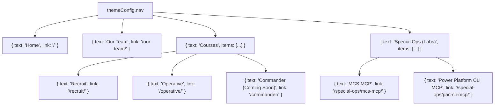
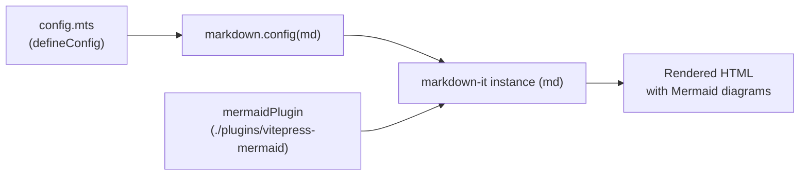

<!-- source: DeepWiki mcp.deepwiki.com · repo microsoft/agent-academy · page 4.1 Site Configuration and Navigation · fetched 2026-10-26 -->

# Site Configuration and Navigation

<details>
<summary>Relevant source files</summary>

The following files were used as context for generating this wiki page:

- [.gitignore](.gitignore)
- [docs/.vitepress/config.mts](docs/.vitepress/config.mts)
- [docs/special-ops/index.md](docs/special-ops/index.md)
- [docs/special-ops/mcs-mcp/index.md](docs/special-ops/mcs-mcp/index.md)
- [docs/special-ops/pac-cli-mcp/assets/powerplatform-cli-mcp-added-vs-code.png](docs/special-ops/pac-cli-mcp/assets/powerplatform-cli-mcp-added-vs-code.png)
- [docs/special-ops/pac-cli-mcp/assets/restrict-developer-environments-to-admins-only.png](docs/special-ops/pac-cli-mcp/assets/restrict-developer-environments-to-admins-only.png)
- [docs/special-ops/pac-cli-mcp/assets/show-trial-env-creation-setting.png](docs/special-ops/pac-cli-mcp/assets/show-trial-env-creation-setting.png)
- [docs/special-ops/pac-cli-mcp/index.md](docs/special-ops/pac-cli-mcp/index.md)
- [docs/special-ops/pac-cli-mcp/power-platform-plan/index.md](docs/special-ops/pac-cli-mcp/power-platform-plan/index.md)

</details>


This page covers the VitePress site configuration file for the Agent Academy documentation website — specifically how the navigation bar, sidebar, base URL, analytics, and Mermaid plugin are wired together in `docs/.vitepress/config.mts`. For information about running the site locally or deploying it to GitHub Pages, see [4.2](). For an overview of the VitePress framework itself and its relationship to the markdown source files, see [4]().

---

## Configuration File Overview

All site-level settings are defined in a single file: [docs/.vitepress/config.mts:1-194](). It exports a VitePress `defineConfig` object that controls the site title, base path, HTML head injection, theme configuration (nav and sidebar), and the markdown plugin pipeline.

**Top-level configuration fields:**

| Field | Value | Purpose |
|---|---|---|
| `title` | `"Agent Academy"` | Browser tab and site title |
| `base` | `"/agent-academy/"` | URL prefix for GitHub Pages deployment |
| `description` | `"Welcome to Copilot Studio Agent Academy..."` | HTML meta description |
| `head` | Array of tags | Injects favicon and analytics script |
| `themeConfig` | Object | Nav bar, sidebar, logo, social links, lastUpdated |
| `markdown.config` | Function | Registers the Mermaid plugin |

Sources: [docs/.vitepress/config.mts:1-194]()

---

## Base URL

The `base` field is set to `"/agent-academy/"` [docs/.vitepress/config.mts:6](). This prefix is prepended to all internal asset and page URLs, which is required because the site is served from a GitHub Pages subpath rather than a root domain. For example, the favicon is referenced as `/agent-academy/logo.png` [docs/.vitepress/config.mts:8]().

Sources: [docs/.vitepress/config.mts:4-13]()

---

## Head Injection

Two entries are added to the HTML `<head>` via the `head` array [docs/.vitepress/config.mts:7-14]():

1. **Favicon** — A `<link rel="icon">` pointing to `/agent-academy/logo.png`.
2. **Microsoft Clarity analytics** — An inline `<script>` tag that loads the Clarity tracking snippet with tag ID `u32wbf0qvv`. This is an IIFE that appends the Clarity script to the document at runtime.

Sources: [docs/.vitepress/config.mts:7-14]()

---

## Navigation Bar

The top navigation bar is defined under `themeConfig.nav` [docs/.vitepress/config.mts:19-38](). It contains four entries, two of which are dropdown menus.

**Nav bar structure:**

| Entry | Type | Links to |
|---|---|---|
| `Home` | Single link | `/` |
| `Our Team` | Single link | `/our-team/` |
| `Courses` | Dropdown | Recruit, Operative, Commander (Coming Soon) |
| `Special Ops (Labs)` | Dropdown | Overview, MCS ❤️ MCP, Power Platform CLI MCP |

**Courses dropdown items:**

| Label | Link |
|---|---|
| `Recruit` | `/recruit/` |
| `Operative` | `/operative/` |
| `Commander (Coming Soon)` | `/commander/` |

**Special Ops dropdown items:**

| Label | Link |
|---|---|
| `Overview` | `/special-ops/` |
| `MCS ❤️ MCP` | `/special-ops/mcs-mcp/` |
| `Power Platform CLI MCP` | `/special-ops/pac-cli-mcp/` |

**Diagram: Nav bar structure mapped to config.mts**



Sources: [docs/.vitepress/config.mts:19-38]()

---

## Sidebar

The sidebar is defined under `themeConfig.sidebar` as a flat array of section groups [docs/.vitepress/config.mts:45-181](). Unlike the nav bar, it is a single unified sidebar shown on all pages, not a per-path sidebar map.

The sidebar array contains four top-level entries:

| Entry | `collapsed` | Child items |
|---|---|---|
| `Home` | N/A (no children) | — |
| `Our Team` | N/A (no children) | — |
| `Courses` | — | Recruit (collapsed), Operative (collapsed), Commander link |
| `Special Ops (Labs)` | `true` | MCS ❤️ MCP, Power Platform CLI MCP |

Both the **Recruit** and **Operative** sections use `collapsed: true`, meaning they render as collapsed accordions by default.

### Recruit Sidebar Items

[docs/.vitepress/config.mts:51-113]()

| Label | Link path |
|---|---|
| Course Setup | `/recruit/00-course-setup/` |
| Introduction to Agents | `/recruit/01-introduction-to-agents/` |
| Copilot Studio Fundamentals | `/recruit/02-copilot-studio-fundamentals/` |
| Create A Declarative Agent For Microsoft 365 Copilot | `/recruit/03-create-a-declarative-agent-for-M365Copilot/` |
| Creating A Solution | `/recruit/04-creating-a-solution/` |
| Using Prebuilt Agents | `/recruit/05-using-prebuilt-agents/` |
| Create Agent From Conversation | `/recruit/06-create-agent-from-conversation/` |
| Add New Topic With Trigger | `/recruit/07-add-new-topic-with-trigger/` |
| Add Adaptive Cards | `/recruit/08-add-adaptive-card/` |
| Add An Agent Flow | `/recruit/09-add-an-agent-flow/` |
| Add Event Triggers | `/recruit/10-add-event-triggers/` |
| Publish Your Agents | `/recruit/11-publish-your-agent/` |
| Understanding Licensing | `/recruit/12-understanding-licensing/` |
| Course Completion Badge Recruit | `/recruit/course-completion-badges-recruit/` |

### Operative Sidebar Items

[docs/.vitepress/config.mts:114-168]()

| Label | Link path |
|---|---|
| Get started with the Hiring Agent | `/operative/01-get-started/` |
| Authoring Agent Instructions | `/operative/02-agent-instructions/` |
| Make your agent multi-agent ready with connected agents | `/operative/03-multi-agent/` |
| Automate your agent with Triggers | `/operative/04-automate-triggers/` |
| Understanding Agent Models | `/operative/05-model-selection/` |
| Content Moderation and AI Safety Essentials | `/operative/06-ai-safety/` |
| Extracting Resume Contents with Multi-Modal Prompts | `/operative/07-multimodal-prompts/` |
| Prompts - Dataverse Grounding | `/operative/08-dataverse-grounding/` |
| Generating an Interview Prep Document | `/operative/09-document-generation/` |
| Integrate with MCP Servers | `/operative/10-mcp/` |
| Obtain User Feedback with Adaptive Cards | `/operative/11-obtain-user-feedback/` |
| Course Completion Badge Operative | `/operative/course-completion-badges-operative` |

### Special Ops Sidebar Items

[docs/.vitepress/config.mts:172-180]()

| Label | Link path |
|---|---|
| MCS ❤️ MCP | `/special-ops/mcs-mcp/` |
| Power Platform CLI MCP | `/special-ops/pac-cli-mcp/` |

**Diagram: Sidebar hierarchy mapped to config.mts properties**

```mermaid
graph TD
    sidebar["themeConfig.sidebar (array)"]

    home_entry["{ text: 'Home', link: '/' }"]
    team_entry["{ text: 'Our Team', link: '/our-team/' }"]

    courses_group["{ text: 'Courses', items: [...] }"]

    recruit_group["{ text: 'Recruit', link: '/recruit/', collapsed: true, items: [...] }"]
    r0["00-course-setup"]
    r1["01-introduction-to-agents"]
    r2["02-copilot-studio-fundamentals"]
    r3["03-create-a-declarative-agent-for-M365Copilot"]
    r4["04-creating-a-solution"]
    r5["05-using-prebuilt-agents"]
    r6["06-create-agent-from-conversation"]
    r7["07-add-new-topic-with-trigger"]
    r8["08-add-adaptive-card"]
    r9["09-add-an-agent-flow"]
    r10["10-add-event-triggers"]
    r11["11-publish-your-agent"]
    r12["12-understanding-licensing"]
    r13["course-completion-badges-recruit"]

    operative_group["{ text: 'Operative', link: '/operative/', collapsed: true, items: [...] }"]
    o1["01-get-started"]
    o2["02-agent-instructions"]
    o3["03-multi-agent"]
    o4["04-automate-triggers"]
    o5["05-model-selection"]
    o6["06-ai-safety"]
    o7["07-multimodal-prompts"]
    o8["08-dataverse-grounding"]
    o9["09-document-generation"]
    o10["10-mcp"]
    o11["11-obtain-user-feedback"]
    o12["course-completion-badges-operative"]

    commander_entry["{ text: 'Commander (Coming Soon)', link: '/commander/' }"]

    specialops_group["{ text: 'Special Ops (Labs)', link: '/special-ops/', collapsed: true, items: [...] }"]
    s1["mcs-mcp"]
    s2["pac-cli-mcp"]

    sidebar --> home_entry
    sidebar --> team_entry
    sidebar --> courses_group
    courses_group --> recruit_group
    recruit_group --> r0
    recruit_group --> r1
    recruit_group --> r2
    recruit_group --> r3
    recruit_group --> r4
    recruit_group --> r5
    recruit_group --> r6
    recruit_group --> r7
    recruit_group --> r8
    recruit_group --> r9
    recruit_group --> r10
    recruit_group --> r11
    recruit_group --> r12
    recruit_group --> r13
    courses_group --> operative_group
    operative_group --> o1
    operative_group --> o2
    operative_group --> o3
    operative_group --> o4
    operative_group --> o5
    operative_group --> o6
    operative_group --> o7
    operative_group --> o8
    operative_group --> o9
    operative_group --> o10
    operative_group --> o11
    operative_group --> o12
    courses_group --> commander_entry
    sidebar --> specialops_group
    specialops_group --> s1
    specialops_group --> s2
```



Sources: [docs/.vitepress/config.mts:45-181]()

---

## Mermaid Plugin Integration

Mermaid diagram support is added via a custom local plugin. It is imported and registered in `config.mts` as follows [docs/.vitepress/config.mts:1-3,189-193]():

```
import { mermaidPlugin } from "./plugins/vitepress-mermaid";

markdown: {
  config: (md) => {
    md.use(mermaidPlugin);
  },
},
```

The `mermaidPlugin` is sourced from `docs/.vitepress/plugins/vitepress-mermaid` and is applied to the `markdown-it` (`md`) instance used by VitePress. This enables fenced code blocks with the `mermaid` language tag to be rendered as diagrams in the published HTML output.

**Diagram: Plugin wiring in the VitePress config pipeline**



Sources: [docs/.vitepress/config.mts:1-3,189-193]()

---

## Additional Theme Settings

**Logo and social links** [docs/.vitepress/config.mts:17-188]():

| Setting | Value |
|---|---|
| `themeConfig.logo` | `/logo.png` |
| `themeConfig.socialLinks` | GitHub icon → `https://github.com/microsoft/agent-academy/` |

**Last updated display** [docs/.vitepress/config.mts:39-44]():

The `lastUpdated` option is enabled with `text: 'Last updated at'` and `dateStyle: 'long'`, causing each page to show a human-readable last-modified timestamp derived from Git history. Individual pages can opt out by setting `lastUpdated: false` in their frontmatter (as seen in `docs/special-ops/index.md`).

Sources: [docs/.vitepress/config.mts:17-44](), [docs/special-ops/index.md:1-3]()

---

