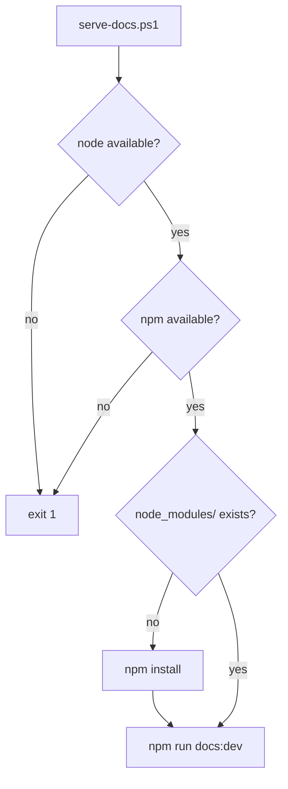
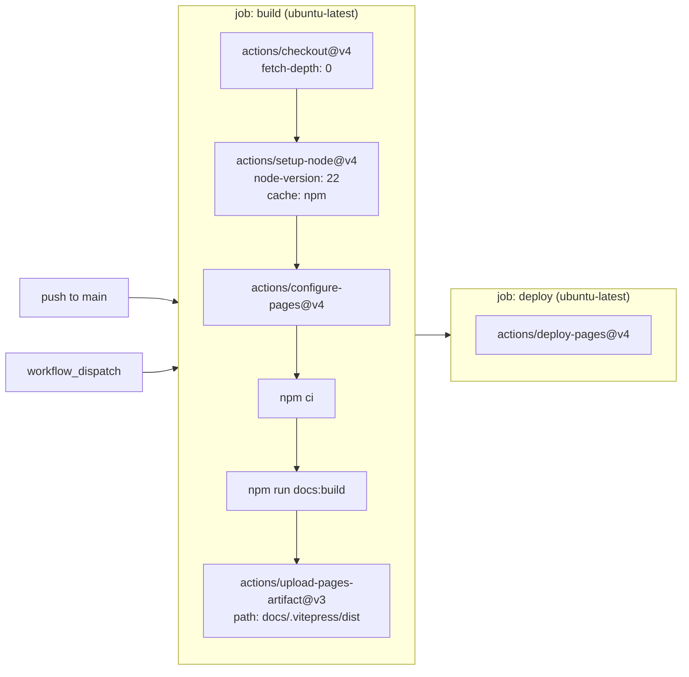
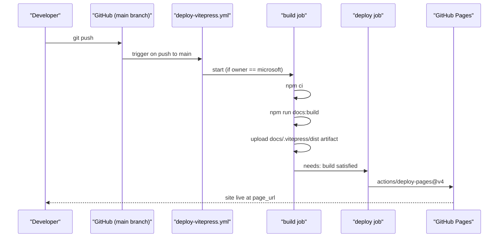

<!-- source: DeepWiki mcp.deepwiki.com · repo microsoft/agent-academy · page 4.2 Local Development and Deployment · fetched 2026-10-26 -->

# Local Development and Deployment

<details>
<summary>Relevant source files</summary>

The following files were used as context for generating this wiki page:

- [.github/workflows/deploy-vitepress.yml](.github/workflows/deploy-vitepress.yml)
- [.vscode/extensions.json](.vscode/extensions.json)
- [CONTRIBUTING.md](CONTRIBUTING.md)
- [package-lock.json](package-lock.json)
- [package.json](package.json)
- [scripts/serve-docs.ps1](scripts/serve-docs.ps1)
- [scripts/validate-markdown.ps1](scripts/validate-markdown.ps1)

</details>


This page covers how to run the Agent Academy documentation site locally for development purposes, and how production deployments to GitHub Pages are automated via CI/CD. It focuses on the npm scripts, VitePress dev server, and the GitHub Actions workflow.

For information about the VitePress site configuration, sidebar structure, and mermaid plugin integration, see [Site Configuration and Navigation](#4.1). For content quality tools like markdownlint and cspell that run on pull requests, see [Contributing](#6).

---

## Prerequisites

| Requirement | Minimum Version | Notes |
|---|---|---|
| Node.js | 18+ | Required by VitePress |
| npm | Bundled with Node.js | Used for dependency management |

The repository is fully compatible with GitHub Codespaces, which ships with Node.js pre-installed.

Sources: [CONTRIBUTING.md:232-235]()

---

## Installing Dependencies

After cloning the repository, install the npm packages listed in [`package.json`](package.json):

```bash
npm install
```

This resolves the two direct dev dependencies defined in [`package.json:6-8`]():

| Package | Version | Role |
|---|---|---|
| `vitepress` | `^2.0.0-alpha.12` | Static site generator and dev server |
| `mermaid` | `^11.12.3` | Diagram rendering library |

Both packages are locked to specific resolved versions in [`package-lock.json`]().

Sources: [package.json:1-17](), [package-lock.json:1-17]()

---

## npm Scripts

The three VitePress-related scripts are defined in [`package.json:9-13`]():

| Script | Command | Purpose |
|---|---|---|
| `npm run docs:dev` | `vitepress dev docs` | Start dev server with hot reload |
| `npm run docs:build` | `vitepress build docs` | Compile static output to `docs/.vitepress/dist` |
| `npm run docs:preview` | `vitepress preview docs` | Serve the production build locally |

All three commands operate on the `docs/` directory as the VitePress source root.

Sources: [package.json:9-13]()

---

## Local Development Server

### Starting the Server

```bash
npm run docs:dev
```

The dev server starts at `http://localhost:5173/agent-academy/`. The `/agent-academy/` base path matches the `base` setting in the VitePress config (see [Site Configuration and Navigation](#4.1)).

### Hot Reload Behavior

While the server is running, VitePress watches the `docs/` directory and rebuilds automatically on file changes:

- Changes to any `.md` file trigger an incremental rebuild and browser reload.
- Changes to the VitePress configuration file (`docs/.vitepress/config.mts`) also trigger a rebuild.
- No manual server restart is required for content edits.

Sources: [CONTRIBUTING.md:284-292]()

### Helper Script

The repository also includes [`scripts/serve-docs.ps1`](), a PowerShell wrapper that:

1. Verifies Node.js is available (`node --version`)
2. Verifies npm is available (`npm --version`)
3. Checks for the presence of `node_modules/`; runs `npm install` if absent
4. Executes `npm run docs:dev`

This script is useful for contributors who want a single command that handles dependency checks before launching the server.

**Script flow diagram:**



Sources: [scripts/serve-docs.ps1:1-59]()

---

## Production Build

```bash
npm run docs:build
```

This runs `vitepress build docs` and outputs the compiled static site to `docs/.vitepress/dist`. The build result is a fully self-contained set of HTML, CSS, and JavaScript files suitable for serving from any static host.

To verify the production build locally before deploying:

```bash
npm run docs:preview
```

Sources: [package.json:9-13](), [CONTRIBUTING.md:293-306]()

---

## CI/CD: GitHub Actions Deployment

The file [`.github/workflows/deploy-vitepress.yml`]() automates deployment to GitHub Pages. The workflow is named `Deploy VitePress site to Pages`.

### Trigger Conditions

| Trigger | Condition |
|---|---|
| `push` | Only on the `main` branch |
| `workflow_dispatch` | Manual trigger from the GitHub Actions tab |

The `build` job includes a guard condition: `if: github.repository_owner == 'microsoft'`. This prevents forks from accidentally deploying to GitHub Pages.

Sources: [.github/workflows/deploy-vitepress.yml:5-29]()

### Concurrency

```yaml
concurrency:
  group: pages
  cancel-in-progress: false
```

Only one deployment runs at a time. Queued runs are skipped in favor of the latest, but a run already in progress is never cancelled — this ensures in-flight deployments complete cleanly.

Sources: [.github/workflows/deploy-vitepress.yml:22-24]()

### Workflow Structure

The workflow has two sequential jobs: `build` and `deploy`.

**Workflow job diagram:**



Sources: [.github/workflows/deploy-vitepress.yml:26-67]()

### Build Job Steps

| Step | Action | Notes |
|---|---|---|
| Checkout | `actions/checkout@v4` | `fetch-depth: 0` fetches full history (used by VitePress for last-updated timestamps) |
| Setup Node | `actions/setup-node@v4` | Node.js 22; npm cache enabled |
| Setup Pages | `actions/configure-pages@v4` | Configures GitHub Pages environment |
| Install deps | `npm ci` | Reproducible install using `package-lock.json` |
| Build | `npm run docs:build` | Outputs to `docs/.vitepress/dist` |
| Upload artifact | `actions/upload-pages-artifact@v3` | Uploads `docs/.vitepress/dist` as the Pages artifact |

Sources: [.github/workflows/deploy-vitepress.yml:28-54]()

### Deploy Job Steps

| Step | Action | Notes |
|---|---|---|
| Deploy | `actions/deploy-pages@v4` | Publishes the uploaded artifact to GitHub Pages |

The deploy job depends on the `build` job via `needs: build` and runs in the `github-pages` environment, which outputs the live `page_url`.

Sources: [.github/workflows/deploy-vitepress.yml:57-67]()

### Required Permissions

```yaml
permissions:
  contents: read
  pages: write
  id-token: write
```

The `pages: write` and `id-token: write` permissions are required by `actions/deploy-pages@v4` for GitHub OIDC-based deployment.

Sources: [.github/workflows/deploy-vitepress.yml:15-18]()

---

## End-to-End Flow Summary

**From source edit to live site:**



Sources: [.github/workflows/deploy-vitepress.yml:1-67](), [package.json:9-13]()

---

