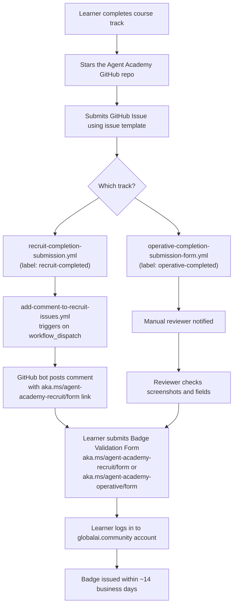
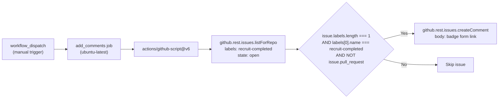
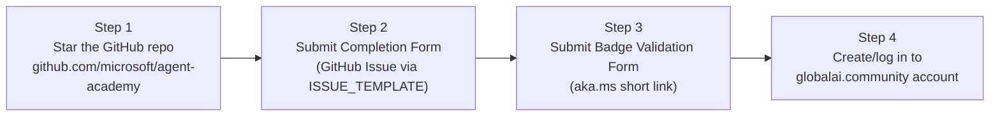
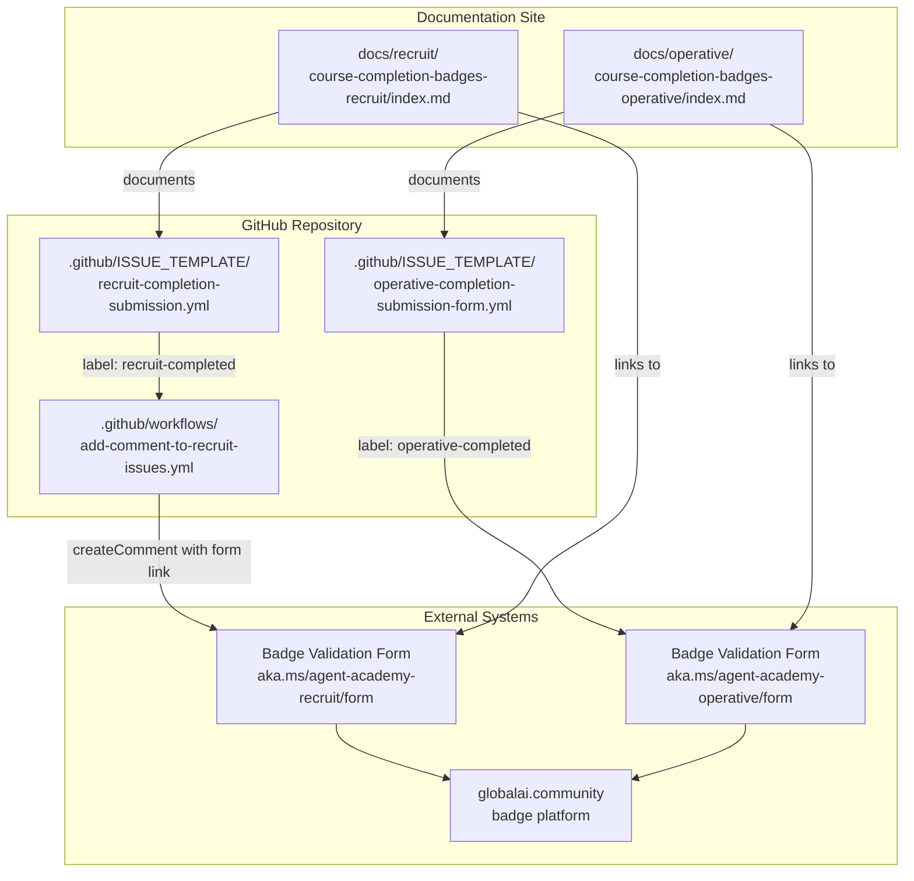

<!-- source: DeepWiki mcp.deepwiki.com · repo microsoft/agent-academy · page 5 Badge and Completion System · fetched 2026-10-26 -->

# Badge and Completion System

Relevant source files

The following files were used as context for generating this wiki page:

- [.github/ISSUE_TEMPLATE/operative-completion-submission-form.yml](.github/ISSUE_TEMPLATE/operative-completion-submission-form.yml)
- [.github/ISSUE_TEMPLATE/recruit-completion-submission.yml](.github/ISSUE_TEMPLATE/recruit-completion-submission.yml)
- [.github/workflows/add-comment-to-recruit-issues.yml](.github/workflows/add-comment-to-recruit-issues.yml)
- [docs/operative/course-completion-badges-operative/assets/HiringAgent.png](docs/operative/course-completion-badges-operative/assets/HiringAgent.png)
- [docs/operative/course-completion-badges-operative/assets/InterviewAgent.png](docs/operative/course-completion-badges-operative/assets/InterviewAgent.png)
- [docs/operative/course-completion-badges-operative/assets/operativebadge.png](docs/operative/course-completion-badges-operative/assets/operativebadge.png)
- [docs/operative/course-completion-badges-operative/assets/solution.png](docs/operative/course-completion-badges-operative/assets/solution.png)
- [docs/operative/course-completion-badges-operative/assets/uploadimage.png](docs/operative/course-completion-badges-operative/assets/uploadimage.png)
- [docs/operative/course-completion-badges-operative/index.md](docs/operative/course-completion-badges-operative/index.md)
- [docs/recruit/course-completion-badges-recruit/assets/agent.png](docs/recruit/course-completion-badges-recruit/assets/agent.png)
- [docs/recruit/course-completion-badges-recruit/assets/recruitbadge.png](docs/recruit/course-completion-badges-recruit/assets/recruitbadge.png)
- [docs/recruit/course-completion-badges-recruit/assets/solution.png](docs/recruit/course-completion-badges-recruit/assets/solution.png)
- [docs/recruit/course-completion-badges-recruit/assets/uploadimage.png](docs/recruit/course-completion-badges-recruit/assets/uploadimage.png)
- [docs/recruit/course-completion-badges-recruit/index.md](docs/recruit/course-completion-badges-recruit/index.md)

This page describes the end-to-end process for earning and issuing digital badges upon completing an Agent Academy course track. It covers the GitHub issue submission templates, required evidence, the GitHub Actions workflow that automates follow-up comments, the external Badge Validation Form, and the Global AI Community platform where badges are hosted.

For information about the course content that leads to badge eligibility, see the Course Tracks pages ([2](#2), [2.1](#2.1), [2.2](#2.2), [2.3](#2.3)).

---

## System Overview

Badges are not issued automatically. Every submission is reviewed by a human. The process involves three distinct systems working together:

1. **GitHub Issues** — Learners submit a structured completion form as a GitHub issue.
2. **GitHub Actions** — An automated workflow detects labeled issues and posts a comment with the badge validation form link.
3. **External Systems** — A Badge Validation Form (Microsoft Forms via `aka.ms` short link) and the Global AI Community platform (`globalai.community`) handle identity verification and badge delivery.

**End-to-End Submission Flow**

Sources: [.github/ISSUE_TEMPLATE/recruit-completion-submission.yml:1-69](), [.github/ISSUE_TEMPLATE/operative-completion-submission-form.yml:1-69](), [.github/workflows/add-comment-to-recruit-issues.yml:1-46](), [docs/recruit/course-completion-badges-recruit/index.md:1-166](), [docs/operative/course-completion-badges-operative/index.md:1-170]()

---

## GitHub Issue Templates

Two issue templates in `.github/ISSUE_TEMPLATE/` drive the submission process. They use GitHub's structured YAML issue form format.

### Recruit Completion Template

**File:** [.github/ISSUE_TEMPLATE/recruit-completion-submission.yml:1-69]()

| Field | Type | Required | Purpose |
|---|---|---|---|
| Curriculum Completion Validation | `checkboxes` | Yes | Confirms learner completed the Recruit curriculum |
| Solution Verification | `checkboxes` | Yes | Confirms two screenshots are attached |
| Final Solution Screenshots (`Final_solution`) | `textarea` | Yes | PNG uploads of IT Help Desk Agent and solution file |
| Key Learnings and Takeaways (`learnings`) | `textarea` | Yes | Free-form reflection on the Recruit path |
| Challenges Faced (`challenges`) | `textarea` | Yes | Difficulty or mission-specific feedback |
| Final Thoughts (`final_thoughts`) | `textarea` | Yes | Improvement suggestions |
| Badge validation form | `checkboxes` | Yes | Confirms submission of the external badge form |

- **Label applied:** `recruit-completed`
- **Issue title format:** `<Insert Name> Recruit Completion Submission`

[.github/ISSUE_TEMPLATE/recruit-completion-submission.yml:4-6]()

### Operative Completion Template

**File:** [.github/ISSUE_TEMPLATE/operative-completion-submission-form.yml:1-69]()

Identical field structure to the Recruit template, with the following differences:

| Difference | Recruit | Operative |
|---|---|---|
| Label | `recruit-completed` | `operative-completed` |
| Agent under review | IT Help Desk Agent | Hiring Agent + Interview Agent |
| Screenshot count | 2 | 3 (solution file, Hiring Agent, Interview Agent) |
| Badge form URL | `aka.ms/agent-academy-recruit/form` | `aka.ms/agent-academy-operative/form` |
| Completion form URL | `aka.ms/agent-academy-recruit/badge` | `aka.ms/agent-academy-operative/badge` |

[.github/ISSUE_TEMPLATE/operative-completion-submission-form.yml:4-6](), [docs/operative/course-completion-badges-operative/index.md:64-103]()

---

## GitHub Actions Workflow

**File:** [.github/workflows/add-comment-to-recruit-issues.yml:1-46]()

Sources: [.github/workflows/add-comment-to-recruit-issues.yml:1-46]()

### Key Details

- **Trigger:** `workflow_dispatch` only — manually run by maintainers. It does not fire automatically on issue creation.
- **Token:** Uses `secrets.GH_PAT` (a Personal Access Token), not the default `GITHUB_TOKEN`. This requires the `issues: write` permission declared at the workflow level.
- **Filter logic:** The script skips issues that have more than one label. This prevents double-commenting on issues that have already been processed or escalated with additional labels.
- **Comment body posted:**
  > "Thank you for filling out the Recruit Completion Form. In order to collect your digital badge, you must submit the following Badge Validation Form: https://aka.ms/agent-academy-recruit/form."

[.github/workflows/add-comment-to-recruit-issues.yml:30-45]()

> **Note:** There is no equivalent automated workflow file for Operative issues in the provided codebase. Operative submissions are handled through the same manual review process but without the automated comment step.

---

## Submission Requirements by Track

### Recruit Track

Documented in [docs/recruit/course-completion-badges-recruit/index.md]().

**Screenshot requirements:**

| Screenshot | Content Required |
|---|---|
| Agent overview page | IT Help Desk Agent overview with environment name visible |
| Solution file | Solution file with "All" section expanded and environment name visible |

**Important constraint:** Screenshots must show the IT Help Desk Agent built in the Recruit path. Screenshots of any other agent are rejected.

[docs/recruit/course-completion-badges-recruit/index.md:43-45]()

### Operative Track

Documented in [docs/operative/course-completion-badges-operative/index.md]().

**Screenshot requirements:**

| Screenshot | Content Required |
|---|---|
| Solution file | Solution file with "All" section expanded and environment name visible |
| Hiring Agent overview | Agent overview with environment name visible |
| Interview Agent overview | Agent overview with environment name visible |

**Important constraint:** Screenshots must show the Hiring Agent (and Interview Agent) built in the Operative path only.

[docs/operative/course-completion-badges-operative/index.md:41-44]()

---

## Submission Steps (All Tracks)

The documentation pages define a four-step protocol:

Sources: [docs/recruit/course-completion-badges-recruit/index.md:54-123](), [docs/operative/course-completion-badges-operative/index.md:51-129]()

**Critical note on account email:** The email used in the Badge Validation Form must match the email used to create the `globalai.community` account. A mismatch prevents badge delivery even with a valid submission.

[docs/recruit/course-completion-badges-recruit/index.md:119-123]()

---

## Badge Issuance Timeline and Failure Handling

| Condition | Outcome |
|---|---|
| All steps complete and valid | Badge issued within ~14 business days |
| Missing screenshots or fields | Reviewer replies to the issue requesting missing info |
| No response within 2 weeks | Issue is closed; learner must resubmit |
| Badge Validation Form not submitted | Issue ineligible for badge; may be closed |
| Screenshot shows wrong agent | Submission rejected |
| Duplicate submissions | Slow down processing; not accepted |

[docs/recruit/course-completion-badges-recruit/index.md:128-137](), [docs/operative/course-completion-badges-operative/index.md:134-143]()

---

## Badge Hosting: Global AI Community

Badges for all tracks — Recruit, Operative, and Commander — are issued through the [Global AI Community](https://globalai.community) platform. Learners must have a registered account on that platform to receive their badge.

Badges are described as:
- **Verifiable** — tied to a submission reviewed by a human
- **Shareable** — suitable for LinkedIn, resumes, and portfolios
- **Evidence-based** — linked to a real working agent in a real environment, not self-attestation

[docs/recruit/course-completion-badges-recruit/index.md:30-38](), [docs/operative/course-completion-badges-operative/index.md:27-35]()

---

## File and Component Map

Sources: [.github/ISSUE_TEMPLATE/recruit-completion-submission.yml:1-69](), [.github/ISSUE_TEMPLATE/operative-completion-submission-form.yml:1-69](), [.github/workflows/add-comment-to-recruit-issues.yml:1-46](), [docs/recruit/course-completion-badges-recruit/index.md:1-166](), [docs/operative/course-completion-badges-operative/index.md:1-170]()

---

