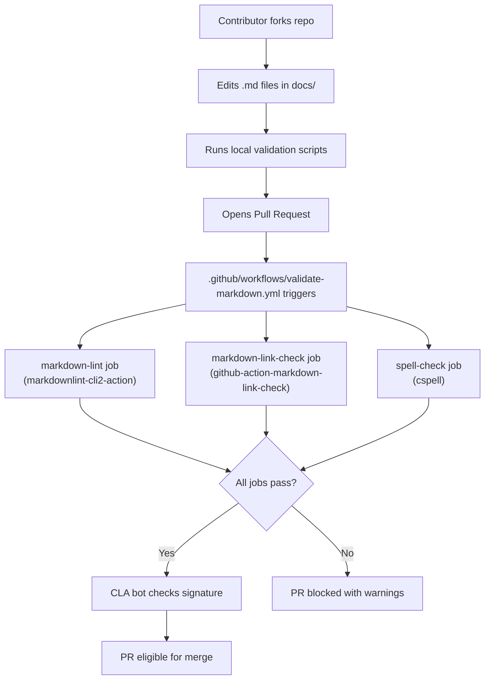
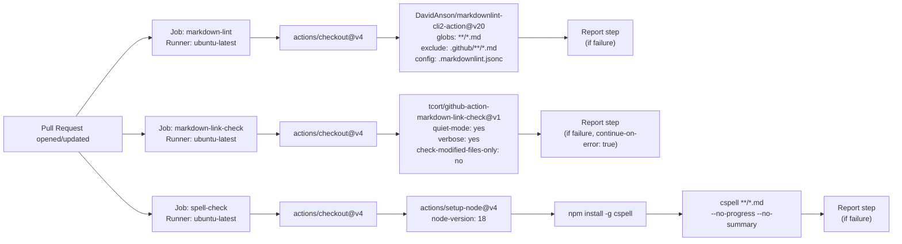
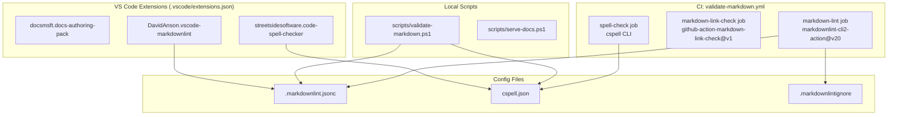

<!-- source: DeepWiki mcp.deepwiki.com · repo microsoft/agent-academy · page 6 Contributing · fetched 2026-10-26 -->

# Contributing

<details>
<summary>Relevant source files</summary>

The following files were used as context for generating this wiki page:

- [.github/workflows/validate-markdown.yml](.github/workflows/validate-markdown.yml)
- [.markdownlint.jsonc](.markdownlint.jsonc)
- [.markdownlintignore](.markdownlintignore)
- [.vscode/extensions.json](.vscode/extensions.json)
- [CONTRIBUTING.md](CONTRIBUTING.md)
- [README.md](README.md)
- [SECURITY.md](SECURITY.md)
- [SUPPORT.md](SUPPORT.md)
- [cspell.json](cspell.json)
- [docs/operative/04-automate-triggers/assets/3.1.11.1_triggercondition.png](docs/operative/04-automate-triggers/assets/3.1.11.1_triggercondition.png)
- [docs/operative/04-automate-triggers/index.md](docs/operative/04-automate-triggers/index.md)
- [docs/operative/05-model-selection/assets/5.0_05_AIProvidersOperatingAsMicrosoftSubProcessors.png](docs/operative/05-model-selection/assets/5.0_05_AIProvidersOperatingAsMicrosoftSubProcessors.png)
- [docs/operative/05-model-selection/index.md](docs/operative/05-model-selection/index.md)
- [scripts/serve-docs.ps1](scripts/serve-docs.ps1)
- [scripts/validate-markdown.ps1](scripts/validate-markdown.ps1)

</details>


This page documents the processes and tooling required to contribute to the Agent Academy repository. It covers content standards, markdown linting, spell checking, and the automated CI workflow that validates all pull requests.

For information about how the documentation site is built and deployed, see [Documentation Site](#4). For information about running the site locally, see [Local Development and Deployment](#4.2).

---

## Overview

All contributions to this repository go through a pull request process enforced by two mechanisms:

1. **Manual standards** — content written following the Microsoft Docs Authoring Pack guidelines.
2. **Automated checks** — a GitHub Actions workflow (`validate-markdown.yml`) that runs linting, link checking, and spell checking on every PR.

The following diagram shows the overall contribution pipeline.

**Contribution validation pipeline**



Sources: [.github/workflows/validate-markdown.yml:1-79](), [CONTRIBUTING.md:1-30]()

---

## Documentation Standards

Content must follow Microsoft's documentation guidelines. The recommended reference is the **Microsoft Docs Authoring Pack** (`docsmsft.docs-authoring-pack`), which is listed as a recommended VS Code extension in [.vscode/extensions.json:4]().

The authoring pack covers:

- Clear, concise writing
- Proper markdown syntax
- Consistent terminology
- Effective document structure
- Accessibility best practices

---

## Markdown Linting

The repository uses `markdownlint-cli2` to enforce consistent markdown formatting.

### Configuration — `.markdownlint.jsonc`

Rules are configured in [.markdownlint.jsonc:1-32](). The table below summarizes the active overrides.

| Rule | Status | Justification |
|---|---|---|
| `MD013` (line-length) | Disabled | No line length standard defined |
| `MD024` (duplicate headings) | `siblings_only: true` | Common template sub-heading format |
| `MD029` (ordered list prefix) | `style: "one"` | Indented content resets numbering |
| `MD046` (code-block style) | Disabled | Code blocks used for plain text |
| `MD060` (table-column style) | Disabled | Mixed table styles used throughout |

All other rules remain enabled at their default state ([.markdownlint.jsonc:6]()).

Files under `.github/` are excluded via [.markdownlintignore:1]().

### Running Locally

Install the tool globally:

```bash
npm install -g markdownlint-cli2
```

Common commands from [CONTRIBUTING.md:37-45]():

```bash
# Scan all markdown files
markdownlint-cli2 "**/*.md"

# Scan a specific file
markdownlint-cli2 "docs/recruit/README.md"

# Auto-fix resolvable issues
markdownlint-cli2 --fix "**/*.md"
```

### Inline Rule Exceptions

When the global configuration does not cover a specific case, contributors can disable rules inline. The three available scopes are:

| Scope | Syntax |
|---|---|
| Next line only | `<!-- markdownlint-disable-next-line MD029 -->` |
| Block range | `<!-- markdownlint-disable MD029 -->` … `<!-- markdownlint-enable MD029 -->` |
| Entire file | Place `<!-- markdownlint-disable MD029 -->` at the top of the file |

**When to use exceptions** ([CONTRIBUTING.md:96-103]()):

| Rule | Typical reason for exception |
|---|---|
| `MD029` | Continuing numbered lists after other content |
| `MD013` | URLs or code examples that cannot be line-broken |
| `MD033` | HTML elements not achievable in plain markdown |
| `MD041` | Template files that intentionally omit a leading heading |

**Best practices:** Use `markdownlint-disable-next-line` where possible; add a comment explaining why; run the linter before committing.

### Common Errors and Fixes

| Error code | Fix |
|---|---|
| `MD036` | Use `## Heading` instead of `**Bold text**` |
| `MD007` | Indent unordered lists with 2 spaces, not 4 |
| `MD022` | Add blank lines before and after headings |
| `MD032` | Add blank lines before and after lists |
| `MD009` | Remove trailing spaces at end of lines |

Sources: [.markdownlint.jsonc:1-32](), [.markdownlintignore:1](), [CONTRIBUTING.md:19-125]()

---

## Spell Checking

Spell checking is performed by `cspell` (Code Spell Checker).

### Configuration — `cspell.json`

The configuration file is [cspell.json:1-99](). It specifies:

- **`language`**: `"en"` — English spell checking.
- **`words`**: A custom allow-list of domain-specific terms.
- **`ignorePaths`**: File patterns excluded from checking.

**Custom word list** (selected examples from [cspell.json:4-88]()):

| Word | Category |
|---|---|
| `Dataverse`, `powerapps`, `powerplatform` | Microsoft platform terms |
| `agentic`, `multimodal`, `HITL` | AI/agent domain terms |
| `Contoso`, `Entra` | Microsoft product names |
| `azurecontainerapps`, `devtunnel` | Infrastructure terms |
| `mcsmcplab`, `Streamable` | Repository-specific identifiers |
| `BYOM`, `SSML`, `DTMF` | Abbreviations used in course content |

**Ignored paths** ([cspell.json:89-98]()):

```
node_modules/**
.git/**
.github/**
*.js  *.css  *.min.js  *.map  *.html
```

### Running Locally

Install the tool globally:

```bash
npm install -g cspell
```

Common commands from [CONTRIBUTING.md:164-178]():

```bash
# Check all markdown files in the repository
cspell "**/*.md" --no-progress --no-summary

# Check docs folder only
cspell "docs/**/*.md"

# Show suggestions for flagged words
cspell --show-suggestions "docs/**/*.md"
```

### Adding New Words

If a legitimate term is flagged, add it to the `words` array in `cspell.json`:

```json
{
  "words": [
    "YourNewTechnicalTerm"
  ]
}
```

With the VS Code `streetsidesoftware.code-spell-checker` extension (listed in [.vscode/extensions.json:3]()), right-clicking a flagged word and selecting **Spelling → Add to cSpell configuration** performs this automatically.

Sources: [cspell.json:1-99](), [CONTRIBUTING.md:147-217](), [.vscode/extensions.json:1-8]()

---

## CI Workflow — `validate-markdown.yml`

The workflow at [.github/workflows/validate-markdown.yml:1-79]() runs on every pull request against any branch except `gh-pages`.

**Workflow job structure**



Sources: [.github/workflows/validate-markdown.yml:1-79]()

### Job Summary

| Job | Tool | `continue-on-error` | Blocks PR |
|---|---|---|---|
| `markdown-lint` | `markdownlint-cli2-action@v20` | `false` | Yes |
| `markdown-link-check` | `github-action-markdown-link-check@v1` | `true` | No (warning only) |
| `spell-check` | `cspell` (Node 18) | `false` | Yes |

Note: `markdown-link-check` is set to `continue-on-error: true` ([.github/workflows/validate-markdown.yml:43]()) because external links can fail transiently. The other two jobs fail the PR.

---

## Local Validation Script

A convenience PowerShell script at [scripts/validate-markdown.ps1:1-10]() runs both `markdownlint-cli2` and `cspell` in sequence, excluding `.venv`, `.github`, and `node_modules`. Run it from the repository root:

```powershell
./scripts/validate-markdown.ps1
```

A separate script, [scripts/serve-docs.ps1:1-59](), validates Node.js/npm availability and launches the VitePress development server. See [Local Development and Deployment](#4.2) for full details.

Sources: [scripts/validate-markdown.ps1:1-10](), [scripts/serve-docs.ps1:1-59]()

---

## Tooling Map

The following diagram maps the contributing tools to their configuration files and the code entities that invoke them.

**Tool-to-file relationships**



Sources: [.github/workflows/validate-markdown.yml:1-79](), [.markdownlint.jsonc:1-32](), [cspell.json:1-99](), [.markdownlintignore:1](), [scripts/validate-markdown.ps1:1-10](), [.vscode/extensions.json:1-8]()

---

## Contributor License Agreement (CLA)

When submitting a pull request, a CLA bot automatically checks whether the contributor has signed the **Contributor License Agreement**. If not, the bot posts a comment with instructions.

- The CLA only needs to be signed once across all Microsoft repositories.
- Details: `https://cla.opensource.microsoft.com`

---

## Code of Conduct

This project follows the **Microsoft Open Source Code of Conduct**.

- Full text: `https://opensource.microsoft.com/codeofconduct/`
- FAQ: `https://opensource.microsoft.com/codeofconduct/faq/`
- Contact: `opencode@microsoft.com`

Sources: [README.md:12-23]()

---

## Summary Checklist

Before opening a pull request:

| Step | Command |
|---|---|
| Run markdownlint | `markdownlint-cli2 "**/*.md"` |
| Run spell check | `cspell "**/*.md" --no-progress --no-summary` |
| Run both at once | `./scripts/validate-markdown.ps1` |
| Preview the site locally | `npm run docs:dev` or `./scripts/serve-docs.ps1` |
| Sign the CLA | Follow CLA bot instructions on the PR |