# Page: Overview

# Overview

<details>
<summary>Relevant source files</summary>

The following files were used as context for generating this wiki page:

- [README.md](README.md)
- [docs/commander/index.md](docs/commander/index.md)
- [docs/images/mcs-agent-academy-commander-badge.png](docs/images/mcs-agent-academy-commander-badge.png)
- [docs/images/mcs-agent-academy-commander-banner.png](docs/images/mcs-agent-academy-commander-banner.png)
- [docs/images/mcs-agent-academy-operative-badge.png](docs/images/mcs-agent-academy-operative-badge.png)
- [docs/images/mcs-agent-academy-operative-banner.png](docs/images/mcs-agent-academy-operative-banner.png)
- [docs/images/mcs-agent-academy-recruit-badge.png](docs/images/mcs-agent-academy-recruit-badge.png)
- [docs/images/mcs-agent-academy-recruit-banner.png](docs/images/mcs-agent-academy-recruit-banner.png)
- [docs/index.md](docs/index.md)
- [docs/operative/index.md](docs/operative/index.md)
- [docs/our-team/index.md](docs/our-team/index.md)
- [docs/recruit/index.md](docs/recruit/index.md)

</details>


This page covers the purpose, structure, and major components of the **Copilot Studio Agent Academy** repository. For details on individual course tracks, see the [Course Tracks](#2) page. For the documentation site implementation, see [Documentation Site](#4).

---

## Purpose

The `microsoft/agent-academy` repository hosts a self-paced, hands-on training platform for building AI agents with **Microsoft Copilot Studio**. The curriculum is organized into three ranked course tracks of increasing difficulty, plus standalone lab missions called Special Ops. The public-facing course is served as a static documentation site at `https://aka.ms/agent-academy`.

---

## Repository Structure

The repository contains five major components:

| Component | Location | Purpose |
|---|---|---|
| Course content | `docs/recruit/`, `docs/operative/`, `docs/commander/` | Markdown source for all course modules |
| Special Ops labs | `docs/special-ops/` | Standalone mission content |
| Documentation site | `docs/`, `package.json`, `.vitepress/` | VitePress site configuration and build |
| MCP server source | `special-ops/mcs-mcp/` | TypeScript Express MCP server for the MCS MCP lab |
| CI/CD & tooling | `.github/workflows/`, `.markdownlint*`, `cspell.json` | Deployment, linting, spell checking |

Sources: [README.md:1-31](), [docs/index.md:1-84]()

---

## Rank Progression Model

The academy uses a three-rank progression model. Each rank requires completion of the previous rank (except Special Ops, which is rank-independent).

**Diagram: Rank Progression and Prerequisites**

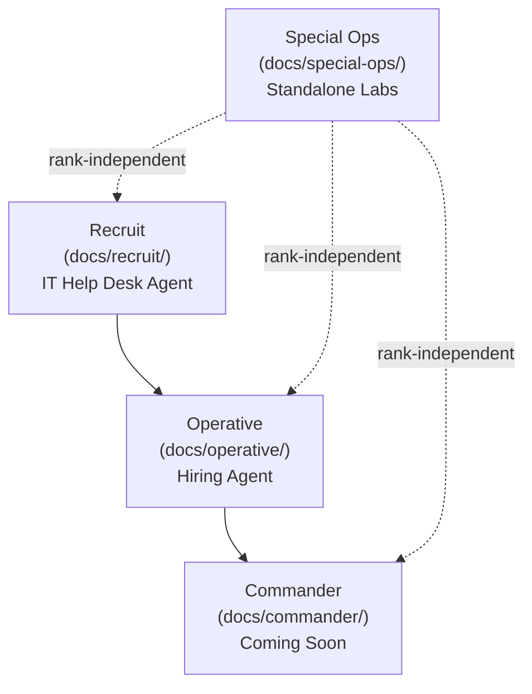

Sources: [docs/index.md:13-28](), [docs/recruit/index.md:1-50](), [docs/operative/index.md:1-76](), [docs/commander/index.md:1-13]()

---

## Major Components

### Course Content

All course content is written in Markdown and lives under `docs/`. Each rank has an `index.md` landing page and numbered module subdirectories.

| Rank | Entry Point | Status |
|---|---|---|
| Recruit | `docs/recruit/index.md` | Active |
| Operative | `docs/operative/index.md` | Active |
| Commander | `docs/commander/index.md` | Preview / Coming Soon |
| Special Ops | `docs/special-ops/index.md` | Active |

The Recruit track builds an **IT Help Desk Agent** across 13 modules ([docs/recruit/index.md:48-65]()). The Operative track builds a **Hiring Agent** across 12 missions ([docs/operative/index.md:53-72]()). Commander is not yet publicly available ([docs/commander/index.md:5-7]()).

Sources: [docs/recruit/index.md:44-65](), [docs/operative/index.md:53-72]()

---

### Documentation Site

The course is published as a VitePress static site. The `docs/` directory contains all Markdown source files, and the site is deployed to GitHub Pages on push to `main`. For build and deployment details, see [Local Development and Deployment](#4.2).

The main landing page is `docs/index.md`, which renders the rank progression table, Special Ops links, and prerequisites.

Sources: [docs/index.md:1-84]()

---

### MCP Server Source

The Special Ops MCS MCP lab includes a runnable TypeScript MCP server. This is one of the few components in the repository that contains executable source code rather than documentation. It is covered in detail in [MCS MCP Lab](#3.1).

---

### Badge and Completion System

Upon completing a rank, learners can claim a digital badge. The badge system uses:

- **GitHub Issue templates** for submission
- **GitHub Actions** to post badge form links to completed issues
- An external **Badge Validation Form** and the **Global AI Community** platform for issuance

Badge images are stored in `docs/images/` (e.g., `mcs-agent-academy-recruit-badge.png`, `mcs-agent-academy-operative-badge.png`, `mcs-agent-academy-commander-badge.png`).

For the full badge workflow, see [Badge and Completion System](#5).

Sources: [docs/index.md:17-22]()

---

### CI/CD and Tooling

| Workflow | File | Trigger |
|---|---|---|
| Deploy documentation | `.github/workflows/deploy-vitepress.yml` | Push to `main` |
| Validate markdown | `.github/workflows/validate-markdown.yml` | Pull request |
| Badge automation | `.github/workflows/` (badge workflow) | Issue closed |

Markdown quality is enforced with `markdownlint-cli2` and spell checking with `cspell` (word list at `cspell.json`). For contributing guidelines, see [Contributing](#6).

Sources: [README.md:9-23]()

---

## Component Relationship Diagram

The following diagram maps the major repository components to their corresponding file locations.

**Diagram: Repository Components and File Layout**

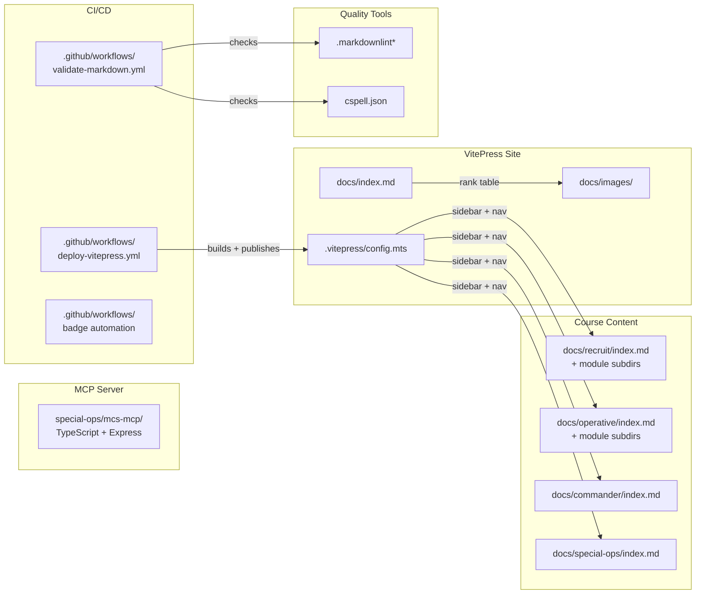

Sources: [README.md:1-31](), [docs/index.md:1-84](), [docs/recruit/index.md:1-10](), [docs/operative/index.md:1-13](), [docs/commander/index.md:1-13]()

---

## Environment and Licensing Notes

The platform does not provide environments. Learners must supply their own Microsoft 365 / Power Platform tenant. Key access requirements stated in `docs/index.md`:

- Ability to **upload and import solutions** into a Power Platform environment
- Access to **Microsoft Dataverse**
- Access to the **Frontier program** (for the MCP module in Operative)
- **Administrative permissions** to create agents and configure settings

Free trial paths are documented within the course setup modules.

Sources: [docs/index.md:38-55]()

---

## Related Courses

The repository links to several external courses for learners wanting broader context:

| Resource | Topic |
|---|---|
| Copilot Developer Camp | Declarative agents, custom engine agents, M365 extensibility |
| MCP for Beginners | Model Context Protocol fundamentals |
| AI Agents for Beginners | Agent design patterns, multi-agent systems, agentic RAG |

Sources: [docs/index.md:57-64]()

---

# Page: Course Tracks

# Course Tracks

<details>
<summary>Relevant source files</summary>

The following files were used as context for generating this wiki page:

- [README.md](README.md)
- [docs/commander/index.md](docs/commander/index.md)
- [docs/index.md](docs/index.md)
- [docs/operative/index.md](docs/operative/index.md)
- [docs/our-team/index.md](docs/our-team/index.md)
- [docs/recruit/index.md](docs/recruit/index.md)

</details>


This page describes the three-rank progression model used in Copilot Studio Agent Academy, the prerequisite relationship between ranks, and the Special Ops standalone lab system. It also summarizes the curriculum philosophy and intended audiences for each track.

For detailed module-by-module documentation of each track, see:
- [Recruit Track](#2.1)
- [Operative Track](#2.2)
- [Commander Track](#2.3)
- [Special Ops Labs](#3)

---

## Rank Progression Model

The Academy is structured as a three-rank system. Each rank represents a distinct skill tier and awards a digital badge upon completion. Ranks must be completed in order; each rank is a prerequisite for the next.

| Rank | Symbol | Status | Starting Point |
|---|:---:|---|---|
| 🟢 **Recruit** | `•` | Available | `docs/recruit/index.md` |
| 🔵 **Operative** | `••` | Available | `docs/operative/index.md` |
| 🟡 **Commander** | `•••` | Preview / Coming Soon | `docs/commander/index.md` |

Sources: [docs/index.md:17-23]()

---

## Prerequisite Chain

**Rank progression is strictly sequential.** A learner must complete Recruit before starting Operative, and Operative before starting Commander. The Operative track index explicitly states this requirement.

**Rank dependency diagram:**

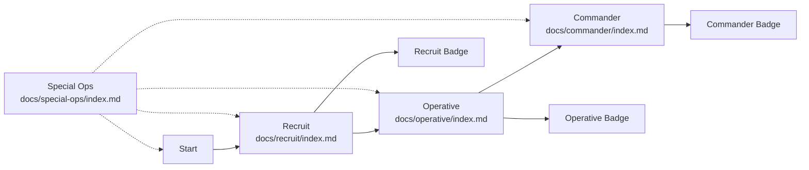

*Dashed lines from Special Ops indicate that these labs can be started at any point in the progression, with no prerequisite.*

Sources: [docs/index.md:23-29](), [docs/operative/index.md:29-35](), [docs/recruit/index.md:65-67]()

---

## Track Summaries

### Recruit

The Recruit track is the entry point to the Academy. It is structured as 14 sequential lessons (modules `00` through `13`) and builds a single project — an **IT Help Desk Agent** — across the course.

**Target audience:**

| Audience | Description |
|---|---|
| Makers | Exploring Copilot Studio for the first time |
| Developers | Building Microsoft 365 Copilot extensions |
| Power Platform users | Leveling up with intelligent agents |
| Hands-on learners | Prefer to learn by doing |

**Prerequisites:**
- Microsoft 365 Developer tenant (with SharePoint enabled)
- Microsoft Copilot Studio (trial or licensed)
- Optional: Basic knowledge of SharePoint, Power Platform, or Power Fx

**Curriculum snapshot:**

| Module | Title |
|---|---|
| `00` | Course Setup |
| `01` | Introduction to Agents |
| `02` | Copilot Studio Fundamentals |
| `03` | Create a Declarative Agent |
| `04` | Creating a Solution |
| `05` | Get Started with Pre-Built Agents |
| `06` | Build a Custom Agent |
| `07` | Add a Topic with Triggers |
| `08` | Enhance with Adaptive Cards |
| `09` | Automate with Agent Flows |
| `10` | Add Event Triggers |
| `11` | Publish Your Agent |
| `12` | Understanding Licensing |
| `13` | Securing Your Recruit Badge |

Sources: [docs/recruit/index.md:36-67]()

---

### Operative

The Operative track assumes Recruit completion. It consists of 12 missions (modules `01` through `12`) and builds a **Hiring Agent** — a multi-agent system that automates an enterprise hiring workflow.

**Target audience:**

| Audience | Description |
|---|---|
| Solution architects | Designing enterprise AI systems |
| Developers | Building production-ready agent solutions |
| IT professionals | Implementing AI governance and safety |
| Business analysts | Creating complex automation workflows |

**Prerequisites:**
- Completed Recruit training
- Power Platform environment with Copilot Studio license or trial
- Access to Microsoft Dataverse
- Administrative permissions to create solutions and agents
- Access to the Frontier Program (required for MCP module)

**Curriculum snapshot:**

| Mission | Title |
|---|---|
| `01` | Get Started with the Hiring Agent |
| `02` | Authoring Agent Instructions |
| `03` | Make Your Agent Multi-Agent Ready |
| `04` | Automate Your Agent with Triggers |
| `05` | Understanding Agent Models and Response Formatting |
| `06` | Content Moderation and AI Safety Essentials |
| `07` | Extracting Resume Contents with Multi-Modal Prompts |
| `08` | Prompts — Dataverse Grounding |
| `09` | Generating an Interview Prep Document |
| `10` | Integrate with MCP Servers |
| `11` | Obtain User Feedback with Adaptive Cards |
| `12` | Course Completion Badges |

Sources: [docs/operative/index.md:56-74]()

---

### Commander (Preview)

The Commander track is currently in preview and not yet publicly available. Its index page at `docs/commander/index.md` contains only a placeholder. When released, it will require completion of the Operative track.

See [Commander (Preview)](#2.3) for full documentation of its planned curriculum.

Sources: [docs/commander/index.md:1-12]()

---

## Special Ops

Special Ops are standalone labs that are **not part of the rank progression**. They have no rank prerequisite and can be completed at any time, in any order, independently of the Recruit → Operative → Commander chain.

They are intended as focused, single-topic skill exercises — described in the docs as "side missions."

The two currently available Special Ops labs are:

| Lab | Topic |
|---|---|
| MCS MCP | Connecting a custom MCP server to Copilot Studio |
| PAC CLI MCP | Managing Power Platform environments via AI and the `pac` CLI |

See [Special Ops Labs](#3) for full documentation.

Sources: [docs/index.md:25-29]()

---

## Directory Structure

The following diagram maps each track to its corresponding directory and index file in the repository.

**Repository layout for course tracks:**

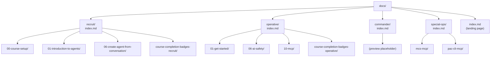

Sources: [docs/recruit/index.md:48-63](), [docs/operative/index.md:56-70](), [docs/commander/index.md:1-12](), [docs/index.md:25-29]()

---

## Curriculum Philosophy

The Academy applies several consistent design principles across all tracks:

**Progressive difficulty.** Each rank, and each module within a rank, explicitly builds on the previous one. Learners who skip modules may encounter missing dependencies (solutions, agents, data) that block progress in later modules. This is documented in the landing page as an intentional design constraint.

**Bring your own environment.** The Academy does not provision environments. Learners must supply their own Microsoft 365 tenant and Power Platform environment. Free trials are supported but time-limited.

**Skipping is allowed but has consequences.** If a module requires a capability unavailable in a learner's environment, it can be skipped. However, since many modules depend on artifacts created in prior modules, skipping may require manual workarounds.

**Badge-gated completion.** Each rank concludes with a badge submission mission. Earning the badge requires submitting evidence through the GitHub issue and badge form system described in [Badge and Completion System](#5).

Sources: [docs/index.md:33-55](), [docs/recruit/index.md:65-67](), [docs/operative/index.md:29-38]()

---

# Page: Recruit Track

# Recruit Track

<details>
<summary>Relevant source files</summary>

The following files were used as context for generating this wiki page:

- [docs/commander/index.md](docs/commander/index.md)
- [docs/index.md](docs/index.md)
- [docs/operative/index.md](docs/operative/index.md)
- [docs/our-team/index.md](docs/our-team/index.md)
- [docs/recruit/00-course-setup/index.md](docs/recruit/00-course-setup/index.md)
- [docs/recruit/02-copilot-studio-fundamentals/index.md](docs/recruit/02-copilot-studio-fundamentals/index.md)
- [docs/recruit/03-create-a-declarative-agent-for-M365Copilot/index.md](docs/recruit/03-create-a-declarative-agent-for-M365Copilot/index.md)
- [docs/recruit/06-create-agent-from-conversation/index.md](docs/recruit/06-create-agent-from-conversation/index.md)
- [docs/recruit/07-add-new-topic-with-trigger/index.md](docs/recruit/07-add-new-topic-with-trigger/index.md)
- [docs/recruit/08-add-adaptive-card/assets/8.0_04_AdaptiveCardDesignerSamples.png](docs/recruit/08-add-adaptive-card/assets/8.0_04_AdaptiveCardDesignerSamples.png)
- [docs/recruit/08-add-adaptive-card/index.md](docs/recruit/08-add-adaptive-card/index.md)
- [docs/recruit/09-add-an-agent-flow/index.md](docs/recruit/09-add-an-agent-flow/index.md)
- [docs/recruit/10-add-event-triggers/assets/10_AllowConnector.png](docs/recruit/10-add-event-triggers/assets/10_AllowConnector.png)
- [docs/recruit/10-add-event-triggers/assets/10_ConfigureInputParameters.png](docs/recruit/10-add-event-triggers/assets/10_ConfigureInputParameters.png)
- [docs/recruit/10-add-event-triggers/assets/10_ConfigureTriggerNameAndConnections.png](docs/recruit/10-add-event-triggers/assets/10_ConfigureTriggerNameAndConnections.png)
- [docs/recruit/10-add-event-triggers/assets/10_ConfigureTriggerParams.png](docs/recruit/10-add-event-triggers/assets/10_ConfigureTriggerParams.png)
- [docs/recruit/10-add-event-triggers/assets/10_CreateTestTicket.png](docs/recruit/10-add-event-triggers/assets/10_CreateTestTicket.png)
- [docs/recruit/10-add-event-triggers/assets/10_EditTriggerInPowerAutomate.png](docs/recruit/10-add-event-triggers/assets/10_EditTriggerInPowerAutomate.png)
- [docs/recruit/10-add-event-triggers/assets/10_EnableGenerativeAI.png](docs/recruit/10-add-event-triggers/assets/10_EnableGenerativeAI.png)
- [docs/recruit/10-add-event-triggers/assets/10_InsertExpressionForTrigger.png](docs/recruit/10-add-event-triggers/assets/10_InsertExpressionForTrigger.png)
- [docs/recruit/10-add-event-triggers/assets/10_MonitorTriggerTest.png](docs/recruit/10-add-event-triggers/assets/10_MonitorTriggerTest.png)
- [docs/recruit/10-add-event-triggers/assets/10_NavigateToTrigger.png](docs/recruit/10-add-event-triggers/assets/10_NavigateToTrigger.png)
- [docs/recruit/10-add-event-triggers/assets/10_SelectOutlookConnector.png](docs/recruit/10-add-event-triggers/assets/10_SelectOutlookConnector.png)
- [docs/recruit/10-add-event-triggers/index.md](docs/recruit/10-add-event-triggers/index.md)
- [docs/recruit/12-understanding-licensing/index.md](docs/recruit/12-understanding-licensing/index.md)
- [docs/recruit/index.md](docs/recruit/index.md)

</details>


## Purpose and Scope

This page documents the Recruit training path in full: all 14 missions (numbered 00–12, plus a badge completion mission), the environment prerequisites, and the key technical concepts introduced at each stage. The primary lab artifact is the **Contoso Helpdesk Agent**, assembled incrementally across missions 06–10.

The Recruit track is the prerequisite for the [Operative Track](#2.2) and [Commander (Preview)](#2.3). For standalone labs that require no rank completion, see [Special Ops Labs](#3). For the badge awarded upon completing the track, see [Badge and Completion System](#5).

---

## Prerequisites

Defined in [docs/recruit/index.md:29-33]().

| Requirement | Details |
|---|---|
| Microsoft 365 Developer tenant | SharePoint must be enabled |
| Copilot Studio access | Trial or licensed; trial setup is in Mission 00 |
| Power Apps Developer environment | Created in Mission 00 via the Developer Plan |
| Optional | Basic familiarity with SharePoint, Power Platform, or Power Fx |

## Target Audience

From [docs/recruit/index.md:36-42]().

- Makers and developers new to Copilot Studio
- IT professionals building M365 Copilot extensions
- Power Platform users adding intelligent agents to existing workflows
- Learners who prefer hands-on labs over theory-first courses

---

## Curriculum Overview

All 14 missions are listed in [docs/recruit/index.md:48-64](). Each mission lives in a numbered subdirectory under `docs/recruit/`.

| Mission | Title | Codename | Key Concepts | Est. Time |
|---|---|---|---|---|
| `00` | Course Setup | `OPERATION DEPLOYMENT READY` | M365 tenant, Copilot Studio trial, developer environment, SharePoint site | ~30 min |
| `01` | Introduction to Agents | — | LLMs, RAG, declarative vs. custom agents | — |
| `02` | Copilot Studio Fundamentals | `OPERATION CORE PROTOCOL` | Knowledge, Tools, Topics, Instructions | ~30 min |
| `03` | Deploy a Declarative Agent for M365 Copilot | `OPERATION COPILOT EXTENSION` | Declarative agents, AI prompts, M365 Copilot + Teams publishing | ~60 min |
| `04` | Creating a Solution | — | Solution publishers, preferred solution, environment management | — |
| `05` | Get Started with Pre-Built Agents | — | Pre-built agent templates | — |
| `06` | Build a Custom Agent | `OPERATION AGENT FORGE` | Natural language authoring, knowledge sources, generative orchestration | ~75 min |
| `07` | Add a Topic with Triggers | `OPERATION STAY ON TOPIC` | Topics, trigger phrases, conversation nodes, SharePoint connector, Power Fx | ~60 min |
| `08` | Enhance with Adaptive Cards | `OPERATION INTERFACE UPLIFT` | Adaptive Cards, JSON, Power Fx `ForAll`/`IsBlank` formulas | ~45 min |
| `09` | Automate with Agent Flows | `OPERATION AUTOMATION POWERHOUSE` | Agent flows, deterministic automation, SharePoint + Outlook connectors | ~30 min |
| `10` | Add Event Triggers | `OPERATION GHOST ROUTINE` | Event triggers, autonomous agents, `When an item is created` (SharePoint) | ~45 min |
| `11` | Publish Your Agent | — | Teams channel, M365 Copilot channel, availability options | — |
| `12` | Understanding Licensing | `OPERATION KNOW WHAT YOU OWE` | Copilot Credits, PAYGO, capacity packs, CCCUs | ~15 min |
| `13` | Securing Your Recruit Badge | — | Badge submission form, evidence screenshots | — |

**Curriculum progression mapped to source directories**

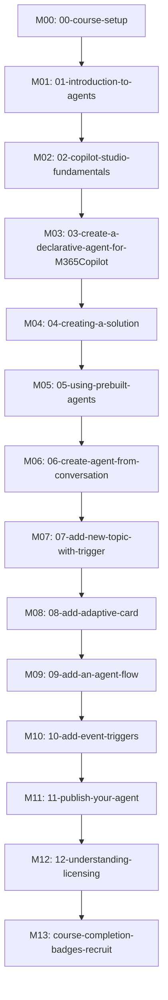

Sources: [docs/recruit/index.md:48-64]()

---

## The Two Agents Built

The track builds two distinct agents at different points in the curriculum.

### Contoso Tech Support Pro (Mission 03)

Source: [docs/recruit/03-create-a-declarative-agent-for-M365Copilot/index.md]()

| Property | Value |
|---|---|
| Agent name | `Contoso Tech Support Pro` |
| Type | Declarative agent for Microsoft 365 Copilot |
| Prompt tool | `IT Expert` (parameter: `problem input`) |
| Published channels | Microsoft 365 Copilot, Microsoft Teams |
| Default model | Basic GPT-4.1 mini |

This agent is standalone — it is not extended in later missions.

### Contoso Helpdesk Agent (Missions 06–10)

Source: [docs/recruit/06-create-agent-from-conversation/index.md]() through [docs/recruit/10-add-event-triggers/index.md]()

Created in Mission 06 via natural language authoring, then extended with a topic (07), an adaptive card topic (08), an agent flow (09), and a SharePoint event trigger (10).

**Contoso Helpdesk Agent — components mapped to source files and code identifiers**

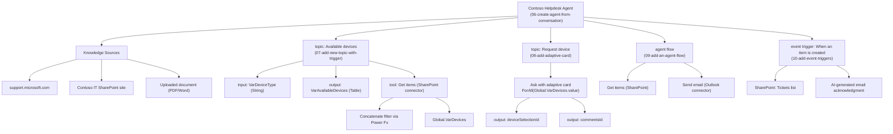

Sources: [docs/recruit/06-create-agent-from-conversation/index.md](), [docs/recruit/07-add-new-topic-with-trigger/index.md](), [docs/recruit/08-add-adaptive-card/index.md](), [docs/recruit/09-add-an-agent-flow/index.md](), [docs/recruit/10-add-event-triggers/index.md]()

---

## Key Technical Concepts

### Four Building Blocks of an Agent (Mission 02)

Introduced in [docs/recruit/02-copilot-studio-fundamentals/index.md:65-74](). Every Copilot Studio agent is composed of these four elements:

| Building Block | Role | Missions Where Applied |
|---|---|---|
| **Knowledge** | Data sources queried to answer questions (SharePoint, Dataverse, websites, uploaded files) | 02, 06 |
| **Tools** | Actions executed by the agent: connectors, agent flows, AI prompts, REST APIs, MCP servers | 03, 07, 09 |
| **Topics** | Named conversation flows activated by user input or generative orchestration | 07, 08 |
| **Instructions** | System-level prompt defining the agent's persona, tone, and behavioral constraints | 02, 03, 06 |

At runtime, the Copilot Studio orchestrator uses generative AI to decide which topic to invoke or which tool to call based on the user message and the agent's instructions. This is referred to as **generative orchestration** in the curriculum.

Sources: [docs/recruit/02-copilot-studio-fundamentals/index.md:184-220]()

---

### Knowledge Sources (Mission 06)

Source: [docs/recruit/06-create-agent-from-conversation/index.md:154-182]()

| Source Type | Backed By | Auth Required |
|---|---|---|
| Public websites | Bing search over specified URLs | No |
| Documents | Uploaded PDFs/Word files stored in Dataverse | No |
| SharePoint | SharePoint folders/files via Work IQ | Yes — user permissions respected |
| Dataverse | Structured table rows; supports synonym/glossary definitions | Yes |
| Connectors | Live data from Salesforce, ServiceNow, Dynamics 365, etc. | Yes |
| Azure AI Search | Vector and semantic search over large document collections | Yes (Azure account) |

When a knowledge source requires user authentication, the agent returns only data the authenticated user has access to. The `Contoso IT` SharePoint site added in Mission 06 uses this mechanism.

---

### Topics and Triggers (Mission 07)

Source: [docs/recruit/07-add-new-topic-with-trigger/index.md]()

A **topic** is a structured conversation unit with a trigger, a sequence of conversation nodes, and optional input/output variable declarations defined in the topic's `Details` pane.

**Topic purposes:**

| Purpose | Example user input |
|---|---|
| Informational | `"What is the VPN policy?"` |
| Task completion | `"I want to request a device"` |
| Troubleshooting | `"My laptop won't connect to Wi-Fi"` |

**Topic types:**
- **System topics** — built-in; e.g., `Conversational boosting`, `Goodbye`, `Escalate`
- **Custom topics** — user-created; e.g., `Available devices`, `Request device`

**Conversation node types in a topic**

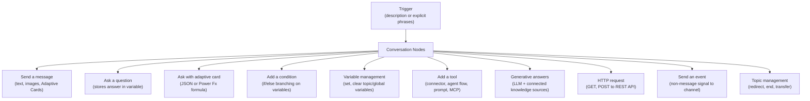

Sources: [docs/recruit/07-add-new-topic-with-trigger/index.md:121-244]()

**Power Fx in topics** ([docs/recruit/07-add-new-topic-with-trigger/index.md:247-268]()):

Power Fx is the low-code expression language used across topics (and Adaptive Cards) to add dynamic logic. Common uses:
- Variable assignment: `Set(userName, "Adele Vance")`
- Branching: `If(score > 80, "Pass", "Fail")`
- Date formatting: `Text(DateValue, "dd/mm/yyyy")`
- Filtering a SharePoint `Get items` result in the `Available devices` topic:

```
Concatenate("Status eq 'Available' and AssetType eq '", Topic.VarDeviceType, "'")
```

The `Available devices` topic defines the following interface ([docs/recruit/07-add-new-topic-with-trigger/index.md:496-565]()):

| Property | Value |
|---|---|
| Input variable | `VarDeviceType` (String; `Identify as: User's entire response`) |
| Input description | `List of possible values: Laptop, Desktop, Smartphone` |
| Output variable | `VarAvailableDevices` (Table) |
| Global variable written | `Global.VarDevices` (stores the raw `Get items` response) |
| SharePoint tool | `Get items` connector action (site: `Contoso IT`, list: `Devices`) |

---

### Adaptive Cards (Mission 08)

Source: [docs/recruit/08-add-adaptive-card/index.md]()

Adaptive Cards are structured JSON objects defining interactive UI elements (text, images, form inputs, buttons) rendered inside Teams, M365 Copilot Chat, or other channels. In topics, they are added via the `Ask with adaptive card` node.

**Two authoring modes:**

| Mode | Description |
|---|---|
| JSON | Static card definition; can be drafted in the external Adaptive Card Designer (`adaptivecards.microsoft.com/designer`) |
| Formula (Power Fx) | Dynamic card using Power Fx; supports referencing topic variables and global variables |

The `Request device` topic uses the Formula mode to populate a device selection list by iterating over `Global.VarDevices.value` with `ForAll` and guarding with `IsBlank`. Output variables declared in element properties (`deviceSelectionId`, `commentsId`) are available downstream in the topic.

**Adaptive Card Designer panels** ([docs/recruit/08-add-adaptive-card/index.md:119-165]()):

| Panel | Purpose |
|---|---|
| Card Elements | Drag-and-drop palette: `TextBlock`, `Image`, `FactSet`, `Input.Text`, `Input.Date`, `Action.Submit`, `Action.OpenUrl` |
| Card Viewer | Live preview updated as elements are added or modified |
| Card Structure | Hierarchy view of nested elements (containers, column sets) |
| Element Properties | Per-element configuration: text, URLs, placeholder values, IDs |
| Card Payload Editor | Raw JSON; changes here are reflected in the visual designer |

**Common use cases in topics:**
- Forms and data collection (device requests, leave requests, feedback)
- Displaying dynamic data from connectors or Dataverse
- Interactive choice selection tied to SharePoint list items

Sources: [docs/recruit/08-add-adaptive-card/index.md:36-246]()

---

### Agent Flows (Mission 09)

Source: [docs/recruit/09-add-an-agent-flow/index.md]()

Agent flows are **deterministic** automation workflows built directly in Copilot Studio. Unlike the AI-driven decision-making of the orchestrator, agent flows follow the same execution path every time given the same inputs.

| Feature | Agent Flows | Power Automate Cloud Flows |
|---|---|---|
| Authoring location | Copilot Studio only | Power Automate portal |
| Licensing | Included in Copilot Studio billing | Requires separate Power Automate license |
| Sharing/co-ownership | Not supported | Supported |
| AI actions | Native support | Via AI Builder |
| Visibility | Copilot Studio only | Cross-platform |

The device request agent flow in Mission 09 runs these steps after a user submits the `Request device` adaptive card:

1. Receive `deviceSelectionId` from the topic output variable
2. `Get items` — retrieve the selected device row from the SharePoint `Devices` list
3. `Send email` (Outlook connector) — notify the manager with device request details

Expressions (Power Automate workflow functions) used in agent flows:
- Text: `concat()`, `toLower()`, `toUpper()`, `substring()`, `trim()`
- Math: `add()`, `sub()`, `mul()`, `div()`
- Date/time: `utcNow()`, `addDays()`, `formatDateTime()`
- Logic: `if()`, `equals()`, `and()`, `or()`
- Utility: `length()`, `guid()`, `coalesce()`

Sources: [docs/recruit/09-add-an-agent-flow/index.md:36-110]()

---

### Event Triggers (Mission 10)

Source: [docs/recruit/10-add-event-triggers/index.md]()

Event triggers enable **autonomous agent behavior** — the agent acts without direct user input, reacting to events in connected systems via a Power Automate cloud flow that forwards a payload to the agent.

**Event trigger execution flow**

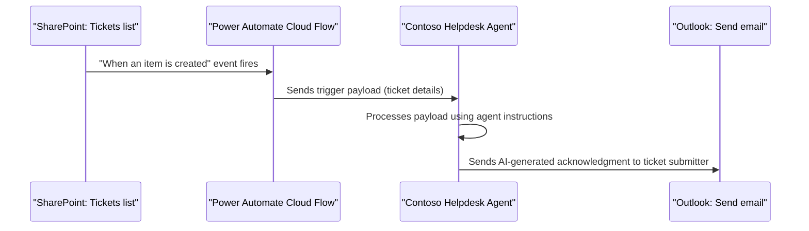

Sources: [docs/recruit/10-add-event-triggers/index.md:71-82]()

**Event trigger vs. topic trigger** ([docs/recruit/10-add-event-triggers/index.md:83-92]()):

| | Event Trigger | Topic Trigger |
|---|---|---|
| Activation | External system event | User input / phrases |
| User interaction required | No | Yes |
| Authentication | Maker's credentials | Option for user credentials |
| Examples | `When an item is created` (SharePoint), new Dataverse record, Microsoft Forms response | User asks about available devices |

**Payload types:**
- **Default payload** — uses the standard connector schema, e.g., `Use content from {Body}`
- **Custom payload** — includes specific agent instructions and data formatting for complex workflows

**Requirements:**
- Generative AI orchestration must be enabled (`Settings → Orchestration → Use generative AI orchestration`)
- Solution-aware cloud flow sharing must be enabled in the Power Platform environment
- Tenant DLP policies must permit the connector used by the trigger

Supported event sources include: SharePoint (`When an item is created`), Dataverse, Microsoft Forms, Planner, Microsoft Teams messages, and scheduled recurrence.

---

### Declarative Agents for M365 Copilot (Mission 03)

Source: [docs/recruit/03-create-a-declarative-agent-for-M365Copilot/index.md]()

A declarative agent is a customized version of Microsoft 365 Copilot, scoped to a specific purpose via custom instructions, enterprise knowledge, and tools. Mission 03 covers building one in Copilot Studio and compares it to Agent Builder in M365 Copilot:

| Feature | Agent Builder in M365 Copilot | Copilot Studio |
|---|---|---|
| Knowledge | Web, SharePoint, Teams chats, Outlook, Copilot connectors | Web (Bing), SharePoint, Dataverse, Dynamics 365, Copilot connectors |
| Tools | Code interpreter, image generator | 1400+ Power Platform connectors, MCP, REST API, custom connectors, computer use |
| Deployment channels | M365 Copilot only | M365 Copilot + Microsoft Teams |
| User sharing | Viewers only | Editors or viewers |

**Publishing availability options after building** ([docs/recruit/03-create-a-declarative-agent-for-M365Copilot/index.md:488-497]()):

| Option | Description |
|---|---|
| Share Link | Distributed link opening the agent in M365 Copilot |
| Show to my teammates and shared users | Named users or security groups |
| Show to everyone in my org | Submitted to tenant admin for org-wide catalog |
| Download as .zip | Manual upload as a custom Teams app |

Developer mode (`-developer on` in the chat) can be used to inspect which tools were matched and executed at runtime via the `Agent Debug Info` card.

---

### Licensing (Mission 12)

Source: [docs/recruit/12-understanding-licensing/index.md]()

Copilot Studio usage is measured in **Copilot Credits**. Every topic invocation, tool call, grounding operation, and connector action consumes credits. Testing in the embedded test chat does not consume credits.

| Plan | Details |
|---|---|
| Pay-As-You-Go (PAYGO) | $0.01/credit, billed via Azure, no upfront commitment |
| Capacity Pack | 25,000 credits/month per pack; pooled at tenant level; credits do not roll over |
| Pre-Purchase (CCCUs) | Annual commitment; 1 CCCU = 100 Copilot Credits; credits do not roll over |

**Maker license requirements:**
- **Copilot Studio Tenant License** — enables Copilot Studio in the tenant (capacity pack or PAYGO)
- **Copilot Studio User License** ($0 cost) — required for any person creating or managing agents

When Microsoft 365 Copilot user licenses are in place, basic internal interactions may be covered. However, **agent flows, connector calls, external publishing, and topic/trigger execution** always draw from the tenant's Copilot Credit capacity, regardless of individual Copilot subscriptions.

---

## Course Setup Details (Mission 00)

Source: [docs/recruit/00-course-setup/index.md]()

Mission 00 consists of five steps, of which steps 1–4 apply only to new trial environments:

| Step | Action | Notes |
|---|---|---|
| 1 | Acquire a Microsoft 365 account | Microsoft 365 Business Basic trial minimum |
| 2 | Start a Copilot Studio trial | Via `aka.ms/TryCopilotStudio`; 30-day trial, extendable to 90 days |
| 3 | Create a Power Apps Developer environment | Via `aka.ms/PowerAppsDevPlan`; provides a free dev environment |
| 4 | Enable publishing | Create `AgentCreators` security group → assign it the **Copilot Studio Authors** role in Power Platform Admin Center (`admin.powerplatform.com → Tenant settings → Copilot Studio authors`) |
| 5 | Create the Contoso IT SharePoint site | Required for all users; uses the IT help desk SharePoint template |

**Devices SharePoint list** (used in missions 07–09):

The `Devices` list is created from the IT help desk template and requires the following columns populated with at least 4 sample rows: `Title`, `Status`, `Manufacturer`, `Model`, `Asset Type`, `Color`, `Serial Number`, `Purchase Date`, `Purchase Price`, `Order #`, and a custom `Image` (Hyperlink type) column. The `Asset Type` column values (`Laptop`, `Desktop`, `Smartphone`) map to the `VarDeviceType` input used in Mission 07's Power Fx filter expression.

Sources: [docs/recruit/00-course-setup/index.md:47-256]()

---

## File Structure

All Recruit track content lives under `docs/recruit/`. Each mission is a subdirectory containing `index.md` and an `assets/` folder of screenshots and supporting files.

```
docs/recruit/
├── index.md                                             ← Curriculum overview and mission table
├── 00-course-setup/index.md
├── 01-introduction-to-agents/index.md
├── 02-copilot-studio-fundamentals/index.md
├── 03-create-a-declarative-agent-for-M365Copilot/index.md
├── 04-creating-a-solution/index.md
├── 05-using-prebuilt-agents/index.md
├── 06-create-agent-from-conversation/index.md
├── 07-add-new-topic-with-trigger/index.md
├── 08-add-adaptive-card/
│   ├── index.md
│   ├── assets/8.1_RequestDevice.json                   ← Adaptive Card JSON payload (placeholder)
│   └── assets/8.1_RequestDeviceFormula.txt             ← Power Fx formula for dynamic card
├── 09-add-an-agent-flow/index.md
├── 10-add-event-triggers/index.md
├── 11-publish-your-agent/index.md
├── 12-understanding-licensing/index.md
└── course-completion-badges-recruit/index.md
```

Sources: [docs/recruit/index.md](), [docs/recruit/08-add-adaptive-card/index.md:323-364]()

---

# Page: Operative Track

# Operative Track

<details>
<summary>Relevant source files</summary>

The following files were used as context for generating this wiki page:

- [cspell.json](cspell.json)
- [docs/commander/index.md](docs/commander/index.md)
- [docs/index.md](docs/index.md)
- [docs/operative/03-multi-agent/index.md](docs/operative/03-multi-agent/index.md)
- [docs/operative/04-automate-triggers/assets/3.1.11.1_triggercondition.png](docs/operative/04-automate-triggers/assets/3.1.11.1_triggercondition.png)
- [docs/operative/04-automate-triggers/index.md](docs/operative/04-automate-triggers/index.md)
- [docs/operative/05-model-selection/assets/5.0_05_AIProvidersOperatingAsMicrosoftSubProcessors.png](docs/operative/05-model-selection/assets/5.0_05_AIProvidersOperatingAsMicrosoftSubProcessors.png)
- [docs/operative/05-model-selection/index.md](docs/operative/05-model-selection/index.md)
- [docs/operative/06-ai-safety/assets/6-conversation-boosting-moderation.png](docs/operative/06-ai-safety/assets/6-conversation-boosting-moderation.png)
- [docs/operative/06-ai-safety/assets/6-error-topic.png](docs/operative/06-ai-safety/assets/6-error-topic.png)
- [docs/operative/06-ai-safety/assets/6-generative-answer-test.png](docs/operative/06-ai-safety/assets/6-generative-answer-test.png)
- [docs/operative/06-ai-safety/assets/6-knowledge-filtered.png](docs/operative/06-ai-safety/assets/6-knowledge-filtered.png)
- [docs/operative/06-ai-safety/index.md](docs/operative/06-ai-safety/index.md)
- [docs/operative/07-multimodal-prompts/index.md](docs/operative/07-multimodal-prompts/index.md)
- [docs/operative/08-dataverse-grounding/assets/8-add-application-5.png](docs/operative/08-dataverse-grounding/assets/8-add-application-5.png)
- [docs/operative/08-dataverse-grounding/index.md](docs/operative/08-dataverse-grounding/index.md)
- [docs/operative/10-mcp/index.md](docs/operative/10-mcp/index.md)
- [docs/operative/11-obtain-user-feedback/index.md](docs/operative/11-obtain-user-feedback/index.md)
- [docs/operative/index.md](docs/operative/index.md)
- [docs/our-team/index.md](docs/our-team/index.md)
- [docs/recruit/index.md](docs/recruit/index.md)

</details>


## Purpose and Scope

This page documents the **Operative Track** — the second rank in the Agent Academy three-rank progression. It covers all 11 training missions that incrementally build an enterprise-grade **Hiring Agent** multi-agent system using Microsoft Copilot Studio. Key topics include multi-agent orchestration, autonomous event-driven triggers, AI model selection, content moderation, multimodal document processing, Dataverse grounding, MCP server integration, and user feedback collection.

For background on the three-rank structure and rank prerequisites, see [Course Tracks](#2). For the Recruit Track (required prerequisite), see [Recruit Track](#2.1). For the Commander Track, see [Commander (Preview)](#2.3). For badge issuance details, see [Badge and Completion System](#5).

---

## Prerequisites

| Requirement | Detail |
|---|---|
| Prior rank | Completed Agent Academy Recruit track |
| Platform | Microsoft Power Platform environment with Copilot Studio license or trial |
| Data | Access to Microsoft Dataverse |
| Permissions | Administrative rights to create solutions and agents |
| Program access | Frontier Program (required for experimental models and MCP features) |

The Operative course does not bundle its own environment setup. If needed, follow Steps 1–4 of the Recruit Course Setup; Step 5 (SharePoint site creation) is not required for this track.

Sources: [docs/operative/index.md:28-38]()

---

## Target Audience

This track is designed for:

- **Solution architects** designing enterprise AI systems
- **Developers** building production-ready agent solutions
- **IT professionals** implementing AI governance and safety controls
- **Business analysts** creating complex automation workflows

Sources: [docs/operative/index.md:42-51]()

---

## Curriculum Overview

All missions are documented under `docs/operative/`. Each mission depends on the agents and artifacts produced by previous missions.

| Mission | Codename | Title | Source File | Time |
|---|---|---|---|---|
| `01` | — | Get started with the Hiring Agent | `docs/operative/01-get-started/index.md` | — |
| `02` | — | Authoring Agent Instructions | `docs/operative/02-agent-instructions/index.md` | — |
| `03` | `OPERATION SYMPHONY` | Multi-Agent Systems | `docs/operative/03-multi-agent/index.md` | ~45 min |
| `04` | `OPERATION SIGNAL POINT` | Add Event Triggers | `docs/operative/04-automate-triggers/index.md` | ~45 min |
| `05` | `OPERATION ARCHETYPE` | Understanding Agent Models and Response Formatting | `docs/operative/05-model-selection/index.md` | ~45 min |
| `06` | `OPERATION SAFE HARBOR` | AI Safety and Content Moderation | `docs/operative/06-ai-safety/index.md` | ~45 min |
| `07` | `DOCUMENT RESUME RECON` | Extracting Resume Contents with Multimodal Prompts | `docs/operative/07-multimodal-prompts/index.md` | ~45 min |
| `08` | `OPERATION GROUNDING CONTROL` | Enhanced Prompts with Dataverse Grounding | `docs/operative/08-dataverse-grounding/index.md` | ~60 min |
| `09` | — | Generating an Interview Prep Document | `docs/operative/09-document-generation/index.md` | — |
| `10` | `OPERATION MCP RENDEZVOUS` | Integrate with MCP Servers | `docs/operative/10-mcp/index.md` | ~45 min |
| `11` | `OPERATION ECHO` | Collecting Feedback from Users | `docs/operative/11-obtain-user-feedback/index.md` | ~45 min |
| `12` | — | Course Completion Badges | `docs/operative/course-completion-badges-operative/index.md` | — |

Sources: [docs/operative/index.md:53-70]()

---

## The Hiring Agent System

The central artifact built across all missions is a **Hiring Agent** — an orchestrator agent coordinating specialized child and connected agents for HR recruitment automation. The system grows mission by mission; later missions add tools, grounding, safety controls, MCP integrations, and feedback collection on top of the base architecture.

**Diagram: Hiring Agent — Multi-Agent System Architecture**

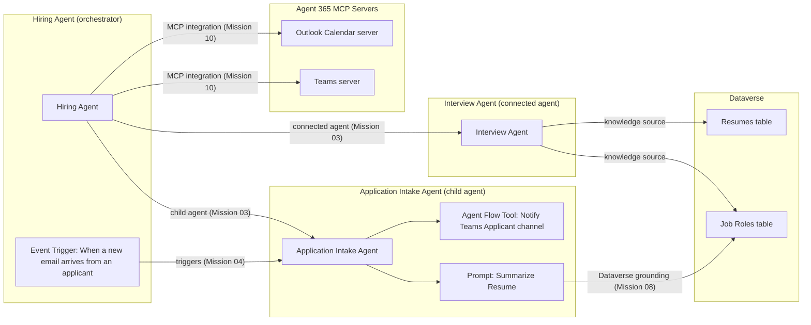

Sources: [docs/operative/03-multi-agent/index.md:40-111](), [docs/operative/04-automate-triggers/index.md:136-158](), [docs/operative/10-mcp/index.md:62-98]()

---

## Mission 01–02: Agent Foundation

**Mission 01** (`docs/operative/01-get-started/index.md`) deploys the foundational infrastructure. It creates the central **Hiring Agent** orchestrator and imports the **Hiring Hub** solution, which provisions Dataverse tables including `Resumes` and `Job Roles`. A model-driven app called **Hiring Hub** is also configured for data entry and management.

**Mission 02** (`docs/operative/02-agent-instructions/index.md`) focuses on crafting precise agent instructions to control agent behavior, scope, tone, and response patterns. Instructions are the primary mechanism for defining what topics the agent will and will not address, and how it should respond.

Sources: [docs/operative/index.md:58-59](), [docs/operative/05-model-selection/index.md:347-348]()

---

## Mission 03: Multi-Agent Architecture

`docs/operative/03-multi-agent/index.md`

This mission transforms the single Hiring Agent into a coordinated multi-agent system by adding two specialist agents. Copilot Studio supports two relationship types:

### Child Agents vs. Connected Agents

| Dimension | Child Agents | Connected Agents |
|---|---|---|
| Scope | Live inside the parent; single configuration page | Fully independent, own topics and settings |
| Tools and Knowledge | Stored at the parent; flagged "Available to" the child | Own tools and knowledge |
| Topics | Share parent's topics; can reference them in instructions | Independent conversation flows |
| Publishing | No separate publish needed; share parent workspace | Must be published before connecting to another agent |
| ALM | Tested and changed within the parent workspace | Independent deployment lifecycle |
| Reusability | Not reusable across solutions | Reusable across multiple solutions |
| Best for | Single-team solutions, logical sub-specializations | Multi-team, independently maintained agents |

Two specialists are built in this mission:

- **Application Intake Agent** — a **child agent** handling resume intake and document processing. Tools and knowledge assigned at the Hiring Agent level are configured as available to this child.
- **Interview Agent** — a **connected agent** that must be published independently before it can be linked. It uses Dataverse (`Resumes` table, `Job Roles` table) as knowledge sources.

### Multi-Agent Architecture Patterns

| Pattern | Description | Applied in This System |
|---|---|---|
| **Hub and Spoke** | Orchestrator delegates tasks to specialists | ✅ Hiring Agent is the hub |
| **Pipeline** | Agents pass work sequentially stage by stage | ✅ Intake → scoring → interview prep |
| **Collaborative** | Agents work simultaneously on different aspects | Partially used |

### Agent Communication

- **Conversation history**: The orchestrator passes full conversation history to specialists by default. This can be disabled for security to prevent data leakage.
- **Explicit instructions**: The orchestrator provides task-specific instructions when invoking a specialist agent, allowing targeted delegation without full context exposure.

Sources: [docs/operative/03-multi-agent/index.md:59-134]()

---

## Mission 04: Event-Driven Automation

`docs/operative/04-automate-triggers/index.md`

This mission upgrades the Hiring Agent from **interactive** (user-initiated) to **autonomous** (event-triggered). Event triggers fire from external systems without any user message, requiring generative orchestration to be enabled.

### Interactive vs. Autonomous Agents

| Dimension | Interactive Agent | Autonomous Agent |
|---|---|---|
| Activation | User sends a message → topic runs | External event fires via connector → agent responds |
| Trigger surface | Topic triggers: `By agent`, `Phrases`, `Message received` | Event triggers: email, SharePoint, Planner, schedule |
| Planner requirement | Used for `By agent` and `Plan complete` | Required for all event triggers |
| Auth model | Channel/auth context of the conversation | Agent maker's account ("agent author authentication") |
| Capacity impact | Per user message/response | Per event delivery (e.g., 10-min recurrence = 6 msgs/hr) |
| Setup path | Create topics, define trigger type, publish | Add event trigger in Overview → Triggers, configure payload, publish |

### Use Case: Resume Email Automation

The lab builds end-to-end automation triggered by incoming applicant emails. The Hiring Agent detects the email, extracts PDF attachments, stores them in Dataverse, and notifies the HR team via a Teams Adaptive Card.

**Diagram: Event Trigger Flow — Mission 04**

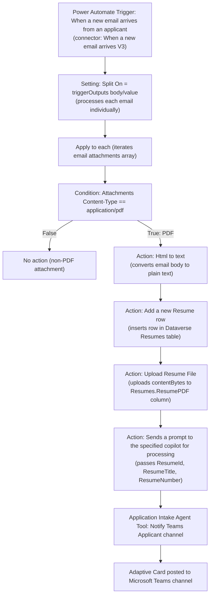

Key implementation details:

- `Split On` is enabled on the trigger to process each email individually even when batched.
- `item()?['name']` retrieves the attachment filename as the `Resume Title`.
- `item()?['contentBytes']` provides the raw binary (Base64) PDF data for upload.
- `utcNow()` sets the `Upload Date` field on the new Resumes row.
- A `Cover Letter` field is populated using `if(greater(length(body('Html_to_text')), 2000), substring(..., 0, 2000), body('Html_to_text'))` to cap text at 2000 characters.
- After building the flow, its plan must be switched from **Power Automate** to **Copilot Studio** (in the flow Details panel) so it consumes Copilot Studio capacity. The flow must then be **published** to activate.

Sources: [docs/operative/04-automate-triggers/index.md:99-584]()

---

## Mission 05: Model Selection and Response Formatting

`docs/operative/05-model-selection/index.md`

This mission covers selecting the underlying AI model for an agent and configuring response output format.

### Agent Model Categories

| Tag | Strengths | Latency | Cost |
|---|---|---|---|
| **Deep** | Multi-step reasoning, long document synthesis with citations | Highest | Highest |
| **Auto** | Mixed workload routing, blending knowledge and actions dynamically | Variable | Variable |
| **General** | Everyday chat, summarization, simple action automation | Lowest | Lowest |

### Available OpenAI Models (as of 2025)

| Model | Category | Availability | Best For |
|---|---|---|---|
| `GPT-4.1` | General | **Default** | Complex text analysis, high-precision Q&A |
| `GPT-5 Chat` | General | GA | Conversational agents, IT/HR helpdesk |
| `GPT-5 Auto` | Auto | Preview | Multi-step process automation |
| `GPT-5 Reasoning` | Deep | Preview | Advanced planning, complex data analysis |
| `GPT-5.2 Chat` | General | Experimental | Latest conversational model |
| `GPT-5.2 Reasoning` | Deep | Experimental | Ultra-complex analytical tasks |

### Available Anthropic Models (Frontier Program opt-in)

| Model | Category | Availability | Notes |
|---|---|---|---|
| `Claude Sonnet 4.5` | General | Preview | Code tasks, multi-step agent workflows, tool use |
| `Claude Opus 4.1` | Deep | Experimental | In-depth analysis, compliance auditing |

> Anthropic models are hosted outside Microsoft and subject to Anthropic terms. Not recommended for production use.

### Admin Controls for Model Access

| Setting | Effect | Location |
|---|---|---|
| **Enable Anthropic as a Microsoft subprocessor** | When enabled, Anthropic models appear in the model dropdown | Microsoft 365 Admin Center |
| **Allow Preview & Experimental Models** | When OFF, only GA models appear | Power Platform admin center |
| **Move Data Across Regions** | Must be ON to allow experimental models that run in different regional datacenters | Power Platform admin center |

### Retired Models

When a model is retired, agents are automatically upgraded to the new default. The **"Continue using retired models"** toggle (in **Settings → Generative AI → Model**) allows continued use for up to **30 days** post-upgrade. This window supports compatibility testing, compliance review, and prompt adjustment.

### Response Formatting

Response formatting defines how agent output is structured. Configured in **Settings → Generative AI → Response formatting**.

| Option | Purpose |
|---|---|
| **Bold** | Highlight key values |
| _Italics_ | Secondary emphasis, denote special terms |
| **Hyperlinks** | Clickable references to external or internal resources |
| **Power Fx expressions** | Dynamic content, e.g., `Text(Now(), "MMM dd, yyyy")` for date formatting |

Lab 5.2 compares responses from `GPT-4.1`, `GPT-5 Chat`, and `Claude Sonnet 4.5` against the same set of Interview Agent queries, observing differences in depth, structure, tone, and formatting adherence.

Sources: [docs/operative/05-model-selection/index.md:38-288]()

---

## Mission 06: AI Safety and Content Moderation

`docs/operative/06-ai-safety/index.md`

This mission implements enterprise-grade content safety for the **Interview Agent**, which handles sensitive candidate data.

### Three Content Blocking Mechanisms

| Mechanism | Triggered By | User-Visible Behavior | Where to Configure |
|---|---|---|---|
| **Responsible AI Filtering & Content Moderation** | Prompts or responses violating safety policies | `ContentFiltered` error; conversation fails to produce a response | Agent level (Settings → Generative AI) or topic-level Generative Answers node |
| **Unknown Intent fallback** | No matching intent or generative answer found | System Fallback topic asks user to rephrase; eventually escalates | Add trigger phrases, verify knowledge sources, customize Fallback topic |
| **Agent instructions** | Custom instructions deliberately restrict scope | Polite refusal, even for seemingly valid questions | Review agent instructions for no-go topics |

Topic-level moderation settings override the agent-level default at runtime, enabling fine-grained control per conversation flow.

### Content Moderation Categories

Azure AI Content Safety evaluates content on four axes, each at four severity levels (Safe, Low, Medium, High):

| Category | Example in Hiring Context |
|---|---|
| **Inappropriate Language** | Biased comments about candidate demographics |
| **Unprofessional Content** | Personal questions violating workplace standards |
| **Threatening Language** | Aggressive or hostile messages toward staff or candidates |
| **Harmful Discussions** | Promotion of unsafe or illegal workplace practices |

### Prompt Injection Protection

Copilot Studio automatically scans prompts in real time for:

- **XPIA** (Cross Prompt Injection Attacks): Malicious instructions embedded in external data sources ingested by the agent.
- **UPIA** (User Prompt Injection Attacks): Attempts by users to bypass safety controls through crafted input.

The **Agent Runtime Protection Status** panel surfaces active threat detections. Organizations with stricter requirements can layer on external threat detection systems.

Sources: [docs/operative/06-ai-safety/index.md:102-192]()

---

## Missions 07–09: Document Intelligence Pipeline

These three missions build a complete pipeline: extract structured data from resume PDFs, ground that extraction with live Dataverse records, and generate an Interview Prep document as output.

**Diagram: Resume Intelligence Pipeline**

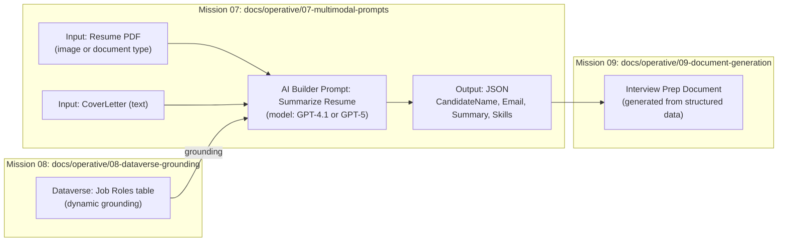

### Mission 07: Multimodal Prompts

`docs/operative/07-multimodal-prompts/index.md`

The `Summarize Resume` prompt is created under **Tools → Prompts** in Copilot Studio (via **+ New tool → Prompt**). It accepts mixed input types (document + text) and outputs structured JSON.

#### Prompt Parameters

| Parameter | Type | Description |
|---|---|---|
| `Resume` | Image or document (.PDF, .PNG, .JPG) | Candidate resume file |
| `CoverLetter` | Text | Cover letter body |

#### JSON Output Schema

```json
{
  "CandidateName": "string",
  "Email": "string",
  "Summary": "string (max 2000 characters)",
  "Skills": [{"item": "Skill name"}]
}
```

Use **temperature 0** for document extraction to maximize consistency across runs.

#### AI Builder Model Options

| Model | Cost | Speed | Best For |
|---|---|---|---|
| `GPT-4.1 mini` | Basic | Fast | Standard processing, cost-sensitive |
| `GPT-4.1` | Standard | Moderate | Complex documents, high accuracy |
| `o3` | Premium | Slow | Critical reasoning, data analysis |
| `GPT-5 chat` | Standard | Enhanced | Latest document understanding |
| `GPT-5 reasoning` | Premium | Slow | Most sophisticated analysis |

Sources: [docs/operative/07-multimodal-prompts/index.md:40-130]()

### Mission 08: Dataverse Grounding

`docs/operative/08-dataverse-grounding/index.md`

Dataverse grounding connects the `Summarize Resume` prompt to live Dataverse tables at inference time. Instead of hardcoded job role names in the prompt instructions, the prompt queries the **Job Roles** table directly to match candidates against current openings and applies current **Evaluation Criteria** records. Job roles and criteria can change in Dataverse without requiring any prompt modifications.

Sources: [docs/operative/08-dataverse-grounding/index.md:35-57]()

### Mission 09: Interview Prep Document Generation

`docs/operative/09-document-generation/index.md`

This mission extends the pipeline to produce an **Interview Prep document** using structured data from the `Summarize Resume` prompt output. Document generation is implemented in AI Builder prompts and integrated into the Interview Agent workflow.

Sources: [docs/operative/index.md:66]()

---

## Mission 10: MCP Server Integration

`docs/operative/10-mcp/index.md`

This mission connects the Hiring Agent to external services using the **Model Context Protocol (MCP)** — an open standard for AI agents to access external tools and data sources. **Agent 365** serves as the enterprise control plane, providing each agent a **Microsoft Entra Agent ID** and governing all MCP tool calls.

### Agent 365 Pre-Built MCP Servers

| MCP Server | Capability |
|---|---|
| **Outlook Calendar** | Create, update, manage calendar events |
| **Outlook Mail** | Send, read, search emails |
| **Teams** | Create chats, post messages, manage channels |
| **SharePoint & OneDrive** | Upload files, manage lists, search documents |
| **Word** | Create and edit documents, add comments |
| **Dataverse & Dynamics 365** | CRUD operations on business data |
| **User Profile** | Access user info, managers, direct reports |
| **Copilot Search** | Chat with M365 Copilot, ground responses with files |

### What This Mission Builds

The Hiring Agent is connected to the **Outlook Calendar** and **Teams** MCP servers to arrange interview prep meetings. The agent can create calendar events and post Teams messages autonomously using these servers.

### Enterprise Controls

| Control | Mechanism |
|---|---|
| Organization-wide allow/block | Microsoft 365 admin center |
| Scoped permissions per agent | Microsoft Entra scopes |
| Audit trail for all tool calls | Microsoft Defender Advanced Hunting |
| Policy enforcement | DLP, MIP, rate limits applied at runtime |

Sources: [docs/operative/10-mcp/index.md:33-115]()

---

## Mission 11: User Feedback Collection

`docs/operative/11-obtain-user-feedback/index.md`

This mission implements two complementary feedback mechanisms on the deployed Hiring Agent.

### Built-in Thumbs Up/Down Reactions

- Enabled by default on all Copilot Studio agents; active across Teams, web, and custom channels.
- Users click 👍/👎 after each agent response; an optional comment prompt follows.
- All feedback (including comments) is stored in the `conversationtranscript` Dataverse table.
- Aggregated in **Analytics → Satisfaction → Reactions** as a ratio of positive to negative responses over time.
- Toggle controlled by **"Collect user reactions to agent messages"** under **Settings → Generative AI → User feedback**.

### Custom Adaptive Card Feedback

When structured, multi-field feedback is needed, an Adaptive Card is inserted directly into the conversation flow. This collects CSAT ratings and free-text comments in a controlled format. It is triggered conditionally within topics after agent responses.

### Azure Application Insights Integration

Custom telemetry events can be logged to Azure Application Insights for advanced tracking beyond what the built-in analytics dashboard provides. This supports dashboarding, alerting, and long-term trend analysis outside of Copilot Studio.

Sources: [docs/operative/11-obtain-user-feedback/index.md:40-105]()

---

## Mission 12: Course Completion Badge

`docs/operative/course-completion-badges-operative/index.md`

Upon completing all 11 Operative missions, learners submit evidence screenshots via a GitHub issue template to claim the **Operative** digital badge through the Global AI Community platform. For full details on the submission process, evidence requirements, and automated badge delivery workflow, see [Badge and Completion System](#5).

Sources: [docs/operative/index.md:71-73]()

---

# Page: Commander (Preview)

# Commander (Preview)

<details>
<summary>Relevant source files</summary>

The following files were used as context for generating this wiki page:

- [docs/commander-preview/01-advanced-mcp/index.md](docs/commander-preview/01-advanced-mcp/index.md)
- [docs/commander-preview/02-computer-using-agents/index.md](docs/commander-preview/02-computer-using-agents/index.md)
- [docs/commander-preview/03-code-interpreter/index.md](docs/commander-preview/03-code-interpreter/index.md)
- [docs/commander-preview/04-human-in-the-loop/index.md](docs/commander-preview/04-human-in-the-loop/index.md)
- [docs/commander-preview/05-voice-enabled-agents/index.md](docs/commander-preview/05-voice-enabled-agents/index.md)
- [docs/commander-preview/06-localization/index.md](docs/commander-preview/06-localization/index.md)
- [docs/commander-preview/07-azure-ai-byom/index.md](docs/commander-preview/07-azure-ai-byom/index.md)
- [docs/commander-preview/08-knowledge-deep-dive/index.md](docs/commander-preview/08-knowledge-deep-dive/index.md)
- [docs/commander-preview/09-handoff-to-human/index.md](docs/commander-preview/09-handoff-to-human/index.md)
- [docs/commander-preview/10-governance-auth-dlp/index.md](docs/commander-preview/10-governance-auth-dlp/index.md)
- [docs/commander-preview/11-test-monitor-debug/index.md](docs/commander-preview/11-test-monitor-debug/index.md)
- [docs/commander-preview/12-deploy-solutions-pipelines/index.md](docs/commander-preview/12-deploy-solutions-pipelines/index.md)
- [docs/commander-preview/13-next-steps-best-practices/index.md](docs/commander-preview/13-next-steps-best-practices/index.md)
- [docs/commander-preview/index.md](docs/commander-preview/index.md)

</details>


This page documents the **Commander** track of Agent Academy — the third and most advanced rank in the curriculum. It covers the 13 missions that make up the Commander preview, including their learning objectives, technical scope, and current completion status. The Commander track assumes completion of both the Recruit and Operative tracks.

> **Note:** This curriculum is currently in preview. All 13 missions are marked as under active development.

For foundational agent concepts, see the Recruit Track ([2.1](#2.1)). For multi-agent design and intermediate skills, see the Operative Track ([2.2](#2.2)). For standalone labs that are rank-independent, see Special Ops ([3](#3)).

---

## Overview

The Commander track targets practitioners who need to build and operate **production-grade, enterprise-scale** agents in Microsoft Copilot Studio. It advances beyond multi-agent orchestration into areas such as computer automation, code execution, voice telephony, ALM, governance, and observability.

The entry point for the track is [docs/commander-preview/index.md](), which renders as the `Commander (Preview)` landing page on the documentation site.

### Target Audience

| Role | Primary Missions |
|---|---|
| Solution architects | 07, 08, 10, 12, 13 |
| Application developers | 01, 02, 03, 04, 12 |
| IT / security professionals | 10, 11, 12, 13 |
| AI / data specialists | 03, 07, 08 |
| Contact center engineers | 05, 09 |
| Localization engineers | 06 |

Sources: [docs/commander-preview/index.md:21-28]()

---

## Curriculum Structure

The Commander track is organised as 13 sequential missions. Each mission lives in its own directory under `docs/commander-preview/` and is implemented as a VitePress markdown page with `prev`/`next` frontmatter links forming a navigable chain.

**Mission sequence and directory map:**

```mermaid
flowchart LR
    IDX["docs/commander-preview/index.md"]
    M01["01-advanced-mcp"]
    M02["02-computer-using-agents"]
    M03["03-code-interpreter"]
    M04["04-human-in-the-loop"]
    M05["05-voice-enabled-agents"]
    M06["06-localization"]
    M07["07-azure-ai-byom"]
    M08["08-knowledge-deep-dive"]
    M09["09-handoff-to-human"]
    M10["10-governance-auth-dlp"]
    M11["11-test-monitor-debug"]
    M12["12-deploy-solutions-pipelines"]
    M13["13-next-steps-best-practices"]

    IDX --> M01 --> M02 --> M03 --> M04 --> M05 --> M06 --> M07
    M07 --> M08 --> M09 --> M10 --> M11 --> M12 --> M13
```

Sources: [docs/commander-preview/index.md:34-48](), [docs/commander-preview/01-advanced-mcp/index.md:1-8](), [docs/commander-preview/13-next-steps-best-practices/index.md:1-5]()

---

**Full mission reference table:**

| # | Emoji | Title | Directory | Status |
|---|---|---|---|---|
| 01 | 🔌 | Advanced MCP Server Usage | `01-advanced-mcp` | 🚧 Preview |
| 02 | 🖥️ | Computer Using Agents (CUA) | `02-computer-using-agents` | 🚧 Preview |
| 03 | 🐍 | Code Interpreter | `03-code-interpreter` | 🚧 Preview |
| 04 | 🤝 | Human in the Loop (HITL) | `04-human-in-the-loop` | 🚧 Preview |
| 05 | 🎙️ | Voice-enabled Agents | `05-voice-enabled-agents` | 🚧 Preview |
| 06 | 🌍 | Localization | `06-localization` | 🚧 Preview |
| 07 | 🧠 | Extend with Azure AI & BYOM | `07-azure-ai-byom` | 🚧 Preview |
| 08 | 📚 | Knowledge Deep Dive | `08-knowledge-deep-dive` | 🚧 Preview |
| 09 | 🔄 | Handoff to Human Agents | `09-handoff-to-human` | 🚧 Preview |
| 10 | 🔐 | Governance Essentials with Authentication, Channels & DLP | `10-governance-auth-dlp` | 🚧 Preview |
| 11 | 🧪 | Test, Monitor, Debug & Analytics | `11-test-monitor-debug` | 🚧 Preview |
| 12 | 🚀 | Deploy Agents with Solutions & Pipelines | `12-deploy-solutions-pipelines` | 🚧 Preview |
| 13 | 🏁 | Next Steps and Best Practices | `13-next-steps-best-practices` | 🚧 Preview |

Sources: [docs/commander-preview/index.md:34-48]()

---

## Technical Domain Map

The diagram below maps each mission's human-readable domain name to its concrete file path and the key Copilot Studio / Azure concepts it covers. This bridges the curriculum overview to the actual source files.

```mermaid
graph TD
    subgraph "Integration"
        M01f["docs/commander-preview/01-advanced-mcp/index.md"]
        M01c["MCP onboarding wizard\nCustom connector\nDataverse / D365 / Fabric MCP servers\nOAuth 2.0 dynamic discovery"]
        M01f --- M01c
    end

    subgraph "Automation"
        M02f["docs/commander-preview/02-computer-using-agents/index.md"]
        M02c["Computer Use\nAzure Key Vault credentials\nCUA vs RPA decision"]
        M02f --- M02c

        M03f["docs/commander-preview/03-code-interpreter/index.md"]
        M03c["Code Interpreter\nPython sandbox\nCSV / Excel ingestion\nDataverse code queries"]
        M03f --- M03c
    end

    subgraph "Workflow"
        M04f["docs/commander-preview/04-human-in-the-loop/index.md"]
        M04c["Human in the Loop connector\nMulti-stage approvals\nRequest for Information action\nApprovals center"]
        M04f --- M04c
    end

    subgraph "Channel"
        M05f["docs/commander-preview/05-voice-enabled-agents/index.md"]
        M05c["Voice template\nIVR / DTMF input\nSSML\nAzure Communication Services"]
        M05f --- M05c

        M06f["docs/commander-preview/06-localization/index.md"]
        M06c["JSON / ResX translation files\nConversation.LocalTimeZone\nNoda Time zone IDs\nPower Fx date conversion"]
        M06f --- M06c
    end

    subgraph "AI_Extension"
        M07f["docs/commander-preview/07-azure-ai-byom/index.md"]
        M07c["Azure AI Search\nAzure AI Foundry\nBYOM fine-tuned models\nReusable prompt tools"]
        M07f --- M07c

        M08f["docs/commander-preview/08-knowledge-deep-dive/index.md"]
        M08c["SharePoint / OneDrive knowledge\nBing Search\nKnowledge ingestion limits\nSecurity and identity"]
        M08f --- M08c
    end

    subgraph "Operations"
        M09f["docs/commander-preview/09-handoff-to-human/index.md"]
        M09c["Escalate system topic\nTransfer conversation node\nDynamics 365 Customer Service\nServiceNow / Salesforce / LivePerson"]
        M09f --- M09c

        M10f["docs/commander-preview/10-governance-auth-dlp/index.md"]
        M10c["SSO with Entra ID\nManual authentication\nStreaming API vs Direct Line\nDLP policies"]
        M10f --- M10c
    end

    subgraph "Quality"
        M11f["docs/commander-preview/11-test-monitor-debug/index.md"]
        M11c["Test panel / Activity map\nConversation snapshots\nAgent evaluations / test sets\nApplication Insights / Power BI"]
        M11f --- M11c

        M12f["docs/commander-preview/12-deploy-solutions-pipelines/index.md"]
        M12c["Custom solutions\nManaged vs unmanaged layers\nOn-Behalf-Of OBO auth\nPower Platform Pipelines"]
        M12f --- M12c

        M13f["docs/commander-preview/13-next-steps-best-practices/index.md"]
        M13c["Copilot Studio Implementation Guide\nPower CAT tools\nWell-Architected Framework"]
        M13f --- M13c
    end
```

Sources: All mission `index.md` files under `docs/commander-preview/`

---

## Mission Details

### Mission 01 — Advanced MCP Server Usage

[docs/commander-preview/01-advanced-mcp/index.md]()

Connects agents to existing MCP servers using either the **MCP onboarding wizard** or a **custom connector** in Power Apps. Covers all authentication modes: `None`, API key, and OAuth 2.0 (`dynamic discovery`, `dynamic`, `manual`). Students learn to selectively enable or disable individual tools from an MCP server, and explore the built-in MCP servers catalog: Dataverse, Dynamics 365, Fabric, and Microsoft 365.

For hands-on MCP server construction, see the MCS MCP Special Ops Lab ([3.1](#3.1)).

**Key objectives:**
- MCP onboarding wizard and custom connector configuration
- OAuth 2.0 authentication flow variants
- Built-in catalog: Dataverse, Dynamics 365, Fabric servers
- Tool-level enable/disable granularity
- Common MCP integration troubleshooting

---

### Mission 02 — Computer Using Agents (CUA)

[docs/commander-preview/02-computer-using-agents/index.md]()

Enables agents to control desktop applications and websites via virtual mouse and keyboard using the **Computer Use** capability. Covers the decision criteria for CUA vs traditional RPA, credential security via **Azure Key Vault**, and integrating human-in-the-loop assistance directly within CUA workflows.

**Key objectives:**
- Enabling and configuring `Computer Use`
- CUA vs RPA selection criteria
- Effective prompting for computer-using agents
- Azure Key Vault for secure credential storage
- HITL assistance, input provision, host type selection

---

### Mission 03 — Code Interpreter

[docs/commander-preview/03-code-interpreter/index.md]()

Enables **Code Interpreter** to generate and execute Python in a sandboxed environment for data analysis, forecasting, chart generation, and file output from CSV or Excel inputs. Distinguishes between *deterministic* (prompt-level) and *non-deterministic* (agent-level) execution modes. Data can be ingested via user-uploaded files in chat or via **SharePoint Documents library** knowledge sources.

**Key objectives:**
- Enabling Code Interpreter at prompt vs agent level
- Structured data ingestion (CSV, Excel)
- Deterministic vs non-deterministic execution
- Image generation and custom skill extension
- Querying and updating Dataverse using generated code

---

### Mission 04 — Human in the Loop (HITL)

[docs/commander-preview/04-human-in-the-loop/index.md]()

Builds multi-stage approval workflows in agent flows using the **Human in the Loop connector**. Configures both manual and AI-driven approval stages, dynamic routing conditions, and the **Request for Information (RFI) action** to pause a flow and collect structured reviewer input. AI stage instructions and decision rationale are reviewable in the **Approvals center**.

**Key objectives:**
- Human in the Loop connector configuration
- Manual and AI approval stage setup with input mappings
- Condition-based dynamic routing (approve / reject / skip)
- RFI action: pausing flows and collecting structured input
- Writing effective AI stage instructions; reviewing AI rationale

---

### Mission 05 — Voice-enabled Agents

[docs/commander-preview/05-voice-enabled-agents/index.md]()

Builds IVR-capable agents using the **Voice template**. Handles phone calls combining speech recognition and **DTMF** (dual-tone multi-frequency) keypad input. Configures barge-in, silence detection, timeout handling, and custom voice synthesis via **Speech Synthesis Markup Language (SSML)**. Phone number provisioning is done through **Azure Communication Services**.

**Key objectives:**
- Voice template agent creation
- Speech and DTMF input collection
- Barge-in, silence detection, and timeout configuration
- SSML voice customisation
- Call transfer, termination, and Azure Communication Services phone provisioning

---

### Mission 06 — Localization

[docs/commander-preview/06-localization/index.md]()

Configures multilingual agents using **JSON** and **ResX** translation files. Covers automatic language detection and dynamic switching via **generative orchestration**, localisation of Adaptive Cards, and time zone handling using the system variable `Conversation.LocalTimeZone` with **Noda Time** zone IDs and Power Fx date conversion functions.

**Key objectives:**
- Primary and secondary language configuration with region settings
- JSON / ResX translation file management
- Automatic language detection and dynamic switching
- Adaptive Card localisation
- `Conversation.LocalTimeZone`, Noda Time zone IDs, Power Fx date conversions

---

### Mission 07 — Extend with Azure AI & BYOM

[docs/commander-preview/07-azure-ai-byom/index.md]()

Integrates external AI services: **Azure AI Search** for enterprise knowledge retrieval, **Azure AI Foundry** for bring-your-own-data copilots, and **BYOM** (bring your own model) for custom or fine-tuned model inference. Also covers adding prompts as reusable tools within topics.

**Key objectives:**
- Azure AI Search integration for knowledge retrieval
- Azure AI Foundry for BYOD scenarios
- BYOM with custom or fine-tuned models via AI Builder
- Reusable prompt tools inside topics

---

### Mission 08 — Knowledge Deep Dive

[docs/commander-preview/08-knowledge-deep-dive/index.md]()

Covers knowledge source optimisation: preparing public websites for agent ingestion, connecting **SharePoint** and **OneDrive** content, understanding ingestion limitations, and using **Bing Search** for dynamic external retrieval. Security and identity topics govern how knowledge is accessed at runtime.

**Key objectives:**
- Public website optimisation for knowledge ingestion
- SharePoint and OneDrive content connection
- Agent reasoning over knowledge and known limitations
- Bing Search for dynamic external knowledge
- Security and identity in knowledge access

---

### Mission 09 — Handoff to Human Agents

[docs/commander-preview/09-handoff-to-human/index.md]()

Configures seamless escalation to live agents via the **Escalate system topic** and the **Transfer conversation node**. Escalation can be triggered implicitly (user requests a human) or explicitly (topic-driven). Context variables — conversation history, topics, phrases, and private messages — are passed to the engagement hub so the live agent has full context.

Supported engagement hubs: Dynamics 365 Customer Service, ServiceNow, Salesforce, LivePerson, and generic hubs via custom adapters.

**Key objectives:**
- Escalate system topic and Transfer conversation node configuration
- Implicit vs explicit escalation triggers
- Context variable transfer to engagement hubs
- Engagement hub integrations (D365, ServiceNow, Salesforce, LivePerson, generic)
- Customising escalation-related agent messages

---

### Mission 10 — Governance Essentials with Authentication, Channels & DLP

[docs/commander-preview/10-governance-auth-dlp/index.md]()

Secures agent access with **Single Sign-On (SSO)** via Entra ID and manual authentication for external APIs. Compares **Streaming API** vs **Direct Line** protocols for embedding agents in custom applications. Prevents anonymous access using **Data Loss Prevention (DLP) policies**.

**Key objectives:**
- SSO configuration with Entra ID
- Manual authentication for API access
- Streaming API vs Direct Line for custom app embedding
- DLP policy enforcement to prevent anonymous access

---

### Mission 11 — Test, Monitor, Debug & Analytics

[docs/commander-preview/11-test-monitor-debug/index.md]()

Covers the full observability lifecycle. The built-in **Test panel** provides real-time topic tracking via the **Activity map** during generative orchestration. **Conversation snapshots** capture state for diagnostics. **Agent evaluations** automate quality scoring against test sets with user profiles. Production monitoring uses **Analytics dashboards** for KPIs (session outcomes, CSAT, topic trends). Custom telemetry is captured via **Azure Application Insights** and visualised in **Power BI**.

**Key objectives:**
- Test panel, topic tracking, Activity map
- Variable inspection, conversation snapshots, support flagging
- Test set creation, user profile configuration, automated evaluations
- Evaluation score interpretation and cross-run comparison
- Analytics dashboard KPIs, Application Insights integration, Power BI reporting

---

### Mission 12 — Deploy Agents with Solutions & Pipelines

[docs/commander-preview/12-deploy-solutions-pipelines/index.md]()

Delivers Application Lifecycle Management (ALM) for agents. Covers environment strategies (dev / test / production), packaging in **custom solutions** with managed and unmanaged layers, exporting and importing solutions with required objects, **reusable component collections**, **On-Behalf-Of (OBO) authentication** for connections, sharing controls (Editor and Viewer roles), and deploying at scale via **Power Platform Pipelines**.

**Key objectives:**
- Dev / test / production environment strategies
- Custom solutions: managed vs unmanaged layers, export/import
- Reusable component collections with dependency management
- OBO authentication and connection configuration
- Power Platform Pipelines for automated deployment

---

### Mission 13 — Next Steps and Best Practices

[docs/commander-preview/13-next-steps-best-practices/index.md]()

Consolidates Commander-level knowledge into production readiness guidance using the **Copilot Studio Implementation Guide**, **Power CAT tools**, and the **Power Platform Well-Architected Framework**.

**Key objectives:**
- Applying the Copilot Studio Implementation Guide
- Power CAT tools for agent management
- Monitoring and governance dashboards
- Well-Architected Framework for operational excellence

---

## Mission Dependency and Skill Grouping

The 13 missions cluster into five skill domains. Later missions in each domain build on earlier ones, and the ALM domain (Missions 11–13) assumes concepts from all others.

```mermaid
graph TD
    subgraph "Track_Prerequisites"
        RECRUIT["Recruit Track"]
        OPERATIVE["Operative Track"]
        RECRUIT --> OPERATIVE
    end

    OPERATIVE --> COMMANDER

    subgraph "COMMANDER"
        subgraph "Integration_and_Automation"
            M01["Mission 01\nAdvanced MCP"]
            M02["Mission 02\nCUA"]
            M03["Mission 03\nCode Interpreter"]
        end

        subgraph "Workflow_and_Channels"
            M04["Mission 04\nHITL Approvals"]
            M05["Mission 05\nVoice / IVR"]
            M06["Mission 06\nLocalization"]
        end

        subgraph "AI_Extension_and_Knowledge"
            M07["Mission 07\nAzure AI + BYOM"]
            M08["Mission 08\nKnowledge Deep Dive"]
        end

        subgraph "Governance_and_Escalation"
            M09["Mission 09\nHandoff to Human"]
            M10["Mission 10\nAuth + DLP"]
        end

        subgraph "ALM_and_Operations"
            M11["Mission 11\nTest + Monitor"]
            M12["Mission 12\nSolutions + Pipelines"]
            M13["Mission 13\nBest Practices"]
        end

        M01 --> M02
        M02 --> M03
        M03 --> M04
        M04 --> M05
        M05 --> M06
        M06 --> M07
        M07 --> M08
        M08 --> M09
        M09 --> M10
        M10 --> M11
        M11 --> M12
        M12 --> M13
    end
```

Sources: [docs/commander-preview/index.md:34-48](), individual `prev`/`next` frontmatter in all mission files

---

## File Structure Reference

All Commander content resides under `docs/commander-preview/`. Each mission is a subdirectory containing a single `index.md`.

```
docs/
└── commander-preview/
    ├── index.md                            ← landing page / curriculum overview
    ├── 01-advanced-mcp/index.md
    ├── 02-computer-using-agents/index.md
    ├── 03-code-interpreter/index.md
    ├── 04-human-in-the-loop/index.md
    ├── 05-voice-enabled-agents/index.md
    ├── 06-localization/index.md
    ├── 07-azure-ai-byom/index.md
    ├── 08-knowledge-deep-dive/index.md
    ├── 09-handoff-to-human/index.md
    ├── 10-governance-auth-dlp/index.md
    ├── 11-test-monitor-debug/index.md
    ├── 12-deploy-solutions-pipelines/index.md
    └── 13-next-steps-best-practices/index.md
```

The sidebar registration for this track is handled in the VitePress configuration. For details on how the sidebar is wired up, see the Site Configuration and Navigation page ([4.1](#4.1)).

Sources: [docs/commander-preview/index.md:1-51]()

---

# Page: Special Ops Labs

# Special Ops Labs

<details>
<summary>Relevant source files</summary>

The following files were used as context for generating this wiki page:

- [.gitignore](.gitignore)
- [docs/.vitepress/config.mts](docs/.vitepress/config.mts)
- [docs/special-ops/index.md](docs/special-ops/index.md)
- [docs/special-ops/mcs-mcp/index.md](docs/special-ops/mcs-mcp/index.md)
- [docs/special-ops/pac-cli-mcp/assets/powerplatform-cli-mcp-added-vs-code.png](docs/special-ops/pac-cli-mcp/assets/powerplatform-cli-mcp-added-vs-code.png)
- [docs/special-ops/pac-cli-mcp/assets/restrict-developer-environments-to-admins-only.png](docs/special-ops/pac-cli-mcp/assets/restrict-developer-environments-to-admins-only.png)
- [docs/special-ops/pac-cli-mcp/assets/show-trial-env-creation-setting.png](docs/special-ops/pac-cli-mcp/assets/show-trial-env-creation-setting.png)
- [docs/special-ops/pac-cli-mcp/index.md](docs/special-ops/pac-cli-mcp/index.md)
- [docs/special-ops/pac-cli-mcp/power-platform-plan/index.md](docs/special-ops/pac-cli-mcp/power-platform-plan/index.md)

</details>


This page covers the **Special Ops** section of Agent Academy — a set of standalone, rank-independent labs that focus on specific technologies rather than following the Recruit → Operative → Commander progression. Special Ops labs can be completed in any order and do not require completion of any course track as a prerequisite.

For details on the structured course tracks (Recruit, Operative, Commander), see page [2](). For details on a specific Special Ops lab, see page [3.1]() (MCS MCP) or page [3.2]() (PAC CLI MCP).

---

## What are Special Ops Labs?

Special Ops labs are self-contained missions, each covering a distinct technology or integration pattern. They are listed in the navigation under **Special Ops (Labs)**, separate from the **Courses** section.

[docs/special-ops/index.md:1-14]()

| Property | Structured Tracks | Special Ops Labs |
|---|---|---|
| Prerequisites | Sequential (Recruit → Operative → Commander) | None — rank-independent |
| Outcome | Earns a completion badge | No badge; skill-focused |
| Scope | Full agent-building curriculum | One focused technology per lab |
| Ordering | Fixed module sequence | Choose any lab in any order |

The Special Ops section appears in both the top navigation bar and the sidebar of the documentation site, as a separate nav group from Courses.

[docs/.vitepress/config.mts:31-37]()
[docs/.vitepress/config.mts:172-180]()

---

## Available Missions

**Diagram: Special Ops Labs — Structural Position**

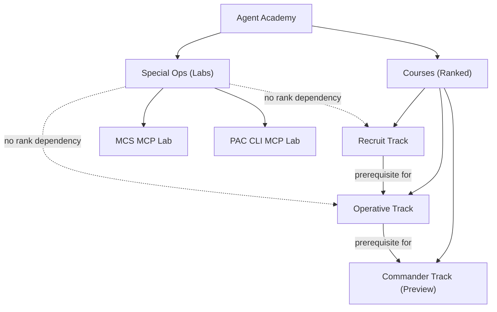

Sources: [docs/special-ops/index.md:1-14](), [docs/.vitepress/config.mts:19-37](), [docs/.vitepress/config.mts:45-180]()

---

### Lab 1 — MCS MCP (Microsoft Copilot Studio ❤️ MCP)

Located at `docs/special-ops/mcs-mcp/`.

This lab walks through building and hosting a **Jokes MCP Server** — a TypeScript/Express HTTP server that implements the Model Context Protocol using `StreamableHTTPServerTransport`. The server exposes two tools:

| Tool name | Description |
|---|---|
| `get-chuck-joke` | Fetches a Chuck Norris joke by category |
| `get-dad-joke` | Fetches a dad joke |

The lab has two hosting paths:

| Path | Mechanism | Public URL |
|---|---|---|
| Local (dev) | VS Code port forwarding via devtunnel | `https://<id>-3000.<region>.devtunnels.ms/mcp` |
| Azure | `azd up` deploying to Azure Container Apps via Bicep | `https://<app-name>.azurecontainerapps.io/mcp` |

After hosting, the server is integrated into two clients:

1. **VS Code / GitHub Copilot** — via `MCP: Add Server` (HTTP transport), saved to `settings.json`
2. **Microsoft Copilot Studio** — as a connector-backed MCP tool added to a "Jokester" agent

The MCP endpoint is always `/mcp` (e.g., `GET` to `/mcp` returns a `Method not allowed` JSON-RPC error, which is expected).

[docs/special-ops/mcs-mcp/index.md:1-341]()

---

### Lab 2 — PAC CLI MCP (Power Platform CLI MCP)

Located at `docs/special-ops/pac-cli-mcp/`.

This lab configures the **built-in MCP server** that ships with Power Platform CLI (version 1.44+). The MCP server binary is `pac-mcp.exe`, located at:

```
%USERPROFILE%\.dotnet\tools\.store\microsoft.powerapps.cli.tool\[version]\microsoft.powerapps.cli.tool\[version]\tools\net8.0\any\pac-mcp.exe
```

The lab installs `pac` via `dotnet tool install --global Microsoft.PowerApps.CLI.Tool`, then wires `pac-mcp.exe` into VS Code as a `Command (stdio)` MCP server. GitHub Copilot then invokes PAC CLI operations using natural language.

The primary mission is tenant settings governance: using prompts to read and update Power Platform tenant settings via `pac admin list-tenant-settings` and `pac admin update-tenant-settings`, without needing to remember exact CLI syntax.

[docs/special-ops/pac-cli-mcp/index.md:1-339]()

---

## Architecture Diagrams

**Diagram: MCS MCP Lab — Source Files and Runtime Components**

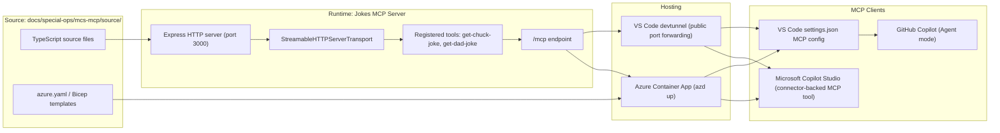

Sources: [docs/special-ops/mcs-mcp/index.md:33-117](), [docs/special-ops/mcs-mcp/index.md:119-158](), [docs/special-ops/mcs-mcp/index.md:160-326]()

---

**Diagram: PAC CLI MCP Lab — Executable Path and Integration Chain**

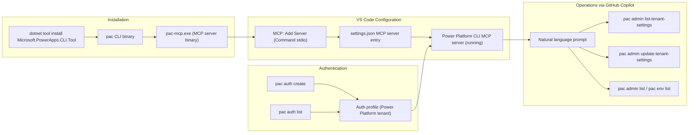

Sources: [docs/special-ops/pac-cli-mcp/index.md:29-81](), [docs/special-ops/pac-cli-mcp/index.md:108-141](), [docs/special-ops/pac-cli-mcp/index.md:173-224]()

---

## Comparison of the Two Labs

| Dimension | MCS MCP Lab | PAC CLI MCP Lab |
|---|---|---|
| **MCP server type** | Custom HTTP server (TypeScript/Express) | Bundled binary (`pac-mcp.exe`) |
| **Transport** | `StreamableHTTPServerTransport` (HTTP/SSE) | `stdio` (`Command` type) |
| **Hosting required** | Yes — devtunnel or Azure Container App | No — runs locally as a subprocess |
| **Tools exposed** | `get-chuck-joke`, `get-dad-joke` | 20+ PAC CLI commands (`pac admin`, `pac env`, etc.) |
| **MCP client** | VS Code GitHub Copilot + Microsoft Copilot Studio | VS Code GitHub Copilot only |
| **Azure required** | Optional (local devtunnel path exists) | No |
| **Admin permissions needed** | No | Yes — Power Platform admin |
| **Primary scenario** | Build and deploy a custom MCP server | Natural language tenant governance |

Sources: [docs/special-ops/mcs-mcp/index.md:23-30](), [docs/special-ops/pac-cli-mcp/index.md:82-107]()

---

## Prerequisites Summary

### MCS MCP Lab

- Visual Studio Code
- Node.js v22 (via `nvm`)
- Docker
- Azure Developer CLI (`azd`) — required only for Azure deployment path
- Azure subscription with payment method — required only for Azure deployment path
- Microsoft Copilot Studio trial or developer account

[docs/special-ops/mcs-mcp/index.md:23-30]()

### PAC CLI MCP Lab

- .NET 8.0 or later
- Power Platform CLI v1.44+ (`dotnet tool install --global Microsoft.PowerApps.CLI.Tool`)
- Visual Studio Code with GitHub Copilot extension
- Power Platform admin account

[docs/special-ops/pac-cli-mcp/index.md:34-44](), [docs/special-ops/pac-cli-mcp/index.md:179-224]()

---

## Relationship to Course Track Content

The MCS MCP lab complements **Operative Mission 10** (`/operative/10-mcp/`), which also covers MCP integration in Microsoft Copilot Studio, but in the context of the Hiring Agent multi-mission curriculum. The Special Ops version is self-contained: it builds a server from scratch and demonstrates both the VS Code and Copilot Studio integration paths without depending on prior Operative missions.

[docs/.vitepress/config.mts:156-159]()

---

# Page: MCS MCP Lab

# MCS MCP Lab

<details>
<summary>Relevant source files</summary>

The following files were used as context for generating this wiki page:

- [.gitignore](.gitignore)
- [docs/.vitepress/config.mts](docs/.vitepress/config.mts)
- [docs/special-ops/index.md](docs/special-ops/index.md)
- [docs/special-ops/mcs-mcp/index.md](docs/special-ops/mcs-mcp/index.md)
- [docs/special-ops/mcs-mcp/source/Dockerfile](docs/special-ops/mcs-mcp/source/Dockerfile)
- [docs/special-ops/mcs-mcp/source/azure.yaml](docs/special-ops/mcs-mcp/source/azure.yaml)
- [docs/special-ops/mcs-mcp/source/infra/abbreviations.json](docs/special-ops/mcs-mcp/source/infra/abbreviations.json)
- [docs/special-ops/mcs-mcp/source/infra/main.bicep](docs/special-ops/mcs-mcp/source/infra/main.bicep)
- [docs/special-ops/mcs-mcp/source/infra/main.parameters.json](docs/special-ops/mcs-mcp/source/infra/main.parameters.json)
- [docs/special-ops/mcs-mcp/source/infra/modules/fetch-container-image.bicep](docs/special-ops/mcs-mcp/source/infra/modules/fetch-container-image.bicep)
- [docs/special-ops/mcs-mcp/source/infra/resources.bicep](docs/special-ops/mcs-mcp/source/infra/resources.bicep)
- [docs/special-ops/mcs-mcp/source/package-lock.json](docs/special-ops/mcs-mcp/source/package-lock.json)
- [docs/special-ops/mcs-mcp/source/package.json](docs/special-ops/mcs-mcp/source/package.json)
- [docs/special-ops/mcs-mcp/source/src/server.ts](docs/special-ops/mcs-mcp/source/src/server.ts)
- [docs/special-ops/pac-cli-mcp/assets/powerplatform-cli-mcp-added-vs-code.png](docs/special-ops/pac-cli-mcp/assets/powerplatform-cli-mcp-added-vs-code.png)
- [docs/special-ops/pac-cli-mcp/assets/restrict-developer-environments-to-admins-only.png](docs/special-ops/pac-cli-mcp/assets/restrict-developer-environments-to-admins-only.png)
- [docs/special-ops/pac-cli-mcp/assets/show-trial-env-creation-setting.png](docs/special-ops/pac-cli-mcp/assets/show-trial-env-creation-setting.png)
- [docs/special-ops/pac-cli-mcp/index.md](docs/special-ops/pac-cli-mcp/index.md)
- [docs/special-ops/pac-cli-mcp/power-platform-plan/index.md](docs/special-ops/pac-cli-mcp/power-platform-plan/index.md)

</details>


This page documents the **MCS MCP Special Ops Lab** end-to-end: the Jokes MCP server source code, how to run it locally and deploy it to Azure, and how to integrate it with both VS Code GitHub Copilot and Microsoft Copilot Studio. This is a standalone lab independent of any course track rank. For an overview of all Special Ops labs, see page [3](). For the PAC CLI MCP lab, see page [3.2]().

---

## Purpose and Scope

The lab teaches you to build, deploy, and consume a custom MCP (Model Context Protocol) server. The concrete vehicle is a "Jokes" server that exposes Chuck Norris and dad joke APIs as MCP tools. By the end, the same server endpoint is usable from both VS Code GitHub Copilot and a Microsoft Copilot Studio agent.

---

## What Is MCP?

MCP (Model Context Protocol) is an open protocol defined by Anthropic that standardizes how applications provide context and tool access to LLMs. In Copilot Studio, MCP servers are surfaced through the existing connector infrastructure, so they inherit enterprise security controls (VNet integration, DLP policies, authentication methods) rather than bypassing them.

| Concern | Answer |
|---|---|
| Protocol origin | Anthropic (open standard) |
| Transport used in this lab | Streamable HTTP (POST to `/mcp`) |
| Copilot Studio integration layer | Custom connector, created automatically |
| Auth support | Connector-level (anonymous in this lab) |

Sources: [docs/special-ops/mcs-mcp/index.md:10-18]()

---

## Prerequisites

| Requirement | Notes |
|---|---|
| Node v22 | Use `nvm` or `nvm-windows` |
| Visual Studio Code | For port forwarding and MCP config |
| Docker | Required for Azure Container App build |
| Azure Developer CLI (`azd`) | Required for Azure deployment only |
| Azure Subscription | Required for Azure deployment only |
| Copilot Studio trial/dev account | Required for Copilot Studio integration |

Sources: [docs/special-ops/mcs-mcp/index.md:23-30]()

---

## Server Source Code

The server lives in [docs/special-ops/mcs-mcp/source/src/server.ts](). It is a TypeScript application with three dependencies declared in [docs/special-ops/mcs-mcp/source/package.json]():

| Package | Role |
|---|---|
| `@modelcontextprotocol/sdk` | MCP server core (`McpServer`, `StreamableHTTPServerTransport`) |
| `express` (v5) | HTTP server framework |
| `zod` (v4) | Input schema validation for parameterized tools |

### Server Architecture Diagram

**Diagram: server.ts class and route relationships**

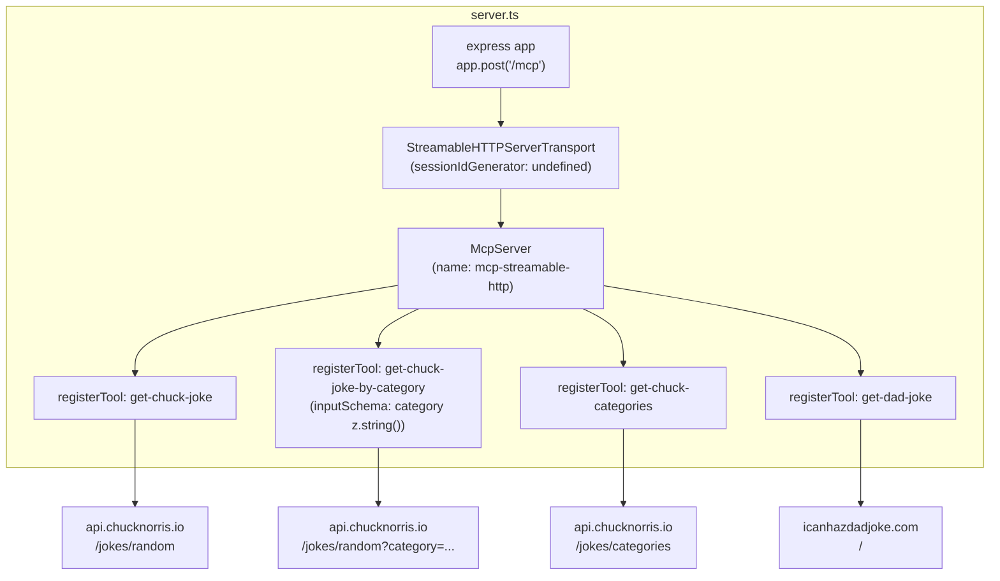

Sources: [docs/special-ops/mcs-mcp/source/src/server.ts:1-163]()

### Registered Tools

| Tool Name | Parameters | External API |
|---|---|---|
| `get-chuck-joke` | none | `https://api.chucknorris.io/jokes/random` |
| `get-chuck-joke-by-category` | `category: string` | `https://api.chucknorris.io/jokes/random?category=${category}` |
| `get-chuck-categories` | none | `https://api.chucknorris.io/jokes/categories` |
| `get-dad-joke` | none | `https://icanhazdadjoke.com/` |

Sources: [docs/special-ops/mcs-mcp/source/src/server.ts:12-98]()

### HTTP Routes

The Express app exposes three handlers on `/mcp`:

| Method | Behavior |
|---|---|
| `POST /mcp` | Creates a `StreamableHTTPServerTransport`, connects it to the `McpServer`, and dispatches the request. Each request is stateless (`sessionIdGenerator: undefined`). |
| `GET /mcp` | Returns HTTP 405 with JSON-RPC error `"Method not allowed."` |
| `DELETE /mcp` | Returns HTTP 405 with JSON-RPC error `"Method not allowed."` |

The server listens on `process.env.PORT` or `3000` by default.

Sources: [docs/special-ops/mcs-mcp/source/src/server.ts:100-163]()

### Build Scripts

Defined in [docs/special-ops/mcs-mcp/source/package.json:6-10]():

| Script | Command |
|---|---|
| `build` | `tsc` (compiles TypeScript to `dist/`) |
| `start` | `node dist/server.js` |

---

## Running Locally

```bash
npm install
npm run build && npm run start
```

After the server starts on port `3000`, use VS Code's **Ports** panel to forward port `3000` and set visibility to **Public**. The resulting devtunnel URL (e.g. `https://something-3000.something.devtunnels.ms`) becomes your server base URL. Append `/mcp` to get the full MCP endpoint.

A `GET /mcp` to confirm the server is reachable returns the expected 405 response:

```json
{"jsonrpc":"2.0","error":{"code":-32000,"message":"Method not allowed."},"id":null}
```

This is the expected behavior — it confirms the server is up and that only POST is accepted.

Sources: [docs/special-ops/mcs-mcp/index.md:45-87](), [docs/special-ops/mcs-mcp/source/src/server.ts:131-143]()

---

## Azure Deployment

### Overview

The Azure deployment uses the Azure Developer CLI (`azd up`) and a set of Bicep templates. The container is built from the multi-stage `Dockerfile`.

**Deployment command:**

```bash
azd auth login
azd up
```

After completion, `azd` outputs the Container App URL. Append `/mcp` for the MCP endpoint.

**Cleanup:**

```bash
azd down
```

Sources: [docs/special-ops/mcs-mcp/index.md:89-117]()

### Dockerfile

The [docs/special-ops/mcs-mcp/source/Dockerfile]() uses a two-stage build:

| Stage | Base Image | Action |
|---|---|---|
| `builder` | `node:22.12-alpine` | Copies source, runs `npm install`, runs `npm run build` |
| `release` | `node:22-alpine` | Copies `dist/` and runs `npm ci --omit-dev`; sets `PORT=80` |

### Azure Infrastructure (Bicep)

The [docs/special-ops/mcs-mcp/source/azure.yaml]() defines the service `jokesmcp-http-typescript` targeting a `containerapp` host. The main Bicep files are:

| File | Purpose |
|---|---|
| `infra/main.bicep` | Creates resource group `rg-${environmentName}`, calls `resources.bicep` |
| `infra/resources.bicep` | Provisions all Azure resources |
| `infra/main.parameters.json` | Reads `AZURE_ENV_NAME`, `AZURE_LOCATION`, `AZURE_PRINCIPAL_ID` from environment |

**Diagram: Azure infrastructure provisioned by resources.bicep**

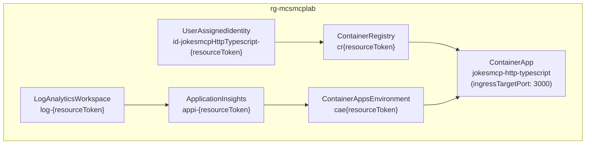

Sources: [docs/special-ops/mcs-mcp/source/infra/main.bicep:1-44](), [docs/special-ops/mcs-mcp/source/infra/resources.bicep:1-100](), [docs/special-ops/mcs-mcp/source/azure.yaml:1-12]()

---

## Integration with VS Code / GitHub Copilot

**Diagram: VS Code MCP server registration flow**

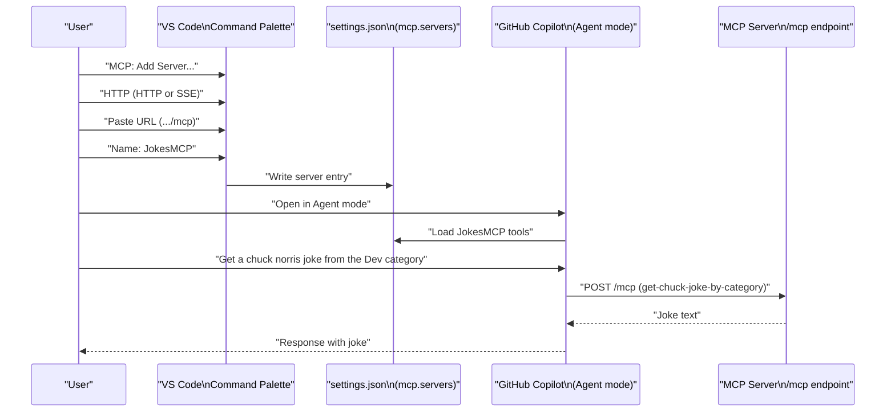

Steps:
1. Open the VS Code Command Palette and run **MCP: Add Server...**
2. Choose **HTTP (HTTP or Server-Sent Events)**
3. Paste the full MCP URL (devtunnel or Azure Container App URL + `/mcp`)
4. Name the server (e.g. `JokesMCP`) and save to **User Settings**
5. Open GitHub Copilot in **Agent** mode and verify `JokesMCP` tools appear in the tools menu

Sources: [docs/special-ops/mcs-mcp/index.md:119-158]()

---

## Integration with Microsoft Copilot Studio

### What Copilot Studio Does Behind the Scenes

When you add an MCP server in Copilot Studio, it automatically generates a custom connector that wraps the MCP endpoint. This connector inherits connector-level security and governance.

**Diagram: Copilot Studio MCP integration architecture**

```mermaid
graph LR
  A["User Message\n(Test pane)"]
  B["Jokester Agent\n(Copilot Studio)"]
  C["Jokes MCP Server\n(Tool in agent)"]
  D["Custom Connector\n(auto-created by CPS)"]
  E["MCP Server\n/mcp endpoint"]
  F["get-chuck-joke\nor get-dad-joke"]

  A --> B
  B --> C
  C --> D
  D --> E
  E --> F
```

Sources: [docs/special-ops/mcs-mcp/index.md:160-326]()

### Steps: Create the Jokester Agent

1. Navigate to [copilotstudio.microsoft.com](https://copilotstudio.microsoft.com) and create a **blank agent**
2. Name it `Jokester`
3. Set the description and instructions (provided in the lab)
4. Go to **Tools** → **Add a tool** → **Model Context Protocol**
5. Enter the tool name (`Jokes MCP Server`), description, and the MCP server URL (`https://.../mcp`)
6. Select **Create** — Copilot Studio provisions the connector
7. Create a connection (initially shown as **Not connected**)
8. In the test pane, send a message; when prompted, open **connection manager** and connect
9. Start a new testing session and send `Can I get a Chuck Norris joke?`

### Agent Configuration Summary

| Field | Value |
|---|---|
| Agent name | `Jokester` |
| Tool name | `Jokes MCP Server` |
| Tool type | Model Context Protocol |
| MCP URL | `https://<host>/mcp` |
| Tools exposed | `get-chuck-joke`, `get-chuck-joke-by-category`, `get-chuck-categories`, `get-dad-joke` |

Sources: [docs/special-ops/mcs-mcp/index.md:163-326]()

---

## End-to-End Request Flow Summary

**Diagram: Full request lifecycle from user prompt to joke response**

```mermaid
sequenceDiagram
  participant User as "User"
  participant CPS as "Copilot Studio\nJokester Agent"
  participant Conn as "Custom Connector\n(auto-generated)"
  participant Srv as "server.ts\napp.post('/mcp')"
  participant Transport as "StreamableHTTPServerTransport"
  participant MCP as "McpServer\n(mcp-streamable-http)"
  participant API as "api.chucknorris.io"

  User->>CPS: "Can I get a Chuck Norris joke?"
  CPS->>Conn: "Invoke get-chuck-joke tool"
  Conn->>Srv: "POST /mcp"
  Srv->>Transport: "new StreamableHTTPServerTransport"
  Transport->>MCP: "server.connect(transport)"
  MCP->>API: "GET /jokes/random"
  API-->>MCP: "joke JSON"
  MCP-->>Transport: "content[0].text = joke"
  Transport-->>Srv: "JSON-RPC response"
  Srv-->>Conn: "HTTP 200"
  Conn-->>CPS: "Tool output"
  CPS-->>User: "Here's a Chuck Norris joke: ..."
```

Sources: [docs/special-ops/mcs-mcp/source/src/server.ts:103-129](), [docs/special-ops/mcs-mcp/index.md:160-326]()

---

## Cleanup

After finishing the lab, if you deployed to Azure, remove all provisioned resources with:

```bash
azd down
```

This deletes the resource group and all contained resources (Container App, Container Registry, App Insights, Log Analytics workspace, managed identity).

Sources: [docs/special-ops/mcs-mcp/index.md:328-338]()

---

# Page: PAC CLI MCP Lab

# PAC CLI MCP Lab

<details>
<summary>Relevant source files</summary>

The following files were used as context for generating this wiki page:

- [.gitignore](.gitignore)
- [docs/.vitepress/config.mts](docs/.vitepress/config.mts)
- [docs/special-ops/index.md](docs/special-ops/index.md)
- [docs/special-ops/mcs-mcp/index.md](docs/special-ops/mcs-mcp/index.md)
- [docs/special-ops/pac-cli-mcp/assets/powerplatform-cli-mcp-added-vs-code.png](docs/special-ops/pac-cli-mcp/assets/powerplatform-cli-mcp-added-vs-code.png)
- [docs/special-ops/pac-cli-mcp/assets/restrict-developer-environments-to-admins-only.png](docs/special-ops/pac-cli-mcp/assets/restrict-developer-environments-to-admins-only.png)
- [docs/special-ops/pac-cli-mcp/assets/show-trial-env-creation-setting.png](docs/special-ops/pac-cli-mcp/assets/show-trial-env-creation-setting.png)
- [docs/special-ops/pac-cli-mcp/index.md](docs/special-ops/pac-cli-mcp/index.md)
- [docs/special-ops/pac-cli-mcp/power-platform-plan/index.md](docs/special-ops/pac-cli-mcp/power-platform-plan/index.md)

</details>


## Purpose and Scope

This page documents the **Power Platform CLI MCP** Special Ops lab. It covers how to install the `pac` CLI tool, locate and configure the built-in `pac-mcp.exe` MCP server in VS Code, authenticate with a Power Platform tenant, and use GitHub Copilot to manage tenant settings through natural language commands.

This lab is rank-independent and standalone. For the companion Special Ops lab that builds and deploys a custom MCP server from TypeScript source, see [MCS MCP Lab](#3.1). For background on the MCP protocol itself, see [Special Ops Labs Overview](#3).

---

## What Is the Power Platform CLI?

The Microsoft Power Platform CLI (`pac`) is a command-line tool for developers and administrators to manage resources across the Power Platform. It is distributed as a .NET global tool under the NuGet package name `Microsoft.PowerApps.CLI.Tool`.

**Capability areas exposed by the CLI:**

| Area | Example Operations |
|---|---|
| Environment lifecycle | Create, list, and delete environments |
| Authentication | Manage auth profiles for multiple tenants |
| Dataverse | Work with tables, data, and configurations |
| Solutions | Import, export, and manage solution packages |
| Power Pages | Deploy and configure websites |
| Code components | Create and manage PCF controls |
| Tenant settings | Read and update admin-level tenant configuration |

Sources: [docs/special-ops/pac-cli-mcp/index.md:16-26]()

---

## Installing the CLI

The CLI is installed as a .NET global tool. The prerequisite is **.NET 8.0 or later**.

```bash
dotnet tool install --global Microsoft.PowerApps.CLI.Tool
```

After installation, verify with:

```bash
pac
```

Expected output:

```text
Microsoft PowerPlatform CLI
Version: 1.30.3+g0f0e0b9
```

To upgrade:

```bash
dotnet tool update --global Microsoft.PowerApps.CLI.Tool
```

**Installation path:** The `pac` executable is placed in `%USERPROFILE%\.dotnet\tools`, which is automatically added to the system `PATH`.

Sources: [docs/special-ops/pac-cli-mcp/index.md:29-80]()

---

## The MCP Server Component

Starting with version **1.44**, the `pac` CLI ships a built-in MCP server executable: `pac-mcp.exe`. This server uses the **stdio** transport (not HTTP), meaning it is launched as a subprocess by the MCP host (VS Code) rather than connecting to a running HTTP endpoint. This distinguishes it from the HTTP-based Jokes MCP server in the [MCS MCP Lab](#3.1).

**Location of `pac-mcp.exe`:**

```text
%USERPROFILE%\.dotnet\tools\.store\microsoft.powerapps.cli.tool\[version]\microsoft.powerapps.cli.tool\[version]\tools\net8.0\any\pac-mcp.exe
```

To resolve the exact path for the installed version:

```bash
pac copilot mcp
```

This command prints the resolved path to `pac-mcp.exe` for the current installation.

**Supported operations (20+ commands):**

| Category | Operations |
|---|---|
| Environment Management | List, create, manage environments |
| Solution Operations | Import, export, package solutions |
| Authentication | Auth profiles and tenant connections |
| Dataverse Operations | Tables, data, configurations |
| Power Pages | Website deployments |
| Component Management | PCF controls and components |
| Tenant Settings | Read/write admin-level settings |

Sources: [docs/special-ops/pac-cli-mcp/index.md:82-107]()

---

## System Architecture

The following diagram shows how the components relate at the code and process level.

**Diagram: PAC CLI MCP Runtime Architecture**

```mermaid
flowchart TD
    User["User (natural language)"]
    GHCopilot["GitHub Copilot\n(VS Code Agent mode)"]
    MCPConfig["VS Code MCP config\n(settings.json)"]
    PacMCP["pac-mcp.exe\n(stdio MCP server)"]
    PacCLI["pac CLI\n(Microsoft.PowerApps.CLI.Tool)"]
    PPAdmin["Power Platform Admin API"]
    Tenant["Power Platform Tenant"]

    User --> GHCopilot
    GHCopilot -->|"reads server config"| MCPConfig
    MCPConfig -->|"spawns subprocess"| PacMCP
    GHCopilot -->|"MCP tool calls (stdio)"| PacMCP
    PacMCP -->|"delegates to"| PacCLI
    PacCLI -->|"authenticated REST calls"| PPAdmin
    PPAdmin --> Tenant
```

Sources: [docs/special-ops/pac-cli-mcp/index.md:82-141]()

---

## Setting Up PAC CLI MCP in VS Code

### Step 1: Locate the Executable

Run the following to get the path:

```bash
pac copilot mcp
```

Copy the full path to `pac-mcp.exe` from the output.

### Step 2: Register as an MCP Server

1. Open the VS Code Command Palette (`Ctrl+Shift+P` / `Cmd+Shift+P`).
2. Search for `MCP` and select **MCP: Add Server**.
3. Select **Command (stdio)** — this is the transport type for `pac-mcp.exe`, not HTTP.
4. Paste the full path to `pac-mcp.exe`.
5. Name the server, e.g. `Power Platform CLI MCP`.

VS Code writes this configuration into the user `settings.json`. After registration the server should appear as active in the MCP panel. The server is invoked on demand as a subprocess, not as a persistent background service.

**Diagram: MCP Registration Flow (File and Command References)**

```mermaid
sequenceDiagram
    participant Dev as "Developer"
    participant VSCode as "VS Code"
    participant Settings as "settings.json"
    participant PacMCP as "pac-mcp.exe"
    participant GHCopilot as "GitHub Copilot"

    Dev->>VSCode: "MCP: Add Server"
    VSCode->>Dev: "Select transport: Command (stdio)"
    Dev->>VSCode: "Paste path from pac copilot mcp"
    VSCode->>Settings: "Write MCP server entry"
    Dev->>GHCopilot: "Send natural language prompt"
    GHCopilot->>Settings: "Read server config"
    GHCopilot->>PacMCP: "Spawn subprocess (stdio)"
    PacMCP-->>GHCopilot: "Tool list response"
    GHCopilot->>PacMCP: "Invoke tool (e.g. list-tenant-settings)"
    PacMCP-->>GHCopilot: "Tool result"
    GHCopilot-->>Dev: "Formatted response"
```

Sources: [docs/special-ops/pac-cli-mcp/index.md:108-141]()

---

## Authentication

Before issuing commands against a Power Platform tenant, an auth profile must be established.

**Create a new auth profile:**

```bash
pac auth create
```

**List existing profiles:**

```bash
pac auth list
```

Admin-level operations (such as reading or modifying tenant settings) require the authenticated account to hold **Power Platform administrator** permissions.

Sources: [docs/special-ops/pac-cli-mcp/index.md:188-198]()

---

## Mission: Tenant Settings via Natural Language

This lab mission demonstrates using GitHub Copilot with the PAC CLI MCP server to manage Power Platform tenant settings without memorizing CLI syntax.

### Why Manage Settings via CLI

The Power Platform Admin Center does not expose all available settings through its UI. The CLI provides access to the complete configuration surface.

| Advantage | Detail |
|---|---|
| Comprehensive access | `pac admin list-tenant-settings` exposes settings not visible in the web portal |
| Bulk operations | Multiple settings updated in a single command |
| Version control | Export settings to JSON with `--settings-file` for Git tracking |
| Automation | Commands integrate with CI/CD pipelines |
| Disaster recovery | JSON snapshots enable rapid restore of tenant configuration |

### Verification Checklist Before Running the Mission

```bash
pac --version                # Verify 1.44+ is installed
pac auth list                # Confirm authenticated profile exists
pac copilot mcp              # Confirm pac-mcp.exe path resolves
```

Sources: [docs/special-ops/pac-cli-mcp/index.md:173-260]()

---

## Natural Language to CLI Command Mapping

The MCP server translates GitHub Copilot tool calls into `pac` CLI commands. The following diagram maps example natural language inputs to the underlying code paths.

**Diagram: Natural Language → pac CLI Command Translation**

```mermaid
flowchart LR
    subgraph "Natural Language Inputs"
        NL1["Show trial environment creation setting"]
        NL2["Restrict developer environment creation to admins only"]
        NL3["Analyze tenant settings and provide governance plan"]
    end

    subgraph "pac-mcp.exe Tool Calls"
        T1["list-tenant-settings"]
        T2["update-tenant-settings"]
        T3["list-tenant-settings\n+ list environments"]
    end

    subgraph "pac CLI Commands"
        C1["pac admin list-tenant-settings"]
        C2["pac admin update-tenant-settings\n--setting-name disableDeveloperEnvironmentCreationByNonAdminUsers\n--setting-value true"]
        C3["pac admin list-tenant-settings --settings-file config.json\npac admin list"]
    end

    NL1 --> T1 --> C1
    NL2 --> T2 --> C2
    NL3 --> T3 --> C3
```

Sources: [docs/special-ops/pac-cli-mcp/index.md:262-314]()

---

## Example Interactions

### Example 1: View Current Settings

**Prompt:**
```text
Show me the current tenant settings for trial environment creation
```

GitHub Copilot calls the `list-tenant-settings` tool via `pac-mcp.exe`, which executes `pac admin list-tenant-settings` and returns the relevant setting value.

### Example 2: Update a Setting

**Prompt:**
```text
Update my tenant to restrict developer environment creation to admins only
```

Copilot calls the `update-tenant-settings` tool, which executes:

```powershell
pac admin update-tenant-settings --setting-name "disableDeveloperEnvironmentCreationByNonAdminUsers" --setting-value "true"
```

### Example 3: Strategic Governance Analysis

A more complex prompt instructs Copilot to retrieve all tenant settings, compare them against best practices, and produce a prioritized governance plan. This prompt is documented at [docs/special-ops/pac-cli-mcp/index.md:299-314]().

Sources: [docs/special-ops/pac-cli-mcp/index.md:262-330]()

---

## Governance Plan Reference

The lab includes a pre-generated example output of the strategic governance analysis prompt, saved as a separate document at [docs/special-ops/pac-cli-mcp/power-platform-plan/index.md](). This document covers:

- **Assessment** of 16 environments and dozens of tenant settings
- **Prioritized recommendations** across four priority tiers (Critical / High / Medium / Low)
- **Phased implementation roadmap** spanning 3–6 months
- **Ready-to-execute CLI commands** for each recommended change
- **Monitoring KPIs** and success metrics

**Priority tiers from the generated plan:**

| Priority | Timeframe | Example Setting |
|---|---|---|
| 🔴 Critical | Within 2 weeks | `disableTrialEnvironmentCreationByNonAdminUsers` |
| 🟠 High | 4–6 weeks | `enableTenantCapacityReportForEnvironmentAdmins` |
| 🟡 Medium | 8–12 weeks | `enableDesktopFlowDataPolicyManagement` |
| 🟢 Low | 3–6 months | `enableTenantSummaryReportForEnvironmentAdmins` |

Sources: [docs/special-ops/pac-cli-mcp/power-platform-plan/index.md:1-340]()

---

## Security and Tool Access Control

The MCP integration supports **selective tool exposure**: only the `pac` commands needed for a given session need to be enabled. This limits the blast radius if a Copilot interaction triggers an unintended operation.

**Recommended practices:**

- Enable only the commands required for the current task
- Review tool permissions before approving execution in Copilot
- Use environment-specific configurations
- Monitor the VS Code Output panel for MCP-related execution logs

Sources: [docs/special-ops/pac-cli-mcp/index.md:144-153]()

---

## Troubleshooting

| Symptom | Likely Cause | Resolution |
|---|---|---|
| MCP server not found in VS Code | Incorrect path in `settings.json` | Re-run `pac copilot mcp` and update path |
| MCP server not starting | CLI version below 1.44 | Run `dotnet tool update --global Microsoft.PowerApps.CLI.Tool` |
| Authentication errors | No valid auth profile | Run `pac auth create` |
| Tool access warnings | Tool not enabled in MCP config | Check VS Code Output window for MCP messages |

Sources: [docs/special-ops/pac-cli-mcp/index.md:155-172]()

---

## Relationship to Other Labs

The PAC CLI MCP lab and the MCS MCP lab are both Special Ops missions, but differ in approach and scope:

| Dimension | MCS MCP Lab ([3.1](#3.1)) | PAC CLI MCP Lab (this page) |
|---|---|---|
| MCP server source | Custom TypeScript server (`jokes-mcp-server`) | Built-in `pac-mcp.exe` in the CLI tool |
| Transport | HTTP / StreamableHTTPServerTransport | stdio (subprocess) |
| Deployment | Local devtunnel or Azure Container App | Local only (Windows) |
| Integration target | VS Code GitHub Copilot + Copilot Studio | VS Code GitHub Copilot |
| Domain | Custom joke API | Power Platform administration |
| Prerequisites | Node.js, Docker, Azure subscription | .NET 8+, Power Platform admin access |

Sources: [docs/special-ops/index.md:1-14](), [docs/special-ops/pac-cli-mcp/index.md:1-14](), [docs/special-ops/mcs-mcp/index.md:1-30]()

---

# Page: Documentation Site

# Documentation Site

<details>
<summary>Relevant source files</summary>

The following files were used as context for generating this wiki page:

- [.github/workflows/deploy-vitepress.yml](.github/workflows/deploy-vitepress.yml)
- [.gitignore](.gitignore)
- [docs/.vitepress/config.mts](docs/.vitepress/config.mts)
- [docs/special-ops/index.md](docs/special-ops/index.md)
- [docs/special-ops/mcs-mcp/index.md](docs/special-ops/mcs-mcp/index.md)
- [docs/special-ops/pac-cli-mcp/assets/powerplatform-cli-mcp-added-vs-code.png](docs/special-ops/pac-cli-mcp/assets/powerplatform-cli-mcp-added-vs-code.png)
- [docs/special-ops/pac-cli-mcp/assets/restrict-developer-environments-to-admins-only.png](docs/special-ops/pac-cli-mcp/assets/restrict-developer-environments-to-admins-only.png)
- [docs/special-ops/pac-cli-mcp/assets/show-trial-env-creation-setting.png](docs/special-ops/pac-cli-mcp/assets/show-trial-env-creation-setting.png)
- [docs/special-ops/pac-cli-mcp/index.md](docs/special-ops/pac-cli-mcp/index.md)
- [docs/special-ops/pac-cli-mcp/power-platform-plan/index.md](docs/special-ops/pac-cli-mcp/power-platform-plan/index.md)
- [package-lock.json](package-lock.json)
- [package.json](package.json)

</details>


This page describes how the Agent Academy documentation website is structured, what technologies it uses, and how markdown source files are transformed into the published site. It covers the framework, plugin integration, npm dependency management, and the relationship between source and output.

For configuration details (nav bar, sidebar, base URL, analytics), see [Site Configuration and Navigation](#4.1). For running the site locally and the automated deployment workflow, see [Local Development and Deployment](#4.2).

---

## Overview

The documentation site is a static site built with [VitePress](https://vitepress.dev/), a Vue-powered static site generator optimized for documentation. All course content, labs, and supporting pages are written as Markdown files under the `docs/` directory. VitePress compiles these into a set of HTML/JS/CSS assets that are served via GitHub Pages.

The key entry point for all site configuration is [docs/.vitepress/config.mts:1-194]().

---

## Technology Stack

| Component | Package | Version (from `package.json`) | Role |
|---|---|---|---|
| Static site generator | `vitepress` | `^2.0.0-alpha.12` | Compiles Markdown to HTML |
| Diagram rendering | `mermaid` | `^11.12.3` | Renders Mermaid diagrams in docs |
| Custom plugin | `vitepress-mermaid` | local (`./plugins/`) | Wires Mermaid into VitePress markdown pipeline |
| Runtime | Node.js | 22 (in CI) | Required by VitePress and npm |

`mermaid` appears in both `dependencies` and `devDependencies` in [package.json:1-17](). The `vitepress` package itself is only in `devDependencies`.

Sources: [package.json:1-17](), [package-lock.json:1-17]()

---

## Source Structure

**Diagram: Markdown Source to Published Site**

```mermaid
flowchart TD
    subgraph "Source (docs/)"
        md["Markdown files\n(.md)"]
        cfg["docs/.vitepress/config.mts"]
        plugin["docs/.vitepress/plugins/vitepress-mermaid"]
        assets["Static assets\n(images, logo.png)"]
    end

    subgraph "VitePress Build"
        vp["vitepress build docs\n(npm run docs:build)"]
        mermaidPlugin["mermaidPlugin\n(md.use)"]
    end

    subgraph "Output"
        dist["docs/.vitepress/dist/\n(HTML + JS + CSS)"]
    end

    subgraph "Hosting"
        gh["GitHub Pages\n(/agent-academy/)"]
    end

    md --> vp
    cfg --> vp
    plugin --> mermaidPlugin
    mermaidPlugin --> vp
    assets --> vp
    vp --> dist
    dist --> gh
```

Sources: [docs/.vitepress/config.mts:1-194](), [package.json:9-13](), [.github/workflows/deploy-vitepress.yml:48-55](), [.gitignore:18-19]()

---

## npm Scripts

The three primary scripts are defined in [package.json:9-13]():

| Script | Command | Purpose |
|---|---|---|
| `docs:dev` | `vitepress dev docs` | Local dev server with hot reload |
| `docs:build` | `vitepress build docs` | Production build to `docs/.vitepress/dist` |
| `docs:preview` | `vitepress preview docs` | Preview the production build locally |

All three target the `docs/` directory as the VitePress source root.

---

## VitePress Configuration

The entire site configuration lives in `docs/.vitepress/config.mts` and is exported via VitePress's `defineConfig` function.

**Diagram: config.mts Structure**

```mermaid
flowchart LR
    configmts["docs/.vitepress/config.mts\ndefineConfig()"]

    configmts --> title["title:\n'Agent Academy'"]
    configmts --> base["base:\n'/agent-academy/'"]
    configmts --> head["head[]\n- favicon link\n- Clarity analytics script"]
    configmts --> themeConfig["themeConfig{}"]
    configmts --> markdown["markdown.config\nmd.use(mermaidPlugin)"]

    themeConfig --> nav["nav[]\nHome / Our Team / Courses / Special Ops"]
    themeConfig --> sidebar["sidebar[]\nFull course hierarchy"]
    themeConfig --> lastUpdated["lastUpdated\n{text, formatOptions}"]
    themeConfig --> socialLinks["socialLinks[]\nGitHub repo link"]

    markdown --> mermaidPlugin["mermaidPlugin\nfrom './plugins/vitepress-mermaid'"]
```

Sources: [docs/.vitepress/config.mts:1-194]()

Key settings:

- **`base`**: Set to `/agent-academy/` so all asset paths resolve correctly under the GitHub Pages subdirectory. See [docs/.vitepress/config.mts:6]().
- **`head`**: Injects the Microsoft Clarity analytics tag (ID `u32wbf0qvv`) and a favicon `<link>` pointing to `/agent-academy/logo.png`. See [docs/.vitepress/config.mts:7-14]().
- **`lastUpdated`**: Configured with `dateStyle: 'long'` to display the last git commit date on each page. See [docs/.vitepress/config.mts:39-44]().
- **`socialLinks`**: Renders a GitHub icon linking to the repository in the site header. See [docs/.vitepress/config.mts:182-187]().

For the full nav and sidebar layout, see [Site Configuration and Navigation](#4.1).

---

## Mermaid Plugin Integration

VitePress does not natively render Mermaid diagrams in Markdown. A custom plugin bridges them.

The plugin is imported and registered in [docs/.vitepress/config.mts:2]() and [docs/.vitepress/config.mts:189-193]():

```
import { mermaidPlugin } from "./plugins/vitepress-mermaid";

markdown: {
  config: (md) => {
    md.use(mermaidPlugin);
  },
},
```

The `mermaidPlugin` function extends the `markdown-it` instance (`md`) that VitePress uses internally. Any fenced code block marked with ` ```mermaid ` in a Markdown file is processed by this plugin at build time.

**Diagram: Mermaid Rendering Pipeline**

```mermaid
sequenceDiagram
    participant Author as "Author (Markdown file)"
    participant VitePress as "VitePress (vitepress build)"
    participant mdit as "markdown-it instance (md)"
    participant mermaidPlugin as "mermaidPlugin\n(./plugins/vitepress-mermaid)"
    participant Browser as "Browser"

    Author ->> VitePress: "```mermaid ... ```"
    VitePress ->> mdit: "md.render(content)"
    mdit ->> mermaidPlugin: "fence token (lang='mermaid')"
    mermaidPlugin ->> mdit: "Return rendered HTML/SVG"
    mdit ->> VitePress: "HTML output"
    VitePress ->> Browser: "Static HTML page"
```

Sources: [docs/.vitepress/config.mts:2](), [docs/.vitepress/config.mts:189-193](), [package.json:4-8]()

---

## Deployment Pipeline

The deployment is fully automated via a GitHub Actions workflow at [.github/workflows/deploy-vitepress.yml:1-67]().

**Diagram: deploy-vitepress.yml Workflow**

```mermaid
flowchart TD
    trigger["Trigger:\npush to main\nor workflow_dispatch"]

    subgraph "build job (ubuntu-latest)"
        checkout["actions/checkout@v4\n(fetch-depth: 0)"]
        setupnode["actions/setup-node@v4\n(node-version: 22, cache: npm)"]
        setuppages["actions/configure-pages@v4"]
        install["npm ci"]
        build["npm run docs:build\n(vitepress build docs)"]
        upload["actions/upload-pages-artifact@v3\npath: docs/.vitepress/dist"]
    end

    subgraph "deploy job (ubuntu-latest)"
        deploy["actions/deploy-pages@v4"]
    end

    trigger --> checkout
    checkout --> setupnode
    setupnode --> setuppages
    setuppages --> install
    install --> build
    build --> upload
    upload --> deploy
    deploy --> ghpages["GitHub Pages\n(github-pages environment)"]
```

Sources: [.github/workflows/deploy-vitepress.yml:1-67]()

Key workflow details:

| Setting | Value |
|---|---|
| Trigger branch | `main` |
| Runner | `ubuntu-latest` |
| Node version | `22` |
| Install command | `npm ci` |
| Build command | `npm run docs:build` |
| Artifact path | `docs/.vitepress/dist` |
| Deploy target | `github-pages` environment |
| Owner restriction | `github.repository_owner == 'microsoft'` |

The `fetch-depth: 0` option on checkout ensures full git history is available, which VitePress uses to populate the `lastUpdated` timestamps on each page. See [.github/workflows/deploy-vitepress.yml:34-36]().

The `cancel-in-progress: false` concurrency setting means in-progress deployments are never cancelled—only queued runs are skipped. See [.github/workflows/deploy-vitepress.yml:22-25]().

For instructions on running the site locally and triggering builds manually, see [Local Development and Deployment](#4.2).

---

## Build Output and Ignored Files

The VitePress build produces output in two directories, both excluded from version control in [.gitignore:18-19]():

| Path | Contents |
|---|---|
| `docs/.vitepress/dist` | Final HTML/JS/CSS assets, uploaded to GitHub Pages |
| `docs/.vitepress/cache` | Intermediate build cache, not deployed |

---

# Page: Site Configuration and Navigation

# Site Configuration and Navigation

<details>
<summary>Relevant source files</summary>

The following files were used as context for generating this wiki page:

- [.gitignore](.gitignore)
- [docs/.vitepress/config.mts](docs/.vitepress/config.mts)
- [docs/special-ops/index.md](docs/special-ops/index.md)
- [docs/special-ops/mcs-mcp/index.md](docs/special-ops/mcs-mcp/index.md)
- [docs/special-ops/pac-cli-mcp/assets/powerplatform-cli-mcp-added-vs-code.png](docs/special-ops/pac-cli-mcp/assets/powerplatform-cli-mcp-added-vs-code.png)
- [docs/special-ops/pac-cli-mcp/assets/restrict-developer-environments-to-admins-only.png](docs/special-ops/pac-cli-mcp/assets/restrict-developer-environments-to-admins-only.png)
- [docs/special-ops/pac-cli-mcp/assets/show-trial-env-creation-setting.png](docs/special-ops/pac-cli-mcp/assets/show-trial-env-creation-setting.png)
- [docs/special-ops/pac-cli-mcp/index.md](docs/special-ops/pac-cli-mcp/index.md)
- [docs/special-ops/pac-cli-mcp/power-platform-plan/index.md](docs/special-ops/pac-cli-mcp/power-platform-plan/index.md)

</details>


This page covers the VitePress site configuration file for the Agent Academy documentation website — specifically how the navigation bar, sidebar, base URL, analytics, and Mermaid plugin are wired together in `docs/.vitepress/config.mts`. For information about running the site locally or deploying it to GitHub Pages, see [4.2](). For an overview of the VitePress framework itself and its relationship to the markdown source files, see [4]().

---

## Configuration File Overview

All site-level settings are defined in a single file: [docs/.vitepress/config.mts:1-194](). It exports a VitePress `defineConfig` object that controls the site title, base path, HTML head injection, theme configuration (nav and sidebar), and the markdown plugin pipeline.

**Top-level configuration fields:**

| Field | Value | Purpose |
|---|---|---|
| `title` | `"Agent Academy"` | Browser tab and site title |
| `base` | `"/agent-academy/"` | URL prefix for GitHub Pages deployment |
| `description` | `"Welcome to Copilot Studio Agent Academy..."` | HTML meta description |
| `head` | Array of tags | Injects favicon and analytics script |
| `themeConfig` | Object | Nav bar, sidebar, logo, social links, lastUpdated |
| `markdown.config` | Function | Registers the Mermaid plugin |

Sources: [docs/.vitepress/config.mts:1-194]()

---

## Base URL

The `base` field is set to `"/agent-academy/"` [docs/.vitepress/config.mts:6](). This prefix is prepended to all internal asset and page URLs, which is required because the site is served from a GitHub Pages subpath rather than a root domain. For example, the favicon is referenced as `/agent-academy/logo.png` [docs/.vitepress/config.mts:8]().

Sources: [docs/.vitepress/config.mts:4-13]()

---

## Head Injection

Two entries are added to the HTML `<head>` via the `head` array [docs/.vitepress/config.mts:7-14]():

1. **Favicon** — A `<link rel="icon">` pointing to `/agent-academy/logo.png`.
2. **Microsoft Clarity analytics** — An inline `<script>` tag that loads the Clarity tracking snippet with tag ID `u32wbf0qvv`. This is an IIFE that appends the Clarity script to the document at runtime.

Sources: [docs/.vitepress/config.mts:7-14]()

---

## Navigation Bar

The top navigation bar is defined under `themeConfig.nav` [docs/.vitepress/config.mts:19-38](). It contains four entries, two of which are dropdown menus.

**Nav bar structure:**

| Entry | Type | Links to |
|---|---|---|
| `Home` | Single link | `/` |
| `Our Team` | Single link | `/our-team/` |
| `Courses` | Dropdown | Recruit, Operative, Commander (Coming Soon) |
| `Special Ops (Labs)` | Dropdown | Overview, MCS ❤️ MCP, Power Platform CLI MCP |

**Courses dropdown items:**

| Label | Link |
|---|---|
| `Recruit` | `/recruit/` |
| `Operative` | `/operative/` |
| `Commander (Coming Soon)` | `/commander/` |

**Special Ops dropdown items:**

| Label | Link |
|---|---|
| `Overview` | `/special-ops/` |
| `MCS ❤️ MCP` | `/special-ops/mcs-mcp/` |
| `Power Platform CLI MCP` | `/special-ops/pac-cli-mcp/` |

**Diagram: Nav bar structure mapped to config.mts**

```mermaid
graph TD
    nav["themeConfig.nav"]
    home["{ text: 'Home', link: '/' }"]
    team["{ text: 'Our Team', link: '/our-team/' }"]
    courses["{ text: 'Courses', items: [...] }"]
    recruit["{ text: 'Recruit', link: '/recruit/' }"]
    operative["{ text: 'Operative', link: '/operative/' }"]
    commander["{ text: 'Commander (Coming Soon)', link: '/commander/' }"]
    specialops["{ text: 'Special Ops (Labs)', items: [...] }"]
    mcs["{ text: 'MCS MCP', link: '/special-ops/mcs-mcp/' }"]
    pac["{ text: 'Power Platform CLI MCP', link: '/special-ops/pac-cli-mcp/' }"]

    nav --> home
    nav --> team
    nav --> courses
    courses --> recruit
    courses --> operative
    courses --> commander
    nav --> specialops
    specialops --> mcs
    specialops --> pac
```

Sources: [docs/.vitepress/config.mts:19-38]()

---

## Sidebar

The sidebar is defined under `themeConfig.sidebar` as a flat array of section groups [docs/.vitepress/config.mts:45-181](). Unlike the nav bar, it is a single unified sidebar shown on all pages, not a per-path sidebar map.

The sidebar array contains four top-level entries:

| Entry | `collapsed` | Child items |
|---|---|---|
| `Home` | N/A (no children) | — |
| `Our Team` | N/A (no children) | — |
| `Courses` | — | Recruit (collapsed), Operative (collapsed), Commander link |
| `Special Ops (Labs)` | `true` | MCS ❤️ MCP, Power Platform CLI MCP |

Both the **Recruit** and **Operative** sections use `collapsed: true`, meaning they render as collapsed accordions by default.

### Recruit Sidebar Items

[docs/.vitepress/config.mts:51-113]()

| Label | Link path |
|---|---|
| Course Setup | `/recruit/00-course-setup/` |
| Introduction to Agents | `/recruit/01-introduction-to-agents/` |
| Copilot Studio Fundamentals | `/recruit/02-copilot-studio-fundamentals/` |
| Create A Declarative Agent For Microsoft 365 Copilot | `/recruit/03-create-a-declarative-agent-for-M365Copilot/` |
| Creating A Solution | `/recruit/04-creating-a-solution/` |
| Using Prebuilt Agents | `/recruit/05-using-prebuilt-agents/` |
| Create Agent From Conversation | `/recruit/06-create-agent-from-conversation/` |
| Add New Topic With Trigger | `/recruit/07-add-new-topic-with-trigger/` |
| Add Adaptive Cards | `/recruit/08-add-adaptive-card/` |
| Add An Agent Flow | `/recruit/09-add-an-agent-flow/` |
| Add Event Triggers | `/recruit/10-add-event-triggers/` |
| Publish Your Agents | `/recruit/11-publish-your-agent/` |
| Understanding Licensing | `/recruit/12-understanding-licensing/` |
| Course Completion Badge Recruit | `/recruit/course-completion-badges-recruit/` |

### Operative Sidebar Items

[docs/.vitepress/config.mts:114-168]()

| Label | Link path |
|---|---|
| Get started with the Hiring Agent | `/operative/01-get-started/` |
| Authoring Agent Instructions | `/operative/02-agent-instructions/` |
| Make your agent multi-agent ready with connected agents | `/operative/03-multi-agent/` |
| Automate your agent with Triggers | `/operative/04-automate-triggers/` |
| Understanding Agent Models | `/operative/05-model-selection/` |
| Content Moderation and AI Safety Essentials | `/operative/06-ai-safety/` |
| Extracting Resume Contents with Multi-Modal Prompts | `/operative/07-multimodal-prompts/` |
| Prompts - Dataverse Grounding | `/operative/08-dataverse-grounding/` |
| Generating an Interview Prep Document | `/operative/09-document-generation/` |
| Integrate with MCP Servers | `/operative/10-mcp/` |
| Obtain User Feedback with Adaptive Cards | `/operative/11-obtain-user-feedback/` |
| Course Completion Badge Operative | `/operative/course-completion-badges-operative` |

### Special Ops Sidebar Items

[docs/.vitepress/config.mts:172-180]()

| Label | Link path |
|---|---|
| MCS ❤️ MCP | `/special-ops/mcs-mcp/` |
| Power Platform CLI MCP | `/special-ops/pac-cli-mcp/` |

**Diagram: Sidebar hierarchy mapped to config.mts properties**

```mermaid
graph TD
    sidebar["themeConfig.sidebar (array)"]

    home_entry["{ text: 'Home', link: '/' }"]
    team_entry["{ text: 'Our Team', link: '/our-team/' }"]

    courses_group["{ text: 'Courses', items: [...] }"]

    recruit_group["{ text: 'Recruit', link: '/recruit/', collapsed: true, items: [...] }"]
    r0["00-course-setup"]
    r1["01-introduction-to-agents"]
    r2["02-copilot-studio-fundamentals"]
    r3["03-create-a-declarative-agent-for-M365Copilot"]
    r4["04-creating-a-solution"]
    r5["05-using-prebuilt-agents"]
    r6["06-create-agent-from-conversation"]
    r7["07-add-new-topic-with-trigger"]
    r8["08-add-adaptive-card"]
    r9["09-add-an-agent-flow"]
    r10["10-add-event-triggers"]
    r11["11-publish-your-agent"]
    r12["12-understanding-licensing"]
    r13["course-completion-badges-recruit"]

    operative_group["{ text: 'Operative', link: '/operative/', collapsed: true, items: [...] }"]
    o1["01-get-started"]
    o2["02-agent-instructions"]
    o3["03-multi-agent"]
    o4["04-automate-triggers"]
    o5["05-model-selection"]
    o6["06-ai-safety"]
    o7["07-multimodal-prompts"]
    o8["08-dataverse-grounding"]
    o9["09-document-generation"]
    o10["10-mcp"]
    o11["11-obtain-user-feedback"]
    o12["course-completion-badges-operative"]

    commander_entry["{ text: 'Commander (Coming Soon)', link: '/commander/' }"]

    specialops_group["{ text: 'Special Ops (Labs)', link: '/special-ops/', collapsed: true, items: [...] }"]
    s1["mcs-mcp"]
    s2["pac-cli-mcp"]

    sidebar --> home_entry
    sidebar --> team_entry
    sidebar --> courses_group
    courses_group --> recruit_group
    recruit_group --> r0
    recruit_group --> r1
    recruit_group --> r2
    recruit_group --> r3
    recruit_group --> r4
    recruit_group --> r5
    recruit_group --> r6
    recruit_group --> r7
    recruit_group --> r8
    recruit_group --> r9
    recruit_group --> r10
    recruit_group --> r11
    recruit_group --> r12
    recruit_group --> r13
    courses_group --> operative_group
    operative_group --> o1
    operative_group --> o2
    operative_group --> o3
    operative_group --> o4
    operative_group --> o5
    operative_group --> o6
    operative_group --> o7
    operative_group --> o8
    operative_group --> o9
    operative_group --> o10
    operative_group --> o11
    operative_group --> o12
    courses_group --> commander_entry
    sidebar --> specialops_group
    specialops_group --> s1
    specialops_group --> s2
```

Sources: [docs/.vitepress/config.mts:45-181]()

---

## Mermaid Plugin Integration

Mermaid diagram support is added via a custom local plugin. It is imported and registered in `config.mts` as follows [docs/.vitepress/config.mts:1-3,189-193]():

```
import { mermaidPlugin } from "./plugins/vitepress-mermaid";

markdown: {
  config: (md) => {
    md.use(mermaidPlugin);
  },
},
```

The `mermaidPlugin` is sourced from `docs/.vitepress/plugins/vitepress-mermaid` and is applied to the `markdown-it` (`md`) instance used by VitePress. This enables fenced code blocks with the `mermaid` language tag to be rendered as diagrams in the published HTML output.

**Diagram: Plugin wiring in the VitePress config pipeline**

```mermaid
flowchart LR
    configmts["config.mts\n(defineConfig)"]
    mdconfig["markdown.config(md)"]
    mermaidPlugin["mermaidPlugin\n(./plugins/vitepress-mermaid)"]
    markdownit["markdown-it instance (md)"]
    output["Rendered HTML\nwith Mermaid diagrams"]

    configmts --> mdconfig
    mdconfig --> markdownit
    mermaidPlugin --> markdownit
    markdownit --> output
```

Sources: [docs/.vitepress/config.mts:1-3,189-193]()

---

## Additional Theme Settings

**Logo and social links** [docs/.vitepress/config.mts:17-188]():

| Setting | Value |
|---|---|
| `themeConfig.logo` | `/logo.png` |
| `themeConfig.socialLinks` | GitHub icon → `https://github.com/microsoft/agent-academy/` |

**Last updated display** [docs/.vitepress/config.mts:39-44]():

The `lastUpdated` option is enabled with `text: 'Last updated at'` and `dateStyle: 'long'`, causing each page to show a human-readable last-modified timestamp derived from Git history. Individual pages can opt out by setting `lastUpdated: false` in their frontmatter (as seen in `docs/special-ops/index.md`).

Sources: [docs/.vitepress/config.mts:17-44](), [docs/special-ops/index.md:1-3]()

---

# Page: Local Development and Deployment

# Local Development and Deployment

<details>
<summary>Relevant source files</summary>

The following files were used as context for generating this wiki page:

- [.github/workflows/deploy-vitepress.yml](.github/workflows/deploy-vitepress.yml)
- [.vscode/extensions.json](.vscode/extensions.json)
- [CONTRIBUTING.md](CONTRIBUTING.md)
- [package-lock.json](package-lock.json)
- [package.json](package.json)
- [scripts/serve-docs.ps1](scripts/serve-docs.ps1)
- [scripts/validate-markdown.ps1](scripts/validate-markdown.ps1)

</details>


This page covers how to run the Agent Academy documentation site locally for development purposes, and how production deployments to GitHub Pages are automated via CI/CD. It focuses on the npm scripts, VitePress dev server, and the GitHub Actions workflow.

For information about the VitePress site configuration, sidebar structure, and mermaid plugin integration, see [Site Configuration and Navigation](#4.1). For content quality tools like markdownlint and cspell that run on pull requests, see [Contributing](#6).

---

## Prerequisites

| Requirement | Minimum Version | Notes |
|---|---|---|
| Node.js | 18+ | Required by VitePress |
| npm | Bundled with Node.js | Used for dependency management |

The repository is fully compatible with GitHub Codespaces, which ships with Node.js pre-installed.

Sources: [CONTRIBUTING.md:232-235]()

---

## Installing Dependencies

After cloning the repository, install the npm packages listed in [`package.json`](package.json):

```bash
npm install
```

This resolves the two direct dev dependencies defined in [`package.json:6-8`]():

| Package | Version | Role |
|---|---|---|
| `vitepress` | `^2.0.0-alpha.12` | Static site generator and dev server |
| `mermaid` | `^11.12.3` | Diagram rendering library |

Both packages are locked to specific resolved versions in [`package-lock.json`]().

Sources: [package.json:1-17](), [package-lock.json:1-17]()

---

## npm Scripts

The three VitePress-related scripts are defined in [`package.json:9-13`]():

| Script | Command | Purpose |
|---|---|---|
| `npm run docs:dev` | `vitepress dev docs` | Start dev server with hot reload |
| `npm run docs:build` | `vitepress build docs` | Compile static output to `docs/.vitepress/dist` |
| `npm run docs:preview` | `vitepress preview docs` | Serve the production build locally |

All three commands operate on the `docs/` directory as the VitePress source root.

Sources: [package.json:9-13]()

---

## Local Development Server

### Starting the Server

```bash
npm run docs:dev
```

The dev server starts at `http://localhost:5173/agent-academy/`. The `/agent-academy/` base path matches the `base` setting in the VitePress config (see [Site Configuration and Navigation](#4.1)).

### Hot Reload Behavior

While the server is running, VitePress watches the `docs/` directory and rebuilds automatically on file changes:

- Changes to any `.md` file trigger an incremental rebuild and browser reload.
- Changes to the VitePress configuration file (`docs/.vitepress/config.mts`) also trigger a rebuild.
- No manual server restart is required for content edits.

Sources: [CONTRIBUTING.md:284-292]()

### Helper Script

The repository also includes [`scripts/serve-docs.ps1`](), a PowerShell wrapper that:

1. Verifies Node.js is available (`node --version`)
2. Verifies npm is available (`npm --version`)
3. Checks for the presence of `node_modules/`; runs `npm install` if absent
4. Executes `npm run docs:dev`

This script is useful for contributors who want a single command that handles dependency checks before launching the server.

**Script flow diagram:**

```mermaid
flowchart TD
  A["serve-docs.ps1"] --> B{"node available?"}
  B -- "no" --> C["exit 1"]
  B -- "yes" --> D{"npm available?"}
  D -- "no" --> C
  D -- "yes" --> E{"node_modules/ exists?"}
  E -- "no" --> F["npm install"]
  F --> G["npm run docs:dev"]
  E -- "yes" --> G
```

Sources: [scripts/serve-docs.ps1:1-59]()

---

## Production Build

```bash
npm run docs:build
```

This runs `vitepress build docs` and outputs the compiled static site to `docs/.vitepress/dist`. The build result is a fully self-contained set of HTML, CSS, and JavaScript files suitable for serving from any static host.

To verify the production build locally before deploying:

```bash
npm run docs:preview
```

Sources: [package.json:9-13](), [CONTRIBUTING.md:293-306]()

---

## CI/CD: GitHub Actions Deployment

The file [`.github/workflows/deploy-vitepress.yml`]() automates deployment to GitHub Pages. The workflow is named `Deploy VitePress site to Pages`.

### Trigger Conditions

| Trigger | Condition |
|---|---|
| `push` | Only on the `main` branch |
| `workflow_dispatch` | Manual trigger from the GitHub Actions tab |

The `build` job includes a guard condition: `if: github.repository_owner == 'microsoft'`. This prevents forks from accidentally deploying to GitHub Pages.

Sources: [.github/workflows/deploy-vitepress.yml:5-29]()

### Concurrency

```yaml
concurrency:
  group: pages
  cancel-in-progress: false
```

Only one deployment runs at a time. Queued runs are skipped in favor of the latest, but a run already in progress is never cancelled — this ensures in-flight deployments complete cleanly.

Sources: [.github/workflows/deploy-vitepress.yml:22-24]()

### Workflow Structure

The workflow has two sequential jobs: `build` and `deploy`.

**Workflow job diagram:**

```mermaid
flowchart LR
  push["push to main"] --> build_job
  dispatch["workflow_dispatch"] --> build_job

  subgraph build_job["job: build (ubuntu-latest)"]
    checkout["actions/checkout@v4\nfetch-depth: 0"]
    setup_node["actions/setup-node@v4\nnode-version: 22\ncache: npm"]
    setup_pages["actions/configure-pages@v4"]
    npm_ci["npm ci"]
    npm_build["npm run docs:build"]
    upload["actions/upload-pages-artifact@v3\npath: docs/.vitepress/dist"]
    checkout --> setup_node --> setup_pages --> npm_ci --> npm_build --> upload
  end

  build_job --> deploy_job

  subgraph deploy_job["job: deploy (ubuntu-latest)"]
    deploy_pages["actions/deploy-pages@v4"]
  end
```

Sources: [.github/workflows/deploy-vitepress.yml:26-67]()

### Build Job Steps

| Step | Action | Notes |
|---|---|---|
| Checkout | `actions/checkout@v4` | `fetch-depth: 0` fetches full history (used by VitePress for last-updated timestamps) |
| Setup Node | `actions/setup-node@v4` | Node.js 22; npm cache enabled |
| Setup Pages | `actions/configure-pages@v4` | Configures GitHub Pages environment |
| Install deps | `npm ci` | Reproducible install using `package-lock.json` |
| Build | `npm run docs:build` | Outputs to `docs/.vitepress/dist` |
| Upload artifact | `actions/upload-pages-artifact@v3` | Uploads `docs/.vitepress/dist` as the Pages artifact |

Sources: [.github/workflows/deploy-vitepress.yml:28-54]()

### Deploy Job Steps

| Step | Action | Notes |
|---|---|---|
| Deploy | `actions/deploy-pages@v4` | Publishes the uploaded artifact to GitHub Pages |

The deploy job depends on the `build` job via `needs: build` and runs in the `github-pages` environment, which outputs the live `page_url`.

Sources: [.github/workflows/deploy-vitepress.yml:57-67]()

### Required Permissions

```yaml
permissions:
  contents: read
  pages: write
  id-token: write
```

The `pages: write` and `id-token: write` permissions are required by `actions/deploy-pages@v4` for GitHub OIDC-based deployment.

Sources: [.github/workflows/deploy-vitepress.yml:15-18]()

---

## End-to-End Flow Summary

**From source edit to live site:**

```mermaid
sequenceDiagram
  participant "Developer"
  participant "GitHub (main branch)"
  participant "deploy-vitepress.yml"
  participant "build job"
  participant "deploy job"
  participant "GitHub Pages"

  "Developer"->>"GitHub (main branch)": git push
  "GitHub (main branch)"->>"deploy-vitepress.yml": trigger on push to main
  "deploy-vitepress.yml"->>"build job": start (if owner == microsoft)
  "build job"->>"build job": npm ci
  "build job"->>"build job": npm run docs:build
  "build job"->>"build job": upload docs/.vitepress/dist artifact
  "build job"->>"deploy job": needs: build satisfied
  "deploy job"->>"GitHub Pages": actions/deploy-pages@v4
  "GitHub Pages"-->>"Developer": site live at page_url
```

Sources: [.github/workflows/deploy-vitepress.yml:1-67](), [package.json:9-13]()

---

# Page: Badge and Completion System

# Badge and Completion System

<details>
<summary>Relevant source files</summary>

The following files were used as context for generating this wiki page:

- [.github/ISSUE_TEMPLATE/operative-completion-submission-form.yml](.github/ISSUE_TEMPLATE/operative-completion-submission-form.yml)
- [.github/ISSUE_TEMPLATE/recruit-completion-submission.yml](.github/ISSUE_TEMPLATE/recruit-completion-submission.yml)
- [.github/workflows/add-comment-to-recruit-issues.yml](.github/workflows/add-comment-to-recruit-issues.yml)
- [docs/operative/course-completion-badges-operative/assets/HiringAgent.png](docs/operative/course-completion-badges-operative/assets/HiringAgent.png)
- [docs/operative/course-completion-badges-operative/assets/InterviewAgent.png](docs/operative/course-completion-badges-operative/assets/InterviewAgent.png)
- [docs/operative/course-completion-badges-operative/assets/operativebadge.png](docs/operative/course-completion-badges-operative/assets/operativebadge.png)
- [docs/operative/course-completion-badges-operative/assets/solution.png](docs/operative/course-completion-badges-operative/assets/solution.png)
- [docs/operative/course-completion-badges-operative/assets/uploadimage.png](docs/operative/course-completion-badges-operative/assets/uploadimage.png)
- [docs/operative/course-completion-badges-operative/index.md](docs/operative/course-completion-badges-operative/index.md)
- [docs/recruit/course-completion-badges-recruit/assets/agent.png](docs/recruit/course-completion-badges-recruit/assets/agent.png)
- [docs/recruit/course-completion-badges-recruit/assets/recruitbadge.png](docs/recruit/course-completion-badges-recruit/assets/recruitbadge.png)
- [docs/recruit/course-completion-badges-recruit/assets/solution.png](docs/recruit/course-completion-badges-recruit/assets/solution.png)
- [docs/recruit/course-completion-badges-recruit/assets/uploadimage.png](docs/recruit/course-completion-badges-recruit/assets/uploadimage.png)
- [docs/recruit/course-completion-badges-recruit/index.md](docs/recruit/course-completion-badges-recruit/index.md)

</details>


This page describes the end-to-end process for earning and issuing digital badges upon completing an Agent Academy course track. It covers the GitHub issue submission templates, required evidence, the GitHub Actions workflow that automates follow-up comments, the external Badge Validation Form, and the Global AI Community platform where badges are hosted.

For information about the course content that leads to badge eligibility, see the Course Tracks pages ([2](#2), [2.1](#2.1), [2.2](#2.2), [2.3](#2.3)).

---

## System Overview

Badges are not issued automatically. Every submission is reviewed by a human. The process involves three distinct systems working together:

1. **GitHub Issues** — Learners submit a structured completion form as a GitHub issue.
2. **GitHub Actions** — An automated workflow detects labeled issues and posts a comment with the badge validation form link.
3. **External Systems** — A Badge Validation Form (Microsoft Forms via `aka.ms` short link) and the Global AI Community platform (`globalai.community`) handle identity verification and badge delivery.

**End-to-End Submission Flow**

```mermaid
flowchart TD
    A["Learner completes course track"] --> B["Stars the Agent Academy GitHub repo"]
    B --> C["Submits GitHub Issue using issue template"]
    C --> D{"Which track?"}
    D --> E["recruit-completion-submission.yml\n(label: recruit-completed)"]
    D --> F["operative-completion-submission-form.yml\n(label: operative-completed)"]
    E --> G["add-comment-to-recruit-issues.yml\ntriggers on workflow_dispatch"]
    F --> H["Manual reviewer notified"]
    G --> I["GitHub bot posts comment\nwith aka.ms/agent-academy-recruit/form link"]
    H --> J["Reviewer checks screenshots and fields"]
    I --> K["Learner submits Badge Validation Form\naka.ms/agent-academy-recruit/form or\naka.ms/agent-academy-operative/form"]
    J --> K
    K --> L["Learner logs in to globalai.community account"]
    L --> M["Badge issued within ~14 business days"]
```

Sources: [.github/ISSUE_TEMPLATE/recruit-completion-submission.yml:1-69](), [.github/ISSUE_TEMPLATE/operative-completion-submission-form.yml:1-69](), [.github/workflows/add-comment-to-recruit-issues.yml:1-46](), [docs/recruit/course-completion-badges-recruit/index.md:1-166](), [docs/operative/course-completion-badges-operative/index.md:1-170]()

---

## GitHub Issue Templates

Two issue templates in `.github/ISSUE_TEMPLATE/` drive the submission process. They use GitHub's structured YAML issue form format.

### Recruit Completion Template

**File:** [.github/ISSUE_TEMPLATE/recruit-completion-submission.yml:1-69]()

| Field | Type | Required | Purpose |
|---|---|---|---|
| Curriculum Completion Validation | `checkboxes` | Yes | Confirms learner completed the Recruit curriculum |
| Solution Verification | `checkboxes` | Yes | Confirms two screenshots are attached |
| Final Solution Screenshots (`Final_solution`) | `textarea` | Yes | PNG uploads of IT Help Desk Agent and solution file |
| Key Learnings and Takeaways (`learnings`) | `textarea` | Yes | Free-form reflection on the Recruit path |
| Challenges Faced (`challenges`) | `textarea` | Yes | Difficulty or mission-specific feedback |
| Final Thoughts (`final_thoughts`) | `textarea` | Yes | Improvement suggestions |
| Badge validation form | `checkboxes` | Yes | Confirms submission of the external badge form |

- **Label applied:** `recruit-completed`
- **Issue title format:** `<Insert Name> Recruit Completion Submission`

[.github/ISSUE_TEMPLATE/recruit-completion-submission.yml:4-6]()

### Operative Completion Template

**File:** [.github/ISSUE_TEMPLATE/operative-completion-submission-form.yml:1-69]()

Identical field structure to the Recruit template, with the following differences:

| Difference | Recruit | Operative |
|---|---|---|
| Label | `recruit-completed` | `operative-completed` |
| Agent under review | IT Help Desk Agent | Hiring Agent + Interview Agent |
| Screenshot count | 2 | 3 (solution file, Hiring Agent, Interview Agent) |
| Badge form URL | `aka.ms/agent-academy-recruit/form` | `aka.ms/agent-academy-operative/form` |
| Completion form URL | `aka.ms/agent-academy-recruit/badge` | `aka.ms/agent-academy-operative/badge` |

[.github/ISSUE_TEMPLATE/operative-completion-submission-form.yml:4-6](), [docs/operative/course-completion-badges-operative/index.md:64-103]()

---

## GitHub Actions Workflow

**File:** [.github/workflows/add-comment-to-recruit-issues.yml:1-46]()

```mermaid
flowchart LR
    T["workflow_dispatch\n(manual trigger)"] --> J["add_comments job\n(ubuntu-latest)"]
    J --> S["actions/github-script@v6"]
    S --> Q["github.rest.issues.listForRepo\nlabels: recruit-completed\nstate: open"]
    Q --> F{"issue.labels.length === 1\nAND labels[0].name === recruit-completed\nAND NOT issue.pull_request"}
    F -->|"Yes"| C["github.rest.issues.createComment\nbody: badge form link"]
    F -->|"No"| SKIP["Skip issue"]
```

Sources: [.github/workflows/add-comment-to-recruit-issues.yml:1-46]()

### Key Details

- **Trigger:** `workflow_dispatch` only — manually run by maintainers. It does not fire automatically on issue creation.
- **Token:** Uses `secrets.GH_PAT` (a Personal Access Token), not the default `GITHUB_TOKEN`. This requires the `issues: write` permission declared at the workflow level.
- **Filter logic:** The script skips issues that have more than one label. This prevents double-commenting on issues that have already been processed or escalated with additional labels.
- **Comment body posted:**
  > "Thank you for filling out the Recruit Completion Form. In order to collect your digital badge, you must submit the following Badge Validation Form: https://aka.ms/agent-academy-recruit/form."

[.github/workflows/add-comment-to-recruit-issues.yml:30-45]()

> **Note:** There is no equivalent automated workflow file for Operative issues in the provided codebase. Operative submissions are handled through the same manual review process but without the automated comment step.

---

## Submission Requirements by Track

### Recruit Track

Documented in [docs/recruit/course-completion-badges-recruit/index.md]().

**Screenshot requirements:**

| Screenshot | Content Required |
|---|---|
| Agent overview page | IT Help Desk Agent overview with environment name visible |
| Solution file | Solution file with "All" section expanded and environment name visible |

**Important constraint:** Screenshots must show the IT Help Desk Agent built in the Recruit path. Screenshots of any other agent are rejected.

[docs/recruit/course-completion-badges-recruit/index.md:43-45]()

### Operative Track

Documented in [docs/operative/course-completion-badges-operative/index.md]().

**Screenshot requirements:**

| Screenshot | Content Required |
|---|---|
| Solution file | Solution file with "All" section expanded and environment name visible |
| Hiring Agent overview | Agent overview with environment name visible |
| Interview Agent overview | Agent overview with environment name visible |

**Important constraint:** Screenshots must show the Hiring Agent (and Interview Agent) built in the Operative path only.

[docs/operative/course-completion-badges-operative/index.md:41-44]()

---

## Submission Steps (All Tracks)

The documentation pages define a four-step protocol:

```mermaid
flowchart LR
    S1["Step 1\nStar the GitHub repo\ngithub.com/microsoft/agent-academy"] --> S2
    S2["Step 2\nSubmit Completion Form\n(GitHub Issue via ISSUE_TEMPLATE)"] --> S3
    S3["Step 3\nSubmit Badge Validation Form\n(aka.ms short link)"] --> S4
    S4["Step 4\nCreate/log in to\nglobalai.community account"]
```

Sources: [docs/recruit/course-completion-badges-recruit/index.md:54-123](), [docs/operative/course-completion-badges-operative/index.md:51-129]()

**Critical note on account email:** The email used in the Badge Validation Form must match the email used to create the `globalai.community` account. A mismatch prevents badge delivery even with a valid submission.

[docs/recruit/course-completion-badges-recruit/index.md:119-123]()

---

## Badge Issuance Timeline and Failure Handling

| Condition | Outcome |
|---|---|
| All steps complete and valid | Badge issued within ~14 business days |
| Missing screenshots or fields | Reviewer replies to the issue requesting missing info |
| No response within 2 weeks | Issue is closed; learner must resubmit |
| Badge Validation Form not submitted | Issue ineligible for badge; may be closed |
| Screenshot shows wrong agent | Submission rejected |
| Duplicate submissions | Slow down processing; not accepted |

[docs/recruit/course-completion-badges-recruit/index.md:128-137](), [docs/operative/course-completion-badges-operative/index.md:134-143]()

---

## Badge Hosting: Global AI Community

Badges for all tracks — Recruit, Operative, and Commander — are issued through the [Global AI Community](https://globalai.community) platform. Learners must have a registered account on that platform to receive their badge.

Badges are described as:
- **Verifiable** — tied to a submission reviewed by a human
- **Shareable** — suitable for LinkedIn, resumes, and portfolios
- **Evidence-based** — linked to a real working agent in a real environment, not self-attestation

[docs/recruit/course-completion-badges-recruit/index.md:30-38](), [docs/operative/course-completion-badges-operative/index.md:27-35]()

---

## File and Component Map

```mermaid
flowchart TD
    subgraph "GitHub Repository"
        IT1[".github/ISSUE_TEMPLATE/\nrecruit-completion-submission.yml"]
        IT2[".github/ISSUE_TEMPLATE/\noperative-completion-submission-form.yml"]
        WF1[".github/workflows/\nadd-comment-to-recruit-issues.yml"]
    end

    subgraph "Documentation Site"
        D1["docs/recruit/\ncourse-completion-badges-recruit/index.md"]
        D2["docs/operative/\ncourse-completion-badges-operative/index.md"]
    end

    subgraph "External Systems"
        EF1["Badge Validation Form\naka.ms/agent-academy-recruit/form"]
        EF2["Badge Validation Form\naka.ms/agent-academy-operative/form"]
        GAI["globalai.community\nbadge platform"]
    end

    IT1 -->|"label: recruit-completed"| WF1
    WF1 -->|"createComment with form link"| EF1
    IT2 -->|"label: operative-completed"| EF2
    D1 -->|"documents"| IT1
    D1 -->|"links to"| EF1
    D2 -->|"documents"| IT2
    D2 -->|"links to"| EF2
    EF1 --> GAI
    EF2 --> GAI
```

Sources: [.github/ISSUE_TEMPLATE/recruit-completion-submission.yml:1-69](), [.github/ISSUE_TEMPLATE/operative-completion-submission-form.yml:1-69](), [.github/workflows/add-comment-to-recruit-issues.yml:1-46](), [docs/recruit/course-completion-badges-recruit/index.md:1-166](), [docs/operative/course-completion-badges-operative/index.md:1-170]()

---

# Page: Contributing

# Contributing

<details>
<summary>Relevant source files</summary>

The following files were used as context for generating this wiki page:

- [.github/workflows/validate-markdown.yml](.github/workflows/validate-markdown.yml)
- [.markdownlint.jsonc](.markdownlint.jsonc)
- [.markdownlintignore](.markdownlintignore)
- [.vscode/extensions.json](.vscode/extensions.json)
- [CONTRIBUTING.md](CONTRIBUTING.md)
- [README.md](README.md)
- [SECURITY.md](SECURITY.md)
- [SUPPORT.md](SUPPORT.md)
- [cspell.json](cspell.json)
- [docs/operative/04-automate-triggers/assets/3.1.11.1_triggercondition.png](docs/operative/04-automate-triggers/assets/3.1.11.1_triggercondition.png)
- [docs/operative/04-automate-triggers/index.md](docs/operative/04-automate-triggers/index.md)
- [docs/operative/05-model-selection/assets/5.0_05_AIProvidersOperatingAsMicrosoftSubProcessors.png](docs/operative/05-model-selection/assets/5.0_05_AIProvidersOperatingAsMicrosoftSubProcessors.png)
- [docs/operative/05-model-selection/index.md](docs/operative/05-model-selection/index.md)
- [scripts/serve-docs.ps1](scripts/serve-docs.ps1)
- [scripts/validate-markdown.ps1](scripts/validate-markdown.ps1)

</details>


This page documents the processes and tooling required to contribute to the Agent Academy repository. It covers content standards, markdown linting, spell checking, and the automated CI workflow that validates all pull requests.

For information about how the documentation site is built and deployed, see [Documentation Site](#4). For information about running the site locally, see [Local Development and Deployment](#4.2).

---

## Overview

All contributions to this repository go through a pull request process enforced by two mechanisms:

1. **Manual standards** — content written following the Microsoft Docs Authoring Pack guidelines.
2. **Automated checks** — a GitHub Actions workflow (`validate-markdown.yml`) that runs linting, link checking, and spell checking on every PR.

The following diagram shows the overall contribution pipeline.

**Contribution validation pipeline**

```mermaid
flowchart TD
    A["Contributor forks repo"] --> B["Edits .md files in docs/"]
    B --> C["Runs local validation scripts"]
    C --> D["Opens Pull Request"]
    D --> E[".github/workflows/validate-markdown.yml triggers"]
    E --> F["markdown-lint job\n(markdownlint-cli2-action)"]
    E --> G["markdown-link-check job\n(github-action-markdown-link-check)"]
    E --> H["spell-check job\n(cspell)"]
    F --> I{"All jobs pass?"}
    G --> I
    H --> I
    I -->|"Yes"| J["CLA bot checks signature"]
    J --> K["PR eligible for merge"]
    I -->|"No"| L["PR blocked with warnings"]
```

Sources: [.github/workflows/validate-markdown.yml:1-79](), [CONTRIBUTING.md:1-30]()

---

## Documentation Standards

Content must follow Microsoft's documentation guidelines. The recommended reference is the **Microsoft Docs Authoring Pack** (`docsmsft.docs-authoring-pack`), which is listed as a recommended VS Code extension in [.vscode/extensions.json:4]().

The authoring pack covers:

- Clear, concise writing
- Proper markdown syntax
- Consistent terminology
- Effective document structure
- Accessibility best practices

---

## Markdown Linting

The repository uses `markdownlint-cli2` to enforce consistent markdown formatting.

### Configuration — `.markdownlint.jsonc`

Rules are configured in [.markdownlint.jsonc:1-32](). The table below summarizes the active overrides.

| Rule | Status | Justification |
|---|---|---|
| `MD013` (line-length) | Disabled | No line length standard defined |
| `MD024` (duplicate headings) | `siblings_only: true` | Common template sub-heading format |
| `MD029` (ordered list prefix) | `style: "one"` | Indented content resets numbering |
| `MD046` (code-block style) | Disabled | Code blocks used for plain text |
| `MD060` (table-column style) | Disabled | Mixed table styles used throughout |

All other rules remain enabled at their default state ([.markdownlint.jsonc:6]()).

Files under `.github/` are excluded via [.markdownlintignore:1]().

### Running Locally

Install the tool globally:

```bash
npm install -g markdownlint-cli2
```

Common commands from [CONTRIBUTING.md:37-45]():

```bash
# Scan all markdown files
markdownlint-cli2 "**/*.md"

# Scan a specific file
markdownlint-cli2 "docs/recruit/README.md"

# Auto-fix resolvable issues
markdownlint-cli2 --fix "**/*.md"
```

### Inline Rule Exceptions

When the global configuration does not cover a specific case, contributors can disable rules inline. The three available scopes are:

| Scope | Syntax |
|---|---|
| Next line only | `<!-- markdownlint-disable-next-line MD029 -->` |
| Block range | `<!-- markdownlint-disable MD029 -->` … `<!-- markdownlint-enable MD029 -->` |
| Entire file | Place `<!-- markdownlint-disable MD029 -->` at the top of the file |

**When to use exceptions** ([CONTRIBUTING.md:96-103]()):

| Rule | Typical reason for exception |
|---|---|
| `MD029` | Continuing numbered lists after other content |
| `MD013` | URLs or code examples that cannot be line-broken |
| `MD033` | HTML elements not achievable in plain markdown |
| `MD041` | Template files that intentionally omit a leading heading |

**Best practices:** Use `markdownlint-disable-next-line` where possible; add a comment explaining why; run the linter before committing.

### Common Errors and Fixes

| Error code | Fix |
|---|---|
| `MD036` | Use `## Heading` instead of `**Bold text**` |
| `MD007` | Indent unordered lists with 2 spaces, not 4 |
| `MD022` | Add blank lines before and after headings |
| `MD032` | Add blank lines before and after lists |
| `MD009` | Remove trailing spaces at end of lines |

Sources: [.markdownlint.jsonc:1-32](), [.markdownlintignore:1](), [CONTRIBUTING.md:19-125]()

---

## Spell Checking

Spell checking is performed by `cspell` (Code Spell Checker).

### Configuration — `cspell.json`

The configuration file is [cspell.json:1-99](). It specifies:

- **`language`**: `"en"` — English spell checking.
- **`words`**: A custom allow-list of domain-specific terms.
- **`ignorePaths`**: File patterns excluded from checking.

**Custom word list** (selected examples from [cspell.json:4-88]()):

| Word | Category |
|---|---|
| `Dataverse`, `powerapps`, `powerplatform` | Microsoft platform terms |
| `agentic`, `multimodal`, `HITL` | AI/agent domain terms |
| `Contoso`, `Entra` | Microsoft product names |
| `azurecontainerapps`, `devtunnel` | Infrastructure terms |
| `mcsmcplab`, `Streamable` | Repository-specific identifiers |
| `BYOM`, `SSML`, `DTMF` | Abbreviations used in course content |

**Ignored paths** ([cspell.json:89-98]()):

```
node_modules/**
.git/**
.github/**
*.js  *.css  *.min.js  *.map  *.html
```

### Running Locally

Install the tool globally:

```bash
npm install -g cspell
```

Common commands from [CONTRIBUTING.md:164-178]():

```bash
# Check all markdown files in the repository
cspell "**/*.md" --no-progress --no-summary

# Check docs folder only
cspell "docs/**/*.md"

# Show suggestions for flagged words
cspell --show-suggestions "docs/**/*.md"
```

### Adding New Words

If a legitimate term is flagged, add it to the `words` array in `cspell.json`:

```json
{
  "words": [
    "YourNewTechnicalTerm"
  ]
}
```

With the VS Code `streetsidesoftware.code-spell-checker` extension (listed in [.vscode/extensions.json:3]()), right-clicking a flagged word and selecting **Spelling → Add to cSpell configuration** performs this automatically.

Sources: [cspell.json:1-99](), [CONTRIBUTING.md:147-217](), [.vscode/extensions.json:1-8]()

---

## CI Workflow — `validate-markdown.yml`

The workflow at [.github/workflows/validate-markdown.yml:1-79]() runs on every pull request against any branch except `gh-pages`.

**Workflow job structure**

```mermaid
flowchart LR
    PR["Pull Request opened/updated"] --> ML
    PR --> LC
    PR --> SC

    ML["Job: markdown-lint\nRunner: ubuntu-latest"]
    ML --> ML1["actions/checkout@v4"]
    ML1 --> ML2["DavidAnson/markdownlint-cli2-action@v20\nglobs: **/*.md\nexclude: .github/**/*.md\nconfig: .markdownlint.jsonc"]
    ML2 --> ML3["Report step\n(if failure)"]

    LC["Job: markdown-link-check\nRunner: ubuntu-latest"]
    LC --> LC1["actions/checkout@v4"]
    LC1 --> LC2["tcort/github-action-markdown-link-check@v1\nquiet-mode: yes\nverbose: yes\ncheck-modified-files-only: no"]
    LC2 --> LC3["Report step\n(if failure, continue-on-error: true)"]

    SC["Job: spell-check\nRunner: ubuntu-latest"]
    SC --> SC1["actions/checkout@v4"]
    SC1 --> SC2["actions/setup-node@v4\nnode-version: 18"]
    SC2 --> SC3["npm install -g cspell"]
    SC3 --> SC4["cspell **/*.md\n--no-progress --no-summary"]
    SC4 --> SC5["Report step\n(if failure)"]
```

Sources: [.github/workflows/validate-markdown.yml:1-79]()

### Job Summary

| Job | Tool | `continue-on-error` | Blocks PR |
|---|---|---|---|
| `markdown-lint` | `markdownlint-cli2-action@v20` | `false` | Yes |
| `markdown-link-check` | `github-action-markdown-link-check@v1` | `true` | No (warning only) |
| `spell-check` | `cspell` (Node 18) | `false` | Yes |

Note: `markdown-link-check` is set to `continue-on-error: true` ([.github/workflows/validate-markdown.yml:43]()) because external links can fail transiently. The other two jobs fail the PR.

---

## Local Validation Script

A convenience PowerShell script at [scripts/validate-markdown.ps1:1-10]() runs both `markdownlint-cli2` and `cspell` in sequence, excluding `.venv`, `.github`, and `node_modules`. Run it from the repository root:

```powershell
./scripts/validate-markdown.ps1
```

A separate script, [scripts/serve-docs.ps1:1-59](), validates Node.js/npm availability and launches the VitePress development server. See [Local Development and Deployment](#4.2) for full details.

Sources: [scripts/validate-markdown.ps1:1-10](), [scripts/serve-docs.ps1:1-59]()

---

## Tooling Map

The following diagram maps the contributing tools to their configuration files and the code entities that invoke them.

**Tool-to-file relationships**

```mermaid
flowchart TD
    subgraph "CI: validate-markdown.yml"
        CI_Lint["markdown-lint job\nmarkdownlint-cli2-action@v20"]
        CI_Link["markdown-link-check job\ngithub-action-markdown-link-check@v1"]
        CI_Spell["spell-check job\ncspell CLI"]
    end

    subgraph "Config Files"
        MC[".markdownlint.jsonc"]
        CS["cspell.json"]
        MI[".markdownlintignore"]
    end

    subgraph "Local Scripts"
        PS["scripts/validate-markdown.ps1"]
        SS["scripts/serve-docs.ps1"]
    end

    subgraph "VS Code Extensions (.vscode/extensions.json)"
        EX1["docsmsft.docs-authoring-pack"]
        EX2["DavidAnson.vscode-markdownlint"]
        EX3["streetsidesoftware.code-spell-checker"]
    end

    CI_Lint --> MC
    CI_Lint --> MI
    CI_Spell --> CS
    PS --> MC
    PS --> CS
    EX2 --> MC
    EX3 --> CS
```

Sources: [.github/workflows/validate-markdown.yml:1-79](), [.markdownlint.jsonc:1-32](), [cspell.json:1-99](), [.markdownlintignore:1](), [scripts/validate-markdown.ps1:1-10](), [.vscode/extensions.json:1-8]()

---

## Contributor License Agreement (CLA)

When submitting a pull request, a CLA bot automatically checks whether the contributor has signed the **Contributor License Agreement**. If not, the bot posts a comment with instructions.

- The CLA only needs to be signed once across all Microsoft repositories.
- Details: `https://cla.opensource.microsoft.com`

---

## Code of Conduct

This project follows the **Microsoft Open Source Code of Conduct**.

- Full text: `https://opensource.microsoft.com/codeofconduct/`
- FAQ: `https://opensource.microsoft.com/codeofconduct/faq/`
- Contact: `opencode@microsoft.com`

Sources: [README.md:12-23]()

---

## Summary Checklist

Before opening a pull request:

| Step | Command |
|---|---|
| Run markdownlint | `markdownlint-cli2 "**/*.md"` |
| Run spell check | `cspell "**/*.md" --no-progress --no-summary` |
| Run both at once | `./scripts/validate-markdown.ps1` |
| Preview the site locally | `npm run docs:dev` or `./scripts/serve-docs.ps1` |
| Sign the CLA | Follow CLA bot instructions on the PR |