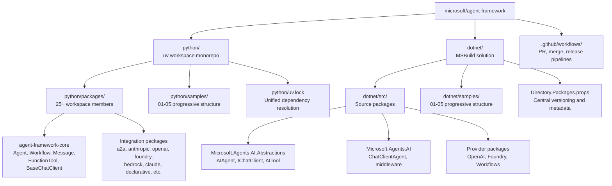
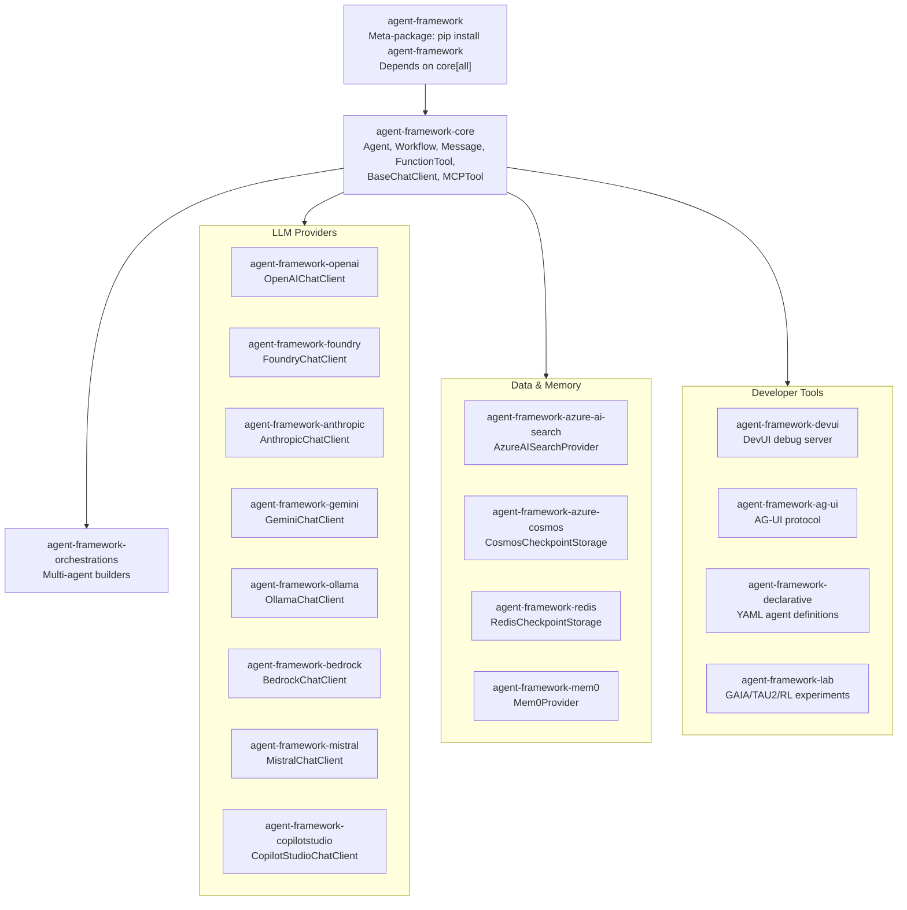
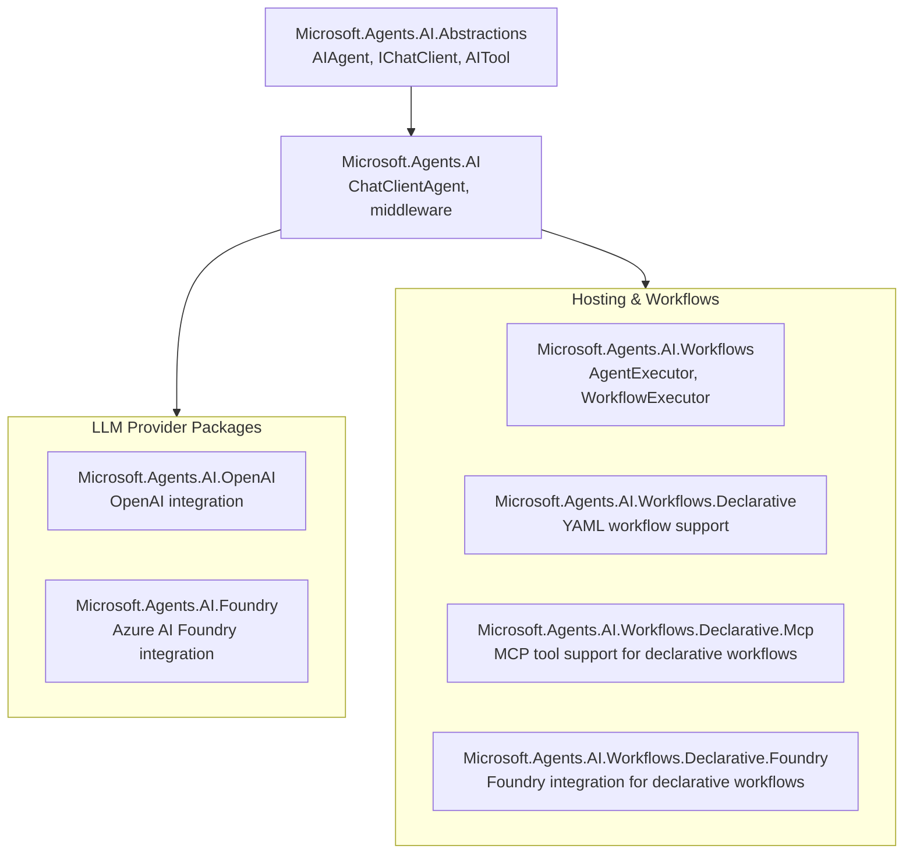
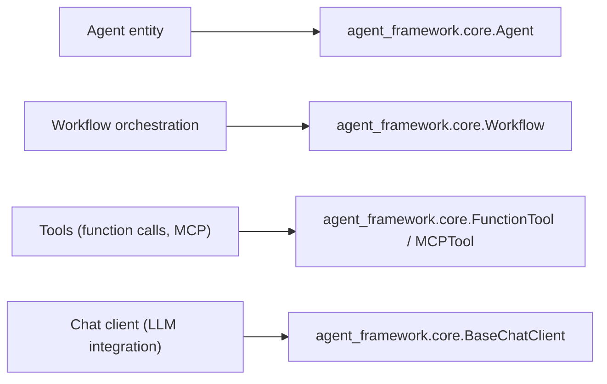
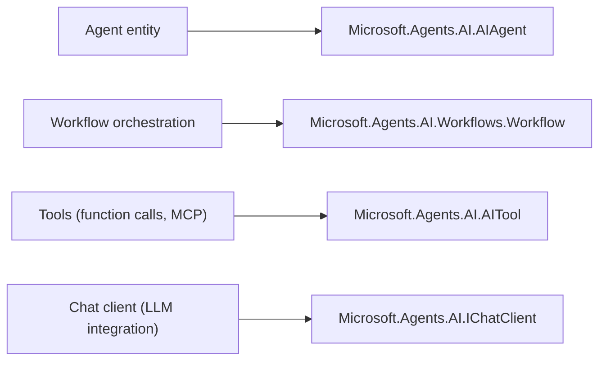

<!-- source: DeepWiki mcp.deepwiki.com · repo microsoft/agent-framework · page 1 Overview · fetched 2026-10-26 -->

# Overview

Relevant source files

The following files were used as context for generating this wiki page:

- [README.md](README.md)
- [SUPPORT.md](SUPPORT.md)
- [TRANSPARENCY_FAQ.md](TRANSPARENCY_FAQ.md)
- [dotnet/Directory.Packages.props](dotnet/Directory.Packages.props)
- [dotnet/README.md](dotnet/README.md)
- [dotnet/agent-framework-dotnet.slnx](dotnet/agent-framework-dotnet.slnx)
- [dotnet/samples/02-agents/AGUI/README.md](dotnet/samples/02-agents/AGUI/README.md)
- [dotnet/samples/02-agents/AgentProviders/anthropic/Agent_Anthropic_Step04_UsingSkills/Program.cs](dotnet/samples/02-agents/AgentProviders/anthropic/Agent_Anthropic_Step04_UsingSkills/Program.cs)
- [dotnet/samples/README.md](dotnet/samples/README.md)
- [dotnet/src/Microsoft.Agents.AI.Anthropic/AnthropicBetaServiceExtensions.cs](dotnet/src/Microsoft.Agents.AI.Anthropic/AnthropicBetaServiceExtensions.cs)
- [dotnet/src/Microsoft.Agents.AI.Anthropic/Microsoft.Agents.AI.Anthropic.csproj](dotnet/src/Microsoft.Agents.AI.Anthropic/Microsoft.Agents.AI.Anthropic.csproj)
- [dotnet/src/Microsoft.Agents.AI.Anthropic/PublicAPI/net10.0/PublicAPI.Shipped.txt](dotnet/src/Microsoft.Agents.AI.Anthropic/PublicAPI/net10.0/PublicAPI.Shipped.txt)
- [dotnet/src/Microsoft.Agents.AI.Anthropic/PublicAPI/net10.0/PublicAPI.Unshipped.txt](dotnet/src/Microsoft.Agents.AI.Anthropic/PublicAPI/net10.0/PublicAPI.Unshipped.txt)
- [dotnet/src/Microsoft.Agents.AI.Anthropic/PublicAPI/net472/PublicAPI.Shipped.txt](dotnet/src/Microsoft.Agents.AI.Anthropic/PublicAPI/net472/PublicAPI.Shipped.txt)
- [dotnet/src/Microsoft.Agents.AI.Anthropic/PublicAPI/net472/PublicAPI.Unshipped.txt](dotnet/src/Microsoft.Agents.AI.Anthropic/PublicAPI/net472/PublicAPI.Unshipped.txt)
- [dotnet/src/Microsoft.Agents.AI.Anthropic/PublicAPI/net8.0/PublicAPI.Shipped.txt](dotnet/src/Microsoft.Agents.AI.Anthropic/PublicAPI/net8.0/PublicAPI.Shipped.txt)
- [dotnet/src/Microsoft.Agents.AI.Anthropic/PublicAPI/net8.0/PublicAPI.Unshipped.txt](dotnet/src/Microsoft.Agents.AI.Anthropic/PublicAPI/net8.0/PublicAPI.Unshipped.txt)
- [dotnet/src/Microsoft.Agents.AI.Anthropic/PublicAPI/net9.0/PublicAPI.Shipped.txt](dotnet/src/Microsoft.Agents.AI.Anthropic/PublicAPI/net9.0/PublicAPI.Shipped.txt)
- [dotnet/tests/AnthropicChatCompletion.IntegrationTests/AnthropicSkillsIntegrationTests.cs](dotnet/tests/AnthropicChatCompletion.IntegrationTests/AnthropicSkillsIntegrationTests.cs)
- [dotnet/tests/Microsoft.Agents.AI.Anthropic.UnitTests/Extensions/AnthropicBetaServiceExtensionsTests.cs](dotnet/tests/Microsoft.Agents.AI.Anthropic.UnitTests/Extensions/AnthropicBetaServiceExtensionsTests.cs)
- [dotnet/tests/Microsoft.Agents.AI.Anthropic.UnitTests/Extensions/AnthropicClientExtensionsTests.cs](dotnet/tests/Microsoft.Agents.AI.Anthropic.UnitTests/Extensions/AnthropicClientExtensionsTests.cs)
- [dotnet/tests/Microsoft.Agents.AI.Workflows.Declarative.IntegrationTests/MediaInputTest.cs](dotnet/tests/Microsoft.Agents.AI.Workflows.Declarative.IntegrationTests/MediaInputTest.cs)
- [dotnet/tests/Microsoft.Agents.AI.Workflows.Declarative.IntegrationTests/Microsoft.Agents.AI.Workflows.Declarative.IntegrationTests.csproj](dotnet/tests/Microsoft.Agents.AI.Workflows.Declarative.IntegrationTests/Microsoft.Agents.AI.Workflows.Declarative.IntegrationTests.csproj)
- [dotnet/tests/Microsoft.Agents.AI.Workflows.Declarative.IntegrationTests/TestFiles/basic-text.pdf](dotnet/tests/Microsoft.Agents.AI.Workflows.Declarative.IntegrationTests/TestFiles/basic-text.pdf)
- [dotnet/tests/Microsoft.Agents.AI.Workflows.Declarative.IntegrationTests/TestFiles/test-image.jpg](dotnet/tests/Microsoft.Agents.AI.Workflows.Declarative.IntegrationTests/TestFiles/test-image.jpg)
- [go/README.md](go/README.md)
- [python/CHANGELOG.md](python/CHANGELOG.md)
- [python/README.md](python/README.md)
- [python/packages/a2a/README.md](python/packages/a2a/README.md)
- [python/packages/a2a/pyproject.toml](python/packages/a2a/pyproject.toml)
- [python/packages/ag-ui/pyproject.toml](python/packages/ag-ui/pyproject.toml)
- [python/packages/anthropic/pyproject.toml](python/packages/anthropic/pyproject.toml)
- [python/packages/copilotstudio/README.md](python/packages/copilotstudio/README.md)
- [python/packages/copilotstudio/pyproject.toml](python/packages/copilotstudio/pyproject.toml)
- [python/packages/core/README.md](python/packages/core/README.md)
- [python/packages/core/pyproject.toml](python/packages/core/pyproject.toml)
- [python/packages/devui/pyproject.toml](python/packages/devui/pyproject.toml)
- [python/packages/lab/pyproject.toml](python/packages/lab/pyproject.toml)
- [python/packages/lab/uv.lock](python/packages/lab/uv.lock)
- [python/packages/mem0/pyproject.toml](python/packages/mem0/pyproject.toml)
- [python/packages/postgres/README.md](python/packages/postgres/README.md)
- [python/packages/postgres/pyproject.toml](python/packages/postgres/pyproject.toml)
- [python/packages/purview/pyproject.toml](python/packages/purview/pyproject.toml)
- [python/packages/redis/pyproject.toml](python/packages/redis/pyproject.toml)
- [python/pyproject.toml](python/pyproject.toml)
- [python/samples/02-agents/middleware/runtime_context_delegation.py](python/samples/02-agents/middleware/runtime_context_delegation.py)
- [python/uv.lock](python/uv.lock)

## Purpose and Scope

This document provides a high-level introduction to the Microsoft Agent Framework (MAF), a comprehensive multi-language framework for building, orchestrating, and deploying AI agents and multi-agent workflows. It covers the framework's architecture, core capabilities, repository organization, and supported platforms.

For step-by-step tutorials on creating your first agent, see [Getting Started](#2). For in-depth explanations of core concepts like agents, tools, and workflows, see [Core Concepts](#3). For implementation details and internal architecture, see [Implementation Architecture](#7).

**Sources:** [README.md:1-182](), [python/pyproject.toml:1-27](), [dotnet/Directory.Packages.props:1-78]()

## What is the Microsoft Agent Framework

The Microsoft Agent Framework is an open-source, multi-language (.NET and Python) framework designed to enable developers to build production-grade AI agents and orchestrate complex multi-agent workflows. It provides robust abstractions and components that enable integration with a wide variety of large language model (LLM) providers, workflow orchestration, extensibility through tools, observability, and deployment capabilities.

Key capabilities include:

- Support for AI agents compatible with diverse LLM providers such as OpenAI, Azure OpenAI, Azure AI Foundry, Anthropic, Claude, Ollama, AWS Bedrock, GitHub Copilot, Gemini, Mistral, and others.  
- Designing and executing orchestrations of multiple agents using workflow patterns including sequential, concurrent, handoff, group chat, and magentic workflows.  
- Graph-based functional workflows with features for streaming outputs, durable checkpointing, and human-in-the-loop approval or augmentation mechanisms.  
- Extensibility via tools that support function calling and Model Context Protocol (MCP) integrations, including hosted tools like code interpreters and web search.  
- Observability through native OpenTelemetry support with integration to Application Insights and Aspire dashboards.  
- Data governance with Microsoft Purview for policy enforcement and content auditing.  
- Flexible deployment options including containerized environments, ASP.NET Core, Azure Functions, and agent-to-agent communication (A2A) protocols.

The framework is designed to provide a consistent developer experience across .NET and Python by preserving conceptual parity while respecting language-specific idioms and ecosystems.

**Sources:** [README.md:12-60](), [python/packages/core/pyproject.toml:1-66](), [python/uv.lock:27-67]()

---

## Repository Structure

### Repository Organization Diagram

### Description

The repository is structured as a monorepo supporting two major language ecosystems and their tooling systems:

| Directory                     | Description                                                                                                    |
|------------------------------|---------------------------------------------------------------------------------------------------------------|
| `python/`                    | Python implementation managed via the `uv` monorepo workspace system with 25+ packages.                        |
| `python/pyproject.toml`      | Python workspace and package metadata, including dependency and linting configuration.                         |
| `python/uv.lock`             | Centralized lock file for consistent Python dependency resolution spanning supported Python versions (3.10 - 3.14).  |
| `python/packages/core/`      | Core abstractions and implementations shared by all Python packages including Agents, Workflows, Messages, and Tools. |
| `python/packages/*/`         | Integration packages for various LLM providers, developer tools, data stores, and additional features.          |
| `python/samples/`            | Sample applications illustrating progressive usage from basics to advanced orchestration and hosting.           |
| `dotnet/`                   | .NET implementation managed with MSBuild and central package versioning.                                       |
| `dotnet/src/`               | Source code for .NET framework libraries including abstractions, core runtime, and provider integrations.       |
| `dotnet/samples/`           | Sample .NET applications mirroring Python samples for agent and workflow scenarios.                            |
| `.github/workflows/`         | CI/CD pipeline definitions, validating builds, releases, and repository automation workflows.                   |

**Sources:** [python/pyproject.toml:70-71](), [python/uv.lock:1-20](), [dotnet/Directory.Packages.props:1-78]()

---

## Python Package Ecosystem

### Python Package Dependency Graph

### Description

The Python implementation is modular and extensible, with `agent-framework-core` providing foundational abstractions such as:

- **Agents:** The base `Agent` class encapsulating run lifecycles that support chat interaction and streaming.  
- **Workflows:** Functional APIs for graph-based workflow execution to orchestrate multi-agent scenarios.  
- **Messages and Content:** Unified message and content models handling multimodal inputs, outputs, and function call semantics.  
- **Tools:** Mechanism for defining function tools via decorators, schema generation, and Model Context Protocol (MCP) tool integration.  
- **Chat Clients:** Abstract `BaseChatClient` enabling LLM provider-specific transport and streaming with middleware layering.

Provider-specific packages like `agent-framework-openai`, `agent-framework-foundry`, and `agent-framework-anthropic` each implement integrations with particular LLM services. Experimental features are organized under the `agent-framework-lab` package, which is separately versioned and installed. Additional packages support developer tooling, data services, and advanced orchestration builders.

This modular design allows users to install only the needed packages and provider integrations for their scenarios.

**Sources:** [python/pyproject.toml:25-27](), [python/packages/core/pyproject.toml:1-66](), [python/uv.lock:27-67](), [python/CHANGELOG.md:10-75]()

---

## .NET Package Architecture

### .NET Package Dependency Graph

### Description

The .NET implementation is organized into layers with clear separation of responsibilities:

- **Abstractions Layer:** Defines core interfaces and base classes including `AIAgent`, `IChatClient`, and `AITool`, specifying contracts for agents, chat clients, and tools [dotnet/src/Microsoft.Agents.AI.Abstractions/].  
- **Core Runtime Layer:** Provides runtime implementations such as `ChatClientAgent` and a flexible middleware system enabling request/response pipeline extensions.  
- **Provider Integration Packages:** Host client implementations for LLM providers like OpenAI and Azure AI Foundry, encapsulating their specific features and APIs.  
- **Workflows and Hosting:** Supports multi-agent workflow orchestration with executors and declarative YAML workflows, backed by hosting models such as ASP.NET Core and Azure Functions.

Central package versioning and dependency management is maintained via MSBuild and NuGet with `Directory.Packages.props` ensuring coherent version pins and transitive dependency control for security and stability. The solution file includes numerous sample projects illustrating key framework features.

**Sources:** [dotnet/Directory.Packages.props:1-78](), [README.md:12-60]()

---

## Core Abstractions and Concepts

### Key Abstract Layers

| Concept           | Python Code Symbol / Package             | .NET Code Symbol / Namespace                        | Description                                                                                         |
|-------------------|----------------------------------------|----------------------------------------------------|-------------------------------------------------------------------------------------------------|
| Agent Layer       | `Agent` class in `agent_framework.core` | `AIAgent` base class, `ChatClientAgent`             | Encapsulates AI agent operations including chat runs, tool use, memory management, and context.  |
| Chat Client Layer  | `BaseChatClient` protocol and implementations | `IChatClient` interface and provider-specific clients | Abstracts communication with LLM backends, supporting middleware, streaming, and response processing. |
| Workflow Layer     | `Workflow` class enabling graph execution  | `Workflow`, `AgentExecutor`, `WorkflowExecutor`     | Orchestrates multi-agent interactions via functional or graph-based workflows with checkpoints. |

These abstractions define consistent patterns for agent logic, LLM integration, and complex orchestration across .NET and Python ecosystems.

**Sources:** [python/packages/core/pyproject.toml:1-149](), [python/CHANGELOG.md:1-75](), [README.md:46-47]()

---

## Package Management and Build Systems

### Python Build System Overview

| Component         | Role                                         |
|-------------------|----------------------------------------------|
| `python/uv.lock`              | Central lockfile ensuring reproducible, unified dependency versions across Python 3.10 to 3.14 environments. |
| `uv` Workspace               | Manages the Python monorepo workspace with 25+ packages in `python/packages/*`. |
| Task Automation             | `poethepoet` orchestrates build tasks like linting, testing, typing checks, and release automation. |
| Build Backend              | Uses `flit-core` for core packages and `hatchling` for some packages like `ag-ui`. |
| Code Quality              | Enforced using `ruff` (linting), `pyright` and `mypy` (type checking), and `pytest` (testing). |

### .NET Build System Overview

- MSBuild orchestrates the build with central package management and versioning through `Directory.Packages.props`.  
- NuGet packaging formalizes releases with semantic versioning and support for release candidates.  
- Multi-targeting and dependency transitive pinning ensure security, compatibility, and clear dependency chains.

**Sources:** [python/pyproject.toml:1-183](), [python/uv.lock:1-60](), [dotnet/Directory.Packages.props:1-78](), [python/packages/core/pyproject.toml:113-130]()

---

## Bridging Natural Language Space to Code Entity Space

### Diagram 1: Natural Language Concepts to Python Core Code Entities

### Diagram 2: Natural Language Concepts to .NET Core Code Entities

---

## Sub-Topics

For detailed information, consult these pages:

- **[Architecture at a Glance](#1.1)** — High-level overview of the layered architecture for both .NET and Python.  
- **[Multi-Language Design Philosophy](#1.2)** — How parallel .NET and Python implementations maintain conceptual parity while respecting language idioms.

**Sources:** [README.md:1-182](), [python/README.md:1-252]()

---

