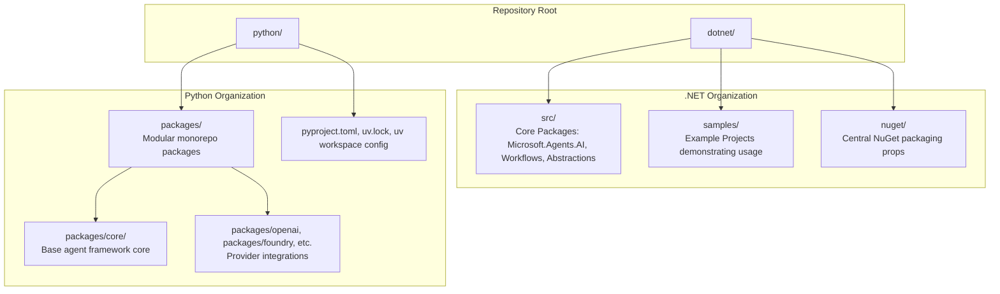
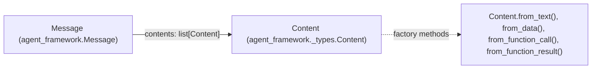
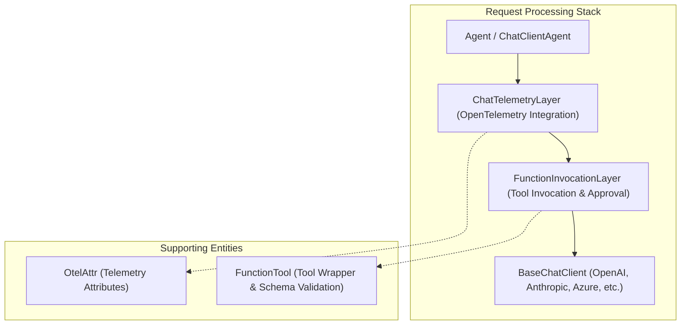

<!-- source: DeepWiki mcp.deepwiki.com · repo microsoft/agent-framework · page 1.1 Architecture at a Glance · fetched 2026-10-26 -->

# Architecture at a Glance

<details>
<summary>Relevant source files</summary>

The following files were used as context for generating this wiki page:

- [docs/decisions/0022-chat-history-persistence-consistency.md](docs/decisions/0022-chat-history-persistence-consistency.md)
- [docs/specs/004-python-function-calling-loop.md](docs/specs/004-python-function-calling-loop.md)
- [dotnet/samples/02-agents/Agents/Agent_Step19_InFunctionLoopCheckpointing/Program.cs](dotnet/samples/02-agents/Agents/Agent_Step19_InFunctionLoopCheckpointing/Program.cs)
- [dotnet/samples/02-agents/Agents/Agent_Step19_InFunctionLoopCheckpointing/README.md](dotnet/samples/02-agents/Agents/Agent_Step19_InFunctionLoopCheckpointing/README.md)
- [dotnet/src/Microsoft.Agents.AI.Abstractions/AdditionalPropertiesExtensions.cs](dotnet/src/Microsoft.Agents.AI.Abstractions/AdditionalPropertiesExtensions.cs)
- [dotnet/src/Microsoft.Agents.AI/ChatClient/ChatClientAgent.cs](dotnet/src/Microsoft.Agents.AI/ChatClient/ChatClientAgent.cs)
- [dotnet/src/Microsoft.Agents.AI/ChatClient/ChatClientAgentContinuationToken.cs](dotnet/src/Microsoft.Agents.AI/ChatClient/ChatClientAgentContinuationToken.cs)
- [dotnet/src/Microsoft.Agents.AI/ChatClient/ChatClientAgentLogMessages.cs](dotnet/src/Microsoft.Agents.AI/ChatClient/ChatClientAgentLogMessages.cs)
- [dotnet/src/Microsoft.Agents.AI/ChatClient/ChatClientAgentOptions.cs](dotnet/src/Microsoft.Agents.AI/ChatClient/ChatClientAgentOptions.cs)
- [dotnet/src/Microsoft.Agents.AI/ChatClient/ChatClientBuilderExtensions.cs](dotnet/src/Microsoft.Agents.AI/ChatClient/ChatClientBuilderExtensions.cs)
- [dotnet/src/Microsoft.Agents.AI/ChatClient/ChatClientExtensions.cs](dotnet/src/Microsoft.Agents.AI/ChatClient/ChatClientExtensions.cs)
- [dotnet/tests/Microsoft.Agents.AI.Abstractions.UnitTests/AdditionalPropertiesExtensionsTests.cs](dotnet/tests/Microsoft.Agents.AI.Abstractions.UnitTests/AdditionalPropertiesExtensionsTests.cs)
- [dotnet/tests/Microsoft.Agents.AI.UnitTests/ChatClient/ChatClientAgentContinuationTokenTests.cs](dotnet/tests/Microsoft.Agents.AI.UnitTests/ChatClient/ChatClientAgentContinuationTokenTests.cs)
- [dotnet/tests/Microsoft.Agents.AI.UnitTests/ChatClient/ChatClientAgentOptionsTests.cs](dotnet/tests/Microsoft.Agents.AI.UnitTests/ChatClient/ChatClientAgentOptionsTests.cs)
- [dotnet/tests/Microsoft.Agents.AI.UnitTests/ChatClient/ChatClientAgentTestHelper.cs](dotnet/tests/Microsoft.Agents.AI.UnitTests/ChatClient/ChatClientAgentTestHelper.cs)
- [dotnet/tests/Microsoft.Agents.AI.UnitTests/ChatClient/ChatClientAgentTests.cs](dotnet/tests/Microsoft.Agents.AI.UnitTests/ChatClient/ChatClientAgentTests.cs)
- [dotnet/tests/Microsoft.Agents.AI.UnitTests/ChatClient/ChatClientAgent_ApprovalsTests.cs](dotnet/tests/Microsoft.Agents.AI.UnitTests/ChatClient/ChatClientAgent_ApprovalsTests.cs)
- [dotnet/tests/Microsoft.Agents.AI.UnitTests/ChatClient/ChatClientAgent_BackgroundResponsesTests.cs](dotnet/tests/Microsoft.Agents.AI.UnitTests/ChatClient/ChatClientAgent_BackgroundResponsesTests.cs)
- [dotnet/tests/Microsoft.Agents.AI.UnitTests/ChatClient/ChatClientAgent_ChatHistoryManagementTests.cs](dotnet/tests/Microsoft.Agents.AI.UnitTests/ChatClient/ChatClientAgent_ChatHistoryManagementTests.cs)
- [dotnet/tests/Microsoft.Agents.AI.UnitTests/ChatClient/ChatClientAgent_ChatOptionsMergingTests.cs](dotnet/tests/Microsoft.Agents.AI.UnitTests/ChatClient/ChatClientAgent_ChatOptionsMergingTests.cs)
- [dotnet/tests/Microsoft.Agents.AI.UnitTests/ChatClient/ChatClientBuilderExtensionsTests.cs](dotnet/tests/Microsoft.Agents.AI.UnitTests/ChatClient/ChatClientBuilderExtensionsTests.cs)
- [dotnet/tests/Microsoft.Agents.AI.UnitTests/ChatClient/ChatClientExtensionsTests.cs](dotnet/tests/Microsoft.Agents.AI.UnitTests/ChatClient/ChatClientExtensionsTests.cs)
- [python/packages/core/agent_framework/_agents.py](python/packages/core/agent_framework/_agents.py)
- [python/packages/core/agent_framework/_clients.py](python/packages/core/agent_framework/_clients.py)
- [python/packages/core/agent_framework/_compaction.py](python/packages/core/agent_framework/_compaction.py)
- [python/packages/core/agent_framework/_harness/_tool_approval.py](python/packages/core/agent_framework/_harness/_tool_approval.py)
- [python/packages/core/agent_framework/_middleware.py](python/packages/core/agent_framework/_middleware.py)
- [python/packages/core/agent_framework/_tools.py](python/packages/core/agent_framework/_tools.py)
- [python/packages/core/agent_framework/_types.py](python/packages/core/agent_framework/_types.py)
- [python/packages/core/agent_framework/observability.py](python/packages/core/agent_framework/observability.py)
- [python/packages/core/tests/core/test_agent_hooks.py](python/packages/core/tests/core/test_agent_hooks.py)
- [python/packages/core/tests/core/test_agents.py](python/packages/core/tests/core/test_agents.py)
- [python/packages/core/tests/core/test_clients.py](python/packages/core/tests/core/test_clients.py)
- [python/packages/core/tests/core/test_compaction.py](python/packages/core/tests/core/test_compaction.py)
- [python/packages/core/tests/core/test_function_invocation_logic.py](python/packages/core/tests/core/test_function_invocation_logic.py)
- [python/packages/core/tests/core/test_harness_tool_approval.py](python/packages/core/tests/core/test_harness_tool_approval.py)
- [python/packages/core/tests/core/test_middleware_with_agent.py](python/packages/core/tests/core/test_middleware_with_agent.py)
- [python/packages/core/tests/core/test_middleware_with_chat.py](python/packages/core/tests/core/test_middleware_with_chat.py)
- [python/packages/core/tests/core/test_observability.py](python/packages/core/tests/core/test_observability.py)
- [python/packages/core/tests/core/test_tools.py](python/packages/core/tests/core/test_tools.py)
- [python/packages/core/tests/core/test_types.py](python/packages/core/tests/core/test_types.py)
- [python/samples/02-agents/context_providers/cross_session_observer.py](python/samples/02-agents/context_providers/cross_session_observer.py)
- [python/samples/02-agents/observability/README.md](python/samples/02-agents/observability/README.md)
- [python/samples/02-agents/observability/microsoft_opentelemetry_distro.py](python/samples/02-agents/observability/microsoft_opentelemetry_distro.py)

</details>


This document provides a high-level overview of the Microsoft Agent Framework architecture, covering both .NET and Python implementations. It explains the core abstractions, layered middleware design, provider integrations, and package organization that enable building AI agents and multi-agent workflows across multiple platforms.

---

## Dual-Platform Architecture

The Microsoft Agent Framework maintains parallel implementations in .NET and Python, each following language-specific idioms while preserving conceptual alignment. Both implementations share the same core abstractions and communicate via consistent patterns but are expressed idiomatically for their respective ecosystems.

### Repository Structure

The repository is structured to separate .NET and Python implementations clearly, each with its own organization and tools, while remaining part of the unified project.



This organization supports clean separation of concerns and independent lifecycle management of components while enabling composition for agent workflows.

**Sources:** [python/pyproject.toml:1-113](), [dotnet/nuget/nuget-package.props:1-93]()

### Package Organization Strategy

The framework uses modularity extensively to allow enabling only needed capabilities. The .NET side centralizes versioning and metadata in a `nuget-package.props` file for uniformity and uses multiple projects for abstractions, core logic, workflows, and provider integrations. On the Python side, the entire ecosystem is managed as a `uv` workspace monorepo with multiple interconnected packages:

| Package Type          | .NET Example                          | Python Example                     | Purpose                                                        |
|-----------------------|-------------------------------------|----------------------------------|----------------------------------------------------------------|
| Core Framework         | `Microsoft.Agents.AI`                | `agent-framework`                | Base abstractions, chat clients, tool definitions              |
| Abstractions          | `Microsoft.Agents.AI.Abstractions`   | `agent-framework-core`           | Shared interfaces and protocols                                |
| Workflows             | `Microsoft.Agents.AI.Workflows`       | `agent-framework-orchestrations` | Multi-agent orchestration and complex workflow execution       |
| OpenAI Provider       | `Microsoft.Agents.AI.OpenAI`           | `agent-framework-openai`         | OpenAI and Azure OpenAI integrations                            |
| Experimental Features | N/A                                  | `agent-framework-lab`            | Experimental modules including benchmarking and RL training   |

The Python workspace uses `pyproject.toml` to declare package dependencies and workspace membership, ensuring version alignment and coherent dependency resolution.

**Sources:** [python/pyproject.toml:20-80](), [dotnet/nuget/nuget-package.props:3-11](), [python/packages/core/pyproject.toml:2-27](), [python/packages/lab/pyproject.toml:2-55]()

---

## Core Abstractions Layer

The framework defines protocol-based abstractions that implementations can satisfy. This enables flexibility and composability, allowing agents and chat clients to be implemented in multiple ways without strictly coupling to base classes.

### Agent and Chat Client Protocols

In Python, core abstractions such as the agent and chat client follow `typing.Protocol` interfaces to define expected behaviors:

- `SupportsAgentRun`: Defines the method `run()` which agents implement to execute a conversation or command lifecycle.
- `SupportsChatGetResponse`: Defines the asynchronous method `get_response()` which chat clients implement to interact with underlying AI providers.

The `.NET` implementation centers around the `ChatClientAgent` class, which delegates async calls to an underlying `IChatClient` interface implementation, maintaining separation of agent logic from provider invocation.

```mermaid
graph TB
    subgraph "Protocol / Interface Layer"
        SupportsAgentRun["SupportsAgentRun (Protocol)"]
        SupportsChatGetResponse["SupportsChatGetResponse (Protocol)"]
    end
    
    subgraph "Implementation Entities"
        Agent["Agent (agent_framework.Agent)"]
        BaseChatClient["BaseChatClient (agent_framework._clients.BaseChatClient)"]
        ChatTelemetryLayer["ChatTelemetryLayer (agent_framework.observability.ChatTelemetryLayer)"]
    end
    
    subgraph "Execution Logic"
        RunMethod["run(input, stream, ...) (agent_framework._agents)"]
        GetResponseMethod["get_response(messages, options, ...) (agent_framework._clients)"]
    end
    
    Agent -.->|implements| SupportsAgentRun
    BaseChatClient -.->|implements| SupportsChatGetResponse
    ChatTelemetryLayer --wraps--> BaseChatClient
    
    SupportsAgentRun --> RunMethod
    SupportsChatGetResponse --> GetResponseMethod
    Agent o-- SupportsChatGetResponse
```

This layering allows middleware to wrap chat clients transparently (e.g., telemetry, function invocation middleware), while agents rely on consistent protocol contracts.

**Sources:** [python/packages/core/agent_framework/_agents.py:15-65](), [python/packages/core/agent_framework/_clients.py:1-50](), [python/packages/core/agent_framework/observability.py:110-120]()

### Core Type System and Content Model

The message model uses a unified `Content` class to encapsulate different parts of a message (text, data, function calls, etc.). Each message is composed of multiple `Content` pieces, enabling compatibility across providers and extensibility.



This abstraction allows standardized handling of chat messages regardless of provider-level differences.

**Sources:** [python/packages/core/agent_framework/_types.py:50-180](), [python/packages/core/agent_framework/_tools.py:150-205]()

---

## Layered Middleware Architecture

A fundamental architectural pattern in the framework is the use of layered middleware stacks wrapping chat clients and agents. This allows cross-cutting concerns like telemetry, function invocation, and response processing to be modularly composed.

### Standard Middleware Layers Stack

The typical stack layers are:

- **Agent/ChatClientAgent**: Entry point agent object managing the run lifecycle.
- **ChatTelemetryLayer**: OpenTelemetry-based layer for instrumentation and tracing.
- **FunctionInvocationLayer**: Middleware that handles tool/function call invocation on responses.
- **BaseChatClient**: Concrete chat client implementations for OpenAI, Anthropic, Azure, etc.



Middleware entities wrap the next layer transparently while enhancing or instrumenting functionality.

**Sources:** [python/packages/core/agent_framework/_middleware.py:1-50](), [python/packages/core/agent_framework/observability.py:90-115]()

---

## Tool and Function Calling System

Tool invocation is first-class in the framework. Tools expose functions callable by AI agents with automated schema validation, human-in-the-loop approval, and lifecycle management.

| Concept               | Code Entity                    | Responsibility                                               |
|-----------------------|--------------------------------|--------------------------------------------------------------|
| Tool Definition        | `FunctionTool` / `MCPTool`      | Wraps function metadata, parameters, and validation          |
| Tool Discovery         | `@tool` decorator (Python)      | Registers function tools with schemas usable by LLMs         |
| Skills System          | `SkillsProvider`                 | Modular extensions for capabilities (e.g., file access, MCP) |
| Invocation Approval    | `ApprovalMode` enum              | Controls whether function calls require user approval        |

The framework infrastructure supports automatic function call response analysis, invocation limits, and human approval modes.

**Sources:** [python/packages/core/agent_framework/_tools.py:40-140](), [python/packages/core/agent_framework/_agents.py:90-130]()

---

## Observability and Monitoring

OpenTelemetry integration is built into the middleware stack, capturing detailed telemetry for each interaction and tool call.

- **Usage Reporting:** Token count and usage details are accumulated in structured `UsageDetails` types.
- **Telemetry Attributes:** The `OtelAttr` class defines semantic keys like `gen_ai.operation.name` used consistently for tracing.
- **Message Timing:** A `MessageListTimestampFilter` ensures ordered microsecond resolution timestamps on messages for correlated observability.

This allows insight into agent runtimes, provider performance, and function call latencies with standard instrumentation.

**Sources:** [python/packages/core/agent_framework/_types.py:20-50](), [python/packages/core/agent_framework/observability.py:170-190, 200-240]()

---

# Bridging Natural Language to Code Entities

To help developers relate conceptual system components (like "Agent", "Tools", "Middleware") to actual code entities, here are two diagrams that map these concepts to their primary implementation classes and protocols.

### Diagram 1: Natural Language Concepts to Python Code Entities

```mermaid
graph TD
    "Natural Language" -->|Defines| "Agent"
    "Natural Language" -->|Defines| "Chat Client"
    "Natural Language" -->|Defines| "Middleware Layers"
    "Natural Language" -->|Defines| "Tools"

    "Agent" -->|Implements| "SupportsAgentRun (Protocol)"
    "Agent" -->|Implemented by| "agent_framework.Agent (class)"
    "Chat Client" -->|Implements| "SupportsChatGetResponse (Protocol)"
    "Chat Client" -->|Implemented by| "BaseChatClient (class)"

    "Middleware Layers" -->|Example| "ChatTelemetryLayer"
    "Middleware Layers" -->|Example| "FunctionInvocationLayer"

    "Tools" -->|Wrapped by| "FunctionTool (class)"
    "Tools" -->|Declared by| "@tool decorator (Python)"
```

### Diagram 2: Natural Language Concepts to .NET Code Entities

```mermaid
graph TD
    "Natural Language" -->|Defines| "Agent"
    "Natural Language" -->|Defines| "Chat Client"
    "Natural Language" -->|Defines| "Middleware Layers"
    "Natural Language" -->|Defines| "Tools"

    "Agent" -->|Implemented by| "ChatClientAgent (class)"
    "Agent" -->|Delegates to| "IChatClient (interface)"

    "Chat Client" -->|Implements| "IChatClient"
    "Middleware Layers" -->|Composed with| "Middleware Layer Classes"
    "Tools" -->|Represented as| "AIFunction"
```

These diagrams aid developers in quickly connecting architectural concepts to concrete implementation locations for exploration and extension.

---

# Summary

The Microsoft Agent Framework offers a robust, multi-language SDK for building AI agents with a layered architecture that cleanly separates concerns:

- Parallel .NET and Python implementations with aligned abstract protocols/interfaces
- Modular package organization enabling feature selection for workflows, providers, and tools
- Layered middleware approach supporting instrumentation, function invocation, and context management
- Unified message and content typing for cross-provider compatibility
- Integrated observability via OpenTelemetry for comprehensive runtime insight

This architecture enables scalable development of intelligent applications involving conversational agents, multi-agent workflows, and complex AI orchestration.

---

**Sources:**  
- [python/pyproject.toml:1-113]()  
- [dotnet/nuget/nuget-package.props:1-93]()  
- [python/packages/core/agent_framework/_agents.py:15-65]()  
- [python/packages/core/agent_framework/_clients.py:1-50]()  
- [python/packages/core/agent_framework/observability.py:90-120, 170-190, 200-240]()  
- [python/packages/core/agent_framework/_types.py:20-50, 50-180]()  
- [python/packages/core/agent_framework/_middleware.py:1-50]()  
- [python/packages/core/agent_framework/_tools.py:40-140]()

---

