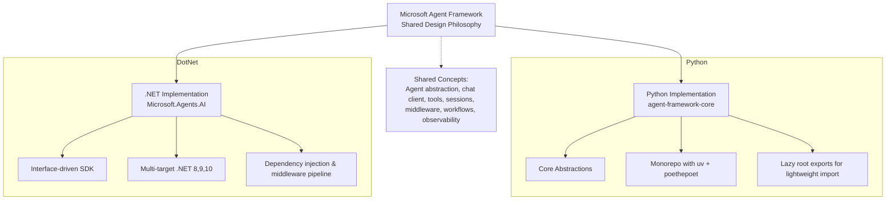
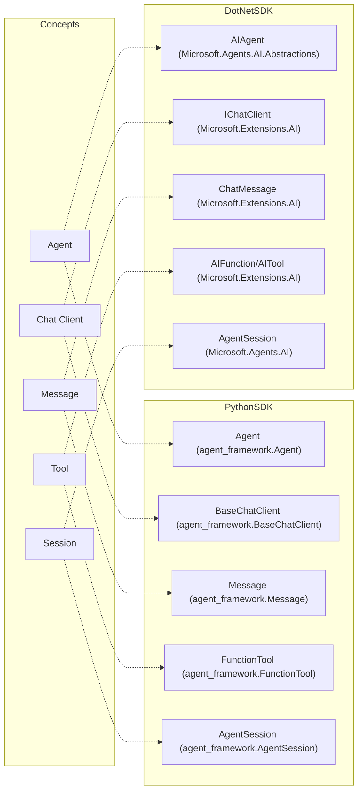
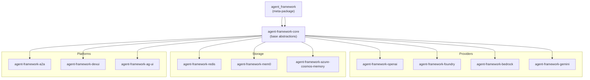

<!-- source: DeepWiki mcp.deepwiki.com · repo microsoft/agent-framework · page 1.2 Multi-Language Design Philosophy · fetched 2026-10-26 -->

# Multi-Language Design Philosophy

Relevant source files

The following files were used as context for generating this wiki page:

- [docs/decisions/0001-agent-run-response.md](docs/decisions/0001-agent-run-response.md)
- [docs/decisions/0006-userapproval.md](docs/decisions/0006-userapproval.md)
- [docs/decisions/0008-python-subpackages.md](docs/decisions/0008-python-subpackages.md)
- [docs/decisions/0009-support-long-running-operations.md](docs/decisions/0009-support-long-running-operations.md)
- [docs/design/python-package-setup.md](docs/design/python-package-setup.md)
- [dotnet/src/Microsoft.Agents.AI.Anthropic/AnthropicClientExtensions.cs](dotnet/src/Microsoft.Agents.AI.Anthropic/AnthropicClientExtensions.cs)
- [dotnet/src/Microsoft.Agents.AI.Purview/IScopedContentProcessor.cs](dotnet/src/Microsoft.Agents.AI.Purview/IScopedContentProcessor.cs)
- [python/packages/core/AGENTS.md](python/packages/core/AGENTS.md)
- [python/packages/core/agent_framework/__init__.py](python/packages/core/agent_framework/__init__.py)
- [python/packages/core/agent_framework/__init__.pyi](python/packages/core/agent_framework/__init__.pyi)
- [python/packages/core/agent_framework/_skills.py](python/packages/core/agent_framework/_skills.py)
- [python/packages/core/tests/core/test_skills.py](python/packages/core/tests/core/test_skills.py)
- [python/samples/02-agents/skills/README.md](python/samples/02-agents/skills/README.md)
- [python/samples/02-agents/skills/class_based_skill/README.md](python/samples/02-agents/skills/class_based_skill/README.md)
- [python/samples/02-agents/skills/class_based_skill/class_based_skill.py](python/samples/02-agents/skills/class_based_skill/class_based_skill.py)
- [python/samples/02-agents/skills/code_defined_skill/README.md](python/samples/02-agents/skills/code_defined_skill/README.md)
- [python/samples/02-agents/skills/code_defined_skill/code_defined_skill.py](python/samples/02-agents/skills/code_defined_skill/code_defined_skill.py)
- [python/samples/02-agents/skills/file_based_skill/file_based_skill.py](python/samples/02-agents/skills/file_based_skill/file_based_skill.py)
- [python/samples/02-agents/skills/mixed_skills/README.md](python/samples/02-agents/skills/mixed_skills/README.md)
- [python/samples/02-agents/skills/mixed_skills/mixed_skills.py](python/samples/02-agents/skills/mixed_skills/mixed_skills.py)
- [python/samples/02-agents/skills/script_approval/script_approval.py](python/samples/02-agents/skills/script_approval/script_approval.py)
- [python/samples/02-agents/skills/subprocess_script_runner.py](python/samples/02-agents/skills/subprocess_script_runner.py)
- [python/samples/03-workflows/declarative/function_tools/README.md](python/samples/03-workflows/declarative/function_tools/README.md)

## Purpose and Scope

This document explains the architectural philosophy behind the Microsoft Agent Framework's dual implementations in Python and .NET. It details the shared design principles ensuring consistent conceptual models and developer experiences while embracing language-specific idioms such as Python's protocols and dynamic typing and .NET's interface-driven static typing. This page provides a technical deep-dive into the rationale and implementation patterns that maintain feature and abstraction parity across both languages.

## Overview: Dual-Language Strategy

Microsoft Agent Framework (MAF) employs a **bilingual implementation** approach with native, parallel implementations in Python and .NET (C#) [python/packages/core/AGENTS.md:3-15](), [python/packages/core/agent_framework/__init__.py:3-9]().

This approach avoids a shared codebase with language bindings or transpilation. Instead, it maintains two full-featured SDKs designed to:

- Offer idiomatic developer experiences per language;
- Encourage idiomatic patterns (e.g., protocols in Python, interfaces in .NET);
- Achieve conceptual and behavioral parity;
- Support independent release cycles and packaging.

### Framework Multi-Language Architecture

Sources: [python/packages/core/AGENTS.md:3-15](), [python/packages/core/agent_framework/__init__.py:1-50](), [docs/design/python-package-setup.md:1-80](), [dotnet/tests/Microsoft.Agents.AI.Workflows.Declarative.IntegrationTests/Microsoft.Agents.AI.Workflows.Declarative.IntegrationTests.csproj:1-2]()

## Design Principles: Consistency Across Languages

### Core Abstractions Parity

Both implementations provide equivalent **core abstractions**:

| Concept            | Python Entity                                   | .NET Entity                                       | Sources                                         |
|--------------------|------------------------------------------------|--------------------------------------------------|------------------------------------------------|
| Agent abstraction   | `Agent` (class)                                | `AIAgent` (abstract class)                        | [python/packages/core/AGENTS.md:53-66](), [dotnet/src/Microsoft.Agents.AI.Abstractions]() |
| Chat client        | `BaseChatClient` (abstract base class)        | `IChatClient` (interface)                        | [python/packages/core/AGENTS.md:68-72](), [.NET source]                          |
| Message system      | `Message` (class)                              | `ChatMessage` (class)                            | [python/packages/core/AGENTS.md:73-74](), [.NET tests]                          |
| Tooling             | `FunctionTool` (class & `@tool` decorator)   | `AIFunction` / `AITool`                          | [python/packages/core/AGENTS.md:85-90](), [.NET source]                         |
| Sessions / State    | `AgentSession` (class managing context)       | `AgentSession` (class with StateBag storage)    | [python/packages/core/AGENTS.md:198-210](), [python/packages/core/agent_framework/_serialization.py:153-180]() |

The Python SDK exploits Python's dynamic typing and protocols to enable flexible extension and composition, e.g., `SupportsChatGetResponse` protocol [python/packages/core/AGENTS.md:69-71](). The .NET SDK builds around formal interfaces and inheritance, offering strong static type guarantees and ecosystem integration.

### Cross-Language Entity Mapping

This mapping helps developers apprehend feature parity and locate equivalent concepts across the two languages.

Sources: [python/packages/core/AGENTS.md:50-75](), [python/packages/core/agent_framework/_serialization.py:153-180](), [.NET source]()

### Protocol-Based & Interface-Driven Design

- **Python** embraces **protocols** (`typing.Protocol`) enabling structural, duck-typed interfaces without explicit inheritance. The framework defines protocols like `SerializationProtocol` for serialization [python/packages/core/agent_framework/_serialization.py:27-33]() and leverages abstract base classes like `BaseChatClient` to specify required behavior [python/packages/core/AGENTS.md:69-71]().

- The **Python API surface** is designed to be **flat and organized** by functional tiers and components for user-friendly developer experience and dependency isolation [docs/design/python-package-setup.md:3-50]().

- **.NET** uses traditional explicit **interface definitions** (`IChatClient`, `IAgentRun`) aligned with the `Microsoft.Extensions.AI` ecosystem, allowing tight integration into dependency injection and middleware patterns familiar to C# developers.

Both approaches enforce clear contracts for custom implementations but respect language idioms to maximize productivity.

Sources: [python/packages/core/agent_framework/_serialization.py:27-115](), [docs/design/python-package-setup.md:3-50](), [.NET Interface source]()

## Language-Specific Package Architectures

### Python: Monorepo with uv Workspace & Lazy Loading

The Python implementation uses a **monorepo** structure managed by the `uv` dependency and task orchestration framework [docs/design/python-package-setup.md:85-116]().

- **Tiered Exports**:

  - **Tier 0:** Core abstractions exported from `agent_framework`, including `Agent`, `FunctionTool`, `BaseChatClient` for quickstart and basic agent builds [python/packages/core/agent_framework/__init__.py:1-50]().

  - **Tier 1:** Advanced components such as workflows, vector stores, middleware, and telemetry are available from submodules (`agent_framework.vector_data`, `agent_framework.workflow`).

  - **Tier 2:** Vendor-specific SDKs and connectors by namespace, e.g., `agent_framework.azure`, `agent_framework.openai`, are independently versioned and optionally installed.

- **Lazy Loading:** The root package uses Python 3.7+'s `__getattr__` in `__init__.py` to lazily import submodules on demand, reducing startup time and isolating heavy dependencies.

- **Serialization Support:** Python's `SerializationMixin` enables `.to_dict()` and `.from_dict()` methods for sessions and state objects to allow persistence, transport, and replay scenarios [python/packages/core/agent_framework/_serialization.py:160-180]().

Sources: [docs/design/python-package-setup.md:52-82](), [python/packages/core/agent_framework/_serialization.py:153-180](), [python/packages/core/agent_framework/__init__.py:1-50](), [python/PACKAGE_STATUS.md:10-55]()

### .NET: Unified Architecture & Azure Integration

The .NET SDK is implemented with:

- **Targeting Modern .NET Versions:** Multi-targeting .NET 8, 9, 10 with SDK version locking via `global.json` to standardize build environments [dotnet/tests/Microsoft.Agents.AI.Workflows.Declarative.IntegrationTests/Microsoft.Agents.AI.Workflows.Declarative.IntegrationTests.csproj:1-2]().

- **Extensible Middleware Pipeline:** Interfaces like `IChatClient` and `IAgentRun` enable plugging in implementations and middleware layers for observability, security, and user approval workflows.

- **Integration with Microsoft Extensions:** Uses `Microsoft.Extensions.AI` for chat client abstractions, dependency injection, configuration, telemetry, and hosting patterns [README.md:87-92]().

- **Cloud Native & Foundry Support:** Packages such as `Microsoft.Agents.AI.Foundry` offer Azure AI integration, hosted agents, and MCP support for advanced Cloud AI tooling.

Sources: [dotnet/tests/Microsoft.Agents.AI.Workflows.Declarative.IntegrationTests/Microsoft.Agents.AI.Workflows.Declarative.IntegrationTests.csproj:1-2](), [README.md:87-92]()

## Build and Quality Standards

### Python Development Practices

- **Static Code Analysis:** Uses `ruff` for linting, `black` for formatting, and `pyright` for static type checks to enforce code quality and consistency [python/README.md:40-42]().

- **Automated Builds and Testing:** Utilizes `uv` for dependency management and `poethepoet` for orchestrating build, test, and release tasks [python/README.md:11-12]().

- **Explicit Serialization Protocols:** Implements `SerializationProtocol` with `.to_dict()` and `.from_dict()` methods used for state persistence and runtime state management [python/packages/core/agent_framework/_serialization.py:27-115]().

### .NET Development Practices

- **Unified Testing Platform:** Uses `Microsoft.Testing.Platform` across all projects, ensuring integrated testing for core and extensions [dotnet/tests/Microsoft.Agents.AI.Workflows.Declarative.IntegrationTests/Microsoft.Agents.AI.Workflows.Declarative.IntegrationTests.csproj:1-2]().

- **Stable Version Targeting:** Targets modern .NET versions with pinning via `global.json` and systematic version bumping to keep dependency consistency.

Sources: [python/README.md:40-42](), [python/packages/core/agent_framework/_serialization.py:153-180](), [dotnet/tests/Microsoft.Agents.AI.Workflows.Declarative.IntegrationTests/Microsoft.Agents.AI.Workflows.Declarative.IntegrationTests.csproj:1-2]()

---

This **multi-language design philosophy** ensures that both Python and .NET developers can leverage the Microsoft Agent Framework with idiomatic, powerful, and consistent tools. The parallel implementations encourage innovation per language while maintaining conceptual coherence for cross-team collaboration, shared learning, and multi-agent ecosystem integration.

# End of 1.2 Multi-Language Design Philosophy

---

