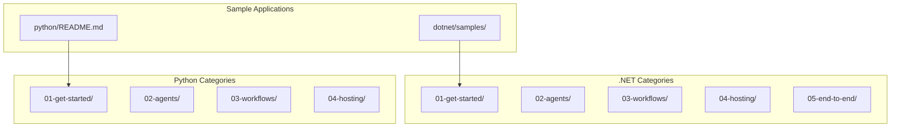
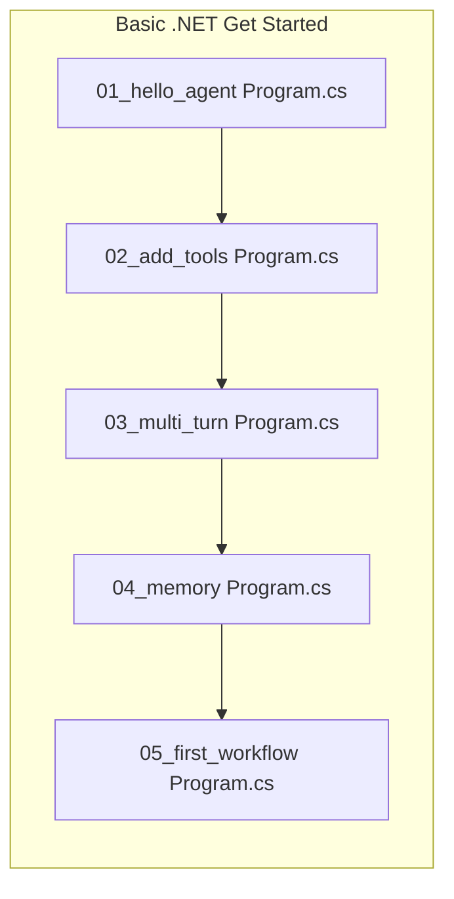
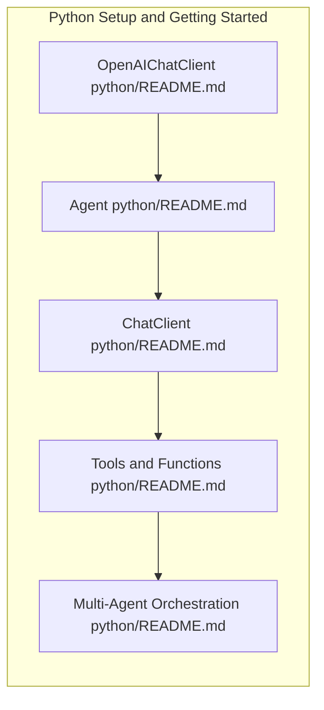

<!-- source: DeepWiki mcp.deepwiki.com · repo microsoft/agent-framework · page 10 Reference · fetched 2026-10-26 -->

# Reference

Relevant source files

The following files were used as context for generating this wiki page:

- [README.md](README.md)
- [SUPPORT.md](SUPPORT.md)
- [TRANSPARENCY_FAQ.md](TRANSPARENCY_FAQ.md)
- [dotnet/README.md](dotnet/README.md)
- [dotnet/samples/02-agents/AGUI/README.md](dotnet/samples/02-agents/AGUI/README.md)
- [dotnet/samples/README.md](dotnet/samples/README.md)
- [dotnet/tests/Microsoft.Agents.AI.Workflows.Declarative.IntegrationTests/MediaInputTest.cs](dotnet/tests/Microsoft.Agents.AI.Workflows.Declarative.IntegrationTests/MediaInputTest.cs)
- [dotnet/tests/Microsoft.Agents.AI.Workflows.Declarative.IntegrationTests/Microsoft.Agents.AI.Workflows.Declarative.IntegrationTests.csproj](dotnet/tests/Microsoft.Agents.AI.Workflows.Declarative.IntegrationTests/Microsoft.Agents.AI.Workflows.Declarative.IntegrationTests.csproj)
- [dotnet/tests/Microsoft.Agents.AI.Workflows.Declarative.IntegrationTests/TestFiles/basic-text.pdf](dotnet/tests/Microsoft.Agents.AI.Workflows.Declarative.IntegrationTests/TestFiles/basic-text.pdf)
- [dotnet/tests/Microsoft.Agents.AI.Workflows.Declarative.IntegrationTests/TestFiles/test-image.jpg](dotnet/tests/Microsoft.Agents.AI.Workflows.Declarative.IntegrationTests/TestFiles/test-image.jpg)
- [go/README.md](go/README.md)
- [python/README.md](python/README.md)
- [python/packages/a2a/README.md](python/packages/a2a/README.md)
- [python/packages/copilotstudio/README.md](python/packages/copilotstudio/README.md)
- [python/packages/core/README.md](python/packages/core/README.md)
- [python/samples/02-agents/middleware/runtime_context_delegation.py](python/samples/02-agents/middleware/runtime_context_delegation.py)

This page provides high-level reference materials for the Microsoft Agent Framework, including responsible AI guidance, comprehensive sample application catalogs for both .NET and Python implementations, and additional resources. For detailed implementation architecture, see [Implementation Architecture](#7). For development and contribution guidelines, see [Development Guide](#9).

Sources: [README.md:1-15](), [TRANSPARENCY_FAQ.md:1-25]()

## Responsible AI and Transparency

The Microsoft Agent Framework is built with responsible AI principles in mind. It is a development framework for building AI-powered business applications, coordinating multi-agent collaboration, and automating workflows [TRANSPARENCY_FAQ.md:18-25]().

**Key Considerations**:
- **LLM Limitations**: The framework inherits common LLM limitations including data biases, lack of contextual understanding, and potential for content harms [TRANSPARENCY_FAQ.md:34-42]().
- **Mitigation**: Users are encouraged to maintain human oversight for critical decisions, implement content moderation, and use safety metaprompts [TRANSPARENCY_FAQ.md:52-59]().
- **Governance**: Integration with Microsoft Purview provides policy evaluation and content auditing capabilities.
- **Transparency**: Clear accountability mechanisms should be established to trace the decision-making process of collaborating agents [TRANSPARENCY_FAQ.md:49-50]().

For details, see [Responsible AI and Transparency](#10.1).

Sources: [TRANSPARENCY_FAQ.md:18-59]()

## Sample Applications Overview

The framework provides extensive sample applications demonstrating core concepts, integration patterns, and deployment strategies across both language implementations [dotnet/samples/README.md:1-21](), [README.md:43-53](). Samples are organized by complexity and concept, ranging from basic setup to complex multi-agent workflows.

### Sample Organization Structure

Sources: [dotnet/samples/README.md:14-21](), [python/README.md:84-195]()

### .NET Sample Catalog

The .NET samples utilize classes like `ChatClientAgent` and `AIAgent` subclasses for remote proxies [dotnet/samples/README.md:7-11](). For details, see [Sample Applications](#10.2).

**Progressive Learning Paths**:

**Key Sample Highlights**:
- **01_hello_agent**: Basic agent creation and execution using `AzureOpenAIClient` and `AsAIAgent()` [dotnet/README.md:7-21]().
- **Memory Integration**: Advanced memory patterns including `AIContextProvider` for session-based memory [dotnet/samples/README.md:29]().
- **Provider Support**: Specific samples showing how to create an `AIAgent` instance for a selection of providers [dotnet/samples/README.md:39]().
- **Telemetry**: Demo showcasing OpenTelemetry integration with `Azure OpenAI` and `Aspire Dashboard` [dotnet/samples/README.md:40]().

Sources: [dotnet/samples/README.md:1-52](), [dotnet/README.md:1-35]()

### Python Sample Catalog

Python samples are organized with a progressive structure allowing developers to explore setup, tools, and multi-turn interactions [python/README.md:84-195](). For details, see [Sample Applications](#10.2).

**Getting Started Progression**:

**Advanced Patterns**:
- **Tooling**: Comprehensive use of decorated functions for tool execution [python/README.md:145-180]().
- **Multi-Turn Context**: Managing state across interactions using `Agent` and chat clients [python/README.md:86-112]().
- **Hosting & Orchestration**: Deployment patterns including sequential and multi-agent workflows [python/README.md:197-223]().

Sources: [python/README.md:1-223]()

## Provider Sample Cross-Reference

The framework provides specific clients and samples for major AI providers:

| Provider | .NET Client / Sample | Python Client / Sample |
|----------|-----------------|-------------------|
| **OpenAI** | `OpenAIClient` / `GetResponsesClient` [dotnet/README.md:16-17]() | `OpenAIChatClient` [python/README.md:92]() |
| **Azure OpenAI** | `AzureOpenAIClient` [dotnet/README.md:16]() | `OpenAIChatClient` (Azure mode) [python/README.md:60-68]() |
| **Azure AI Foundry** | `FoundryChatClient` (via package) [README.md:92-93]() | `FoundryChatClient` [python/README.md:28]() |

Sources: [dotnet/README.md:7-21](), [python/README.md:1-100](), [README.md:88-96]()

## Additional Resources

### Documentation Links
- **MS Learn Documentation**: [learn.microsoft.com/agent-framework](https://learn.microsoft.com/agent-framework/) [README.md:6]()
- **Official Blog**: [devblogs.microsoft.com/agent-framework/](https://devblogs.microsoft.com/agent-framework/) [README.md:41]()

### Package Distribution
- **Python (PyPI)**: `agent-framework`, `agent-framework-core`, `agent-framework-foundry` [python/README.md:12-34]().
- **.NET (NuGet)**: `Microsoft.Agents.AI`, `Microsoft.Agents.AI.Foundry` [README.md:91-93]().

### Support Policy
Support is limited to GitHub Issues unless the issue arises from Azure AI services under a **Unified support agreement**, in which case Microsoft support organizations handle it [SUPPORT.md:11-13]().

Sources: [python/README.md:1-83](), [SUPPORT.md:1-17](), [README.md:1-150]()

---

